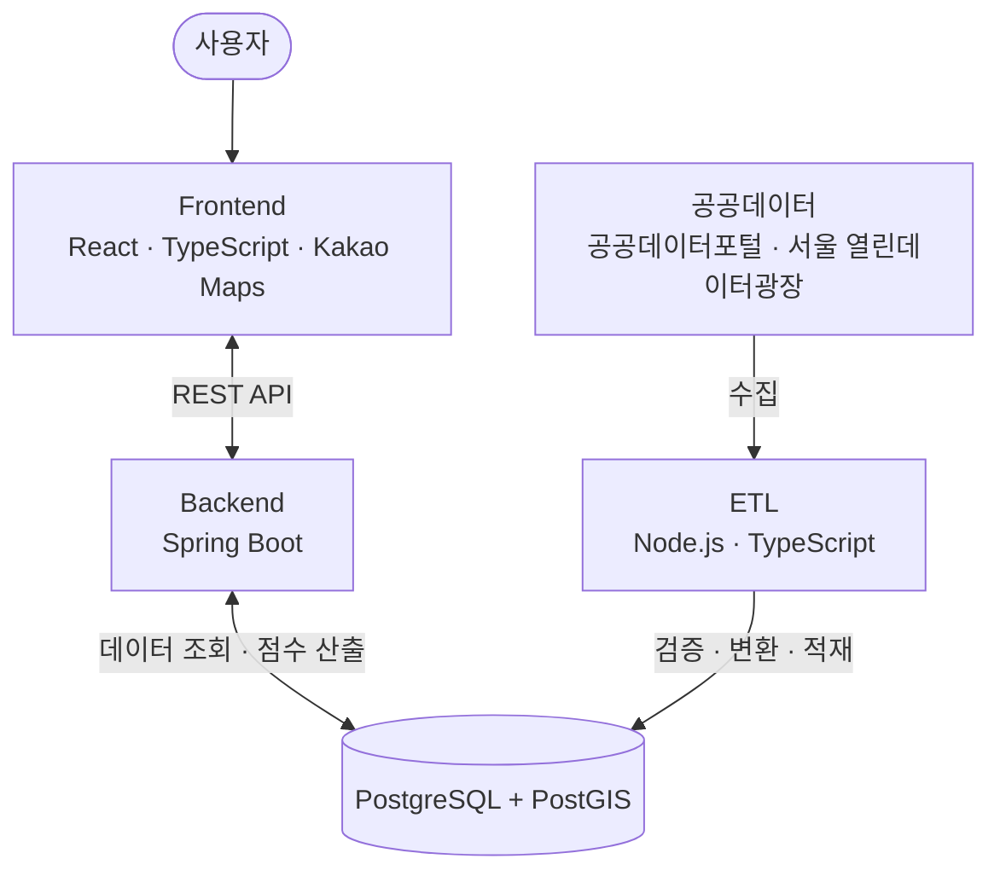

# 여기 창업해도 돼? - RecycleYoungs

**서울 카페 창업 후보지를 공공데이터로 탐색·비교하는 서비스**입니다. 현재 데이터 적재 기반과 행정구역·행정동 점포·추정매출·유동인구 통계·공식 자치구 점포·주변 카페 조회 API를 구현했으며, 실제 서비스 화면·후속 상권 분석·점수 기능은 개발 예정입니다.

**목차**

- [프로젝트 소개](#프로젝트-소개)
- [화면 미리보기](#화면-미리보기)
- [주요 기능](#주요-기능)
  - [MVP 핵심 기능](#mvp-핵심-기능)
  - [추후 도입 검토 기능](#추후-도입-검토-기능)
- [서비스 이용 흐름](#서비스-이용-흐름)
- [기술 스택](#기술-스택)
- [시스템 아키텍처](#시스템-아키텍처)
  - [구성 요소별 역할 (목표 구조)](#구성-요소별-역할-목표-구조)
  - [배포 방향 (계획)](#배포-방향-계획)
- [공공데이터 및 DB 현황](#공공데이터-및-db-현황)
  - [핵심 데이터 (기본 검증 완료)](#핵심-데이터-기본-검증-완료)
  - [추가 활용 검토 데이터](#추가-활용-검토-데이터)
  - [로컬 개발 DB 적재 기록](#로컬-개발-db-적재-기록)
- [현재 개발 현황](#현재-개발-현황)
  - [구현된 행정구역 API](#구현된-행정구역-api)
  - [구현된 점포 통계 API](#구현된-점포-통계-api)
  - [구현된 추정매출 통계 API](#구현된-추정매출-통계-api)
  - [구현된 유동인구 통계 API](#구현된-유동인구-통계-api)
  - [구현된 주변 카페 API](#구현된-주변-카페-api)
- [프로젝트 디렉터리 구성](#프로젝트-디렉터리-구성)
- [빠른 시작](#빠른-시작)
  - [DB 없이 준비 화면과 웹 서버 실행](#db-없이-준비-화면과-웹-서버-실행)
  - [DB를 연결해 행정구역 API 실행](#db를-연결해-행정구역-api-실행)
  - [빌드와 검증](#빌드와-검증)
- [상세 기술 문서](#상세-기술-문서)

## 프로젝트 소개

서울에서 창업을 준비하는 사람들을 위한 공공데이터 기반 MVP 서비스입니다. **MVP에서는 카페 업종만 지원할 예정입니다.**

사용자가 관심 지역의 상권 데이터를 탐색하고, 자체 평가 알고리즘으로 산출한 창업 환경 점수를 확인하며, 여러 후보지를 비교할 수 있도록 하는 것을 목표로 합니다.

복잡한 상권 통계를 처음부터 모두 보여주기보다, **100점 만점의 창업 환경 점수를 먼저 제공하고 사용자가 원하는 경우 세부 분석 근거를 확인할 수 있도록** 구성할 예정입니다.

창업 환경 점수는 실제 창업 성공 확률이나 예상 수익을 의미하지 않으며, 창업 후보지를 검토할 때 참고할 수 있는 자체 평가 지표입니다.

## 화면 미리보기

**실제 서비스 화면은 아직 구현되지 않았습니다.** 현재 프론트엔드는 개발 환경 확인용 준비 화면과 비활성화된 버튼만 표시합니다.

메인 페이지, 지도 기반 상권 탐색, 창업 환경 점수·상세 분석, 후보지 비교 화면을 구현한 뒤 스크린샷이나 시연 이미지를 추가할 예정입니다. 이미지 보관 경로는 `docs/images/`입니다.

## 주요 기능

아래 표는 **MVP 목표 기능**입니다. 행정구역 목록·경계·주변 조회와 행정동 점포·추정매출·유동인구 통계·공식 자치구 점포·주변 카페 API를 구현했으며, 사용자 화면과 서비스 연동은 개발 예정입니다. 우선순위는 데이터 연동 과정에서 조정할 수 있습니다.

### MVP 핵심 기능

| 기능                | 설명                                                                            |
| ------------------- | ------------------------------------------------------------------------------- |
| 서비스 소개         | 스크롤 기반 애니메이션과 화면 미리보기를 활용해 서비스 이용 과정을 안내         |
| 지역 및 장소 검색   | 서울시 내 구·행정동 필터와 지하철역·장소명·주소 검색 지원                       |
| 지도 기반 상권 탐색 | 지도에서 지역 경계와 카페 위치를 확인하고 관심 위치를 탐색                      |
| 자치구 선택         | 장소 주변 탐색 범위가 여러 구에 걸치는 경우 개별 자치구 또는 `모두` 선택        |
| 탐색 조건 설정      | 행정구역·위치 주변 반경·분석 기간·관심 지표 등 조회 조건 설정                   |
| 창업 환경 점수      | 공공데이터를 활용한 자체 알고리즘으로 구·행정동별 100점 만점의 평가 점수 제공   |
| 점수 산출 근거      | 평가 항목별 점수, 가중치, 사용 지표, 데이터 출처 및 기준 시점 확인              |
| 상권 상세 분석      | 점포 현황, 추정매출, 유동인구, 개업·폐업 현황 등의 통계 제공                    |
| 주변 경쟁 카페 조회 | 선택 위치 주변의 기존 카페 위치와 분포 확인                                     |
| 창업 후보지 지정    | 지도에서 관심 지점을 선택하고 분석·비교 대상으로 추가                           |
| 후보지 비교         | 여러 후보지의 주변 카페 정보와 행정구역별 창업 환경 점수를 동일한 기준에서 비교 |

### 추후 도입 검토 기능

- **최근 탐색 기록:** 사용자가 이전에 조회한 지역이나 위치를 다시 확인
- **관심 후보지 저장:** 창업 후보지를 저장하고 이후 다시 확인
- **회원 기능:** 필요한 경우 개인별 후보지 저장과 관리 기능 제공
- **추가 데이터 분석:** 상주인구, 직장인구, 집객시설, 지하철 이용량 등 활용 범위 확대
- **개별 위치 평가 점수:** 충분한 위치 기반 데이터와 검증 기준이 확보되면 후보지별 반경 단위 점수 검토
- **분석 결과 공유:** 선택한 지역이나 후보지의 분석 결과를 다른 사람과 공유하는 기능 검토

추후 검토 기능은 MVP의 필수 구현 범위에 포함하지 않으며, 핵심 기능의 구현과 검증을 우선합니다.

## 서비스 이용 흐름

다음은 개발 예정인 화면과 분석 정책입니다.

1. **서비스 소개:** 스크롤 기반 소개와 화면 미리보기를 보고 `시작하기`로 탐색합니다.
2. **지역 탐색:** 서울시 구·행정동을 선택하거나 역명·장소명·주소를 검색합니다.
3. **범위 선택:** 장소 주변 반경과 겹치는 자치구를 개별 또는 `모두`로 선택합니다. 기본 반경은 500m, 최대 1km 방향이며 행정구역·주변 카페 조회 API는 1~1000m를 지원합니다.
4. **점수·근거 확인:** 구·행정동 전체의 100점 만점 창업 환경 점수를 먼저 보고 세부 지표와 산출 근거를 펼칩니다.
5. **상세 분석:** 반경 내 경쟁 카페 정보와 행정구역 전체 통계를 구분해 확인합니다.
6. **후보지 비교:** 관심 지점을 지정하고 동일한 기간·집계 단위에서 비교합니다.

`모두`는 반경과 겹치는 서울 자치구를 선택한다는 뜻이며 반경을 확장하지 않습니다. 행정동 전체 통계를 반경 내 실제 수치로 해석하거나 단순 합산하지 않습니다. MVP에서는 후보지 위치 자체에 별도 점수를 부여하지 않고 해당 구·행정동 점수를 사용합니다.

점수 산출 항목·가중치·정규화는 데이터 검증 후 확정하며, 데이터가 부족하면 임의 점수 대신 `산출 불가`를 안내합니다. 상세 선택·조회 상태·비교 정책은 [서비스 명세](docs/service-spec.md)를 참고하세요.

## 기술 스택

PostGIS는 PostgreSQL에 공간 좌표·경계 연산을 더하는 확장입니다. Flyway는 SQL 파일의 버전을 관리하며 DB 스키마 변경을 순서대로 적용하는 도구입니다.

| 영역                     | 주요 기술                          | 역할                                     |
| ------------------------ | ---------------------------------- | ---------------------------------------- |
| Frontend                 | React, TypeScript, Vite            | 사용자 인터페이스 및 화면 구현           |
| UI / Styling             | Tailwind CSS, shadcn/ui            | UI 컴포넌트 및 스타일링                  |
| 지도 (도입 예정)         | Kakao Maps JavaScript SDK          | 지도 표시 및 위치 기반 기능              |
| Backend                  | Java 21, Spring Boot 4, Spring MVC | REST API 및 비즈니스 로직 처리           |
| DB 조회                  | Spring JDBC, JdbcClient            | 데이터 접근 및 조회                      |
| Database                 | PostgreSQL, PostGIS                | 데이터 저장 및 공간 데이터 처리          |
| DB 마이그레이션          | Flyway                             | 데이터베이스 스키마 및 변경 이력 관리    |
| ETL                      | TypeScript, Node.js 24 LTS         | 공공데이터 수집·검증·변환·적재           |
| ETL 데이터 검증          | Zod                                | 외부 API 응답 및 데이터 유효성 검증      |
| ETL DB 접근              | node-postgres                      | PostgreSQL 데이터 적재 및 트랜잭션 관리  |
| Testing (Frontend / ETL) | Vitest, React Testing Library      | TypeScript 로직 및 React 컴포넌트 테스트 |
| Testing (Backend)        | JUnit, Spring Boot Test, Mockito   | 비즈니스 로직 및 API 단위·통합 테스트    |
| Testing (Database)       | Testcontainers                     | PostgreSQL·PostGIS 기반 통합 테스트      |
| Testing (E2E)            | Playwright (추후 도입)             | 실제 브라우저 기반 사용자 흐름 테스트    |
| Code Quality             | ESLint, Prettier, Spotless         | 코드 품질 검사 및 포맷팅                 |

프론트엔드 개발 기반과 DB·ETL·백엔드 조회 기술은 적용되어 있습니다. Kakao Maps는 도입 예정이며, Playwright는 추후 검토 대상입니다.

## 시스템 아키텍처

아래는 목표 구조입니다. ETL → DB 적재와 Backend의 행정구역·점포·추정매출·유동인구·주변 카페 조회는 구현되었으며, 지도 화면·구 단위 집계·점수 산출 연결은 예정입니다.



프론트엔드는 Kakao Maps JavaScript SDK를 이용해 지도를 표시하고, 백엔드 API를 통해 서비스에 필요한 상권 데이터와 창업 환경 점수를 조회하는 방향으로 구성합니다.

ETL은 외부 공공데이터를 수집·검증·변환한 후 PostgreSQL에 적재하는 역할을 담당합니다.

### 구성 요소별 역할 (목표 구조)

| 구성 요소          | 주요 역할                                                                             |
| ------------------ | ------------------------------------------------------------------------------------- |
| Frontend           | 메인 페이지, 지도 탐색, 검색·필터, 창업 환경 점수, 상세 분석 및 후보지 비교 UI        |
| Backend            | REST API 제공, 검색 조건 처리, 행정구역·위치 기반 데이터 조회, 점수 산출 및 응답 구성 |
| Database           | 카페 위치, 행정구역 경계, 상권 통계, 평가 결과 및 관련 데이터 저장                    |
| PostGIS            | 특정 위치와 행정구역의 공간 관계 판정, 반경 검색 및 경계 교차 영역 조회               |
| ETL                | 공공데이터 수집, 응답 검증, 데이터 정제·변환 및 DB 적재                               |
| 외부 데이터 제공처 | 카페 위치와 서울시 상권 관련 공공데이터 제공                                          |

주요 데이터 흐름·집계 범위·점수 계산 시점과 재현성 검토는 [서비스 명세](docs/service-spec.md#서비스-데이터-흐름과-설계-고려사항)에 정리했습니다.

### 배포 방향 (계획)

현재는 로컬 개발용 DB만 Docker Compose로 실행합니다. 전체 서비스 배포·클라우드·Nginx·CI/CD는 검토 단계이며 실제 배포 환경과 자동화는 아직 없습니다. 구성안과 검토 항목은 [개발 가이드](docs/development.md#배포-검토-항목)를 참고하세요.

## 공공데이터 및 DB 현황

[공공데이터포털](https://www.data.go.kr/index.do)과 [서울 열린데이터광장](https://data.seoul.go.kr/)의 자료를 사용합니다. 핵심 5종은 기본 검증을 완료했고, 경계·업종·통계·카페 ETL의 실제 적재와 재실행 검증을 완료했습니다. 서비스 연동과 정기 갱신은 남아 있습니다.

### 핵심 데이터 (기본 검증 완료)

| 데이터                                                                               | 제공처               | 활용 목적                                         |
| ------------------------------------------------------------------------------------ | -------------------- | ------------------------------------------------- |
| [상가(상권)정보 API](https://www.data.go.kr/data/15012005/openapi.do)                | 소상공인시장진흥공단 | 카페 위치, 업종 및 주변 경쟁 점포 확인            |
| [점포 - 행정동](https://data.seoul.go.kr/dataList/OA-22172/S/1/datasetView.do)       | 서울 열린데이터광장  | 지역별 점포 수, 개업·폐업 및 프랜차이즈 현황 분석 |
| [추정매출 - 행정동](https://data.seoul.go.kr/dataList/OA-22175/S/1/datasetView.do)   | 서울 열린데이터광장  | 카페 업종의 추정매출과 소비 동향 분석             |
| [길단위인구 - 행정동](https://data.seoul.go.kr/dataList/OA-22178/S/1/datasetView.do) | 서울 열린데이터광장  | 시간대·요일·연령대별 유동인구 분석                |
| [영역 - 행정동](https://data.seoul.go.kr/dataList/OA-22160/S/1/datasetView.do)       | 서울 열린데이터광장  | 행정동 경계 표시 및 선택 위치의 소속 지역 판정    |

### 추가 활용 검토 데이터

| 데이터                                                                                         | 제공처              | 활용 목적                               |
| ---------------------------------------------------------------------------------------------- | ------------------- | --------------------------------------- |
| [상주인구 - 행정동](https://data.seoul.go.kr/dataList/OA-22183/S/1/datasetView.do)             | 서울 열린데이터광장 | 지역별 거주 인구 및 잠재 소비 환경 파악 |
| [직장인구 - 행정동](https://data.seoul.go.kr/dataList/OA-22184/S/1/datasetView.do)             | 서울 열린데이터광장 | 직장인 밀집 지역 및 평일 소비 환경 분석 |
| [집객시설 - 행정동](https://data.seoul.go.kr/dataList/OA-22169/S/1/datasetView.do)             | 서울 열린데이터광장 | 학교·병원 등 주변 시설 환경 파악        |
| [상권변화지표 - 행정동](https://data.seoul.go.kr/dataList/OA-15575/S/1/datasetView.do)         | 서울 열린데이터광장 | 사업체 평균 영업기간과 지역 변화 참고   |
| [영역 - 상권](https://data.seoul.go.kr/dataList/OA-15560/S/1/datasetView.do)                   | 서울 열린데이터광장 | 상권 경계 표시 및 상권별 분석           |
| [지하철호선별 역별 승하차 인원](https://data.seoul.go.kr/dataList/OA-12914/S/1/datasetView.do) | 서울 열린데이터광장 | 인근 지하철역 이용량과 교통 접근성 참고 |

### 로컬 개발 DB 적재 기록

다음은 **2026년 10월까지 검증한 입력 버전의 기록**입니다. 모든 환경에 동일한 건수를 보장하지 않으며, 이번 문서 정리에서 DB를 다시 조회하지 않았습니다.

- **ETL:** 외부 데이터를 수집(Extract)하고 검증·변환(Transform)한 뒤 DB에 적재(Load)하는 과정입니다.
- **`PUBLISHED`(정상 게시):** 수집·검증을 통과한 데이터를 DB에 반영하고 배치 이력을 확정한 상태입니다.
- **`SKIPPED`(동일 데이터 유지):** 동일 원본인지 체크섬·ETL 버전 등으로 확인하고 실제 저장 데이터·출처도 일치하는지 검증한 뒤, 새로 덮어쓰지 않고 기존 정상 데이터와 출처를 유지하는 처리입니다. 단순히 실행을 생략했다는 뜻이 아닙니다. 세부 판정은 ETL별 계약을 따릅니다.

경계의 EPSG:4326은 WGS84 경도·위도 좌표계를 뜻합니다. 원본의 미터 기반 EPSG:5181 경계는 이 좌표계로 변환해 저장합니다.

| 데이터        | 적재 결과                | 검증 범위                                       |
| ------------- | ------------------------ | ----------------------------------------------- |
| 행정구역 경계 | 행정동 425개·자치구 25개 | EPSG:5181 → 4326 변환·도형·대표점 검증          |
| 서비스 업종   | 100개                    | 점포·매출 원본 교차 검증, `CS100010`(커피-음료) |
| 점포 통계     | 211,832행                | `20251`~`20262`, 6개 분기                       |
| 추정매출 통계 | 100,431행                | `20251`~`20262`, 6개 분기                       |
| 유동인구 통계 | 9,350행                  | `20211`~`20262`, 22개 분기·425개 행정동         |
| 카페          | 21,996건                 | `202609`, 소진공 `I21201`·카페, 서울 전체 게시  |

각 ETL의 동일 원본 재실행에서 `SKIPPED`와 기존 게시 출처 보존을 확인했습니다. 원본별 유효·거부 건수, API 표본 검증, 배치 ID, 수집·재실행 명령은 [ETL 가이드](docs/etl-guide.md)에 보존했습니다.

Flyway V1(PostGIS), V2(이력·행정구역·업종), V3(통계), V4(카페·인덱스)는 구현·개발 DB 적용을 완료했습니다. V5는 공식 자치구 점포용 `district_store_stat`을 추가해 현재 구현된 테이블은 9개입니다. V5와 자치구 점포는 이번 작업에서 실제 개발 DB에 적용·적재하지 않았으며 `region_score`는 후속 설계입니다. [모델·ERD·타입·제약조건·게시 정책](docs/data-design.md)을 참고하세요.

통계는 코드·분기·업종 기준으로 연결하고 `NULL`과 실제 `0`을 구분합니다. 서울시 업종과 소진공 분류는 별개이며, 개별 카페 수와 행정동 통계의 카페 수를 임의로 맞추지 않습니다. 데이터별 집계 범위·기준 시점·갱신 주기·좌표계를 확인해야 합니다.

## 현재 개발 현황

| 작업                                              | 상태                                                           |
| ------------------------------------------------- | -------------------------------------------------------------- |
| Frontend·Backend·ETL 개발 환경                    | 완료                                                           |
| 빌드·테스트·린트·포맷 검사 기반                   | 완료                                                           |
| 핵심 공공데이터 5종 기본 검증                     | 완료                                                           |
| DB 주요 모델·관계 설계·통합 검토                  | 1차 완료, 전체 데이터 사전·후속 제약조건 확정 예정             |
| Flyway V1~V5                                      | V1~V4 개발 DB 적용 완료; V5 자치구 점포 추가, 개발 DB 미적용   |
| 경계·업종·점포·추정매출·유동인구·카페 ETL         | 구현·실제 적재·재실행 검증 완료 (위 표 참조)                   |
| JDBC·서비스 DataSource·Flyway 전용 연결·공통 오류 | 구현 완료, 기본 프로필 DB 없는 기동 유지                       |
| 행정구역 목록·GeoJSON 경계·PostGIS 주변 조회      | 아래 API 5개 구현 완료                                         |
| 행정동별 분기·업종 점포 통계 API                  | 구현 완료, 원본 NULL·수치 정밀도·게시 출처 보존                |
| 행정동별 분기·업종 추정매출 통계 API              | 구현 완료, 당월 의미·BIGINT·NULL·게시 출처 보존                |
| 행정동별 분기 유동인구 통계 API                   | 구현 완료, 업종 미사용·NUMERIC·NULL·게시 출처 보존             |
| 주변 카페 반경 조회 API                           | 구현 완료, 최신 완전 게시본·공간 필터·페이징 제공              |
| 지도 영역 카페 조회 API                           | 구현 완료, 사각 영역·선택 구·업소번호순 페이징 제공            |
| 자치구 점포 원본 probe·적재 ETL                   | 구현 완료, 실제 CSV 54,765행 형식 검증·개발 DB 미적재          |
| 자치구 점포 통계 API                              | 구현 완료, 공식 원천 직접 조회·NULL·정밀도·정상 게시 출처 보존 |
| 자치구 추정매출·유동인구 DB·ETL·API               | 개발 예정                                                      |
| 창업 환경 점수 알고리즘·점수 저장                 | 구현 전                                                        |
| React 실제 서비스 화면·API 연동                   | 구현 전 (준비 화면만 제공)                                     |
| 전체 컨테이너 배포·CI/CD·정기 갱신                | 미구성                                                         |

### 구현된 행정구역 API

`db` 프로필에서만 활성화됩니다. 목록은 코드순이고 코드 문자열의 선행 0을 보존합니다. GeoJSON은 좌표와 도형을 JSON으로 표현하는 형식입니다.

| GET 엔드포인트                              | 제공 내용                                                     |
| ------------------------------------------- | ------------------------------------------------------------- |
| `/api/v1/districts`                         | 자치구 목록                                                   |
| `/api/v1/districts/{districtCode}/dongs`    | 행정동 목록과 WGS84 GeoJSON `labelPoint`                      |
| `/api/v1/districts/{districtCode}/boundary` | 자치구 GeoJSON Feature와 게시 배치 정보                       |
| `/api/v1/dongs/{dongCode}/boundary`         | 행정동 GeoJSON Feature와 게시 배치 정보                       |
| `/api/v1/regions/nearby`                    | 반경·선택 구와 실제 겹치는 구·동, `containsCenter`, 게시 배치 |

최신 정상 `PUBLISHED` 경계 배치만 조회합니다. 파라미터 오류 400, 지역 미존재 404, 게시 데이터 부재 503을 구분하며 공통 오류는 ProblemDetail로 응답합니다. 주변 검색은 geography 기반 미터 거리로 반경 접촉까지 포함하며 공간적으로 겹치지 않으면 200과 빈 목록을 반환합니다.

정확한 파라미터·DTO·오류·빈 게시본 처리·트랜잭션 규칙은 [API 계약](docs/data-design.md#행정구역-rest-api-계약)에 정리했습니다.

### 구현된 점포 통계 API

`GET /api/v1/dongs/{dongCode}/stats/stores?quarterCode=20262&industryCode=CS100010`은 `db` 프로필에서 행정동별 분기·업종 점포 수, 일반·프랜차이즈·개업·폐업 수와 개업률·폐업률을 제공합니다.

측정값은 정밀도를 보존하는 문자열 또는 `null`이며, 각 행의 정상 게시 배치 ID·게시 시각을 포함합니다. 과거 정상 배치에 남은 분기도 조회하며, 현재 행정동에 해당 통계가 없으면 `200`과 `data: null`을 반환합니다. [입력·응답·게시 정책](docs/data-design.md#행정동-점포-통계-rest-api-계약)을 참고하세요.

`GET /api/v1/districts/{districtCode}/stats/stores?quarterCode=20262&industryCode=CS100010`은 공식 자치구 원천인 `district_store_stat`을 직접 조회합니다. 행정동 통계를 합산하지 않으며 7개 측정값·NULL·소수 자릿수와 각 행의 정상 게시 출처를 같은 형식으로 제공합니다. 최신 정상 경계의 자치구가 대상이고, 경계·통계 데이터셋 미준비는 503, 자치구 미존재는 404, 준비 후 조건별 미존재는 `200`과 `data: null`입니다. [자치구 점포 API 계약](docs/data-design.md#자치구-점포-통계-rest-api-계약)을 참고하세요.

### 구현된 추정매출 통계 API

`GET /api/v1/dongs/{dongCode}/stats/sales?quarterCode=20262&industryCode=CS100010`은 `db` 프로필에서 당월 추정매출액·매출 건수·주중·주말 매출액과 각 행의 정상 게시 출처를 제공합니다.

네 BIGINT 측정값은 문자열 또는 `null`로 반환합니다. 당월 값을 분기 합계·월평균으로 환산하거나 주중·주말 합계를 보정하지 않습니다. 과거 정상 분기를 유지하며, 조건별 미존재는 `200`과 `data: null`입니다. [입력·응답·게시 정책](docs/data-design.md#행정동-추정매출-통계-rest-api-계약)을 참고하세요.

### 구현된 유동인구 통계 API

`GET /api/v1/dongs/{dongCode}/stats/foot-traffic?quarterCode=20262`는 `db` 프로필에서 동·분기별 전체·남성·여성 유동인구와 정상 게시 출처를 제공합니다. 업종별 통계가 아니므로 `industryCode`를 전달하면 빈 값이어도 400입니다.

세 NUMERIC 값은 정밀도와 소수 자릿수를 보존하는 문자열 또는 `null`입니다. 성별 합계를 보정하지 않으며, 모든 측정값이 NULL인 행도 출처와 함께 반환합니다. 과거 정상 분기는 유지하고 조건별 미존재는 `200`과 `data: null`로 응답합니다. [API 계약](docs/data-design.md#행정동-유동인구-통계-rest-api-계약)을 참고하세요.

### 구현된 주변 카페 API

`GET /api/v1/cafes/nearby?longitude=126.978&latitude=37.5665&radiusM=500&limit=100&offset=0`은 `db` 프로필에서 최신 서울 전체 완전 수집 게시본의 좌표 있는 카페를 미터 거리순·업소번호순으로 제공합니다. `districtCodes=11110&districtCodes=11140`처럼 구를 선택하면 반경과 최신 구 경계에 함께 포함되는 카페만 조회하며, 행정동 FK가 없는 카페도 공간 조건으로 판정합니다.

기본 반경은 500m, 허용 범위는 소수를 포함한 1~1000m이며 기본 `limit=100`, `offset=0`입니다. 응답에는 카페 기본 정보·좌표·거리, 페이징 전 전체 건수·`hasMore`와 `sourceBatch`를 포함합니다. 결과가 없으면 `200`과 빈 목록을 반환하며, 최신 적격 게시본이나 그 배치의 실제 카페 행이 없으면 503입니다. 구를 지정하지 않으면 경계 데이터 없이 조회할 수 있습니다. [입력·응답·게시·공간 판정 계약](docs/data-design.md#주변-카페-rest-api-계약)을 참고하세요.

`GET /api/v1/cafes/viewport?west=126.97&south=37.55&east=126.99&north=37.57`은 같은 최신 카페 게시본을 WGS84 사각 지도 영역으로 조회합니다. 네 좌표는 필수이며 `west < east`, `south < north`를 만족해야 합니다. 영역의 변·모서리를 포함하고, 선택 구 공간 필터와 업소번호 사전순 페이징을 지원합니다. 기본 `limit=100`, `offset=0`이며 응답에는 거리 없이 카페 정보·좌표·전체 건수·`hasMore`·게시 출처를 제공합니다. [지도 영역 카페 API 계약](docs/data-design.md#지도-영역-카페-rest-api-계약)을 참고하세요. 지도 화면 연동은 개발 예정입니다.

자치구 통계는 공식 자치구 원천을 우선하며 행정동 합계와 동일하다고 가정하지 않습니다. `district-stores --probe`로 실제 CP949 점포 CSV 54,765행(`20211`~`20262`, 22개 분기·25개 구·100개 업종)을 DB 없이 검증했습니다. V5와 별도 자치구 점포 적재 ETL을 구현했으며, 빠진 조합을 0으로 채우거나 비율을 재계산하지 않습니다. 공식 자치구 점포 REST API도 구현했지만 실제 개발 DB의 V5 적용·적재는 수행하지 않았습니다. 자치구 추정매출·유동인구 API는 후속 범위입니다. [구 통계 정책](docs/district-statistics-policy.md)과 [probe·적재 실행법](docs/etl-guide.md#자치구-점포-읽기-전용-검증)을 참고하세요.

## 프로젝트 디렉터리 구성

현재 [`project-upgrade` 브랜치](https://github.com/jinwooorp/RecycleYoungs/tree/project-upgrade)의 구성입니다.

```text
RecycleYoungs/
├── AGENTS.md            # 에이전트 작업 지침
├── README.md            # 프로젝트 개요·현황·빠른 시작
├── compose.yaml         # 로컬 PostgreSQL·PostGIS
├── .env.example         # Compose·Backend·ETL 공통 환경변수 예시
├── frontend/            # React·Vite·Tailwind·shadcn/ui, 준비 화면
│   ├── src/
│   ├── components.json
│   └── package.json
├── backend/             # Java 21·Spring Boot 4·Gradle Wrapper
│   ├── src/main/        # 공통 오류·행정구역·점포·추정매출·유동인구·주변 카페 API·Flyway V1~V5
│   ├── src/test/        # DB 없는 기동·단위·MVC 테스트
│   ├── src/integrationTest/ # 일회용 PostGIS 통합 테스트
│   ├── gradle/wrapper/
│   └── build.gradle
├── etl/                 # Node.js 24·TypeScript·Zod·node-postgres
│   ├── src/
│   └── package.json
└── docs/
    ├── service-spec.md  # 서비스 정책·상세 이용 흐름
    ├── data-design.md   # DB·API·게시 계약
    ├── etl-guide.md     # 출처·검증 기록·적재 및 재실행
    ├── development.md   # 환경·실행·테스트
    ├── agents/         # 에이전트 보조 문서, 현재 .gitkeep
    └── images/         # 화면·문서 이미지, 현재 .gitkeep
```

각 앱은 독립적으로 빌드합니다. `.gitignore`는 환경변수 파일·빌드 산출물을 제외하며, 원본 공공데이터와 인증키는 저장소에 넣지 않습니다.

## 빠른 시작

현재 개발·검증 환경은 **macOS 및 Linux(Windows의 WSL 포함)**이며, 네이티브 Windows의 현재 미지원 범위와 향후 계획은 [개발 도구 안내](docs/development.md#1-개발-도구)를 참고하세요.

Node.js **24 LTS**·npm **11**, Java **21**, Docker·Docker Compose를 사용합니다. Backend·ETL은 호스트에서 실행합니다. 아래 명령은 각각 표시한 위치에서 실행합니다.

### DB 없이 준비 화면과 웹 서버 실행

저장소 루트의 터미널에서 프론트엔드를 실행합니다.

```bash
cd frontend
nvm use
npm ci
npm run dev
```

별도 터미널의 저장소 루트에서 백엔드를 실행합니다.

```bash
cd backend
./gradlew bootRun
```

Frontend는 [localhost:5173](http://localhost:5173), Backend는 [localhost:8080](http://localhost:8080)입니다. 기본 백엔드는 DataSource·JdbcClient·Flyway 없이 실행되며 루트 경로의 404는 정상입니다. 실제 화면 API 호출은 아직 없습니다.

### DB를 연결해 행정구역 API 실행

처음 환경을 설정할 때 저장소 루트에서 실행합니다. `cp -n`은 기존 `.env`를 덮어쓰지 않습니다. 파일이 이미 있으면 필요한 설정만 확인합니다.

```bash
cp -n .env.example .env
# .env의 로컬 DB 이름·사용자·비밀번호·포트를 설정합니다.
docker compose config --quiet
docker compose up -d --wait db
docker compose ps db
set -a
source .env
set +a
cd backend
./gradlew bootRun --args='--spring.profiles.active=db'
```

`db` 프로필은 Flyway V1~V5를 적용하고 서비스용 Hikari DataSource·JdbcClient와 별도 Flyway 연결을 구성합니다. **스키마 적용만으로 경계 데이터가 생기지는 않습니다.** 행정구역·통계 API와 구를 지정한 주변 카페 조회에는 [경계 ETL](docs/etl-guide.md#행정동자치구-경계-적재)의 정상 게시 데이터가 필요합니다. 주변 카페 API에는 [카페 ETL](docs/etl-guide.md#카페-api-수집적재)의 정상 완전 수집 게시본이 필요하며, 구를 지정하지 않으면 경계 데이터는 필요하지 않습니다.

Compose는 `.env`를 자동으로 읽지만 Spring Boot는 읽지 않으므로 실행 셸에서 내보내야 합니다. DB는 `127.0.0.1:${DB_PORT:-5432}`에만 공개되며 named volume에 보존됩니다. 일반적인 종료·재시작 시 볼륨을 삭제하지 않습니다.

ETL 설치·원본 준비·7개 적재 명령은 [ETL 가이드](docs/etl-guide.md#설치-및-공통-실행), 개별 환경변수·DB 접속·프록시는 [개발 가이드](docs/development.md)를 참고하세요. API 인증키와 실제 `.env`는 커밋하지 않습니다.

### 빌드와 검증

각 디렉터리에서 실행합니다.

| 프로젝트 | 명령                                                                | 확인 내용                             |
| -------- | ------------------------------------------------------------------- | ------------------------------------- |
| Frontend | `npm run build`, `npm test`, `npm run lint`, `npm run format:check` | 타입·빌드·렌더링·품질                 |
| Backend  | `./gradlew build integrationTest`                                   | 컴파일·단위·MVC·Spotless·PostGIS 통합 |
| ETL      | `npm run build`, `npm test`, `npm run lint`, `npm run format:check` | 타입·빌드·검증 로직·품질              |

백엔드 통합 테스트에는 Docker가 필요합니다. 서비스·Flyway 연결은 모두 일회용 컨테이너를 사용하며 실제 개발 DB·공공 API에 접근하지 않습니다. ETL의 DB 통합 테스트 활성화 변수와 개별 검증 명령은 [ETL 가이드](docs/etl-guide.md)에 있습니다.

## 상세 기술 문서

| 문서                                                   | 관리하는 내용                                                              |
| ------------------------------------------------------ | -------------------------------------------------------------------------- |
| [서비스 명세](docs/service-spec.md)                    | 상세 이용 흐름, 지역 선택·반경, 점수·후보지 비교 정책                      |
| [데이터 설계](docs/data-design.md)                     | DB 모델·ERD, Flyway V1~V5, 데이터 타입·제약조건·정합성, 게시 배치·API 계약 |
| [ETL 가이드](docs/etl-guide.md)                        | 공공데이터 출처·기존 검증 결과, 수집·적재·재실행 정책과 명령               |
| [개발 가이드](docs/development.md)                     | 개발 도구, Docker·환경변수, 실행·테스트·품질 검사·배포 검토                |
| [자치구 통계 정책](docs/district-statistics-policy.md) | 공식 원천 조사·집계 제한·실제 CSV 검증·자치구 점포 ETL·후속 API 방향       |
| [에이전트 지침](AGENTS.md)                             | 작업 범위·문서 관리·품질·Git 및 데이터 안전                                |
