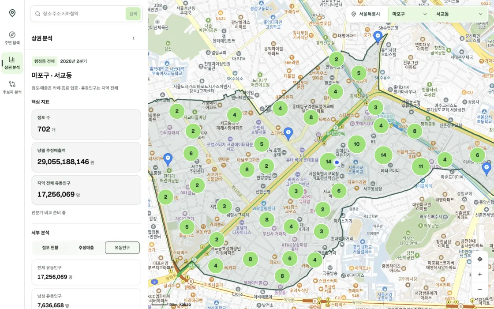
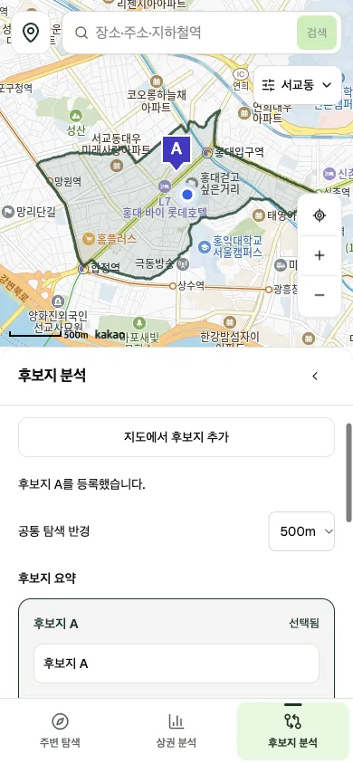

# 여기 창업해도 돼? - RecycleYoungs

## 프로젝트 소개

RecycleYoungs는 지역별 상권 정보와 공공데이터를 바탕으로 창업 후보지를 탐색하고 비교하는 서비스입니다. 다양한 업종의 예비 창업자에게 입지 선택과 창업 여부를 판단할 근거를 제공하는 것이 목표입니다.

**현재 MVP(Minimum Viable Product, 최소 기능 제품)는 서울의 카페 업종만 지원합니다.** 다른 업종은 향후 확장 대상으로 검토할 수 있습니다. [구현 현황과 후속 범위](docs/README.md#현재-상태)

## 화면 미리보기

마포구 서교동의 경계와 카페 분포, 상권 통계를 함께 보는 화면입니다.





## 주요 기능

| 기능 | 할 수 있는 일 |
| --- | --- |
| 지역·장소 탐색 | 자치구·행정동 경계를 확인하고, 장소명·지하철역·주소를 검색합니다. |
| 주변 카페 조회 | 지도에 보이는 카페를 살펴보고, 선택한 위치에서 500m 또는 1km 이내 카페를 거리순으로 확인합니다. |
| 상권 분석 | 선택한 지역 전체의 카페 점포 수·당월 추정매출과 업종 구분 없는 유동인구를 확인합니다. |
| 후보지 비교 | 최대 3곳의 경쟁 카페 수를 같은 반경에서 비교하고, 각 후보지가 속한 행정동의 통계를 함께 봅니다. |

## 기술 스택

| 영역 | 기술 |
| --- | --- |
| Frontend | React, React Router, TypeScript, Vite, Tailwind CSS, shadcn/ui, Kakao Maps JavaScript SDK |
| Backend | Java 21, Spring Boot 4, Spring MVC, Spring JDBC, Gradle |
| DB | PostgreSQL 17, PostGIS 3.5, Flyway(DB 구조 변경 이력 관리) |
| ETL | Node.js 24, TypeScript, Zod, node-postgres |
| 개발·검증 | Docker Compose, Nginx, GitHub Actions, Vitest, Playwright, JUnit, Testcontainers |

## 시스템 아키텍처

React는 지도와 상권 분석 화면을 제공하고 Spring Boot API에 데이터를 요청합니다. Spring Boot는 PostgreSQL에 저장된 상권 데이터와 공간 정보를 조회하고, PostGIS를 사용해 행정구역 경계나 검색 반경 안의 위치를 찾습니다. [스키마와 조회 계약](docs/data-design.md)

ETL은 서울 열린데이터광장과 소상공인시장진흥공단의 공공데이터를 수집·검증하고, 저장 형식으로 변환해 PostgreSQL에 적재합니다. [ETL 원천과 실행 절차](docs/etl-guide.md)

## REST API

Backend의 `db` 프로필은 `/api/v1` 아래에서 행정구역, 점포·추정매출·유동인구, 주변·지도 영역 카페 조회를 제공합니다. [요청 경로와 응답 계약](docs/data-design.md#행정구역-rest-api-계약)

## 빠른 시작

화면부터 확인하려면 Node.js 24와 npm 11을 준비하고, 저장소 루트에서 웹 앱을 실행합니다.

```bash
cd frontend
npm ci
npm run dev
```

[홈](http://localhost:5173/)에서 탐색을 시작할 수 있습니다. 지도를 보려면 Kakao Maps JavaScript 키를 설정합니다. [지도 설정](docs/development.md#kakao-maps-설정)

Backend를 `db` 프로필로 실행하면 Flyway가 새 DB에 테이블 구조를 적용합니다. 지역 목록과 상권 데이터를 조회하려면 게시 데이터가 필요합니다. **데이터 게시**는 검증한 데이터를 서비스가 조회할 수 있도록 DB에 반영하는 작업입니다. [개발 DB 데이터 준비](docs/development.md#개발-db-게시-데이터)

| 목적 | 실행 안내 |
| --- | --- |
| 테스트용 예시 데이터로 조회 API를 확인 | [합성 Demo](docs/development.md#합성-demo) |
| DB는 Docker에서, 웹 앱과 API는 로컬에서 실행 | [하이브리드 실행](docs/development.md#로컬-db-준비) |
| Nginx·Backend·PostGIS를 함께 실행 | [전체 Docker 스택](docs/development.md#전체-docker-스택) |

## 상세 기술 문서

[문서 안내](docs/README.md)에서 개발, 기능 확인, API 연동, 데이터 적재 목적별로 읽을 문서를 찾을 수 있습니다.
