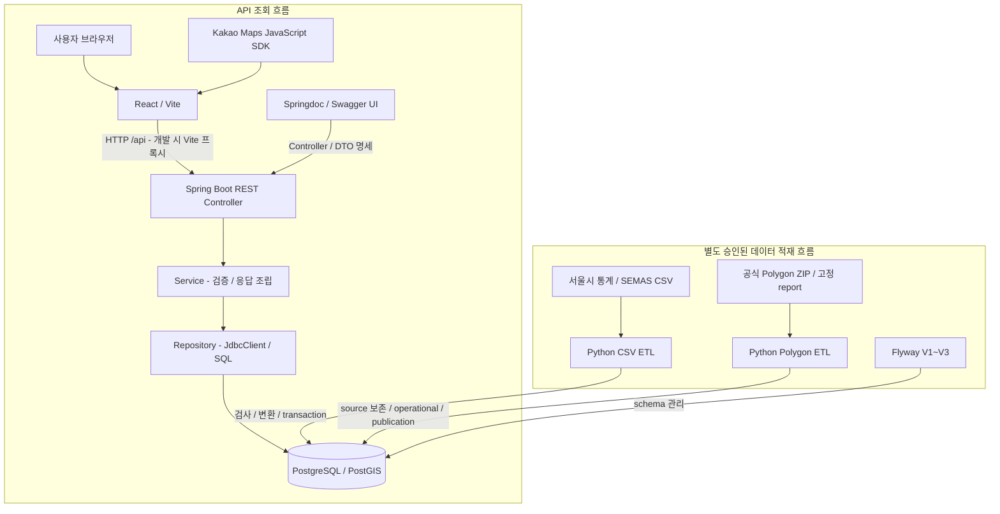
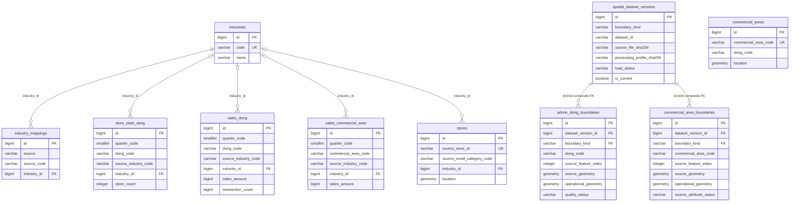
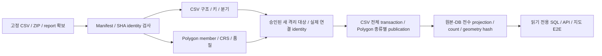

# 여기 창업해도 돼? — RecycleYoungs

## 프로젝트 소개

서울 지역의 창업 후보지를 공공데이터로 분석·비교하는 웹 서비스입니다. 예비 창업자가 지역 통계와 주변 경쟁 점포를 확인하고 후보지를 비교하도록 돕습니다. 현재는 카페 업종부터 지원합니다.

## 화면 미리보기

> 프론트엔드 개편 완료 후 실제 서비스 화면과 설명을 추가할 예정입니다.

## 주요 기능

> 프론트엔드 개편 및 최종 사용자 기능 확정 후 작성할 예정입니다.

## 기술 스택

버전은 [Gradle](backend/build.gradle)·[Wrapper](backend/gradle/wrapper/gradle-wrapper.properties), [npm 선언](frontend/package.json)·[lockfile](frontend/package-lock.json), [Python requirements](etl/requirements.txt)·[Dockerfile](etl/Dockerfile), [Compose](docker-compose.yml)를 대조했습니다. npm의 범위 선언과 lockfile의 실제 resolution을 구분합니다.

| 영역 | 기술·버전 | 실제 역할 |
| --- | --- | --- |
| Frontend | React / React DOM **19.3.0** | 화면 렌더링·지도 위치·후보 상태. package 선언은 `^19.2.8` |
| Frontend 빌드 | TypeScript **6.0.3**, Vite **8.3.0** | 타입 검사·개발 서버·번들·개발 `/api` 프록시. TypeScript 선언은 `~6.0.2` |
| UI | Tailwind CSS **4.3.3**, 수동 도입 shadcn Button/Card | 공통 스타일·접근성. Radix Slot 1.4.0, cva 0.7.1, clsx 2.1.1, tailwind-merge 3.7.0 사용 |
| 지도 | Kakao Maps JavaScript SDK | 지도·타일·클릭 좌표·마커·표준 줌. npm 패키지 대신 공식 SDK loader 사용 |
| Backend | **Java 21**, Spring Boot **4.1.1**, Spring MVC | REST Controller·엄격한 query 검사·Service·공통 오류 |
| SQL 조회 | Spring JDBC / **JdbcClient**, PostgreSQL JDBC driver | 명시적 SQL·행 매핑·읽기 전용 transaction. JDBC starter의 HikariCP 구성 |
| API 문서 | **springdoc-openapi-starter-webmvc-ui 3.1.1**, OpenAPI **3.1.0** | 7개 GET의 query·DTO·오류 schema 생성 및 Swagger UI. 기본 비활성화 |
| DB | PostgreSQL **16**, PostGIS **3.4** 계열 | 분기 집계·점포·공간 version 저장, 포함/거리 조회. Compose image `postgis/postgis:16-3.4` |
| Schema | Flyway **12.4.0** | Boot 관리 dependency 및 Compose migration image. V1~V3 SQL이 schema 기준 |
| ETL | Python **3.12**, pandas **2.2.3**, psycopg[binary] **3.2.3** | CSV 읽기·정규화·청크 처리·transaction 적재 |
| 공간 ETL | pyproj **3.7.0**, pyshp **3.1.6**, Shapely **2.1.2** | CRS 확인/변환·SHP/DBF 검사·source 보존·승인 repair |
| 테스트 | JUnit / Spring Test / Mockito, Vitest **5.0.3**, Testing Library **16.3.3**, jsdom **30.1.1**, unittest | DB 없는 회귀 및 별도 opt-in 통합 검사 |
| 도구 | Gradle Wrapper **9.7.1**, npm, ESLint **10.11.0**, Docker Compose, Makefile | 빌드·테스트·정적 검사·승인된 데이터 실행 진입점 |

Node.js는 24 계열로 개발 검증했으며 `engines`/`.nvmrc`로 고정돼 있지 않습니다. Python image는 `3.12-slim`입니다. Compose tag는 현재 실행 image identity나 정확한 DB patch 버전의 증거가 아닙니다. Lombok은 선언돼 있지만 현재 main Java에서 사용하지 않습니다. JPA·Spring Data JDBC·jOOQ·Nginx·AWS 배포는 현재 적용된 구성으로 표시하지 않습니다.

Springdoc 3.x는 Spring Boot 4 지원 계열입니다. 선택한 3.1.1의 [Maven Central POM](https://repo.maven.apache.org/maven2/org/springdoc/springdoc-openapi/3.1.1/springdoc-openapi-3.1.1.pom)은 Boot 4.1.0을 부모로 사용하며, 이 저장소에서는 Boot 4.1.1·Java 21에서 컴파일·전체 일반 테스트·HTTP·브라우저를 검증했습니다. [공식 저장소](https://github.com/springdoc/springdoc-openapi)와 [설치 안내](https://springdoc.org/getting-started.html)를 참고합니다.

## 아키텍처



일반 API는 적재한 DB를 조회하며 요청마다 ETL을 실행하지 않습니다. Frontend의 API client·types·hooks·components는 요청·계약·상태·표시를 나누고, Backend는 Controller → Service → Repository를 유지합니다. 통계 Service는 `READ ONLY / REPEATABLE READ`, 공간·경쟁 카페 Repository는 읽기 전용 SQL 경로를 사용합니다.

지도 좌표와 V1 점포·상권 대표 POINT는 EPSG:4326, Polygon source/operational geometry는 EPSG:5181입니다. 위치 판정은 query POINT만 5181로 변환해 `ST_Covers`를 적용합니다. 공유 경계나 overlap에 복수 행정동이 일치하면 모든 후보를 반환합니다. 경쟁 카페는 점포 POINT의 geography로 반경 500m를 판정합니다.

실자료 demo의 loopback bridge는 매 요청 원본 hash·identity 검사를 수행하는 별도 안전 경로입니다. 이 비용과 bridge의 직렬 lock은 일반 API 성능과 구분합니다.

## 배포 구조

배포 예정: Docker Compose로 전체 서비스를 구성한 후 AWS EC2에 배포하는 방안을 검토하고 있습니다. Nginx 도입도 고려 중입니다.

## ERD

정확한 DDL은 [V1](backend/src/main/resources/db/migration/V1__initial_schema.sql)·[V2](backend/src/main/resources/db/migration/V2__spatial_schema.sql)·[V3](backend/src/main/resources/db/migration/V3__semas_cafe_mapping_and_store_backfill.sql)를 기준으로 합니다. 핵심 컬럼과 **실제 DB FK만** 표시한 ERD입니다.



### V1 — 통계·점포·대표점

7개 테이블 모두 `BIGSERIAL id` PK를 갖습니다. mapping의 industry FK는 NOT NULL, 통계·매출·점포의 industry FK는 nullable입니다.

| 테이블 | 책임·주요 데이터 | UNIQUE·조회 인덱스 |
| --- | --- | --- |
| `industries` | 내부 업종 code·name·description, 기본 업종 5개 | `code` UNIQUE |
| `industry_mappings` | source별 원천 업종 code → 내부 업종 | `(source, source_code)` UNIQUE, `industry_id → industries.id` FK |
| `store_stats_dong` | 분기·행정동·업종의 점포·유사점포·개폐업·프랜차이즈 집계/비율 | `(quarter_code, dong_code, source_industry_code)` UNIQUE, 동/원천 업종/분기 lookup B-tree |
| `sales_dong` | 행정동 추정매출·거래건수 및 요일·시간·성별·연령 세부 원본. 금액/건수 BIGINT | 위와 같은 논리 key UNIQUE·lookup B-tree |
| `sales_commercial_area` | 상권·업종·분기 추정매출, 별도 공간 집계 | `(quarter_code, commercial_area_code, source_industry_code)` UNIQUE, 상권/원천 업종/분기 B-tree |
| `commercial_areas` | 상권 catalog·지역 속성·원본 X/Y·대표 `POINT(4326)` | 상권 code UNIQUE, location GiST·dong code B-tree |
| `stores` | 개별 SEMAS source ID·상호/지점·원천 분류·주소·행정/법정동·원본 좌표·`POINT(4326)` | source ID UNIQUE, location GiST·소분류/dong code B-tree |

`dong_code`, `commercial_area_code`의 통계·catalog·경계 간 조회 연결은 FK가 아닙니다. `sales_commercial_area.commercial_area_code`에도 catalog FK가 없습니다. 현재 Polygon을 역사적 통계에 FK로 묶어 같은 경계라고 가정하지 않습니다. 통계 행은 개별 점포의 매출·영업 상태가 아닙니다. V1은 분기 형식·지표 비음수·좌표 범위를 DB CHECK로 강제하지 않으므로 ETL/API 검사와 구분합니다.

### V2 — 공간 version·경계

| 테이블 | 책임·제약 |
| --- | --- |
| `spatial_dataset_versions` | BIGSERIAL PK. dataset/kind·ZIP/report/profile SHA·출처·날짜·역사적 호환성·feature count·publication. `(id, boundary_kind)`, `(dataset_id, source_file_sha256, processing_profile_sha256)` UNIQUE |
| `admin_dong_boundaries` | BIGSERIAL PK. `(dataset_version_id, boundary_kind)` 복합 FK → version `(id, boundary_kind)`. version 안의 dong code와 source feature index 각각 UNIQUE |
| `commercial_area_boundaries` | 위와 같은 복합 FK. version 안의 상권 code와 feature index 각각 UNIQUE. 원본 지역 code·속성 검증/충돌 보존 |

`ADMIN_DONG/OA-22160`, `COMMERCIAL_AREA/OA-15560`만 허용합니다. 종류별 current는 partial UNIQUE로 최대 1개이며 `PENDING → READY` publication을 관리합니다. trigger는 경계 UPDATE/DELETE를 거부하고 version metadata·READY 변경을 제한합니다. publication은 기대 feature count·가용 geometry 등 조건을 검사합니다.

source는 `GEOMETRY(GEOMETRY,5181)`, operational은 `GEOMETRY(MULTIPOLYGON,5181)`입니다. geometry의 NULL/존재와 NDR WKB SHA를 함께 검사하며 operational은 valid·nonempty입니다. operational non-NULL에 partial GiST가 있고 source GiST나 4326 Polygon 복제는 없습니다. 품질 상태 `VALID_SOURCE`, `REPAIRED_OPERATIONAL`, `REVIEW_REQUIRED`, `UNSUPPORTED`와 repair method/parameters/detail을 구분합니다. 현재 ETL은 예상 밖/미지원 원본을 자동 적재하지 않고 중단합니다.

다운로드일·파일 수정일·데이터 갱신일은 역사적 경계 기준일과 다릅니다. `reference_date_verified`는 reference date 존재와 일치해야 하며 역사적 호환성은 현재 `UNRESOLVED`입니다.

### V3 — SEMAS 카페 매핑·최소 backfill

테이블·컬럼·인덱스를 추가하지 않습니다. 실제 CAFE ID와 충돌을 검사하고 `SEMAS/I21201 → CAFE` mapping이 없을 때만 추가합니다. 기존 I21201 중 `industry_id IS NULL`만 보완하며 ID·원천 속성·POINT·다른 분류·이미 CAFE인 행을 보존합니다. lock·대상/영향 건수·잔존 NULL/충돌을 검사하고 stores sequence를 재시작하지 않습니다. `nextval`은 일반 MVCC rollback과 다르므로 실패 시 모든 sequence 값까지 원복된다고 보장하지 않습니다.

## ETL

### 입력·출처·기간

실자료는 새 clone에 포함되지 않습니다. [manifest](data/manifest.json)의 파일명·바이트·SHA-256·decoder·행 수·키·조사 범위와 [Polygon 고정 입력](etl/app/spatial_sources.py)을 대조해 별도로 확보해야 합니다.

| 입력 | 원천·구성 | 사용·한계 |
| --- | --- | --- |
| 점포-행정동 CSV | 서울시 상권분석서비스, CP949, 20251~20254 | `store_stats_dong` 분기 집계 |
| 추정매출-행정동 CSV | 서울시, CP949, 20251~20254 | `sales_dong` 원 단위 추정매출·거래건수 |
| 추정매출-상권 CSV | 서울시, CP949, 20251~20254 | `sales_commercial_area`. 행정동 매출과 구분 |
| 영역-상권 CSV | 서울시 catalog·X/Y·면적, CP949 | 대표 POINT. 원천 CRS 미확정으로 임의 적재 금지, Polygon 대체 불가 |
| 개별 점포 CSV | SEMAS `소상공인시장진흥공단_상가(상권)정보_서울_202606.csv`, UTF-8-SIG | `stores`. 파일명 기준 snapshot, 기준일·완전성 UNVERIFIED |
| 길단위인구-서울시 CSV | 서울 전체 2021 Q1~2026 Q2의 22행 | 지역별 수요 ETL에서 제외 |
| 행정동 Polygon ZIP | 서울시 [OA-22160](https://data.seoul.go.kr/dataList/OA-22160/S/1/datasetView.do), 425 feature·quality report | EPSG:5181 operational 경계 |
| 상권 Polygon ZIP | 서울시 [OA-15560](https://data.seoul.go.kr/dataList/OA-15560/S/1/datasetView.do), 1,650 feature·quality/repair report | overlap·H5 속성 충돌·승인 repair 보존 |

CSV의 정확한 파일명은 manifest에 있습니다. SEMAS 출처 후보는 [공공데이터포털](https://www.data.go.kr/data/15012005/openapi.do)입니다. byte/hash 일치는 최초 배포 이력·이용 조건·원천 기간의 증명과 다릅니다. UTF-8-SIG decoder만으로 BOM 존재를 단정하지 않습니다. manifest의 초기 CRS/BOM 기록과 후속 조사 범위 차이는 [기술 명세](docs/technical.md#manifest와-후속-검증의-범위)에 구분돼 있습니다.

### CSV ETL

[main.py](etl/app/main.py)는 `--data-dir`, `--only`, `--validate-only`를 제공합니다. [preflight.py](etl/app/preflight.py)는 존재·encoding·필수/중복 header·열 수·빈 key·중복 논리 key·필수 이름·2025년 네 분기 누락/범위를 검사합니다. 변환 모듈은 문자열 code·NULL·숫자·경위도·주소 등 원천 정보를 처리합니다.

서울시 업종은 `SEOUL`, 개별 점포 소분류는 `SEMAS` mapping으로 내부 업종에 연결합니다. `I21201 → CAFE` 외 SEMAS 확장은 검증 완료 상태가 아닙니다. 미매핑 점포를 임의로 카페로 분류하지 않습니다. 점포 경위도는 WGS84 POINT, 상권 X/Y는 근거 있는 `AREA_SOURCE_CRS` 확인 후 pyproj로 EPSG:4326 변환합니다.

**일반 CSV preflight는 manifest SHA-256 검증을 자동 수행하지 않습니다.** 실자료 demo는 manifest CSV identity·바이트·hash를 추가 검사합니다. 구조 검사와 원본 hash 검증을 혼동하지 않습니다.

선택한 CSV job 전체는 하나의 transaction에서 적재해 중간 실패 시 함께 rollback합니다. 통계/catalog loader는 삭제 후 재적재, stores full loader는 **TRUNCATE 및 ID 재시작**을 수행하므로 기존 DB backfill·일반 검증에 쓰지 않습니다. connection은 종료합니다. 단독 CLI의 DB 기본값은 identity 확인·실행 승인을 대신하지 않습니다.

### Polygon ETL

[spatial_main.py](etl/app/spatial_main.py)는 CSV와 독립돼 있습니다. 기본/`--validate-only`는 DB 미접속, `--load`는 명시적 `--dsn`과 함께 사용해야 합니다. 행정동에는 ZIP+quality report, 상권에는 ZIP+quality+repair report가 필요합니다.

[spatial_geometry.py](etl/app/spatial_geometry.py)는 ZIP·SHP/SHX/DBF/PRJ/CPG의 고정 SHA·구조·필드·feature index/code·count·CRS·encoding·2D geometry·report/profile을 검사합니다. 원본 SHP/ZIP/report를 수정하지 않습니다. source geometry를 보존하고 valid source는 `ST_Multi(source)`에 해당하는 operational MultiPolygon으로 사용합니다.

승인 repair 대상은 **3110137, 3110270, 3110234, 3110407, 3110515, 3110542** 여섯 상권뿐입니다. 고정 code·feature index·source WKB SHA·report ACCEPTABLE과 `make_valid(method="linework", keep_collapsed=True)` 결과 hash·hole·bbox·boundary·vertex set을 대조합니다. invalid source는 보존하고 operational만 보정합니다. valid source repair·`buffer(0)` fallback·line/point discard로 숨기지 않습니다.

geometry SHA는 **2D little-endian OGC WKB, SRID 미포함, ring/vertex normalize 없음**이며 ZIP/SHP SHA와 다릅니다. repair 직후 Polygon과 저장 MultiPolygon hash, `ST_Equals`와 byte/hash 동일성도 구분합니다.

[spatial_load.py](etl/app/spatial_load.py)는 종류별 transaction에서 PENDING version·경계·검사를 거쳐 READY/current를 publication합니다. 같은 고정 READY version 재사용도 무결성 확인을 수반합니다. 실패는 해당 transaction을 rollback하지만 종류 사이의 전역 rollback은 없습니다. 단독 CLI를 기존 DB 적용 안전 runner로 취급하지 않습니다. 승인된 격리 runner는 사전 검사와 실제 publication 연결 identity를 모두 확인합니다.



### 격리 실자료 검증·해석

2026-10-14 **기존 기록**은 새 격리 DB의 점포 통계 141,218행·행정동 매출 67,113행·SEMAS 554,092행·행정동 Polygon 425개·상권 Polygon 1,650개·I21201/CAFE 22,739행 대조입니다. demo는 CSV 3종과 Polygon 2종을 사용하며 상권 catalog/매출 CSV 전체를 적재한 것은 아닙니다. 현재 개발 DB 상태나 새 실행의 고정 기대값이 아닙니다.

서울시 **2025년 분기 집계**와 SEMAS **파일명 기준 2026-06 점포 snapshot**은 시점·단위가 다릅니다. 원천 snapshot catalog·전체 source의 원자적 publication·역사적 경계 호환성은 미완료입니다. 원본 overlap의 복수 `ST_Covers` match와 홍지문 H5 `CONFLICT_OBSERVED`를 숨기지 않습니다.

## 프로젝트 구조

Git 추적 파일과 실제 디렉터리를 기준으로 주요 책임을 정리했습니다. `data/raw/`는 별도 확보하는 Git 제외 원본 영역입니다.

```text
RecycleYoungs/
├── README.md / AGENTS.md
├── Makefile / docker-compose.yml / .env.example
├── backend/
│   ├── build.gradle / gradlew / gradle/wrapper/
│   └── src/
│       ├── main/java/com/example/backend/
│       │   ├── BackendApplication.java / WebConfig.java / OpenApiConfig.java
│       │   ├── admindong/       # lookup·통계·추세, query·오류·DTO
│       │   ├── location/        # 좌표→행정동·상권, 경계 metadata
│       │   └── nearby/          # CAFE/500m 점포·자료 품질
│       ├── main/resources/
│       │   ├── application.yaml
│       │   └── db/migration/    # V1~V3 SQL
│       ├── test/                # 일반 테스트·OpenAPI·문서 preview
│       ├── dbTest/              # 실제 DB opt-in smoke·fixture
│       ├── locationIntegration/ # 격리 Java runner·HTTP probe·Python 제어
│       └── demo/                # 일회용 실자료 Java 앱
├── frontend/
│   ├── package.json / package-lock.json / vite.config.ts / components.json
│   ├── .env.local.example
│   └── src/
│       ├── App.tsx
│       ├── api/                 # fetch client·공통 오류
│       ├── types/               # API·지도·후보 타입
│       ├── hooks/               # 요청 취소·후보 상태·비교 orchestration
│       ├── components/
│       │   └── ui/              # 기존 Button/Card 공통 UI
│       ├── lib/                 # Kakao SDK loader·공통 유틸리티
│       └── test/                # fixture·setup
├── etl/
│   ├── requirements.txt / Dockerfile
│   ├── app/                     # CSV·Polygon 검사/변환/적재
│   ├── control.py / control_backend.py / control_worker.py
│   ├── source_validation.py / source_control.py / source_audit.py
│   ├── demo.py / demo_worker.py / demo_checks.py / demo_safety.py
│   └── tests/                   # unittest·공간/점포 fixture·safety gate
├── data/
│   ├── manifest.json
│   └── raw/                     # 새 clone에 실자료 미포함
├── docs/
│   ├── project.md
│   ├── technical.md
│   └── db-safety.md
└── legacy/                      # 이전 실험 보존
```

`control*`는 기존 safety guard의 격리 실행 제어입니다. `source_validation.py`는 supplied before/after 순수 보존 비교, `source_control.py`는 NOT_READY inspect·비활성 SIMULATED_ONLY 모델, `source_audit.py`는 UNVERIFIED 계약 결속입니다. 실제 source collector/executor·durable crash 처리 경로는 미구현이며 모듈 PASS를 DB 적용 승인으로 해석하지 않습니다. `demo*`는 별도 일회용 실자료 경로입니다.

## 테스트 전략

| 범위 | 검증 내용 | DB·원본 조건 |
| --- | --- | --- |
| Backend 일반 JUnit | query 우선순위·HTTP/오류·Service·Repository SQL/매핑·NULL/0/숫자 문자열 | Service/JdbcClient mock. context는 DataSource/Flyway auto-configuration 제외·MockitoBean JdbcClient |
| Frontend Vitest | 렌더링·접근성·fetch/취소·후보 상태·SDK loader | mocked fetch/SDK, DB 불필요. 실제 타일·DB 성공 증거 아님 |
| ETL unittest | 구조/키·정규화·mapping·geometry·rollback·guard·source 계약 | DB/raw opt-in 없이 실행. 실제 DB/raw 필요 검사는 SKIP |
| 실제 DB opt-in | `dbTest`, ETL spatial/stores DB·raw 검사 | 승인된 격리 대상·fixture·safety gate. 일반 test와 별도, 자동 migration 가능 |
| 실자료 격리 E2E | ETL→PostGIS→Spring→React→Kakao·전수 대조·경계·3후보·복구·cleanup | 새 internal network·tmpfs DB·고정 image/input·실제 SDK. 실행별 승인 |
| Swagger/OpenAPI | context·OpenAPI 3.1 parse·7 GET·필수 query·DTO 21종·NULL union·오류·CAFE/500·기본 비활성화 | MockMvc+RANDOM_PORT loopback HTTP. DataSource/Flyway 없음·JdbcClient 미호출 검사 |
| Swagger UI | HTML·JS/CSS·swagger-config·JSON 및 브라우저 명세 표시 | `swaggerPreview` 테스트 서버만 사용. 실데이터 API 검증과 구분 |

**과거 기록:** 2026-10-14 실자료 최종 검증 당시 Backend **230 PASS**, Frontend **235 PASS**, ETL **277 PASS / 15 SKIP**. Bridge **33 PASS는 ETL 277에 포함**, 실제 TCP RST 후 복구 3회 PASS였습니다. 당시 승인·입력·환경의 결과입니다.

**이번 문서 경로 개선 검증:** Java **21.0.12** / Boot **4.1.1** / Springdoc **3.1.1**, Backend **244 PASS / 0 FAIL / 0 SKIP**(문서 테스트 14개 포함), `test build` PASS. DB 없는 preview의 새 공식 UI/JSON·redirect·JS/CSS/config·브라우저의 7 GET을 검증했습니다. 이전 README/OpenAPI 작업의 242 PASS와 구분하며, 기존 DB·Docker·raw E2E와 Frontend/ETL은 이번에 재실행하지 않았습니다.

### 데이터 해석·기술적 한계

서비스는 창업 성공·수익·폐업을 예측하거나 보장하지 않습니다. 출처·기간·집계 단위·한계를 함께 해석해야 하며, 행정동 추정매출을 후보 반경의 매출이나 개별 가게의 이익으로 환산하지 않습니다.

| 유지하는 상태·한계 | 의미 |
| --- | --- |
| 기존 개발 DB **NOT_READY** | 적용 안전 조건·실측 증거·승인이 미충족. 이번 작업에서 현재 DB 상태를 재조회하지 않음 |
| SEMAS snapshot·원천 기준일 **UNVERIFIED** | 파일명의 `202606`은 완전한 영업 현황·정확한 기준일의 증명이 아님. 누락을 폐업으로 단정하지 않음 |
| 역사적 경계 호환성 **UNRESOLVED** | 확보한 operational 경계가 2025년 통계 당시 경계와 같다고 보증하지 않음 |
| source overlap·홍지문 H5 속성 충돌 | 원본 보존·모호성·품질 metadata 공개. 임의 보정·단일 후보 선택 금지 |
| Java/JDBC 즉시 query cancellation 미구현 | 브라우저 요청 취소가 진행 중 SQL의 즉시 취소를 보장하지 않음 |
| 운영 배포·부하·인증 미완료 | 일회용 MVP 검증을 운영 준비·보안 검증으로 확대하지 않음 |

상세 구현은 [기술 명세](docs/technical.md), 진행 기록은 [프로젝트 문서](docs/project.md), 실제 DB 작업의 승인·복구 정책은 [DB 안전 정책](docs/db-safety.md), 작업 규칙은 [AGENTS.md](AGENTS.md)를 기준으로 합니다.

## 실행 방법

### 실행 환경 요구사항

필요한 항목은 실행 시나리오에 따라 다릅니다. **A는 Frontend와 지도, B는 DB 없는 문서 서버, C는 외부 실자료·새 독립 DB를 포함한 통합 실행**입니다. A/B에는 Docker·실자료 DB가 필요 없습니다.

| 항목 | 실제 버전·기준 | 필요한 시나리오·준비 위치 | 미준비 시 |
| --- | --- | --- | --- |
| Java | Java 21, 이번 검증 Temurin 21.0.12 | B/C. 별도 JDK 설치, `JAVA_HOME` 또는 PATH에서 사용 | Backend 테스트·preview·빌드 불가 |
| Gradle Wrapper | 9.7.1 | B/C. 저장소 `backend/gradlew` 사용, 별도 Gradle 설치 불필요. 최초 dependency 다운로드 필요 | cache 미완성 시 offline 실행 불가 |
| Node.js / npm | 개발 검증 Node 24.20.0, package에 engines 고정 없음 | A/C. Node 24 계열·npm 별도 설치, frontend lockfile로 `npm ci` | Vite/UI 실행 불가 |
| Python | 3.12, 과거 실자료 검증 3.12.14 | C 및 ETL 검사. `etl/.venv` 등 준비한 전용 interpreter·requirements 고정 버전 | ETL/격리 controller 실행 불가 |
| Docker Engine / Compose | daemon 및 Compose v2 명령. repo의 최소 patch 버전 고정 없음 | C의 승인된 container 실행·별도 Compose 작업. demo는 고정 image ID 3개 필요 | 새 격리 DB/sidecar 실행 불가 |
| PostgreSQL | 16 계열 | C. 승인된 독립 DB, demo에서는 새 tmpfs container. 로컬 PostgreSQL 설치가 필수인 것은 아님 | 실제 API/데이터 조회 불가 |
| PostGIS | 3.4 계열 | C의 PostgreSQL extension/image. Compose 선언은 `postgis/postgis:16-3.4`, demo는 지정 image identity | 경계·반경 SQL 불가 |
| Kakao JavaScript 앱 키 | Kakao Maps 공식 SDK | A/C의 실지도. `frontend/.env.local`에 본인 `VITE_KAKAO_MAP_APP_KEY` | SDK·실제 타일 표시 불가 |
| 등록된 localhost origin | A: `http://localhost:5173`, demo: `http://localhost:5273` | Kakao Developers에 정확한 origin 등록. localhost/127.0.0.1 구분 | SDK domain mismatch 가능 |
| 서울시 통계 CSV | 2025년 1~4분기 점포-행정동·추정매출-행정동 | C. `data/raw/dataset/` 아래 manifest의 정확한 파일명 | 점포/매출·추세 조회 자료 없음 |
| SEMAS 서울 점포 CSV | 파일명 기준 202606, 기준일 UNVERIFIED | C. 같은 dataset 디렉터리, manifest 파일명·bytes/SHA 대조 | 경쟁 카페 분석 자료 없음 |
| 행정동·상권 Polygon ZIP | OA-22160 / OA-15560, EPSG:5181 | C. 아래 고정 spatial 경로. 별도 원본 확보 | 위치 판정 경계 없음 |
| 원본 검증 report | quality 2개·repair 1개, 고정 hash/profile | C. `etl/app/spatial_sources.py`의 경로와 일치 | Polygon gate/publication 불가 |
| `data/manifest.json` | 저장소 추적 입력 목록·hash·조사 범위 | C. clone에 포함, 실CSV와 대조. 새 원본·report 자체는 미포함 | 고정 CSV identity 확인 불가 |

Spring/Python은 process 환경 변수를 사용하며 루트 `.env`를 자동 읽지 않습니다. 루트 `.env`는 Compose용, `frontend/.env.local`은 Vite용입니다. 설정 파일·원본은 별도로 준비하고 기존 파일을 덮어쓰지 않습니다. 기존 보호 DB/container/volume은 **NOT_READY**이며 C의 정상 DB로 사용하지 않습니다.

### A. 프론트엔드만 실행

**설치:** 새 clone에서 Node/npm을 준비한 뒤 실행합니다. 이미 clone했다면 기존 저장소 루트에서 시작합니다.

```sh
git clone https://github.com/jinwooorp/RecycleYoungs.git
cd RecycleYoungs
npm --prefix frontend ci

# 기존 설정은 보존
if [ ! -e frontend/.env.local ]; then
  cp frontend/.env.local.example frontend/.env.local
fi
```

**환경 변수:** `frontend/.env.local`의 `VITE_KAKAO_MAP_APP_KEY`에 본인 JavaScript 앱 키를 입력합니다. Kakao Developers에 `http://localhost:5173`을 등록합니다. 키·비밀번호를 출력하거나 Git에 저장하지 않습니다. 실지도에는 유효한 키·등록 origin·SDK/타일 네트워크 접근이 모두 필요합니다.

**실행:** 화면은 mount 시 동·업종·분기 lookup 3개를 자동 요청합니다. 기본 Vite proxy는 localhost:8080입니다. DB 없는 UI 확인 전 8080에 기존 Backend/listener가 없음을 읽기 전용으로 확인합니다. listener가 있거나 확인 불가이면 이 화면 실행 경로를 중단하고 mock 테스트만 사용하며 다른 process를 종료하지 않습니다.

```sh
lsof -nP -iTCP:8080 -sTCP:LISTEN

# 8080 listener 없음이 확인된 경우에만
npm --prefix frontend run dev -- --host 127.0.0.1 --port 5173 --strictPort
```

**접속·정상 확인:** [http://localhost:5173/](http://localhost:5173/)에서 화면·실지도 타일·클릭 좌표·마커를 확인합니다. Backend/DB를 자동 시작하지 않으므로 API lookup·통계·카페는 실패/미준비 상태입니다. SDK 표시를 API 통합 성공으로 해석하지 않습니다. 수동 조회를 누르지 않는 것만으로 기존 Backend 접근을 차단할 수는 없습니다.

**종료:** 실행 터미널의 `Ctrl+C`. port 충돌 시 기존 process를 종료하거나 origin을 임의 변경하지 않습니다.

### B. DB 없이 Backend 테스트·Swagger UI 실행

**요구사항·설치:** Java 21과 Gradle Wrapper만 필요합니다. 최초 실행 시 Gradle dependencies를 내려받습니다. DB용 `.env`·Docker·CSV/Polygon·Kakao 키가 필요 없습니다.

**환경·실행:** DB/raw opt-in은 미설정 상태로 유지합니다. 프로젝트 루트에서 다음 명령을 실행합니다.

```sh
cd backend
./gradlew test build --no-daemon
./gradlew swaggerPreview
```

`swaggerPreview`는 test classpath의 문서 전용 서버입니다. DataSource/Flyway auto-configuration을 제외하고 **mocked JdbcClient**를 공급하며 127.0.0.1:18080에만 바인딩합니다. 일반 `bootRun`은 DB/Flyway를 사용하므로 이 DB 없는 실행 방식과 다릅니다. preview 테스트 클래스는 배포 bootJar에 포함되지 않습니다.

**접속 주소:**

- Swagger UI: [http://127.0.0.1:18080/api/docs](http://127.0.0.1:18080/api/docs)
- OpenAPI JSON: [http://127.0.0.1:18080/api/v3/api-docs](http://127.0.0.1:18080/api/v3/api-docs)

**정상 확인:** `BUILD SUCCESSFUL`과 서버 Started/18080 로그를 확인합니다. UI에서 RecycleYoungs API / OAS 3.1·GET 7개가 보이고 각 operation을 펼치면 필수 query·응답 code·Example Value/Schema를 확인할 수 있습니다. Schemas에서 21종 DTO를 확인합니다. `Try it out`은 HTTP 요청 실행 기능이며 preview는 실제 통계·점포 자료를 조회하는 서버가 아닙니다.

실측 동작은 `/api/docs` **302 → `/api/swagger-ui/index.html`**, HTML·JS/CSS/initializer **200**, `/api/v3/api-docs/swagger-config` **200**·명세 URL `/api/v3/api-docs`입니다. 최종 주소창도 `/api/` 아래이므로 별도 rewrite/resource handler가 필요 없습니다. Petstore 기본 URL은 비활성화했습니다. `/api` 자체는 Swagger UI 주소가 아닙니다.

**종료:** 실행 터미널의 `Ctrl+C` 후 `lsof -nP -iTCP:18080 -sTCP:LISTEN` 등으로 포트 해제를 확인합니다. 기존 listener가 있으면 preview가 중단되며 기존 process를 종료하지 않습니다. DB/Docker cleanup은 없습니다.

### C. 실자료 Backend·Frontend 통합 실행

**실행 가능 범위:** 이 시나리오는 새 clone만으로 바로 실행되지 않습니다. 외부 원본·고정 report/image·Java/Node/Python·Kakao 키가 필요하고 **새 독립 DB와 별도 승인된 실행 절차**가 필요합니다. 일반 사용자를 위한 원본 다운로드→DB→전체 서비스 자동 실행은 미구현입니다. 아래는 구현된 격리 demo 절차와 안전하게 준비된 일반 Backend 절차를 구분한 안내이며 **이번 경로 변경 작업에서는 실행하지 않았습니다**.

#### 1. 원본·의존성·지도 준비

C를 담당하는 실행자가 [격리 시연 안내](docs/technical.md#격리-시연-실행-안내)와 [DB 안전 정책](docs/db-safety.md)을 읽고 새 실행의 생성·접속·적재·종료/정리 범위를 승인받습니다. 기존 `startup-analysis-postgres`·`recycleyoungs_postgres_data`·`startup_analysis`를 대상에 사용하지 않습니다.

A의 frontend 설치/키 설정, Java 21, 준비한 Python 3.12 환경을 확인합니다. 가상환경이 없을 때만 생성합니다.

```sh
# 프로젝트 루트, 기존 .venv 보존
if [ ! -e etl/.venv ]; then
  python3.12 -m venv etl/.venv
fi
etl/.venv/bin/python -m pip install -r etl/requirements.txt
etl/.venv/bin/python -m pip check
(cd backend && ./gradlew prepareDemo)
```

`prepareDemo`는 DB 미접속 Java 산출물 준비입니다. cache가 완전할 때만 `--offline`을 사용할 수 있습니다. [demo_safety.py](etl/demo_safety.py)의 고정 DB/PostGIS·ETL·Java image ID가 로컬에 있어야 하며 runner는 `--pull=never`입니다. tag 대체·자동 image 다운로드/빌드는 지원하지 않습니다.

원본 입력은 아래 **8개**이고 manifest도 함께 대조합니다. 모두 새 clone에서 별도 확보해야 합니다.

| 위치 | 원본 |
| --- | --- |
| `data/raw/dataset/` | `서울시 상권분석서비스(점포-행정동)_2025년.csv` |
| 같은 위치 | `서울시 상권분석서비스(추정매출-행정동)_2025년.csv` |
| 같은 위치 | `소상공인시장진흥공단_상가(상권)정보_서울_202606.csv` |
| `data/raw/spatial/` | `서울시 상권분석서비스(영역-행정동).zip` |
| 같은 위치 | `validation-results.json` (행정동 quality) |
| `data/raw/spatial/stage4-research-20261007/` | `official-commercial-area.zip` |
| `data/raw/spatial/stage56-validation-20261007/` | `results.json` (상권 quality) |
| `data/raw/spatial/six-repair-validation-20261007/` | `results.json` (상권 repair) |

CSV는 [manifest](data/manifest.json)의 파일명·bytes·SHA와, ZIP/member/report는 [spatial_sources.py](etl/app/spatial_sources.py)의 고정 identity/profile과 일치해야 합니다. 누락/불일치 시 STOP이며 다른 입력으로 대체하지 않습니다. 일반 CSV CLI는 구조/key/분기 검사이고 SHA 검증은 demo의 추가 gate입니다.

원본 사용까지 승인된 실행자는 아래 **DB 없는 구조 검사**를 사용할 수 있습니다. Python 옵션은 실제 CLI 기준입니다.

```sh
# 프로젝트 루트
(cd etl && .venv/bin/python -m app.main --validate-only \
  --data-dir ../data/raw/dataset --only store_stats_dong sales_dong stores)

(cd etl && .venv/bin/python -m app.spatial_main --validate-only --only admin \
  --admin-zip "../data/raw/spatial/서울시 상권분석서비스(영역-행정동).zip" \
  --admin-report ../data/raw/spatial/validation-results.json)

(cd etl && .venv/bin/python -m app.spatial_main --validate-only --only commercial \
  --commercial-zip ../data/raw/spatial/stage4-research-20261007/official-commercial-area.zip \
  --commercial-report ../data/raw/spatial/stage56-validation-20261007/results.json \
  --commercial-repair-report ../data/raw/spatial/six-repair-validation-20261007/results.json)
```

구조/Polygon 검사 exit 0과 기대 분기·feature·품질 요약을 확인합니다. raw 접근이므로 일반 test 실행과 다릅니다. `--load`를 덧붙이거나 stores full loader를 기존 DB 검증으로 쓰지 않습니다.

**DB 생성 전 SDK-only gate:** 등록된 localhost:5273 origin에서 별도 Node/Vite `createServer`의 `configFile:false`, `proxy:{}`, `/api` 503 middleware·메모리 진단 route로 실제 SDK·타일·클릭·마커와 API 차단을 검증하고 종료합니다. 기본 Vite proxy/Mock SDK는 gate를 대신하지 않습니다. 이 사전 gate는 현재 공개 단일 task로 자동화돼 있지 않습니다.

#### 2. 새 독립 DB·schema·ETL 준비

승인된 controller를 시작합니다. process에 기존 DB/DSN·opt-in 변수를 주입하지 않습니다.

```sh
etl/.venv/bin/python -u etl/demo.py --isolated-run \
  --dataset-dir data/raw/dataset --spatial-root data/raw/spatial
```

`READY_FOR_EXPLICIT_ACTIONS` 이후 stdin에 JSON action을 **한 단계씩** 입력하고 성공·identity를 확인한 뒤 진행합니다.

| action | 실제 작업·정상 gate |
| --- | --- |
| `{"action":"prepare"}` | 입력 8개/hash·고정 image 검사, 새 owner·internal network·DB host port 없음·data/init tmpfs·기존 volume 없음. 새 DB/계정 생성 |
| `{"action":"identity"}` | 이번 full container/network ID·SID·database/user·PGDATA·mount/alias/port·ownership 확인 |
| `{"action":"migrate"}` | 실제 연결 identity를 검사한 새 DB에 Flyway V1/V2/V3. 기존 schema 변경 승인과 별개 |
| `{"action":"load"}` | CSV 3종 한 transaction, Polygon 2종 종류별 transaction/publication. 실제 연결 검사·rollback/STOP |
| `{"action":"verify"}` | 원본/DB 전수 projection·건수·키/mapping·POINT·geometry hash/SRID/validity·Flyway 대조 |
| `{"action":"seal"}` | reader SELECT-only·owner NOLOGIN 등 접근 계정/권한 확정 |
| `{"action":"serve"}` | guarded Java Backend 8080을 internal network에서 시작. 매 JDBC 연결 identity·읽기 전용·Flyway 비활성화 |
| `{"action":"final"}` | 원본/DB·SQL/HTTP·CAFE/500·통계·특수 좌표 최종 대조 |
| `{"action":"bridge"}` | 이번 run의 새 loopback API bridge URL 반환 |

부정확한 identity·실패/stale 증거·STOP 뒤에는 다음 단계나 자동 retry를 하지 않습니다. 일반 CSV/Polygon CLI의 `--load`·DB 환경 기본값은 이 연결 guard/승인을 대신하지 않습니다. 기존 보호 DB에 `make db-migrate`/`make etl`을 실행하는 절차가 아닙니다.

#### 3. Frontend 연결·실지도 및 API 확인

별도 터미널에서 bridge 출력의 **이번 실제 port**를 지정합니다. 예시 PORT를 교체하고 다른 Backend/과거 port를 사용하지 않습니다.

```sh
cd frontend
RECYCLEYOUNGS_DEMO_API_PROXY=http://127.0.0.1:PORT \
  npm run dev -- --host 127.0.0.1 --port 5273 --strictPort
```

Kakao 키는 `frontend/.env.local`, origin은 `http://localhost:5273`입니다. [http://localhost:5273/](http://localhost:5273/)에서 실타일·클릭 좌표/마커·행정동/상권·반경 500m 카페·동 통계·최대 3후보를 확인합니다. 분기 변경·정상 0/null/NO_ROW·모호성·미준비 오류도 구분합니다. 실제 클릭 좌표의 SQL/API/UI와 품질 metadata를 대조하며 과거 건수를 다른 클릭의 기대값으로 쓰지 않습니다.

**Swagger와의 차이:** 현재 demo의 Backend는 internal network에 있고 host 8080을 공개하지 않습니다. bridge는 기존 비즈니스 GET만 전달하며 Swagger HTML/JS/config는 제공하지 않습니다. demo process에 OPENAPI_ENABLED를 전달하는 공개 실행 옵션도 없습니다. 따라서 위 demo만으로 `localhost:8080/api/docs`까지 통합된다고 안내하지 않습니다. 동일 schema 문서 확인은 B의 preview를 사용하고, 실제 8080 Swagger는 아래의 승인된 일반 Backend 환경에서만 확인합니다.

#### 4. 종료·cleanup

controller에 `{"action":"final"}`로 재검사하고 frontend 터미널에서 `Ctrl+C`로 종료한 뒤 `{"action":"cleanup"}`을 입력합니다. 이번 owner/full ID/attachment·network/mount/port 소유권을 재확인한 자원만 정리하며 잔여 자원과 loopback listener 없음도 확인합니다. EOF/Ctrl+C는 controller의 자동 cleanup을 보장하지 않습니다. 증명이 사라진 자원을 label만 보고 삭제하지 않습니다. 원본·기존 volume·backup·다른 process는 정리 대상이 아닙니다.

tmpfs 종료 후 자료는 사라지고 새 시연에는 새 승인·identity가 필요합니다. 독립 PC 재현·운영 부하/인증·원천 snapshot·역사적 경계·즉시 SQL 취소는 별도 미완료 범위입니다.

### 안전하게 준비된 일반 Backend에서 Swagger 확인

**사전 조건:** 별도로 승인된 독립 PostgreSQL/PostGIS DB·접근 계정·실제 연결 identity·V1~V3·필요 CSV/Polygon 적재가 이미 준비돼 있어야 합니다. 이 일반 DB의 생성/실측 guard/원본 적재를 모두 묶은 공개 자동 task는 없습니다. mutation에는 최신 backup/격리 restore·writer/history/보존·중단/복구 계획과 실행 승인이 필요합니다. 현재 보호 DB는 NOT_READY이며 사용 대상이 아닙니다.

**환경 변수:** Unix/macOS에서 승인된 DB_HOST/PORT/NAME/USER/PASSWORD를 기존의 안전한 process 설정으로 주입합니다. secret 값은 명령 예시에 넣지 않습니다. root `.env`는 Spring에 자동 적용되지 않습니다.

**실행:** 준비된 process에서만 적용하는 형식이며 **이번 작업에서는 bootRun/8080 DB Backend를 실행하지 않았습니다**.

```sh
cd backend
OPENAPI_ENABLED=true ./gradlew bootRun
```

**접속·정상 확인:** 별도 SERVER_PORT override가 없으면 Backend 기본 포트는 8080입니다. Started/port 로그를 확인한 뒤 다음 조건부 주소로 접속합니다.

- UI: [http://localhost:8080/api/docs](http://localhost:8080/api/docs)
- JSON: [http://localhost:8080/api/v3/api-docs](http://localhost:8080/api/v3/api-docs)

동일 경로 구조는 B에서 실측 검증했습니다. `/api` 자체는 Swagger UI 주소가 아닙니다. 기본은 OPENAPI_ENABLED=false이며 true는 UI/JSON 노출만 켭니다. **Swagger 활성화는 DB 접속·migration·ETL 실행 승인이 아닙니다.** 일반 bootRun은 DB 연결/Flyway 자동 migration을 유발할 수 있습니다.

Frontend 기본 Vite proxy는 localhost:8080이므로 A의 키/origin과 설치가 준비되면 이 승인 Backend에 연결할 수 있습니다. 실제 lookup·7 GET·지도/통계/카페·metadata를 확인하며 UI 문서 표시만으로 데이터 적재 성공을 주장하지 않습니다.

**종료:** Backend와 Frontend 각각 실행 터미널의 Ctrl+C. DB/container/volume 종료·재생성·삭제는 별도 승인 범위입니다.

### 현재 Docker Compose 범위

| 서비스 | 실제 역할 | 포함 여부 |
| --- | --- | --- |
| `postgres` | PostgreSQL 16/PostGIS 3.4, loopback DB port·영구 volume | 현재 포함 |
| `db-migrate` | Flyway 12.4.0, migration profile | 현재 포함 |
| `etl` | Python CSV ETL build/run, etl profile·raw read-only mount | 현재 포함 |
| Spring Backend / React Frontend | 전체 웹 서비스 실행 | 현재 미포함, 향후 Compose 통합 검토 |

[Compose](docker-compose.yml)는 루트 `.env`를 사용합니다. `docker compose up -d`만으로 전체 서비스를 실행할 수 없습니다. container `startup-analysis-postgres`·volume `recycleyoungs_postgres_data`와 겹치므로 실행 전 [안전 정책](docs/db-safety.md)과 대상·부작용·승인이 필요합니다. 현재 Compose는 C의 새 owner/tmpfs runner가 아닙니다.

`make db`/db-info/db-migrate/db-baseline/etl/backend/check-db·dbTest는 무조건 실행할 빠른 시작 명령이 아닙니다. `make etl`은 migration을 선행하고 stores는 TRUNCATE/ID 재시작을 합니다. `make etl-validate`도 Docker build/run·raw mount를 수행하며 순수 Python 검사와 다릅니다. `down -v`를 일반 cleanup으로 사용하지 않습니다.

### 일반 회귀 검사

DB/raw opt-in 없는 준비 환경에서 프로젝트 루트 기준입니다. Frontend/ETL 테스트는 실제 SDK/DB E2E 성공을 의미하지 않습니다.

```sh
(cd backend && ./gradlew test build --no-daemon)
npm --prefix frontend run test
make check-frontend
make check-etl PYTHON="$(pwd)/etl/.venv/bin/python"
```

Backend 보고서는 `backend/build/reports/tests/test/index.html`입니다. `check-frontend`는 TypeScript/Vite build+ESLint이고 Vitest는 별도입니다. ETL의 실제 DB/raw 필요 검사는 opt-in 없으면 SKIP입니다. 테스트는 종료 후 서버를 남기지 않으며 build/dist/가상환경 정리는 이번 소유 범위와 별도 삭제 승인을 확인합니다.

## API 문서

[통계 Controller](backend/src/main/java/com/example/backend/admindong/AdminDongController.java)·[위치](backend/src/main/java/com/example/backend/location/LocationController.java)·[경쟁 카페](backend/src/main/java/com/example/backend/nearby/NearbyController.java)의 어노테이션과 validator·Service·DTO·ExceptionHandler가 기준입니다. 문서 어노테이션은 기존 HTTP 상태·DTO·검사·비즈니스 로직을 바꾸지 않습니다.

### 7개 GET API

| Endpoint | 필수 query | 정상 200 응답·의미 | 오류 HTTP |
| --- | --- | --- | --- |
| `/api/admin-dongs` | 없음, query 금지 | `NamedCode[]`: 매핑된 통계·매출에서 조회 가능한 동 code/name | 400, 500 |
| `/api/industries` | 없음, query 금지 | `NamedCode[]`: 서울시 mapping·자료가 있는 내부 업종 | 400, 500 |
| `/api/quarters` | 없음, query 금지 | `Quarter[]`: 실제 lookup code/label. 현재 검증 입력 20251~20254 | 400, 500 |
| `/api/admin-dong-stats` | dongCode, industryCode, quarterCode | `Stats`: 동·업종·분기·점포/매출·missingReasons. 행 부재도 200 | 400, 500 |
| `/api/admin-dong-trends` | dongCode, industryCode | `Trend`: 항상 20251~20254 오름차순 4개, 누락 분기도 유지 | 400, 500 |
| `/api/locations/resolve` | lat, lng | `Resolution`: coordinate·adminDong·commercialArea·dataset/품질. 모호성/미지원도 200 | 400, 500, 503 |
| `/api/nearby-stores` | lat, lng, radius, industryCode | `NearbyStoresResult`: 전체 count·최대 100개·거리·품질/snapshot | 400, 500, 503 |

query는 **허용된 이름만 각각 정확히 한 번** 전달합니다. 미정의·중복·누락·빈 값은 400 `INVALID_PARAMETER`이며 공백을 trim해서 보정하지 않습니다. lookup에는 query가 전혀 없습니다.

| 파라미터 | 형식·지원 범위 |
| --- | --- |
| `dongCode` | ASCII 8자리 `^[0-9]{8}$`. 실제 지원값 `/api/admin-dongs` |
| 통계 `industryCode` | `^[A-Z][A-Z0-9_]{0,29}$`. 내부 업종·지원값 `/api/industries`. 현재 고정 통계 자료 CAFE/HAIR/KFOOD/PUB와 경쟁 카페 전용 조건 구분 |
| `quarterCode` | `^[1-9][0-9]{3}[1-4]$`, 예: 20251. 실제 `/api/quarters` 확인. 추세는 quarterCode를 받지 않음 |
| `lat` / `lng` | 위도 -90~90 / 경도 -180~180, 최대 64자 십진수·지수 표기·유한값. NaN/Infinity/공백/0 underflow 거부, 원래 십진수로 범위 검사 |
| 경쟁 카페 `radius` | 문자열 **500만** 허용(m). 500.0/+500/0500 미지원 |
| 경쟁 카페 `industryCode` | 대문자 **CAFE만** 허용 |

### DTO·NULL·0·metadata

OpenAPI components는 실제 record DTO **21종**의 필드와 대조합니다. 중첩 JSON Schema는 UI의 Schema와 `/api/v3/api-docs`에서 확인합니다.

| 계약 | 실제 표현 |
| --- | --- |
| lookup | `NamedCode {code,name}`, `Quarter {code,label}` 배열. 빈 배열도 정상 200 |
| 통계/추세 | dong·industry·분기·storeStats·salesStats·missingReasons. 점포 5개 건수, 매출은 추정매출·거래건수·평일/주말 매출 4개 필드 |
| 행 없음 | storeStats/salesStats 객체 **null**, 해당 missingReasons **NO_ROW** |
| 개별 NULL | 객체는 존재하고 지표만 **null**, missingReasons는 null |
| 정상 0 | 점포 건수 **정수 0**, 매출/거래건수 **문자열 `"0"`**. 금액 원·건수 건 |
| 큰 정수 | 매출/거래건수는 부호 있는 10진 BIGINT 문자열(`^-?[0-9]+$`). 공간 dataset version·카페 totalCount/quality 7개 건수도 문자열. JS safe integer 밖 정밀도 보존 |
| 행정동 | `RESOLVED` 단일 동, `AMBIGUOUS_BOUNDARY` 모든 candidates+resolvedDong=null, `OUTSIDE_OR_UNSUPPORTED` 0개/투영 미지원+reason=`NO_COVERING_OPERATIONAL_BOUNDARY` |
| 상권 | MEMBERSHIP/NO_MEMBERSHIP·모든 memberships. pointRelation INTERIOR/BOUNDARY, source 속성 UNVERIFIED/CONFLICT_OBSERVED |
| dataset | version/id/name/sourceUrl/sourceCrs/referenceDate/referenceDateVerified/historicalCompatibilityStatus/validationStatus/loadedAt. 기준일·역사적 UNRESOLVED 유지 |
| 경쟁 카페 | radiusMeters=500, totalCount 문자열, listedCount·listLimit=100·listComplete·stores. 거리 오름차순·동률 sourceStoreId C collation, SEMAS/I21201 |
| 정상 카페 0개 | 가용 자료에서 totalCount=`"0"`·stores=[]·listedCount=0·listComplete=true. 자료/매핑 미준비는 503 |
| snapshot | AVAILABLE_RECORDS·UNVERIFIED, referenceDate/loadedAt=null. 누락/미분류/좌표 품질을 따로 제공 |

nullable 객체는 OpenAPI 3.1의 `anyOf(객체 schema, null)`로 표현해 `$ref` 옆 type 배열이 실제 null을 잘못 거부하지 않도록 보정합니다. 서울시 매출은 SEMAS 반경 점포의 매출이 아니며 같은 행정동 후보는 같은 집계를 공유할 수 있습니다.

### 공통 오류

JSON은 `{code,message,field}`입니다. 400은 오류 query 이름, 500/503은 field=null이며 내부 SQL·credentials·예외 세부 정보를 노출하지 않습니다.

| HTTP | code | 적용·의미 |
| --- | --- | --- |
| 400 | INVALID_PARAMETER | 미정의/중복/누락/빈 query. lookup은 추가 query만 해당 |
| 400 | INVALID_DONG_CODE, INVALID_INDUSTRY_CODE | 통계/추세 code 형식 오류 |
| 400 | INVALID_QUARTER | 단일 분기 통계 형식 오류 |
| 400 | UNKNOWN_DONG, UNKNOWN_INDUSTRY | 통계/추세 lookup에 없는 코드 |
| 400 | UNSUPPORTED_INDUSTRY | 통계/추세 mapping·자료 미지원, 경쟁 카페 CAFE 외 입력 |
| 400 | UNSUPPORTED_QUARTER | 단일 통계 lookup 미지원 분기 |
| 400 | INVALID_COORDINATE | 위치/경쟁 카페 좌표 형식·길이·유한값·범위 |
| 400 | UNSUPPORTED_RADIUS | 경쟁 카페 문자열 500 이외 |
| 503 | BOUNDARY_DATA_UNAVAILABLE | 위치의 current READY 경계 부재·미준비 |
| 503 | CAFE_MAPPING_UNAVAILABLE | CAFE/SEMAS I21201 mapping 부재·불일치 |
| 503 | STORES_DATA_UNAVAILABLE | 전체 점포 자료 없음 |
| 503 | CAFE_DATA_UNAVAILABLE | 가용 카페 자료 없음 |
| 500 | DATA_INTEGRITY_ERROR | lookup/분류·중복·건수·경계·목록 등 무결성 오류 |
| 500 | INTERNAL_ERROR | 기타 내부 예외 |

### Swagger 활성화 정책

| 실행 환경 | 공식 Swagger UI | 공식 OpenAPI JSON | 검증 범위 |
| --- | --- | --- | --- |
| 준비된 실제 Backend | [http://localhost:8080/api/docs](http://localhost:8080/api/docs) | [http://localhost:8080/api/v3/api-docs](http://localhost:8080/api/v3/api-docs) | 승인된 DB 환경의 조건부 주소. 이번에 bootRun/8080 DB 연결은 실행하지 않음 |
| DB 없는 preview | [http://127.0.0.1:18080/api/docs](http://127.0.0.1:18080/api/docs) | [http://127.0.0.1:18080/api/v3/api-docs](http://127.0.0.1:18080/api/v3/api-docs) | 실제 HTTP·브라우저 PASS |

`/api` 자체는 Swagger UI 주소가 아닙니다. `/api/docs`는 302로 내부 `/api/swagger-ui/index.html`에 이동하며 JS/CSS/initializer도 `/api/swagger-ui/`에서 로딩됩니다. `/api/v3/api-docs/swagger-config`의 명세 URL은 `/api/v3/api-docs`입니다. 별도 context path·rewrite·resource handler를 추가하지 않았고 기존 비즈니스 API 7개도 `/api/` 그대로입니다.

일반 Backend는 **OPENAPI_ENABLED=false가 기본**이며 새 JSON·swagger-config·UI와 이전 `/v3/api-docs`, `/swagger-ui.html` 등 접근의 404를 테스트했습니다. 승인된 개발 process에서 `OPENAPI_ENABLED=true ./gradlew bootRun`으로 JSON/UI를 함께 활성화합니다. 루트 `.env`만 작성하면 Spring에 전달되지 않으며 활성화는 DB/migration 허가가 아닙니다. `disable-swagger-default-url=true`로 Petstore fallback을 제거했습니다.

인증은 미구현입니다. 활성화하면 명세·Swagger 요청 실행 기능이 접근 가능한 사용자에게 노출되며 API를 숨기거나 권한을 추가하는 보안 기능이 아닙니다. 운영 기본 비활성화를 유지하고 접근 제한은 별도 설계해야 합니다. `/api/**`의 새 Controller는 명세에 자동 포함될 수 있어 7개 경로 테스트가 변경 검토를 요구합니다. 기존 API 접근 제어·CORS는 변경하지 않았습니다.

## 환경 변수

루트 `.env`는 Compose, `frontend/.env.local`은 Vite가 읽습니다. Spring/Python은 **실행 process 환경 변수**·CLI를 사용하며 루트 `.env`를 자동 로드하지 않습니다. [루트 예시](.env.example)·[Frontend 예시](frontend/.env.local.example)는 보존했습니다. 아래 기본값은 승인된 연결 대상의 증명이 아닙니다.

| 변수 | 실제 적용 process | 필수·선택 | 목적·기본값 | 설정 위치·방법 |
| --- | --- | --- | --- | --- |
| `VITE_KAKAO_MAP_APP_KEY` | Vite가 읽고 Frontend SDK loader에서 사용 | 실제 지도 필수, mock/Backend preview 불필요 | 본인 JavaScript 앱 키·정확한 origin. 서버 secret을 넣지 않음 | `frontend/.env.local`, 예시 파일의 빈 값을 직접 설정 |
| `OPENAPI_ENABLED` | Spring Backend | 선택, 기본 **false** | UI/JSON 함께 노출. DB 실행 승인과 별개 | 승인된 process에서 `OPENAPI_ENABLED=true ./gradlew bootRun`. preview는 테스트 설정으로 활성화 |
| `RECYCLEYOUNGS_DEMO_API_PROXY` | Vite Node process | 격리 bridge 연결 시 필수 | 미설정→localhost:8080, `http://127.0.0.1:PORT`만 허용 | Vite 명령 앞에 inline 주입. `.env.local` 자동 주입을 가정하지 않음 |
| `DB_HOST` | Spring·Python, Compose ETL container | 실제 DB 실행 시 승인 대상 명시 | 로컬 기본 localhost, Compose ETL postgres | process 환경, Compose용만 루트 `.env`/container 설정 |
| `DB_PORT` | Spring·Python·Compose | 선택 기본 5432, 대상 port 확인 필수 | Compose host loopback port와 ETL 내부 5432 구분 | process 환경 / Compose 루트 `.env` |
| `DB_NAME` | Spring·Python·Compose | 승인 DB 이름 명시 | 기본 startup_analysis는 보호 DB 사용 승인 아님 | process 환경 / Compose 루트 `.env` |
| `DB_USER` | Spring·Python·Compose | 승인 계정 명시 | 기본 app, 실제 role/ACL/user 확인 | process 환경 / Compose 루트 `.env` |
| `DB_PASSWORD` | Spring·Python·Compose | Spring DB 실행 필수, preview 불필요 | Spring default 없음. Python/Compose 로컬 fallback은 운영 정책 아님 | 승인된 secret 주입 방식·Git 제외 설정. 명령/로그에 값을 출력하지 않음 |
| `FRONTEND_ORIGINS` | Spring WebConfig | 선택 | 기본 `http://localhost:5173,http://127.0.0.1:5173`. CORS이며 인증 대체 아님 | process 환경에 comma 구분 origin 지정 |
| `AREA_SOURCE_CRS` | Python CSV ETL | commercial_areas 적재 시 필요 | 기본 빈 값. 상권 X/Y 원천 CRS 근거 확인 후 지정, Polygon EPSG:5181과 별개 | ETL process 환경, Compose용 루트 `.env` |
| `DATA_DIR` | Python CSV ETL / Compose ETL | 선택, 원본은 필수 | 로컬 기본 `data/raw/dataset`, container `/app/data/raw/dataset` | process 환경 또는 CSV `--data-dir` 우선. demo는 별도 `--dataset-dir`/spatial CLI는 명시 경로 |
| `STORE_CHUNK_SIZE` | Python CSV ETL / Compose ETL | 선택 기본 50000 | stores load에서 양수 청크 크기 | ETL process 환경 / Compose 루트 `.env` |
| `EXPECTED_STORE_STATS_ROWS`, `EXPECTED_SALES_ROWS` | Backend dbTest | 선택·일반 테스트에는 불필요 | 기대 건수 override, 실제 DB 준비/identity/승인 대체 아님 | 승인된 dbTest process 환경만, 이번에 실행하지 않음 |
| `SPATIAL_TEST_DSN`, `STORES_TEST_DSN`, `STORES_REAL_DSN` 등 | ETL DB/raw opt-in 테스트 | 일반 개발은 미설정 | 개별 safety gate·새 격리 대상·원본 승인 필요 | 승인된 테스트 process에만 지정, 이번에 미활성화 |

API key·비밀번호·전체 credential DSN·backup/private evidence는 README/로그/Git에 저장하지 않습니다. 기존 설정을 덮어쓰지 않으며 실제 DB 적용·migration·CSV/Polygon 적재·보호 자원 cleanup은 별도 명시적 승인 범위에서 수행합니다.
