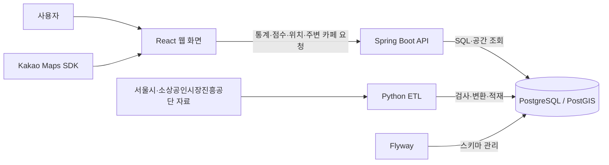

# 여기 창업해도 돼? — RecycleYoungs

## 프로젝트 소개

서울에서 창업을 준비하는 사람들을 위한 공공데이터 기반 MVP 서비스입니다. **현재는 카페 업종만 지원**합니다.

후보 지역의 소비 동향과 주변 경쟁 카페를 함께 살펴보고, 창업을 검토할 때 추가로 확인할 사항을 정리하도록 돕습니다. 지도에서 위치를 탐색하고 상세 근거를 확인한 뒤, 관심 있는 후보지를 최대 3곳까지 비교할 수 있습니다.

## 화면 미리보기

현재 구현된 데스크톱 화면입니다. 이미지를 누르면 원본 크기로 볼 수 있습니다.

| 지도 탐색·검토 요약 | 주변 카페·브랜드 필터 |
| :---: | :---: |
| [](docs/images/map-explore.jpg)<br>지역을 선택하고 소비 신호와 검토 요약을 확인합니다. | [](docs/images/nearby-cafes.jpg)<br>주변 카페의 위치·거리를 살펴보고 추정 브랜드로 목록을 좁힙니다. |
| **상세 분석** | **후보 비교** |
| [](docs/images/detail-analysis.jpg)<br>점수와 소비·점포 그래프로 지역의 변화를 살펴봅니다. | [](docs/images/candidate-comparison.jpg)<br>후보별 소비 신호·주변 카페 수·다음 확인사항을 같은 분기로 비교합니다. |

## 주요 기능

| 기능 | 설명 |
| --- | --- |
| 지도 탐색 | 서울 구·행정동 검색, 서울 외곽선·선택 동 경계 표시, 지점 선택과 행정동·상권 확인 |
| 검토 요약·점수 | 소비규모·소비증감의 100점 상대 점수, 실제 증감 방향과 추가 확인사항 안내 |
| 주변 카페 탐색 | 반경 500m 카페의 상호·직선거리와 밀집 점포 묶음, 11개 브랜드 추정·미식별 필터 제공 |
| 상세 분석 | 검토 근거·점수 설명·선택 분기 수치와 소비·점포 그래프 제공. 정확한 값과 세부지표는 펼쳐 보기 |
| 후보지 비교 | 최대 3곳의 소비 신호·주변 카페 수·확인사항 비교. 같은 행정동의 소비 근거는 공유 표시 |
| 참고 자료·세부 매출 | 지도 요약·비교의 인구 참고, 상세의 인구·시설 종류·상권변화와 카페 세부 매출. 구현·격리 검증 완료, 현재 개발 DB 적용 대기 |

## 프로젝트 한계 · 개선할 점

개선 방향은 후속 검토 과제이며, 자료 확보와 기준 검증을 거쳐 범위를 정합니다.

- **지원 범위:** 현재는 서울·카페만 지원합니다. 다른 지역·업종은 자료와 분류·비교 기준을 검증한 뒤 확장을 검토합니다.

- **창업 판단 근거:** 소비규모·증감 중심이며, 유동인구·시간대 수요·임대료·운영비·계절성은 종합 반영하지 않습니다. 기간·지역 단위를 맞춘 자료를 확충하고 지표·산식을 검증할 계획입니다.

- **분석 범위:** 통계·점수는 행정동 전체 기준이며 선택 지점 반경이나 개별 매장의 성과를 뜻하지 않습니다. 더 세밀한 공간 단위의 자료와 연결할 수 있는지 검토합니다.

- **주변 목록·필터:** 가까운 최대 100개 수신 목록에서만 필터링하며, 반경 전체의 브랜드 구성은 제공하지 않습니다. 전체 목록 조회와 서버 필터·집계 확장을 검토합니다.

- **점포 운영 형태:** 상호로 브랜드를 추정하며 가맹·직영·독립 운영 여부는 확인하지 못했습니다. 점포별 식별 정보·공식 근거·기준일을 확보해 분류를 검증해야 합니다.

- **데이터 시점·품질:** 통계와 점포 자료의 시점이 다르며 기준일·완전성·과거 경계와의 호환성은 미검증입니다. 출처·갱신 시점·경계 호환성을 관리하고 품질 확인을 강화할 계획입니다.

- **통계 갱신 자동화:** 기본 API 개발 환경에서 공식 API 수집·검증·버전 공개와 주간 예약 갱신을 구현했습니다. 최신 지원 분기와 서울 카페 목록을 전수 갱신하고 새 완료 분기를 탐색하며, 이전 분기는 보존합니다. 오래된 분기의 정정 재수집과 운영 알림·보존 정책은 후속 과제입니다.

- **다년도·참고 자료:** 현재 개발 DB의 공개 범위는 2025년 1분기~2026년 2분기입니다. **2021년 1분기~2026년 2분기**의 정상 1,174,306행·명시적 격리2행과 인구·시설·상권변화 참고46,508행을 연결하는 DB·API·화면을 구현하고 새 격리 DB·13개 API·PC/모바일 화면 검증을 마쳤습니다. 지역소비는 품질 사유로 전체 보류하고 아파트는 활용에서 제외합니다. 현재 개발 DB 적용은 별도 작업입니다. 첫 제공 분기의 증감은 이유·현재 거래 건수와 다음 분기 선택으로 안내하며 가상의 점수를 만들지 않습니다. 새 종합점수와 과거 경계 호환성 검증도 남아 있습니다.

- **운영·사용성 검증:** 운영 배포·부하·다양한 실제 기기·포괄적 접근성 검증은 미완료입니다. 배포·성능 기준과 대표 환경의 검증을 단계적으로 준비합니다.

서울시 [행정동 점포 통계 Open API](https://data.seoul.go.kr/dataList/OA-22172/S/1/datasetView.do?tab=A)·[행정동 추정매출 Open API](https://data.seoul.go.kr/dataList/OA-22175/S/1/datasetView.do?tab=A)와 SEMAS 상가정보 API를 사용합니다. 확인한 2025년 통계는 기존 CSV와 전수 일치했고, 개별 점포는 API의 표기 차이를 보존합니다. 다른 기간·업종의 호환성이나 원천의 완전성을 보장하지 않으며, API를 사용해도 공표 주기와 지연은 그대로입니다.

API 응답의 코드·숫자·누락·중복 검사와 적재는 Python ETL이 담당합니다. 과거 버전·원본·검증 이력을 보존합니다. 초기 경계 ZIP은 서울시 공식 HTTPS 주소에서 고정 크기·SHA-256을 확인해 받고, 기존 공개 검증 리포트 3개는 저장소의 바이트 보존 snapshot을 사용합니다. 초기화는 GitHub Release를 다운로드하지 않습니다.

## 사용 흐름

1. **지역·위치 선택:** 구·행정동을 검색해 지역을 살펴보거나 지도에서 실제 지점을 선택합니다. 주변 카페와 후보 추가는 실제 지점을 선택한 뒤 제공됩니다.
2. **요약·주변 확인:** 분석 분기를 정하고 검토 요약·두 점수·주변 카페를 함께 확인합니다.
3. **상세 근거 확인:** 상세 분석에서 소비·점포 흐름과 점수 산정 기준을 읽고, 현장 조사·임대료·운영비 등 추가 확인사항을 정리합니다.
4. **후보 비교:** 관심 지점을 저장하고 비교 창에서 공통 분기를 선택한 뒤 ‘같은 분기로 후보 분석’을 실행합니다.

## 기술 스택

| 영역 | 주요 기술 | 역할 |
| --- | --- | --- |
| Frontend | React, TypeScript, Vite | 지도·통계 화면과 후보지 비교 |
| UI | Tailwind CSS, shadcn/ui | 공통 컴포넌트와 반응형 스타일 |
| 지도 | Kakao Maps JavaScript SDK | 지도 표시, 위치 선택, 마커 |
| Backend | Java 21, Spring Boot, Spring MVC | REST API와 입력 검증 |
| DB 조회 | Spring JDBC / JdbcClient | SQL 조회와 응답 데이터 구성 |
| Database | PostgreSQL, PostGIS | 통계·점포 저장과 위치·거리 계산 |
| 데이터 처리 | Python, pandas, psycopg, Shapely, pyproj, pyshp | 통계·점포·경계 자료의 검사·변환·적재 |
| 개발 환경 | Flyway, Docker Compose | 스키마 관리와 데이터 준비 자동화 |
| 문서·테스트 | Springdoc OpenAPI, JUnit, Vitest, Testing Library, unittest | API 명세와 회귀 검증 |

사람이 읽을 상세 문서의 작성 범위는 [문서 안내](docs/README.md)에서 확인할 수 있습니다.

## 아키텍처



Frontend는 API 호출, 요청 상태, 화면 표시를 나눠 관리하고 API의 소비 지표를 검토 요약으로 설명합니다. Backend는 Controller → Service → Repository 구조로 통계·점수를 제공하고, PostGIS로 행정동·상권 포함 여부와 점포까지의 거리를 계산합니다.

데이터 준비와 사용자 조회는 별도 흐름입니다. ETL이 준비한 데이터를 API가 읽고, 화면은 이를 통계·지도·비교 결과로 보여줍니다.

## 배포 구조

docker compose + AWS EC2 예정, nginx + CI/CD 고려중

기본 `docker-compose.yml`은 개발용 Vite·Backend·API 자료·DB·예약 worker를 준비합니다. 배포용 Frontend 정적 산출물도 소스로 빌드할 수 있으며 nginx·일반 CI/CD·EC2 배포는 데이터·화면·점수 검증 뒤 진행할 계획입니다. 고정 CSV 팀 환경과 별도 API 환경의 Compose·실행 진입점은 퇴역했습니다.

## 데이터와 ETL

ETL은 원본 자료를 읽어 필요한 형식으로 바꾸고 데이터베이스에 저장하는 과정입니다. 이 프로젝트에서는 **지역별 통계**, **개별 점포**, **지역 경계**를 연결해 위치 기반 조회에 사용합니다.

### 사용하는 데이터

| 자료 | 출처·기간 | 서비스에서의 쓰임 |
| --- | --- | --- |
| 행정동 점포 통계 | 서울시 상권분석서비스 API, 확인 기간 2025년 1분기~2026년 2분기 | 점포·개업·폐업·프랜차이즈 수 등 조회 |
| 행정동 추정매출 | 서울시 상권분석서비스 API, 같은 기간 | 추정매출·매출 건수와 분기별 변화 조회 |
| 개별 점포 정보 | SEMAS API, 확인한 응답의 기준년월 202606·서울 카페 | 카페 위치와 반경 500m 내 경쟁 점포 조회 |
| 행정동 경계 | 서울시 행정동 영역 자료 | 선택 좌표가 속하는 행정동 판정 |
| 상권 경계 | 서울시 상권 영역 자료 | 선택 좌표가 포함되는 상권 확인 |

### 데이터·지표 확장 현황

**2026-10-23 기준 22분기 카페 이력과 참고 자료의 수집·검증·저장·조회·화면 연결을 구현하고 격리 환경 검증을 마쳤습니다.** 카페 이력은 2021년 1분기~2026년 2분기 정상 1,174,306행과 승인된 미지원 업종의 격리 2행이며 원본을 보존합니다. 신규 원천은 수집 당시 아파트 포함 7종에서 원문 65,189행을 확보했고, 활용 정책에 따라 5종 46,508행을 참고 자료로 연결했습니다. **현재 개발 DB는 2025년 1분기~2026년 2분기를 제공하며, 확장 자료 적용과 신규 점수 도입은 아직 진행하지 않았습니다.**

- **참고 자료 연결:** 길단위인구·상주인구·직장인구·시설 종류별 개수·상권변화를 DB와 조회 API에 연결했습니다. 지도 요약·후보 비교에는 인구 요약을, 상세에는 원천별 원값·출처·기간·단위·한계를 표시합니다. 기존 카페 매출의 주중·주말·요일·시간대·성별·연령대 구성도 상세 화면에 연결했습니다. 현재 개발 환경에서의 제공은 확장 자료 적용 후 확인합니다.
- **활용 제외·보류:** 아파트 자료와 아파트 구분 가구 항목은 제외합니다. 지역 소비 통계는 음수6행·갱신 설명 충돌로 전체 보류하고, 기존 카페 매출·거래 자료는 계속 활용합니다. 시설 총수도 정의 확인 전 제공하지 않습니다.
- **참고 정보 후보:** 대중교통 위치·승하차, 주차장, 관광·행사, 공식 임대료·공실 통계. 제공 공간·시점과 별도 이용신청을 확인한 뒤 연결합니다.
- **보류:** 제공이 중단된 소득 항목, 개별 점포의 실제 임대료·운영비, 확인되지 않은 운영 형태. 자료가 없는 값을 추정해 채우지 않습니다.

자료마다 출처·실제 기준기간·집계 단위·결측을 표시합니다. 연간 값의 분기 반복이나 행정동 전체 값을 후보 반경의 값으로 해석하지 않습니다. 점수는 같은 조건의 자료로 산식·가중치·민감도를 검증한 뒤 도입하며 창업 성공률을 뜻하지 않습니다.

직장인구의 동 범위 부족, 소비 자료의 갱신 안내와 실제 값 차이, 인구·시설 집계 차이는 보정하지 않습니다. DB·API·화면에서 동/분기 자료 없음·실제 0·원천 NULL·품질보류를 구분하며, 신규 자료의 점수 사용은 후속 검증 전 보류합니다.

후속 작업은 **현재 개발 환경 적용 → 실제 갱신·복구 검증 → 추가 자료·점수 검증 → nginx·CI/CD·배포** 순서로 진행하며, 프론트엔드 구조·실제 지도·다양한 기기·접근성 검증도 보강합니다. 일정은 완성도를 우선해 재산정합니다.

### 처리 흐름

1. **자료 확보:** 공식 API를 페이지 단위로 수집하고 원본·수집 이력을 비공개 저장합니다. 경계는 초기 준비 때 별도로 검증합니다.
2. **검사:** 필수 항목·건수·중복·누락·숫자·좌표와 이전 공개 기간의 보존을 확인합니다.
3. **버전 적재·공개:** 새 버전을 적재·검증한 뒤 공개 포인터를 전환합니다. 실패하면 기존 공개 자료를 유지합니다.
4. **조회 연결:** 같은 공개 버전의 통계·점포를 조회하며 기준년월·수집 시각을 표시합니다. 조회 도중 버전이 바뀌면 새 목록 확인을 안내합니다.

경계 자료는 원본과 서비스 조회에 사용하는 경계를 구분해 보존합니다. 여러 행정동이 겹치는 위치는 임의로 한 곳을 선택하지 않고 모호성을 표시합니다.

과거 수동 CSV 입력의 파일·검사 기록은 [manifest](data/manifest.json)에 보존합니다. 현재 초기화는 해당 CSV 묶음을 사용하지 않습니다. API 수집·정규화 계약은 에이전트용 [기술 명세](docs/agents/technical.md#공공-api-전환-준비)에서 관리합니다.

### 원본 이용조건과 공개 고지

| 자료 | 공식 출처 | 이용조건 |
| --- | --- | --- |
| 행정동 점포 통계 | [서울시 OA-22172](https://data.seoul.go.kr/dataList/OA-22172/S/1/datasetView.do) | 공공누리 제1유형 |
| 행정동 추정매출 | [서울시 OA-22175](https://data.seoul.go.kr/dataList/OA-22175/S/1/datasetView.do) | 공공누리 제1유형 |
| 개별 점포 정보 | [소상공인시장진흥공단 상가(상권)정보](https://www.data.go.kr/data/15083033/fileData.do) | 이용허락범위 제한 없음 |
| 행정동 경계 | [서울시 OA-22160](https://data.seoul.go.kr/dataList/OA-22160/S/1/datasetView.do) | 공공누리 제1유형 |
| 상권 경계 | [서울시 OA-15560](https://data.seoul.go.kr/dataList/OA-15560/S/1/datasetView.do) | 공공누리 제1유형 |

서울시 자료는 [공공누리 제1유형](https://www.kogl.or.kr/info/licenseType1.do)의 출처표시 조건을 따릅니다. 개별 점포 자료에는 공개된 점포명·주소·좌표가 포함됩니다.

경계 검증·품질·보정 리포트 3개에는 프로젝트가 보유·관리하는 권리 범위에서 [CC BY 4.0](https://creativecommons.org/licenses/by/4.0/)을 적용합니다. 출처표시명은 **RecycleYoungs 프로젝트**이며, 재사용 시 출처·라이선스·변경 사항을 표시해야 합니다. 이 조건은 서울시·소상공인시장진흥공단 원본이나 제3자의 권리를 변경하지 않습니다. [공개 리포트 snapshot](data/boundaries/public-reports.json)은 과거 공개 고지와 리포트 원본 바이트를 보존합니다. gzip/base64는 저장 표현만 바꾸며 새 검증 결과를 만들거나 원본 geometry를 보정하지 않습니다.

## 프로젝트 구조

```text
RecycleYoungs/
├── frontend/           # React 화면·API client·상태 관리
├── backend/            # Spring Boot API·SQL 조회
│   └── src/main/resources/db/migration/  # Flyway 스키마
├── etl/                # Python 데이터 검사·변환·적재
├── data/               # 데이터 목록·경계 공개 리포트 snapshot
├── docker/             # 개발 환경과 데이터 준비 자동화
├── docker-compose.yml  # API 데이터·DB·Backend·Frontend 자동 준비
└── docs/               # 사람이 읽을 문서
    ├── README.md       # 문서 안내·작성 예정 범위
    ├── images/         # 실제 서비스 화면 미리보기
    └── agents/         # 에이전트용 작업 기준·구현 계약·검증 기록
```

DB 스키마의 기준은 [Flyway SQL](backend/src/main/resources/db/migration/)입니다.

## 실행 방법

Docker Engine/Desktop(API 1.49 이상)·Buildx·Compose 2.24.4 이상을 준비합니다. PostGIS는 Linux amd64로 고정하므로 ARM Mac은 amd64 실행 지원이 필요합니다. Java·Node·Python 의존성과 앱은 컨테이너에서 빌드합니다.

### 최초 설정

`etl/api.env`가 없을 때만 빈 양식을 복사합니다. 기존 파일의 키는 유지합니다.

```sh
test -e etl/api.env || cp etl/api.env.example etl/api.env
chmod 600 etl/api.env
```

`SEOUL_OPENAPI_KEY`에 서울 일반 인증키, `SEMAS_SERVICE_KEY`에 공공데이터포털 **Decoding** 키를 입력합니다. 이 파일은 Git·이미지에서 제외됩니다.

지도는 `frontend/.env.local.example`을 `frontend/.env.local`로 복사하고 `VITE_KAKAO_MAP_APP_KEY`를 설정합니다. 기존 파일은 덮어쓰지 않습니다. Kakao Developers에 `http://localhost:5173` 웹 도메인을 등록합니다. 지도 키가 없어도 앱·API는 시작하지만 지도는 표시되지 않습니다.

### 시작

```sh
docker compose up -d
```

이미지 빌드 → 사전 검사 → 새 DB 준비 → identity 확인 → migration → API 최초 수집·경계 적재 → Backend·Frontend → 주간 worker가 자동으로 연결됩니다. 최초 실행은 외부 이미지·패키지·공식 API를 받아 시간이 걸립니다. 완료 후 [http://localhost:5173](http://localhost:5173), API 문서는 [http://localhost:5173/api/docs](http://localhost:5173/api/docs)입니다. Frontend `src` 변경은 바로 반영되고, Backend·의존성·설정 변경은 같은 명령으로 재빌드합니다.

현재 수집 가능한 완료 분기를 2025년 1분기부터 순서대로 확인합니다. 서울 점포·매출은 프로젝트에서 선택한 공식 **HTTP** 주소를 사용하므로 키가 암호화되지 않은 요청 URL에 포함됩니다. SEMAS는 HTTPS입니다. HTTP를 허용하지 않을 때는 시작 전에 `DEV_ALLOW_SEOUL_HTTP=false`를 명시합니다. HTTPS 실패를 HTTP로 자동 우회하지 않습니다.

기본 환경의 project는 `recycleyoungs-dev`이며 DB·원본·제어 기록·역할별 secret을 전용 Docker 볼륨에 보존합니다. DB 포트는 호스트에 공개하지 않습니다. 퇴역한 별도 API·팀 환경의 target을 채택하지 않습니다. 재실행은 기존 공개 자료를 검증하며 migration·최초 수집을 반복하지 않습니다. 기존 볼륨의 SQL binding과 현재 소스가 다르면 자동 전환하지 않으므로, V5·22분기 적용은 별도 승인된 전환 절차를 따릅니다.

### 상태·갱신·실패 확인

```sh
docker compose ps -a
make dev-status
```

`preflight`, `identity`, `migrate`, `initialize`의 `Exited (0)`는 정상 종료입니다. Backend·Frontend·DB는 healthy, scheduler·inspect-proxy는 실행 상태여야 합니다. `dev-status`는 실제 DB를 읽기 전용 조회합니다.

| 명령 | 영향 |
| --- | --- |
| `make dev-refresh` | 실제 API 수집·검증·적재 후 새 버전 공개 |
| `make dev-reconcile` | 실패 원인 확인 후 현재 공개 자료·원본을 검증하고 다음 예약 허용 |
| `docker compose stop` | 이 기본 개발 환경 중지, 볼륨 보존 |
| `docker compose logs --tail=30 preflight identity migrate initialize api-scheduler` | 준비·작업 상태 확인 |

worker는 Docker가 실행 중일 때 매주 월요일 04:30 한국 시간에 최신 지원 분기와 카페를 갱신합니다. 이전 분기를 보존하고 동시 실행을 차단합니다. 갱신 실패는 기존 공개 버전을 유지하며 자동 재수집하지 않습니다. 초기화 중단·identity/스키마 불일치도 자동 복구하지 않으므로 로그를 확인합니다. 볼륨 삭제·`down -v`·secret/제어 파일 수동 수정은 복구 절차가 아닙니다. API 키 교체와 schema 변경 시 기존 환경의 전환 절차는 별도 검토합니다.

### 퇴역 환경 정리 상태

고정 CSV 팀 환경·별도 API 환경의 Compose와 전용 초기화·실행·백업 명령, 팀 reader profile 및 과거 전용 E2E workflow를 소스에서 제거했습니다. `make api-images`는 DB에 접속하지 않는 공통 이미지 빌드 도구로 남습니다. 일반 `bootRun`은 퇴역한 팀 DB로 연결하지 않고 중단합니다.

2026-10-23 새 백업·DB 3개의 독립 복원 검증과 원격 소스 반영을 확인한 뒤, 레거시·검증용 컨테이너 19개·볼륨 9개·네트워크 9개와 GitHub Release·asset을 삭제했습니다. 현행 `recycleyoungs-dev`의 컨테이너 9개·볼륨 5개·네트워크 3개는 유지했고, 백업·수집 원본·제어·인증 자료·검증 증거·Git 태그·공유 이미지는 보존했습니다. 백업은 프로젝트 밖 비공개 위치에 있으며, [현재 상태](docs/agents/project.md#레거시-개발-환경-정리)에 검증·정리 결과를 기록합니다. 현재 개발 DB의 V5·22분기 적용은 이 정리에 포함하지 않았습니다.

## 검증과 현재 범위

Backend·Frontend·ETL의 회귀 테스트를 갖추고 있습니다. 2026-10-21 새 영속 API 환경에서 실자료 적재·예약 갱신·실패와 중단 차단·DB 재시작을 확인했습니다. 갱신 후 DB를 독립 복원해 19개 테이블·680,601행의 값·geometry·이력·권한·sequence를 대조했습니다. 실제 HTTP와 테스트 지도 SDK로 여섯 분기·3후보·모바일 화면도 확인했습니다. 실제 Kakao 인증·타일과 운영 서버 검증은 별도로 남아 있습니다.

2026-10-22에는 소스 이미지 빌드와 새 기본 Compose의 실제 DB 초기화·API 수집·여섯 분기 HTTP 조회를 확인했습니다. 같은 명령의 재실행은 migration·최초 수집을 생략했고 새 DB 재시작 뒤에도 identity·공개 버전을 유지했습니다. 별도 PC·EC2의 전체 가동과 운영 배포는 아직 확인하지 않았습니다.

2026-10-23에는 레거시 경로를 제거한 소스로 일반 테스트·Frontend build/lint와 공식 경계·공개 리포트 재현 검증을 통과했습니다. 새 격리 Compose에서 V1~V5·공식 API 최초 수집·여섯 분기 HTTP 조회와 준비 완료 후 재실행 시 최초 수집 생략·공개 버전 보존을 확인했습니다. 검증 환경은 중지했고 원본·볼륨은 보존했습니다. 이는 22분기 확장 자료의 현재 개발 DB 적용이나 전환 후 실제 주간 갱신·복구 검증을 대신하지 않습니다.

현재 구현은 서울·카페 중심의 탐색·검토·비교 MVP입니다. 미지원 기능과 개선 방향은 [프로젝트 한계 · 개선할 점](#프로젝트-한계--개선할-점)에 정리했습니다. 종합 입지점수와 운영 배포·자동 배포는 아직 제공하지 않습니다.

개발·배포 상세 안내는 [문서 안내](docs/README.md)의 범위에 따라 별도로 작성할 예정입니다. 과거 테스트·시연 기록은 현재 환경의 정상 가동이나 운영 준비 완료를 보장하지 않습니다.

## 데이터 해석 시 유의사항

- 서비스는 창업 성공·수익·폐업을 예측하거나 보장하지 않습니다.
- **소비규모 점수**는 추정매출 자료의 거래 건수를 같은 분기 서울 행정동과 비교한 상대 순위입니다. **소비증감 점수**는 전분기 대비 거래 건수 변화율의 상대 순위입니다. 증감점수가 높아도 실제 거래가 감소할 수 있으므로 증감률·방향을 함께 봐야 합니다. 두 점수는 종합 입지점수나 성공 확률이 아닙니다.
- 주변 카페는 **선택 지점 반경 500m**, 점포·매출 통계와 점수는 **행정동 전체**를 기준으로 합니다. 같은 동의 후보는 소비 근거를 공유합니다. 행정동 추정매출은 후보 반경의 매출이나 개별 가게의 이익을 뜻하지 않습니다.
- 반경 전체 조회 수와 가까운 **최대 100개 수신 목록**은 다를 수 있습니다. 종류·브랜드 필터는 받은 목록 안에서만 적용합니다. 브랜드는 상호명으로 추정하며, 미식별 점포를 개인 카페로 확정하거나 브랜드 점포를 가맹점으로 단정하지 않습니다.
- 분기 통계와 점포 snapshot은 시점과 집계 단위가 다릅니다. 현재 확인한 점포 기준년월은 202606이며 정확한 관측일·완전성은 미확인입니다. 수집 시각을 관측일로 바꾸거나 자료 누락을 폐업으로 판단하지 않습니다.
- 현재 경계가 2025년 통계 당시 경계와 같은지는 확인되지 않았습니다. 원본 경계의 겹침과 홍지문 상권의 속성 충돌도 품질 정보로 표시합니다.
- 값이 없는 경우와 실제 0을 구분해 표시합니다.

## 관련 문서

| 문서 | 내용 |
| --- | --- |
| [문서 안내](docs/README.md) | 사람이 읽을 문서의 진입점과 작성 예정 범위 |
