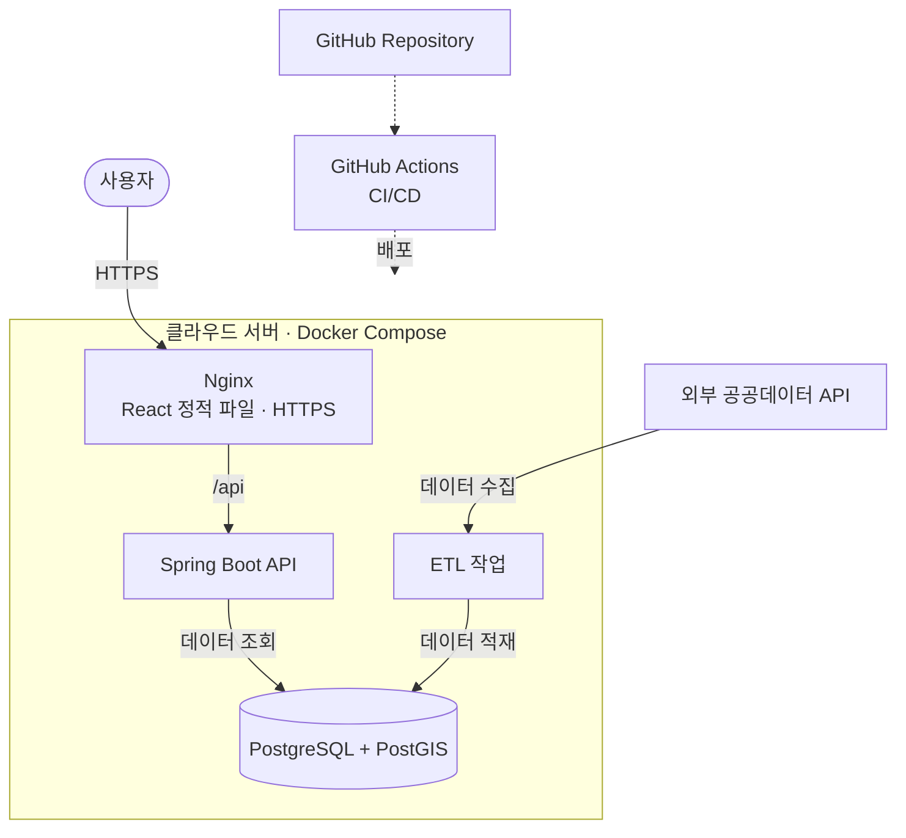

# 여기 창업해도 돼? - RecycleYoungs

## 프로젝트 소개

서울에서 창업을 준비하는 사람들을 위한 공공데이터 기반 MVP 서비스입니다. **현재는 카페 업종만 지원**합니다.

사용자가 관심 지역의 상권 데이터를 탐색하고, 자체 평가 알고리즘으로 산출한 창업 환경 점수를 확인하며, 여러 후보지를 비교할 수 있도록 하는 것을 목표로 합니다.

복잡한 상권 통계를 처음부터 모두 보여주기보다, **100점 만점의 창업 환경 점수를 먼저 제공하고 사용자가 원하는 경우 세부 분석 근거를 확인할 수 있도록** 구성할 예정입니다.

창업 환경 점수는 실제 창업 성공 확률이나 예상 수익을 의미하지 않으며, 창업 후보지를 검토할 때 참고할 수 있는 자체 평가 지표입니다.

## 화면 미리보기

현재 프로젝트는 초기 설계 단계로, 실제 서비스 화면은 아직 구현되지 않았습니다.

향후 메인 페이지, 지도 기반 상권 탐색 화면, 창업 환경 점수 및 상세 분석 화면, 후보지 비교 화면을 개발한 후 스크린샷이나 시연 이미지를 추가할 예정입니다.

## 주요 기능

아래는 현재 계획 중인 기능이며, 실제 구현 범위와 우선순위는 데이터 연동 및 개발 과정에서 조정할 수 있습니다.

### MVP 핵심 기능

| 기능                | 설명                                                                            |
| ------------------- | ------------------------------------------------------------------------------- |
| 서비스 소개         | 스크롤 기반 애니메이션과 화면 미리보기를 활용해 서비스 이용 과정을 안내         |
| 지역 및 장소 검색   | 서울시 내 구·행정동 필터와 지하철역·장소명·주소 검색 지원                       |
| 지도 기반 상권 탐색 | 지도에서 지역 경계와 카페 위치를 확인하고 관심 위치를 탐색                      |
| 자치구 선택         | 장소 주변 탐색 범위가 여러 구에 걸치는 경우 개별 자치구 또는 `모두` 선택        |
| 탐색 조건 설정      | 행정구역·위치 주변 반경·분석 기간·관심 지표 등 조회 조건 설정                   |
| 창업 환경 점수      | 공공데이터를 활용한 자체 알고리즘으로 구·행정동별 100점 만점의 평가 점수 제공   |
| 점수 산출 근거      | 평가 항목별 점수, 가중치, 사용 지표, 데이터 출처 및 기준 시점 확인              |
| 상권 상세 분석      | 점포 현황, 추정매출, 유동인구, 개업·폐업 현황 등의 통계 제공                    |
| 주변 경쟁 카페 조회 | 선택 위치 주변의 기존 카페 위치와 분포 확인                                     |
| 창업 후보지 지정    | 지도에서 관심 지점을 선택하고 분석·비교 대상으로 추가                           |
| 후보지 비교         | 여러 후보지의 주변 카페 정보와 행정구역별 창업 환경 점수를 동일한 기준에서 비교 |

### 추후 도입 검토 기능

- **최근 탐색 기록:** 사용자가 이전에 조회한 지역이나 위치를 다시 확인
- **관심 후보지 저장:** 창업 후보지를 저장하고 이후 다시 확인
- **회원 기능:** 필요한 경우 개인별 후보지 저장과 관리 기능 제공
- **추가 데이터 분석:** 상주인구, 직장인구, 집객시설, 지하철 이용량 등 활용 범위 확대
- **개별 위치 평가 점수:** 충분한 위치 기반 데이터와 검증 기준이 확보되면 후보지별 반경 단위 점수 검토
- **분석 결과 공유:** 선택한 지역이나 후보지의 분석 결과를 다른 사람과 공유하는 기능 검토

추후 검토 기능은 MVP의 필수 구현 범위에 포함하지 않으며, 핵심 기능의 구현과 검증을 우선합니다.

## 사용 흐름

아래는 현재 구상 중인 서비스 이용 흐름이며, 실제 기능과 화면 구성은 개발 과정에서 변경될 수 있습니다.

### 메인 페이지

메인 페이지에서는 서비스의 목적과 주요 기능을 소개하고, 사용자가 상권 탐색을 시작할 수 있도록 안내합니다.

1. **서비스 소개**
   - 공공데이터를 활용한 카페 창업 상권 분석 서비스의 목적과 주요 특징을 소개합니다.
   - 지도 기반 탐색 화면과 창업 환경 점수의 미리보기를 제공합니다.
   - `시작하기` 버튼을 통해 탐색 페이지로 이동할 수 있도록 합니다.

2. **주요 이용 과정 안내**
   - 스크롤에 따라 서비스 이용 과정을 단계별로 소개합니다.
   - 각 단계에는 간단한 설명과 실제 서비스 화면의 미리보기를 함께 제공합니다.
   - 소개할 주요 과정은 다음과 같습니다.
     1. **관심 지역 탐색:** 서울 지도에서 구·행정동을 선택하거나 역명·장소명 등을 검색해 관심 지역을 찾아봅니다.
     2. **창업 환경 점수 확인:** 해당 지역의 공공데이터를 바탕으로 산출한 100점 만점의 창업 환경 점수를 확인합니다.
     3. **상권 상세 분석:** 점수 산출 근거와 점포 현황, 추정매출, 유동인구, 주변 경쟁 카페 등의 정보를 살펴봅니다.
     4. **후보지 비교:** 관심 있는 후보지의 주요 지표를 비교하고 추가로 확인할 사항을 살펴봅니다.

3. **상권 탐색 시작**
   - 주요 이용 과정 안내가 끝나면 실제 탐색을 시작하도록 안내합니다.
   - `시작하기` 버튼을 통해 탐색 페이지로 이동합니다.

메인 페이지는 스크롤 기반 애니메이션과 단계별 화면 전환을 활용해 서비스 이용 과정을 자연스럽게 전달하는 방향으로 구성할 예정입니다.

### 탐색 페이지

탐색 페이지에서는 서울 지도를 중심으로 관심 지역을 찾고, 관련 공공데이터와 자체 평가 알고리즘을 활용해 카페 창업 환경을 분석·비교합니다.

#### 1. 지역 및 위치 탐색

탐색 대상 지역은 **서울특별시로 고정**하며, 행정구역 탐색과 장소 주변 탐색을 구분하여 제공합니다.

**행정구역 탐색**

- 지역 필터는 `서울시 → 구 → 동` 순서로 구성합니다.
  - **시·도:** 서울특별시 고정
  - **구:** 전체 또는 특정 자치구 선택
  - **동:** 전체 또는 선택한 구에 속한 행정동 선택
- 특정 구를 선택하면 해당 구의 행정동 목록을 제공합니다.
- 동 필터의 `전체`는 선택한 구에 속한 전체 행정동을 의미합니다.
- 행정구역을 선택하면 해당 구 또는 행정동을 기준으로 지도와 상권 정보를 표시합니다.
- 지도 이동 및 확대·축소를 통해 관심 지역을 자유롭게 살펴볼 수 있습니다.

**장소 주변 탐색**

- 검색창에서 지하철역, 주요 장소, 주소, 구·행정동 이름 등의 키워드 검색을 지원합니다.
- 장소를 검색하면 해당 위치로 지도를 이동하고 설정된 탐색 범위를 표시합니다.
- 장소 검색으로 이동한 위치가 기존 지역 필터와 다르더라도 기존 필터를 즉시 변경하지 않습니다.
- 검색 위치의 탐색 범위와 겹치는 서울시 자치구를 확인합니다.
  - 하나의 자치구만 포함되면 해당 자치구를 안내합니다.
  - 여러 자치구가 포함되면 사용자가 분석할 자치구를 직접 선택하도록 합니다.
- 예를 들어 `염창역 9호선`을 검색했을 때 탐색 범위에 강서구와 양천구가 포함된다면 `강서구 / 양천구 / 모두` 중 선택할 수 있습니다.
- 3개 이상의 자치구가 포함되는 경우에도 각 자치구와 `모두` 선택지를 제공합니다.
- **`모두`는 검색 위치의 탐색 범위와 겹치는 모든 자치구를 선택한다는 의미**이며, 해당 자치구 전체로 주변 탐색 반경을 확장하는 것은 아닙니다.
- 사용자가 자치구 선택을 확정하면 관련 구·동 필터와 분석 정보를 갱신하고, 검색한 장소의 위치는 유지합니다.
- 여러 자치구가 선택되면 관련 행정동을 자치구별로 구분하여 제공합니다.

#### 2. 탐색 범위 및 조건 설정

- 사용자가 선택한 행정구역 전체를 탐색하는 방식과 특정 위치 주변을 탐색하는 방식을 구분합니다.
- 장소 주변 탐색은 기본 반경을 500m로 시작하고, 1km까지 변경할 수 있도록 검토합니다.
- 장소 주변 탐색에서 특정 자치구를 선택한 경우, **설정된 반경과 선택한 자치구가 겹치는 영역**을 위치 기반 조회 대상으로 사용합니다.
  - 예: `염창역 → 반경 500m → 강서구`를 선택하면 염창역 반경 500m 중 강서구에 속하는 영역의 주변 카페를 조회합니다.
  - `모두`를 선택하면 해당 반경 내에서 확인된 모든 서울시 자치구의 관련 위치 정보를 조회합니다.
- 분석 기간과 관심 지표 등 필요한 조건을 설정합니다.
- 행정구역 단위의 통계와 특정 위치 주변에서 조회한 데이터를 구분하여 제공합니다.
- 지도를 이동하거나 확대·축소하더라도 적용된 분석 조건은 유지합니다.
- 필요한 경우 `이 지역에서 다시 검색` 기능으로 현재 지도 위치를 기준으로 탐색할 수 있도록 검토합니다.

#### 3. 창업 환경 점수 확인

사용자가 분석할 구 또는 행정동을 선택하면 해당 지역의 주요 공공데이터를 바탕으로 **100점 만점의 카페 창업 환경 점수**를 제공합니다.

**점수 표시 방식**

- 상세 통계보다 창업 환경 점수를 먼저 표시해 사용자가 해당 지역의 전반적인 특성을 빠르게 파악할 수 있도록 합니다.
- 점수는 `0~100점` 범위로 표시하며, 지역명과 평가 기준 지역을 함께 안내합니다.
- 예를 들어 염창역 검색 후 강서구를 선택했다면 다음과 같이 표시합니다.

  **강서구의 카페 창업 환경 점수는 70/100 (예시)**

- 위 점수는 화면 구성 설명을 위한 예시이며, 실제 점수는 데이터 확보 및 평가 알고리즘 구현 후 산출합니다.
- 구를 선택하면 해당 자치구 전체의 데이터를 기준으로 점수를 계산하고, 행정동을 선택하면 해당 행정동의 데이터를 기준으로 계산합니다.
- 여러 자치구를 선택하거나 `모두`를 선택한 경우에는 각 자치구의 점수를 개별적으로 표시합니다. 서로 다른 지역의 점수를 임의로 합산하여 하나의 점수로 만들지 않습니다.

**점수 평가 범위**

- 창업 환경 점수는 구 또는 행정동 등 명시된 행정구역을 기준으로 산출합니다.
- 장소 검색 시 사용하는 탐색 반경과 창업 환경 점수의 평가 범위는 별도로 관리합니다.
- 결과 화면에는 **점수 평가 범위**와 **주변 탐색 범위**를 함께 표시합니다.
- 예를 들어 `염창역 → 반경 500m → 강서구`를 선택한 경우 다음과 같이 구분합니다.
  - **창업 환경 점수:** 강서구 전체의 공공데이터를 기준으로 산출한 점수
  - **주변 탐색 정보:** 염창역 반경 500m 중 강서구에 속하는 영역의 위치 기반 데이터
- 따라서 강서구 전체의 점수를 염창역 주변 500m만을 평가한 점수처럼 표현하지 않습니다.
- 행정동을 선택한 경우에는 해당 행정동 전체를 기준으로 산출한 점수임을 명시합니다.
- 서로 다른 집계 단위인 구와 행정동의 점수를 동일한 기준의 점수처럼 직접 비교하지 않도록 안내합니다.

**점수 조회 상태 및 예외 처리**

- **초기 진입:** 분석 대상이 선택되지 않았다면 구 또는 행정동을 선택하도록 안내하고, 임의의 기본 점수는 표시하지 않습니다.
- **조회 및 계산 중:** 점수 데이터를 불러오거나 계산하는 동안 로딩 상태를 표시합니다.
- **조회 완료:** 지역명, 평가 범위, 최종 점수를 우선 표시합니다.
- **데이터 부족:** 점수 산출에 필요한 데이터가 충분하지 않다면 `산출 불가` 상태와 사유를 안내합니다.
- **조회 실패:** API 오류 등으로 결과를 불러오지 못한 경우 오류 메시지와 다시 시도할 수 있는 기능을 제공합니다.
- 실제 데이터가 없거나 계산할 수 없는 상황에서 임의의 점수를 생성하지 않습니다.

**점수 산출 방식**

- 카페 수, 추정매출, 유동인구, 개업·폐업 현황 등 확보한 공공데이터를 활용하여 자체 평가 알고리즘을 설계합니다.
- 지표별 특성과 방향성을 고려해 정규화 및 가중치를 적용하고, 최종 점수를 100점 만점으로 환산합니다.
- 주요 평가 항목은 다음과 같이 검토합니다.
  - **소비 및 상권 수요:** 추정매출, 유동인구 등의 지표
  - **경쟁 환경:** 카페 수와 밀집도 등 경쟁 점포 관련 지표
  - **상권 변화 및 안정성:** 개업·폐업 현황과 지역 변화 관련 지표
- 단순히 유동인구가 많거나 카페 수가 적다는 이유만으로 높은 점수를 부여하지 않고, 지표 간 관계를 함께 고려합니다.
- 구와 행정동은 규모와 특성이 다르므로 각각의 비교 기준을 설계하며, 서로 다른 집계 단위의 점수를 직접 비교하지 않도록 합니다.
- 행정동 단위 자료를 이용해 구 단위 점수를 산출해야 하는 경우에는 지표별 집계 가능 여부와 산출 방법을 별도로 검증합니다.
- 평가 항목, 가중치, 정규화 방식 및 점수 구간은 실제 데이터의 품질과 분포를 확인한 뒤 확정합니다.
- 점수 계산에 필요한 데이터가 부족하거나 기준이 맞지 않으면 임의의 점수를 생성하지 않고 `산출 불가` 또는 데이터 부족 상태를 안내합니다.

**점수 산출 근거 확인**

- 기본 화면에서는 지역명과 최종 점수를 중심으로 간결하게 표시합니다.
- 사용자가 `점수 산출 근거 보기` 또는 `더보기`를 선택하면 상세 분석 정보를 펼쳐서 확인할 수 있도록 합니다.
- 상세 정보에는 다음 내용을 제공합니다.
  - 평가 항목별 점수 및 반영 비중
  - 실제 계산에 사용된 주요 공공데이터 지표
  - 지역별 특징과 점수에 영향을 준 주요 요인
  - 데이터 출처 및 기준 시점
  - 적용된 평가 알고리즘의 기준과 한계
- 사용자가 점수를 맹목적으로 신뢰하지 않고 직접 분석 근거를 확인할 수 있도록 합니다.

**점수 해석 시 유의사항**

창업 환경 점수는 공공데이터를 기반으로 자체 산출한 상대적 평가 지표입니다. 실제 창업 성공 확률이나 예상 수익을 의미하지 않으며, 임대료·입지의 세부 조건·운영 역량 등 반영되지 않은 요인이 존재할 수 있습니다.

#### 4. 지도에서 관심 대상 선택

- 지도에서 기존 카페의 위치와 분포를 확인합니다.
- 카페 마커를 선택하면 상호명, 위치, 업종 등 확인 가능한 기본 정보를 제공합니다.
- 마우스 호버 시 간단한 정보를 미리 표시하고, 클릭 또는 터치 시 상세 정보를 확인할 수 있도록 구성합니다.
- 지도에서 사용자가 직접 관심 지점을 선택해 창업 후보지로 지정할 수 있도록 합니다.
- **창업 후보지는 실제 입점 가능한 상가 매물이 아니라, 주변 상권을 분석하고 비교하기 위해 사용자가 지정한 관심 위치**로 정의합니다.
- 실제 입점 가능 여부, 임대 조건 및 영업 관련 요건은 별도로 확인해야 함을 안내합니다.
- 기존 카페를 선택한 경우와 창업 후보지를 선택한 경우를 구분하여 관련 정보를 제공합니다.
- 선택한 대상에 따라 상세 정보 패널을 열고, 지도를 유지한 상태에서 정보를 확인할 수 있도록 합니다.

#### 5. 상권 상세 분석

- 창업 환경 점수의 산출 근거와 관련 상권 데이터를 확인합니다.
- 선택한 지역의 점포 수, 개업·폐업 현황, 추정매출, 유동인구 등을 살펴봅니다.
- 주변 경쟁 카페의 위치와 분포를 지도 및 목록으로 확인합니다.
- 기간별 변화 추이와 주요 지표를 차트 및 표로 제공합니다.
- 상세 분석 정보는 집계 범위에 따라 구분합니다.
  - **선택 위치 주변 정보:** 설정된 반경 내 경쟁 카페의 위치와 수 등 위치 기반으로 조회할 수 있는 정보
  - **행정구역 단위 통계:** 선택한 구 또는 행정동 전체를 기준으로 집계된 점포 현황, 추정매출, 유동인구 등
- 장소 주변 탐색에서 자치구를 선택한 경우, 위치 기반 데이터는 해당 자치구와 탐색 반경이 겹치는 영역을 기준으로 조회합니다.
- 행정동 단위 통계는 탐색 반경과 겹치는 행정동의 전체 집계값을 참고 정보로 제공하며, 반경 내 실제 통계로 해석하지 않도록 표시합니다.
- 여러 자치구가 포함되면 지역별 통계를 구분하여 확인할 수 있도록 합니다.
- 각 데이터의 출처, 기준 시점, 집계 단위 및 점수 산출 기준을 함께 표시합니다.
- 데이터가 제공되지 않는 경우 실제 값이 `0`인 경우와 구분하여 안내합니다.

#### 6. 창업 후보지 비교

- 사용자가 선택한 관심 위치를 창업 후보지로 추가합니다.
- 여러 후보지의 주변 경쟁 카페, 점포 현황, 추정매출, 유동인구 등 주요 지표를 비교합니다.
- 후보지가 속한 구·행정동의 창업 환경 점수도 함께 확인할 수 있도록 합니다.
- 후보지별 반경 내 위치 기반 정보와 행정구역 단위 통계를 구분하여 비교합니다.
- 동일한 기준 기간과 집계 단위에서 비교할 수 있도록 안내합니다.
- 구 단위와 행정동 단위 점수는 평가 기준이 다를 수 있으므로 직접적인 우열 비교를 피합니다.
- 같은 행정동에 속한 후보지는 동일한 행정동 통계를 공유할 수 있지만, 각 위치 주변의 경쟁 카페 수와 분포는 다를 수 있음을 안내합니다.
- 데이터가 없거나 기준 시점이 다른 경우 해당 내용을 명확하게 표시합니다.
- 비교 결과를 통해 후보지별 특징을 파악하고, 창업 전 추가로 조사할 사항을 확인합니다.

**후보지 점수와 지역 점수의 구분**

- MVP에서는 개별 창업 후보지의 위치 자체에 별도의 100점 점수를 부여하지 않습니다.
- 후보지에 표시되는 창업 환경 점수는 **해당 후보지가 속한 구 또는 행정동의 평가 점수**입니다.
- 동일한 행정동에 있는 두 후보지는 같은 행정동 점수를 공유할 수 있습니다.
- 다만 각 후보지의 위치와 탐색 반경에 따라 주변 경쟁 카페 수와 분포 등의 위치 기반 정보는 달라질 수 있습니다.
- 비교 화면에서는 점수의 평가 단위를 명확히 표시하여 지역 점수를 특정 지점의 독립적인 점수로 오해하지 않도록 합니다.
- 추후 충분한 위치 기반 데이터와 검증 기준이 확보되면 개별 후보지의 반경 단위 평가 점수를 별도로 도입하는 방안을 검토합니다.

**탐색 화면 구성**

탐색 페이지는 전체 화면 지도를 중심으로 검색·필터와 확장 가능한 상세 정보 패널을 배치하는 방향으로 구성할 예정입니다.

지역 선택 후에는 창업 환경 점수를 우선적으로 표시하고, 사용자가 원하는 경우에만 점수 산출 근거와 세부 상권 데이터를 확장하여 확인할 수 있도록 합니다.

**검색 및 데이터 이용 시 유의사항**

- 서울특별시 외 지역을 검색한 경우 서비스 지원 범위를 안내하고, 서울 외 지역에 대한 상권 분석은 제공하지 않습니다.
- 검색 위치의 탐색 반경이 서울 외 지역까지 걸치면 서울특별시 내부만 분석 대상으로 포함합니다.
- 행정동별 추정매출·인구·점포 통계와 개별 카페의 위치 정보는 집계 범위가 다릅니다.
- 특정 위치 주변에 여러 행정구역이 포함되더라도 행정동 전체의 통계를 해당 위치 주변의 실제 수치로 해석하거나 단순 합산하지 않습니다.
- 서로 다른 기준 시점이나 집계 단위의 데이터를 비교할 때에는 한계를 안내합니다.
- 창업 환경 점수는 자체 평가 알고리즘에 따른 참고 지표이며, 실제 창업 성공이나 수익을 보장하지 않습니다.

## 기술 스택

| 영역                     | 주요 기술                                 | 역할                                     |
| ------------------------ | ----------------------------------------- | ---------------------------------------- |
| Frontend                 | React, TypeScript, Vite                   | 사용자 인터페이스 및 화면 구현           |
| UI / Styling             | Tailwind CSS, shadcn/ui                   | UI 컴포넌트 및 스타일링                  |
| 지도                     | Kakao Maps JavaScript SDK                 | 지도 표시 및 위치 기반 기능              |
| Backend                  | Java 21, Spring Boot 4, Spring MVC        | REST API 및 비즈니스 로직 처리           |
| DB 조회                  | JPA, QueryDSL, JDBC, JdbcClient (검토 중) | 데이터 접근 및 조회                      |
| Database                 | PostgreSQL, PostGIS                       | 데이터 저장 및 공간 데이터 처리          |
| DB 마이그레이션          | Flyway                                    | 데이터베이스 스키마 및 변경 이력 관리    |
| ETL                      | TypeScript, Node.js 24 LTS                | 공공데이터 수집·검증·변환·적재           |
| ETL 데이터 검증          | Zod                                       | 외부 API 응답 및 데이터 유효성 검증      |
| ETL DB 접근              | node-postgres                             | PostgreSQL 데이터 적재 및 트랜잭션 관리  |
| Testing (Frontend / ETL) | Vitest, React Testing Library             | TypeScript 로직 및 React 컴포넌트 테스트 |
| Testing (Backend)        | JUnit, Spring Boot Test, Mockito          | 비즈니스 로직 및 API 단위·통합 테스트    |
| Testing (Database)       | Testcontainers                            | PostgreSQL·PostGIS 기반 통합 테스트      |
| Testing (E2E)            | Playwright (추후 도입)                    | 실제 브라우저 기반 사용자 흐름 테스트    |
| Code Quality             | ESLint, Prettier, Spotless                | 코드 품질 검사 및 포맷팅                 |

### 사용하는 공공 데이터

[공공데이터포털](https://www.data.go.kr/index.do)과 [서울 열린데이터광장](https://data.seoul.go.kr/)에서 제공하는 공공데이터를 활용할 예정입니다.

아래 데이터는 활용 후보이며, 실제 연동 여부와 제공 범위는 개발 과정에서 검증할 예정입니다.

#### 핵심 데이터 후보

| 데이터                                                                               | 제공처               | 활용 목적                                         |
| ------------------------------------------------------------------------------------ | -------------------- | ------------------------------------------------- |
| [상가(상권)정보 API](https://www.data.go.kr/data/15012005/openapi.do)                | 소상공인시장진흥공단 | 카페 위치, 업종 및 주변 경쟁 점포 확인            |
| [점포 - 행정동](https://data.seoul.go.kr/dataList/OA-22172/S/1/datasetView.do)       | 서울 열린데이터광장  | 지역별 점포 수, 개업·폐업 및 프랜차이즈 현황 분석 |
| [추정매출 - 행정동](https://data.seoul.go.kr/dataList/OA-22175/S/1/datasetView.do)   | 서울 열린데이터광장  | 카페 업종의 추정매출과 소비 동향 분석             |
| [길단위인구 - 행정동](https://data.seoul.go.kr/dataList/OA-22178/S/1/datasetView.do) | 서울 열린데이터광장  | 시간대·요일·연령대별 유동인구 분석                |
| [영역 - 행정동](https://data.seoul.go.kr/dataList/OA-22160/S/1/datasetView.do)       | 서울 열린데이터광장  | 행정동 경계 표시 및 선택 위치의 소속 지역 판정    |

#### 추가 활용 검토 데이터

| 데이터                                                                                         | 제공처              | 활용 목적                               |
| ---------------------------------------------------------------------------------------------- | ------------------- | --------------------------------------- |
| [상주인구 - 행정동](https://data.seoul.go.kr/dataList/OA-22183/S/1/datasetView.do)             | 서울 열린데이터광장 | 지역별 거주 인구 및 잠재 소비 환경 파악 |
| [직장인구 - 행정동](https://data.seoul.go.kr/dataList/OA-22184/S/1/datasetView.do)             | 서울 열린데이터광장 | 직장인 밀집 지역 및 평일 소비 환경 분석 |
| [집객시설 - 행정동](https://data.seoul.go.kr/dataList/OA-22169/S/1/datasetView.do)             | 서울 열린데이터광장 | 학교·병원 등 주변 시설 환경 파악        |
| [상권변화지표 - 행정동](https://data.seoul.go.kr/dataList/OA-15575/S/1/datasetView.do)         | 서울 열린데이터광장 | 사업체 평균 영업기간과 지역 변화 참고   |
| [영역 - 상권](https://data.seoul.go.kr/dataList/OA-15560/S/1/datasetView.do)                   | 서울 열린데이터광장 | 상권 경계 표시 및 상권별 분석           |
| [지하철호선별 역별 승하차 인원](https://data.seoul.go.kr/dataList/OA-12914/S/1/datasetView.do) | 서울 열린데이터광장 | 인근 지하철역 이용량과 교통 접근성 참고 |

#### API 인증키 발급 방법

공공데이터포털과 서울 열린데이터광장은 인증키 발급 및 API 이용 방식이 다릅니다.

**1. 공공데이터포털**

1. [공공데이터포털](https://www.data.go.kr/)에 회원가입 후 로그인합니다.
2. [소상공인시장진흥공단 상가(상권)정보 API](https://www.data.go.kr/data/15012005/openapi.do) 상세 페이지에 접속합니다.
3. **활용신청**을 클릭하고 화면에 안내되는 신청 정보를 입력합니다.
4. 활용신청을 완료한 뒤 승인 상태를 확인합니다. 해당 API는 확인 당시 개발·운영 단계 모두 자동승인 대상으로 안내되어 있습니다.
5. 마이페이지의 API 활용신청 내역에서 서비스 이용 상태와 인증키를 확인합니다.
6. API 상세 페이지의 활용 명세 및 참고문서를 확인한 뒤 발급받은 인증키로 호출을 테스트합니다.

공공데이터포털은 사용할 API 서비스별로 활용신청 및 승인 여부를 확인해야 합니다. 인증키를 보유하고 있더라도 신청하지 않은 API의 접근 권한이 자동으로 부여되는 것은 아닙니다.

**2. 서울 열린데이터광장**

1. [서울 열린데이터광장](https://data.seoul.go.kr/)에 회원가입 후 로그인합니다.
2. [Open API 인증키 신청](https://data.seoul.go.kr/together/mypage/actkeyMain.do) 페이지에 접속합니다.
3. **일반 인증키 신청**을 선택합니다.
4. 화면에 안내되는 신청 정보를 입력하고 발급을 신청합니다.
5. **인증키 관리** 메뉴에서 발급된 인증키를 확인합니다.
6. 사용할 데이터의 상세 페이지에서 Open API 서비스명과 요청 매개변수를 확인합니다.
7. 발급받은 인증키와 서비스명을 이용해 API 호출을 테스트합니다.

서울 열린데이터광장의 일반 인증키는 여러 일반 Open API에서 사용할 수 있으므로 데이터마다 별도로 신청할 필요는 없습니다. 다만 실시간 지하철 API 등 일부 서비스는 별도 인증키가 필요합니다.

**인증키 관리 및 이용 시 주의사항**

- 발급받은 인증키는 환경변수로 관리하며 Git 저장소에 커밋하지 않습니다.
- API 인증키를 프론트엔드 코드에 포함하지 않고 서버 측에서 관리합니다.
- API별 요청 제한, 이용조건, 제공 기간 및 데이터 갱신 주기를 확인합니다.
- 서울 열린데이터광장 API는 일반적으로 한 번에 최대 1,000건을 조회하므로 데이터가 많다면 구간을 나누어 요청합니다. 개별 API의 제한은 별도로 확인합니다.
- 행정동·상권 경계처럼 파일 형태로 제공되는 데이터는 API 인증키 없이 다운로드할 수 있는지 별도로 확인합니다.

※ 데이터별 집계 단위, 기준 시점, 갱신 주기, 좌표계가 다르므로 비교·결합 전에 확인해야 합니다. 추정매출과 인구 통계는 실제 매장 매출이나 창업 성공 가능성을 보장하지 않습니다.

## 아키텍처

현재 구상 중인 아키텍처입니다. 실제 시스템 구성과 세부 기술은 구현 과정에서 변경될 수 있습니다.

### 전체 구성


프론트엔드는 Kakao Maps JavaScript SDK를 이용해 지도를 표시하고, 백엔드 API를 통해 서비스에 필요한 상권 데이터와 창업 환경 점수를 조회하는 방향으로 구성합니다.

ETL은 외부 공공데이터를 수집·검증·변환한 후 PostgreSQL에 적재하는 역할을 담당합니다.

### 구성 요소별 역할

| 구성 요소          | 주요 역할                                                                             |
| ------------------ | ------------------------------------------------------------------------------------- |
| Frontend           | 메인 페이지, 지도 탐색, 검색·필터, 창업 환경 점수, 상세 분석 및 후보지 비교 UI        |
| Backend            | REST API 제공, 검색 조건 처리, 행정구역·위치 기반 데이터 조회, 점수 산출 및 응답 구성 |
| Database           | 카페 위치, 행정구역 경계, 상권 통계, 평가 결과 및 관련 데이터 저장                    |
| PostGIS            | 특정 위치와 행정구역의 공간 관계 판정, 반경 검색 및 경계 교차 영역 조회               |
| ETL                | 공공데이터 수집, 응답 검증, 데이터 정제·변환 및 DB 적재                               |
| 외부 데이터 제공처 | 카페 위치와 서울시 상권 관련 공공데이터 제공                                          |

### 주요 데이터 흐름

**1. 공공데이터 수집 및 적재**

1. ETL이 외부 공공데이터 API 또는 제공 파일에서 데이터를 수집합니다.
2. 외부 데이터의 형식과 필수 값을 검증합니다.
3. 날짜, 행정구역 코드, 좌표계, 업종 분류 등 필요한 항목을 정제·변환합니다.
4. 데이터의 기준 시점과 출처를 관리하면서 PostgreSQL에 적재합니다.
5. 적재된 데이터가 API 조회와 점수 계산에 사용할 수 있는 상태인지 검증합니다.

**2. 지역 탐색 및 상권 조회**

1. 사용자가 프론트엔드에서 구·행정동 또는 특정 장소를 선택합니다.
2. 프론트엔드는 선택한 지역과 탐색 조건을 백엔드 API에 전달합니다.
3. 백엔드는 필요한 경우 PostGIS를 사용해 탐색 반경과 행정구역 경계의 관계를 확인합니다.
4. 해당 조건에 맞는 카페 위치와 상권 통계를 조회합니다.
5. 프론트엔드는 응답받은 데이터를 지도, 상세 패널, 차트 및 표로 표시합니다.

**3. 창업 환경 점수 제공**

1. 백엔드는 선택한 구 또는 행정동의 점수 산출에 필요한 데이터를 확보합니다.
2. 검증된 평가 알고리즘을 적용해 창업 환경 점수와 항목별 결과를 산출합니다.
3. 최종 점수, 평가 지역, 기준 시점, 평가 항목 및 산출 근거를 API 응답으로 제공합니다.
4. 프론트엔드는 최종 점수를 먼저 표시하고, 사용자가 요청한 경우 상세 산출 근거를 보여줍니다.

점수의 계산 시점(ETL 적재 후 사전 계산 또는 API 요청 시 계산)과 저장 방식은 데이터 규모와 갱신 주기를 검토한 후 결정할 예정입니다.

### 설계 시 고려사항

- **집계 단위 구분:** 반경 내 점포 정보와 행정구역 전체의 통계를 혼동하지 않도록 데이터 모델과 API 응답을 설계합니다.
- **데이터 정합성:** 서로 다른 출처의 데이터가 가진 행정구역 코드, 집계 기준 및 갱신 주기를 검증합니다.
- **점수의 재현성:** 평가 알고리즘의 버전, 적용 가중치 및 사용 데이터 기준 시점을 관리하는 방향으로 설계합니다.
- **보안:** 외부 공공데이터 인증키와 데이터베이스 접속 정보는 서버 측 환경변수 등으로 관리합니다.
- **검증:** ETL 데이터 검증, 점수 계산 단위 테스트, 데이터베이스 공간 조회 통합 테스트를 고려합니다.

## 배포 구조

초기에는 Docker Compose를 활용한 컨테이너 기반 배포를 검토하고 있습니다.

클라우드 환경은 AWS EC2 또는 다른 클라우드 서비스를 후보로 두고 있으며, Nginx와 CI/CD 도입도 고려 중입니다.

**아직 실제 배포 환경이나 배포 자동화는 구성되지 않았습니다.**

### 배포 구성안



위 구성은 배포 방향을 설명하기 위한 예시입니다. 실제 환경에서는 프론트엔드 정적 파일 제공 방식, 데이터베이스 호스팅 위치, ETL 실행 방법 및 보안 구성을 별도로 결정할 예정입니다.

### 배포 시 검토할 항목

| 항목         | 검토 방향                                          |
| ------------ | -------------------------------------------------- |
| 컨테이너     | Docker 및 Docker Compose 활용                      |
| 클라우드     | AWS EC2 또는 대체 클라우드 서비스                  |
| 웹 서버      | Nginx를 통한 정적 파일 제공 및 API 요청 전달       |
| HTTPS        | 도메인과 TLS 인증서 적용                           |
| 데이터베이스 | PostgreSQL·PostGIS 운영 및 데이터 보존 정책        |
| ETL          | 데이터 갱신 주기에 맞춘 실행 및 실패 처리          |
| CI/CD        | GitHub Actions 등을 활용한 빌드·테스트·배포 자동화 |
| 환경변수     | 인증키, DB 접속 정보 등 비밀정보의 분리 관리       |
| 운영         | 로그, 오류 확인, 백업 및 장애 복구 방식 검토       |

실제 배포 방식과 구성 요소는 MVP 개발 및 테스트 결과를 바탕으로 확정할 계획입니다.

## 프로젝트 구조

현재 GitHub의 [`project-upgrade` 브랜치](https://github.com/jinwooorp/RecycleYoungs/tree/project-upgrade)를 기준으로 한 프로젝트 구조입니다.

```text
RecycleYoungs/
├── AGENTS.md
├── README.md
├── frontend/       # React · Vite · Tailwind · shadcn/ui
│   ├── src/
│   ├── components.json
│   └── package.json
├── backend/        # Java 21 · Spring Boot 4 · Gradle Wrapper
│   ├── src/
│   ├── gradle/wrapper/
│   └── build.gradle
├── etl/            # Node.js 24 · TypeScript · Zod · node-postgres
│   ├── src/
│   └── package.json
└── docs/
    ├── agents/
    └── images/
```

### 디렉터리별 역할

| 경로           | 용도                                       | 현재 상태       |
| -------------- | ------------------------------------------ | --------------- |
| `frontend/`    | React 기반 프론트엔드 애플리케이션         | 개발 환경 구성 |
| `backend/`     | Spring Boot 기반 REST API 및 비즈니스 로직 | 개발 환경 구성 |
| `etl/`         | 공공데이터 수집·검증·변환·적재 프로그램    | 개발 환경 구성 |
| `docs/`        | 프로젝트 상세 설계 및 기술 문서            | 디렉터리만 생성 |
| `docs/agents/` | AI 에이전트 관련 보조 문서                 | 디렉터리만 생성 |
| `docs/images/` | README 및 문서에 사용할 이미지             | 디렉터리만 생성 |
| `AGENTS.md`    | AI 코딩 에이전트 작업 지침                 | 작성됨          |
| `.gitignore`   | Git 추적 제외 파일 및 디렉터리 설정        | 작성됨          |
| `README.md`    | 프로젝트 소개 및 개발 관련 안내            | 작성 중         |

각 애플리케이션의 빌드·실행·테스트 기반만 초기화되어 있습니다. 프론트엔드는 준비 화면을 표시하고, 백엔드는 웹 서버를 시작하며, ETL은 초기화 안내 후 종료합니다. 실제 서비스 기능, 공공데이터 연동, Docker Compose 및 CI/CD는 아직 구현하지 않았습니다.

## 실행 방법

### 1. 개발 도구

- Node.js **24 LTS**, npm **11**: `frontend/`, `etl/`에서 각각 `nvm use`와 `npm ci`를 실행합니다. 두 프로젝트는 독립적인 잠금 파일을 사용합니다.
- Java **21**: 백엔드는 포함된 Gradle Wrapper(`./gradlew`, Windows는 `gradlew.bat`)를 사용합니다.
- PostgreSQL + PostGIS: DB 프로필 실행 시 사용자가 준비한 로컬 개발 DB가 필요합니다.
- Docker: 백엔드 DB 통합 테스트를 실행할 때만 필요합니다. Compose 설정은 포함하지 않습니다.

### 2. Frontend

```bash
cd frontend
nvm use
npm ci
npm run dev
```

[http://localhost:5173](http://localhost:5173)에서 준비 화면을 확인합니다. `npm run build`는 타입 검사 후 정적 파일을 `dist/`에 생성하고, `npm run preview`로 빌드 결과를 확인할 수 있습니다.

`frontend/.env.example`을 `.env`로 복사하면 API 프록시 대상을 바꿀 수 있습니다. 생략하면 `/api` 요청을 `http://localhost:8080`으로 전달합니다. 현재 API 호출이나 서비스 엔드포인트는 구현하지 않았습니다. `API_PROXY_TARGET`은 Vite 개발 서버 전용입니다. 프론트엔드의 `VITE_*` 변수는 브라우저에 공개되므로 비밀정보를 넣지 않습니다.

Tailwind CSS 4와 shadcn/ui 설정 및 기본 Button 컴포넌트가 포함되어 있습니다. 추가 UI는 `frontend/`에서 `npx shadcn@latest add <컴포넌트>`로 설치할 수 있습니다.

### 3. Backend

```bash
cd backend
./gradlew bootRun
```

기본 포트는 **8080**입니다. 기본 실행은 DB 없이 가능하며, 서비스 API는 없으므로 루트 경로의 **404 응답은 정상**입니다. DB 접근 기술(JPA, QueryDSL, JDBC/JdbcClient 등)은 아직 선택하지 않았습니다. Flyway는 마이그레이션 전용 연결을 사용합니다.

DB를 사용할 때는 `backend/.env.example`을 `.env`로 복사하고 로컬 개발 DB 정보를 수정한 뒤 다음과 같이 실행합니다. Spring Boot는 `.env`를 자동으로 읽지 않으므로 셸에 내보냅니다.

```bash
cd backend
set -a
source .env
set +a
./gradlew bootRun --args='--spring.profiles.active=db'
```

`db` 프로필은 시작 시 Flyway 마이그레이션으로 PostGIS 확장을 활성화합니다. DB 서버에 PostGIS가 설치되어 있어야 하며, 접속 계정에 확장 생성 권한이 필요합니다. 이미 확장이 있으면 유지합니다. 공유·운영 DB 대신 준비한 로컬 개발 DB를 사용합니다. 서비스용 테이블과 조회 코드는 아직 없습니다.

### 4. ETL

```bash
cd etl
nvm use
npm ci
npm run dev
npm run build
npm start
```

개발 실행은 TypeScript를 직접 실행하고, 빌드는 `dist/`에 JavaScript를 생성합니다. `npm start`는 빌드된 진입점을 실행합니다. 현재는 초기화 안내 후 종료하며 외부 API나 DB에 접속하지 않습니다.

`etl/.env.example`을 `.env`로 복사하면 `npm run dev`와 `npm start`가 Node.js의 환경변수 파일 기능으로 읽습니다. 향후 DB 사용 시 `DATABASE_URL`, `DB_POOL_MAX`, `DB_CONNECTION_TIMEOUT_MS`를 Zod로 검증하고 `pg.Pool`을 생성하는 기반이 포함되어 있습니다. 연결 정보가 실제로 사용될 때 검증하며, 연결 풀 생성만으로 DB에 접속하지 않습니다.

### 5. 빌드·테스트·품질 검사

각 디렉터리에서 실행합니다.

| 프로젝트 | 명령 | 검증 내용 |
| --- | --- | --- |
| Frontend | `npm run build` | TypeScript 타입 검사 · Vite 빌드 |
| Frontend | `npm test` | Vitest · React Testing Library 렌더링 테스트 |
| Frontend / ETL | `npm run lint` | ESLint |
| Frontend / ETL | `npm run format:check` | Prettier 검사 |
| Backend | `./gradlew build` | Java 컴파일 · JUnit/Spring Boot Test · Spotless 검사 · 실행 JAR |
| Backend | `./gradlew integrationTest` | Docker의 별도 PostgreSQL/PostGIS 컨테이너에서 Flyway·공간 확장 검증 |
| ETL | `npm run build` | TypeScript 빌드 |
| ETL | `npm test` | Vitest 환경설정 검증 테스트 |

`npm run test:watch`로 테스트 감시 모드를 사용합니다. 포맷 수정은 TypeScript 프로젝트의 `npm run format`, Java의 `./gradlew spotlessApply`로 수행합니다. 백엔드 통합 테스트는 일반 `build`와 분리되어 있으며 Docker가 실행 중이어야 합니다.

환경변수 예시에는 로컬 개발용 값만 포함합니다. 실제 비밀번호가 포함된 `.env` 파일은 Git에서 제외됩니다.
