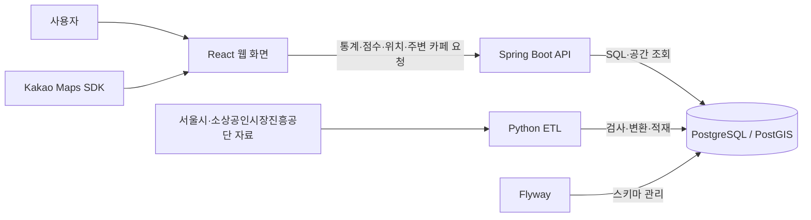

# 여기 창업해도 돼? — RecycleYoungs

## 프로젝트 소개

서울에서 창업을 준비하는 사람들을 위한 공공데이터 기반 MVP 서비스입니다. **현재는 카페 업종만 지원**합니다.

후보 지역의 소비 동향과 주변 경쟁 카페를 함께 살펴보고, 창업을 검토할 때 추가로 확인할 사항을 정리하도록 돕습니다. 지도에서 위치를 탐색하고 상세 근거를 확인한 뒤, 관심 있는 후보지를 최대 3곳까지 비교할 수 있습니다.

## 화면 미리보기

현재 구현된 데스크톱 화면입니다. 이미지를 누르면 원본 크기로 볼 수 있습니다.

| 지도 탐색·검토 요약 | 주변 카페·브랜드 필터 |
| :---: | :---: |
| [](docs/images/map-explore.jpg)<br>지역을 선택하고 소비 신호와 검토 요약을 확인합니다. | [](docs/images/nearby-cafes.jpg)<br>주변 카페의 위치·거리를 살펴보고 추정 브랜드로 목록을 좁힙니다. |
| **상세 분석** | **후보 비교** |
| [](docs/images/detail-analysis.jpg)<br>점수와 소비·점포 그래프로 지역의 변화를 살펴봅니다. | [](docs/images/candidate-comparison.jpg)<br>후보별 소비 신호·주변 카페 수·다음 확인사항을 같은 분기로 비교합니다. |

## 주요 기능

| 기능 | 설명 |
| --- | --- |
| 지도 탐색 | 서울 구·행정동 검색, 서울 외곽선·선택 동 경계 표시, 지점 선택과 행정동·상권 확인 |
| 검토 요약·점수 | 소비규모·소비증감의 100점 상대 점수, 실제 증감 방향과 추가 확인사항 안내 |
| 주변 카페 탐색 | 반경 500m 카페의 상호·직선거리와 밀집 점포 묶음, 11개 브랜드 추정·미식별 필터 제공 |
| 상세 분석 | 검토 근거·점수 설명·선택 분기 수치와 소비·점포 그래프 제공. 정확한 값과 세부지표는 펼쳐 보기 |
| 후보지 비교 | 최대 3곳의 소비 신호·주변 카페 수·확인사항 비교. 같은 행정동의 소비 근거는 공유 표시 |

## 프로젝트 한계 · 개선할 점

개선 방향은 후속 검토 과제이며, 자료 확보와 기준 검증을 거쳐 범위를 정합니다.

- **지원 범위:** 현재는 서울·카페만 지원합니다. 다른 지역·업종은 자료와 분류·비교 기준을 검증한 뒤 확장을 검토합니다.

- **창업 판단 근거:** 소비규모·증감 중심이며, 유동인구·시간대 수요·임대료·운영비·계절성은 종합 반영하지 않습니다. 기간·지역 단위를 맞춘 자료를 확충하고 지표·산식을 검증할 계획입니다.

- **분석 범위:** 통계·점수는 행정동 전체 기준이며 선택 지점 반경이나 개별 매장의 성과를 뜻하지 않습니다. 더 세밀한 공간 단위의 자료와 연결할 수 있는지 검토합니다.

- **주변 목록·필터:** 가까운 최대 100개 수신 목록에서만 필터링하며, 반경 전체의 브랜드 구성은 제공하지 않습니다. 전체 목록 조회와 서버 필터·집계 확장을 검토합니다.

- **점포 운영 형태:** 상호로 브랜드를 추정하며 가맹·직영·독립 운영 여부는 확인하지 못했습니다. 점포별 식별 정보·공식 근거·기준일을 확보해 분류를 검증해야 합니다.

- **데이터 시점·품질:** 통계와 점포 자료의 시점이 다르며 기준일·완전성·과거 경계와의 호환성은 미검증입니다. 출처·갱신 시점·경계 호환성을 관리하고 품질 확인을 강화할 계획입니다.

- **통계 갱신 자동화:** 2025년 통계를 사전 적재해 사용하며 새 분기 자료의 자동 수집·검증·반영은 미구현입니다. 공식 API로 정기 수집하고 기존 Python ETL로 검증·변환한 뒤, 새 분기 추가와 과거 정정 반영을 관리하는 방향을 검토합니다.

- **다년도 분석:** 데이터 처리·추세 API·화면 일부가 2025년에 고정되어 새 연도 자료 적재만으로는 분석이 확장되지 않습니다. 조회·그래프의 기간을 여러 연도·분기로 확장하고 과거 데이터를 보존해 비교를 지원할 계획입니다.

- **운영·사용성 검증:** 운영 배포·부하·다양한 실제 기기·포괄적 접근성 검증은 미완료입니다. 배포·성능 기준과 대표 환경의 검증을 단계적으로 준비합니다.

서울시는 [행정동 점포 통계 Open API](https://data.seoul.go.kr/dataList/OA-22172/S/1/datasetView.do?tab=A)와 [행정동 추정매출 Open API](https://data.seoul.go.kr/dataList/OA-22175/S/1/datasetView.do?tab=A)를 제공합니다. 다만 필요한 모든 연도·분기와 항목이 제공되는지, 기존 CSV와 집계 기준·값이 호환되는지는 추가 검증이 필요합니다. API 인증·호출 제한·나눠 조회할 때의 누락을 확인해야 하며, API를 사용해도 원천 자료의 공표 주기와 지연은 그대로입니다.

API가 필요한 과거 자료까지 완전히 대체한다고 검증되면 **CSV 전용 처리 경로를 단계적으로 제거**하는 방향입니다. API 응답도 코드·숫자·누락·중복 검사와 DB 적재가 필요하므로 Python ETL은 유지합니다. 2025년을 포함한 과거 데이터와 원본·검증 이력은 보존하며, 실제 수집·갱신 구현은 후속 과제입니다.

## 사용 흐름

1. **지역·위치 선택:** 구·행정동을 검색해 지역을 살펴보거나 지도에서 실제 지점을 선택합니다. 주변 카페와 후보 추가는 실제 지점을 선택한 뒤 제공됩니다.
2. **요약·주변 확인:** 분석 분기를 정하고 검토 요약·두 점수·주변 카페를 함께 확인합니다.
3. **상세 근거 확인:** 상세 분석에서 소비·점포 흐름과 점수 산정 기준을 읽고, 현장 조사·임대료·운영비 등 추가 확인사항을 정리합니다.
4. **후보 비교:** 관심 지점을 저장하고 비교 창에서 공통 분기를 선택한 뒤 ‘같은 분기로 후보 분석’을 실행합니다.

## 기술 스택

| 영역 | 주요 기술 | 역할 |
| --- | --- | --- |
| Frontend | React, TypeScript, Vite | 지도·통계 화면과 후보지 비교 |
| UI | Tailwind CSS, shadcn/ui | 공통 컴포넌트와 반응형 스타일 |
| 지도 | Kakao Maps JavaScript SDK | 지도 표시, 위치 선택, 마커 |
| Backend | Java 21, Spring Boot, Spring MVC | REST API와 입력 검증 |
| DB 조회 | Spring JDBC / JdbcClient | SQL 조회와 응답 데이터 구성 |
| Database | PostgreSQL, PostGIS | 통계·점포 저장과 위치·거리 계산 |
| 데이터 처리 | Python, pandas, psycopg, Shapely, pyproj, pyshp | 통계·점포·경계 자료의 검사·변환·적재 |
| 개발 환경 | Flyway, Docker Compose | 스키마 관리와 데이터 준비 자동화 |
| 문서·테스트 | Springdoc OpenAPI, JUnit, Vitest, Testing Library, unittest | API 명세와 회귀 검증 |

세부 버전과 선택 배경은 [기술 명세](docs/technical.md#기술-스택과-선택-이유)에서 확인할 수 있습니다.

## 아키텍처



Frontend는 API 호출, 요청 상태, 화면 표시를 나눠 관리하고 API의 소비 지표를 검토 요약으로 설명합니다. Backend는 Controller → Service → Repository 구조로 통계·점수를 제공하고, PostGIS로 행정동·상권 포함 여부와 점포까지의 거리를 계산합니다.

데이터 준비와 사용자 조회는 별도 흐름입니다. ETL이 준비한 데이터를 API가 읽고, 화면은 이를 통계·지도·비교 결과로 보여줍니다.

## 배포 구조

docker compose + AWS EC2 예정, nginx + CI/CD 고려중

현재 Compose는 개발 DB·데이터 준비용이며 Backend와 Frontend는 호스트에서 실행합니다. 기존 GitHub Actions는 독립 E2E 검증용으로, 운영 배포와 자동 배포 구성은 후속 과제입니다.

## 데이터와 ETL

ETL은 원본 자료를 읽어 필요한 형식으로 바꾸고 데이터베이스에 저장하는 과정입니다. 이 프로젝트에서는 **지역별 통계**, **개별 점포**, **지역 경계**를 연결해 위치 기반 조회에 사용합니다.

### 사용하는 데이터

| 자료 | 출처·기간 | 서비스에서의 쓰임 |
| --- | --- | --- |
| 행정동 점포 통계 | 서울시 상권분석서비스, 2025년 1~4분기 | 점포·개업·폐업·프랜차이즈 수 등 조회 |
| 행정동 추정매출 | 서울시 상권분석서비스, 2025년 1~4분기 | 추정매출·매출 건수와 분기별 변화 조회 |
| 개별 점포 정보 | 소상공인시장진흥공단, 파일명 기준 2026년 6월 서울 자료 | 카페 위치와 반경 500m 내 경쟁 점포 조회 |
| 행정동 경계 | 서울시 행정동 영역 자료 | 선택 좌표가 속하는 행정동 판정 |
| 상권 경계 | 서울시 상권 영역 자료 | 선택 좌표가 포함되는 상권 확인 |

### 처리 흐름

1. **자료 확보:** 통계·점포 CSV와 행정동·상권 경계 파일을 준비합니다.
2. **검사:** 파일 형식, 필수 항목, 중복 코드, 좌표와 경계 품질을 확인합니다.
3. **변환·적재:** 업종 코드를 연결하고 숫자·좌표 형식을 정리해 DB에 저장합니다.
4. **조회 연결:** API가 통계와 공간 데이터를 읽어 지도·주변 카페·후보 비교에 제공합니다.

경계 자료는 원본과 서비스 조회에 사용하는 경계를 구분해 보존합니다. 여러 행정동이 겹치는 위치는 임의로 한 곳을 선택하지 않고 모호성을 표시합니다.

데이터 목록은 [manifest](data/manifest.json), 상세 처리 방식은 [CSV ETL](docs/technical.md#csv-etl)과 [경계 자료 처리](docs/technical.md#polygon-etl과-공간-한계)에 정리돼 있습니다.

### 원본 이용조건과 공개 고지

| 자료 | 공식 출처 | 이용조건 |
| --- | --- | --- |
| 행정동 점포 통계 | [서울시 OA-22172](https://data.seoul.go.kr/dataList/OA-22172/S/1/datasetView.do) | 공공누리 제1유형 |
| 행정동 추정매출 | [서울시 OA-22175](https://data.seoul.go.kr/dataList/OA-22175/S/1/datasetView.do) | 공공누리 제1유형 |
| 개별 점포 정보 | [소상공인시장진흥공단 상가(상권)정보](https://www.data.go.kr/data/15083033/fileData.do) | 이용허락범위 제한 없음 |
| 행정동 경계 | [서울시 OA-22160](https://data.seoul.go.kr/dataList/OA-22160/S/1/datasetView.do) | 공공누리 제1유형 |
| 상권 경계 | [서울시 OA-15560](https://data.seoul.go.kr/dataList/OA-15560/S/1/datasetView.do) | 공공누리 제1유형 |

서울시 자료는 [공공누리 제1유형](https://www.kogl.or.kr/info/licenseType1.do)의 출처표시 조건을 따릅니다. 개별 점포 자료에는 공개된 점포명·주소·좌표가 포함됩니다.

공개 데이터 패키지의 경계 검증·품질·보정 리포트 3개에는 프로젝트가 보유·관리하는 권리 범위에서 [CC BY 4.0](https://creativecommons.org/licenses/by/4.0/)을 적용합니다. 출처표시명은 **RecycleYoungs 프로젝트**이며, 재사용 시 출처·라이선스·변경 사항을 표시해야 합니다. 이 조건은 서울시·소상공인시장진흥공단 원본이나 제3자의 권리를 변경하지 않습니다. 자료별 고지는 [공개 데이터 계약](data/public-data-v2.json)에 정리돼 있습니다.

## 프로젝트 구조

```text
RecycleYoungs/
├── frontend/           # React 화면·API client·상태 관리
├── backend/            # Spring Boot API·SQL 조회
│   └── src/main/resources/db/migration/  # Flyway 스키마
├── etl/                # Python 데이터 검사·변환·적재
├── data/               # 데이터 목록·공개 데이터 계약
├── docker/             # 개발 환경과 데이터 준비 자동화
├── docker-compose.yml  # 개발 DB·데이터 준비 서비스 구성
└── docs/               # 현황·기술 명세·DB 정책
    └── images/         # 실제 서비스 화면 미리보기
```

테이블 관계는 [ERD](docs/technical.md#erd), 상세 구조는 [DB 명세](docs/technical.md#db-schema와-flyway), 정확한 DDL은 [Flyway SQL](backend/src/main/resources/db/migration/)에서 확인할 수 있습니다.

## 실행 방법

Java 21, Node.js 24/npm, Python 3.12, Docker Engine 또는 Docker Desktop과 Compose v2를 준비합니다. DB와 데이터 준비는 Docker에서, Backend·Frontend는 호스트에서 실행합니다.

### 1. DB와 데이터 준비

**새 환경을 처음 준비할 때** 프로젝트 루트에서 자원·포트 충돌을 확인하고 Compose를 시작합니다. 공개 데이터는 자동 다운로드되므로 CSV·경계 파일을 따로 준비할 필요가 없습니다.

```sh
python3 etl/team_dev.py preflight
docker compose up -d
```

`up -d`가 반환돼도 데이터 준비는 진행 중일 수 있습니다. 아래 명령에서 `READY`를 확인한 뒤 Backend를 실행합니다. **이미 준비한 팀 환경은** 최초 준비를 반복하기 전에 아래 명령으로 상태부터 확인합니다. `status`에는 팀 DB의 읽기 전용 조회가 포함됩니다.

```sh
docker compose ps -a
python3 etl/team_dev.py status
```

### 2. Backend 실행

별도 터미널에서 실행합니다. 시작 시 팀 DB의 준비 상태와 연결 대상을 검사합니다.

```sh
cd backend
./gradlew bootRun
```

### 3. Frontend 실행

다른 터미널에서 의존성을 설치하고, 설정 파일이 없을 때만 예시를 복사합니다.

```sh
cd frontend
npm ci
test -e .env.local || cp .env.local.example .env.local
```

`frontend/.env.local`의 `VITE_KAKAO_MAP_APP_KEY`에 본인의 Kakao JavaScript 키를 입력합니다. Kakao Developers에 웹 도메인 `http://localhost:5173`을 등록한 뒤 실행합니다.

```sh
npm run dev
```

- 서비스: [http://localhost:5173](http://localhost:5173)
- API 문서: [http://localhost:8080/api/docs](http://localhost:8080/api/docs)

동일 이름의 기존 자원이나 버전 불일치가 감지되면 삭제·초기화하지 말고 [개발 환경 안내](docs/technical.md#개발-환경과-안전한-시작)를 확인합니다. DB·cache·control 볼륨은 보존하며, `docker compose down -v`는 일반 실행 절차에 포함하지 않습니다.

## 검증과 현재 범위

Backend·Frontend·ETL의 회귀 테스트를 갖추고 있으며, 별도 격리 환경에서 실자료 적재부터 API·지도·3후보 비교까지 검증한 기록이 있습니다. 검증한 환경과 기간은 [프로젝트 현황](docs/project.md#구현-상태와-검증-수준)에서 구분합니다.

현재 구현은 서울·카페 중심의 탐색·검토·비교 MVP입니다. 미지원 기능과 개선 방향은 [프로젝트 한계 · 개선할 점](#프로젝트-한계--개선할-점)에 정리했습니다. 종합 입지점수와 운영 배포·자동 배포는 아직 제공하지 않습니다.

세부 우선순위와 미확정 사항은 [다음 작업](docs/project.md#다음-작업)에서 확인합니다. 과거 테스트·시연 기록은 현재 환경의 정상 가동이나 운영 준비 완료를 보장하지 않습니다.

## 데이터 해석 시 유의사항

- 서비스는 창업 성공·수익·폐업을 예측하거나 보장하지 않습니다.
- **소비규모 점수**는 추정매출 자료의 거래 건수를 같은 분기 서울 행정동과 비교한 상대 순위입니다. **소비증감 점수**는 전분기 대비 거래 건수 변화율의 상대 순위입니다. 증감점수가 높아도 실제 거래가 감소할 수 있으므로 증감률·방향을 함께 봐야 합니다. 두 점수는 종합 입지점수나 성공 확률이 아닙니다.
- 주변 카페는 **선택 지점 반경 500m**, 점포·매출 통계와 점수는 **행정동 전체**를 기준으로 합니다. 같은 동의 후보는 소비 근거를 공유합니다. 행정동 추정매출은 후보 반경의 매출이나 개별 가게의 이익을 뜻하지 않습니다.
- 반경 전체 조회 수와 가까운 **최대 100개 수신 목록**은 다를 수 있습니다. 종류·브랜드 필터는 받은 목록 안에서만 적용합니다. 브랜드는 상호명으로 추정하며, 미식별 점포를 개인 카페로 확정하거나 브랜드 점포를 가맹점으로 단정하지 않습니다.
- 2025년 분기 통계와 파일명 기준 2026년 6월 점포 자료는 시점과 집계 단위가 다릅니다. 점포 자료의 정확한 기준일·완전성은 미확인이고, 자료에서 빠졌다는 이유만으로 폐업으로 판단하지 않습니다.
- 현재 경계가 2025년 통계 당시 경계와 같은지는 확인되지 않았습니다. 원본 경계의 겹침과 홍지문 상권의 속성 충돌도 품질 정보로 표시합니다.
- 값이 없는 경우와 실제 0을 구분해 표시합니다.

## 관련 문서

| 문서 | 내용 |
| --- | --- |
| [프로젝트 현황](docs/project.md) | 구현 범위, 로드맵, 남은 과제 |
| [기술 명세](docs/technical.md) | API 계약, DB 구조, ETL, 개발·검증 안내 |
| [DB 안전 정책](docs/db-safety.md) | 데이터 보존, DB 작업 승인·복구 정책 |
| [작업 지침](AGENTS.md) | 저장소 공통 작업 규칙 |
