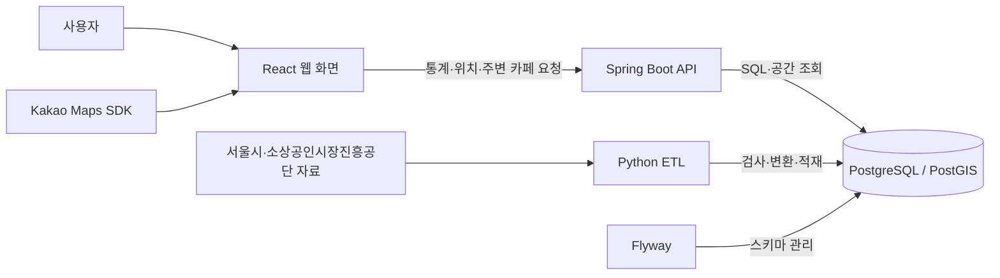

# 여기 창업해도 돼? — RecycleYoungs

## 프로젝트 소개

서울 지역의 창업 후보지를 공공데이터로 살펴보고 비교하는 웹 서비스입니다. 예비 창업자가 주변 경쟁 점포와 지역의 점포·추정매출 통계를 확인해 후보지의 창업 환경을 이해하도록 돕습니다.

지도에서 위치를 선택하고, 관심 있는 후보지를 최대 3곳까지 저장해 같은 분기의 통계를 비교할 수 있습니다. 현재 화면은 카페 업종만 지원하는 초기 MVP입니다.

## 화면 미리보기

프론트엔드 기능 완료 후 사진 올릴 예정

## 주요 기능

| 기능 | 설명 |
| --- | --- |
| 지도에서 위치 선택 | 카카오맵에서 위치를 선택하고 해당 행정동과 상권 확인 |
| 주변 경쟁 카페 조회 | 선택 위치의 반경 500m 내 카페 수와 거리순 목록 확인 |
| 행정동 카페 통계 조회 | 선택한 행정동·분기의 카페 점포 수, 개업·폐업 수, 프랜차이즈 수, 추정매출 등 확인 |
| 분기별 추세 확인 | 2025년 1~4분기의 점포·매출 지표 변화 확인 |
| 후보지 비교 | 최대 3곳의 주변 카페와 같은 분기의 행정동 통계 비교 |
| 지도 지역 검색 | 서울 구·행정동 선택, 공식 서울 외곽선과 선택 동 경계 표시 |
| 카페 소비규모 점수 | 같은 분기 서울 행정동의 카페 거래 규모를 100점 상대 순위로 비교. 종합 입지·성공률 점수가 아님 |
| 카페 소비증감 점수 | 직전 분기 대비 거래 건수 증감률의 서울 상대 순위. 증감 방향과 함께 표시 |
| 상세 분석 | `/analysis`에서 쉬운 점수 설명, 단위·세로축 눈금이 있는 소비·점포 그래프와 정확한 표 확인 |
| 자료 한계 확인 | 결측값, 경계 모호성, 자료의 시점·집계 단위와 품질 정보 표시 |

후보지를 비교할 때 주변 카페는 **선택 좌표의 반경 500m**, 점포·매출 통계는 **행정동 전체**를 기준으로 합니다. 같은 행정동에 있는 후보지는 같은 지역 통계를 공유할 수 있습니다.

## 기술 스택

| 영역 | 주요 기술 | 역할 |
| --- | --- | --- |
| Frontend | React, TypeScript, Vite | 지도·통계 화면과 후보지 비교 |
| UI | Tailwind CSS, shadcn/ui | 공통 컴포넌트와 반응형 스타일 |
| 지도 | Kakao Maps JavaScript SDK | 지도 표시, 위치 선택, 마커 |
| Backend | Java 21, Spring Boot, Spring MVC | REST API와 입력 검증 |
| DB 조회 | Spring JDBC / JdbcClient | SQL 조회와 응답 데이터 구성 |
| Database | PostgreSQL, PostGIS | 통계·점포 저장과 위치·거리 계산 |
| 데이터 처리 | Python, pandas, psycopg, Shapely, pyproj, pyshp | 통계·점포·경계 자료의 검사·변환·적재 |
| DB·개발 환경 관리 | Flyway, Docker Compose | 스키마 관리와 데이터 준비 자동화 |
| API 문서·테스트 | Springdoc OpenAPI, JUnit, Vitest, Testing Library, unittest | API 명세와 회귀 검증 |

세부 버전과 선택 배경은 [기술 명세](docs/technical.md#기술-스택과-선택-이유)에서 확인할 수 있습니다.

## 아키텍처



Frontend는 API 호출, 요청 상태, 화면 표시를 나눠 관리합니다. Backend는 Controller → Service → Repository 구조로 요청을 처리하고, PostGIS로 행정동·상권 포함 여부와 점포까지의 거리를 계산합니다.

데이터 준비와 사용자 조회는 별도 흐름입니다. ETL이 준비한 데이터를 API가 읽고, 화면은 이를 통계·지도·비교 결과로 보여줍니다.

## 배포 구조

docker compose + AWS EC2 예정, nginx + CI/CD 고려중

## 데이터와 ETL

ETL은 원본 자료를 읽어 필요한 형식으로 바꾸고 데이터베이스에 저장하는 과정입니다. 이 프로젝트에서는 **지역별 통계**, **개별 점포**, **지역 경계**를 연결해 위치 기반 조회에 사용합니다.

### 사용하는 데이터

| 자료 | 출처·기간 | 서비스에서의 쓰임 |
| --- | --- | --- |
| 행정동 점포 통계 | 서울시 상권분석서비스, 2025년 1~4분기 | 점포·개업·폐업·프랜차이즈 수 등 조회 |
| 행정동 추정매출 | 서울시 상권분석서비스, 2025년 1~4분기 | 추정매출·매출 건수와 분기별 변화 조회 |
| 개별 점포 정보 | 소상공인시장진흥공단, 파일명 기준 2026년 6월 서울 자료 | 카페 위치와 반경 500m 내 경쟁 점포 조회 |
| 행정동 경계 | 서울시 행정동 영역 자료 | 선택 좌표가 속하는 행정동 판정 |
| 상권 경계 | 서울시 상권 영역 자료 | 선택 좌표가 포함되는 상권 확인 |

### 처리 흐름

1. **자료 확보:** 통계·점포 CSV와 행정동·상권 경계 파일을 준비합니다.
2. **검사:** 파일 형식, 필수 항목, 중복 코드, 좌표와 경계 품질을 확인합니다.
3. **변환·적재:** 업종 코드를 연결하고 숫자·좌표 형식을 정리해 DB에 저장합니다.
4. **조회 연결:** API가 통계와 공간 데이터를 읽어 지도·주변 카페·후보 비교에 제공합니다.

경계 자료는 원본과 서비스 조회에 사용하는 경계를 구분해 보존합니다. 여러 행정동이 겹치는 위치는 임의로 한 곳을 선택하지 않고 모호성을 표시합니다.

데이터 목록은 [manifest](data/manifest.json), 상세 처리 방식은 [CSV ETL](docs/technical.md#csv-etl)과 [경계 자료 처리](docs/technical.md#polygon-etl과-공간-한계)에 정리돼 있습니다.

### 원본 이용조건과 공개 고지

| 자료 | 공식 출처 | 이용조건 |
| --- | --- | --- |
| 행정동 점포 통계 | [서울시 OA-22172](https://data.seoul.go.kr/dataList/OA-22172/S/1/datasetView.do) | 공공누리 제1유형 |
| 행정동 추정매출 | [서울시 OA-22175](https://data.seoul.go.kr/dataList/OA-22175/S/1/datasetView.do) | 공공누리 제1유형 |
| 개별 점포 정보 | [소상공인시장진흥공단 상가(상권)정보](https://www.data.go.kr/data/15083033/fileData.do) | 이용허락범위 제한 없음 |
| 행정동 경계 | [서울시 OA-22160](https://data.seoul.go.kr/dataList/OA-22160/S/1/datasetView.do) | 공공누리 제1유형 |
| 상권 경계 | [서울시 OA-15560](https://data.seoul.go.kr/dataList/OA-15560/S/1/datasetView.do) | 공공누리 제1유형 |

서울시 자료는 [공공누리 제1유형](https://www.kogl.or.kr/info/licenseType1.do)의 출처표시 조건을 따릅니다. 개별 점포 자료에는 공개된 점포명·주소·좌표가 포함됩니다.

공개 데이터 패키지의 경계 검증·품질·보정 리포트 3개에는 프로젝트가 보유·관리하는 권리 범위에서 [CC BY 4.0](https://creativecommons.org/licenses/by/4.0/)을 적용합니다. 출처표시명은 **RecycleYoungs 프로젝트**이며, 재사용 시 출처·라이선스·변경 사항을 표시해야 합니다. 이 조건은 서울시·소상공인시장진흥공단 원본이나 제3자의 권리를 변경하지 않습니다. 자료별 고지는 [공개 데이터 계약](data/public-data-v2.json)에 정리돼 있습니다.

## 프로젝트 구조

```text
RecycleYoungs/
├── frontend/           # React 화면·API client·상태 관리
├── backend/            # Spring Boot API·SQL 조회
│   └── src/main/resources/db/migration/  # Flyway 스키마
├── etl/                # Python 데이터 검사·변환·적재
├── data/               # 데이터 목록·공개 데이터 계약
├── docker/             # 개발 환경과 데이터 준비 자동화
├── docker-compose.yml  # 개발 DB·데이터 준비 서비스 구성
└── docs/               # 현황·기술 명세·DB 정책
```

테이블 관계는 [ERD](docs/technical.md#erd), 상세 구조는 [DB 명세](docs/technical.md#db-schema와-flyway), 정확한 DDL은 [Flyway SQL](backend/src/main/resources/db/migration/)에서 확인할 수 있습니다.

## 실행 방법

Java 21, Node.js 24/npm, Python 3.12, Docker Engine 또는 Docker Desktop과 Compose v2를 준비합니다. DB와 데이터 준비는 Docker에서, Backend·Frontend는 호스트에서 실행합니다.

### 1. DB와 데이터 준비

프로젝트 루트에서 최초 실행 전 자원·포트 충돌을 확인하고 Compose를 시작합니다. 공개 데이터는 자동 다운로드되므로 CSV·경계 파일을 따로 준비할 필요가 없습니다.

```sh
python3 etl/team_dev.py preflight
docker compose up -d
```

`up -d`가 반환돼도 데이터 준비는 진행 중일 수 있습니다. 아래 명령에서 `READY`를 확인한 뒤 Backend를 실행합니다. 이미 이 프로젝트의 환경을 준비했다면 최초용 `preflight` 대신 `status`로 확인합니다.

```sh
docker compose ps -a
python3 etl/team_dev.py status
```

### 2. Backend 실행

별도 터미널에서 실행합니다. 시작 시 팀 DB의 준비 상태와 연결 대상을 검사합니다.

```sh
cd backend
./gradlew bootRun
```

### 3. Frontend 실행

다른 터미널에서 의존성을 설치하고, 설정 파일이 없을 때만 예시를 복사합니다.

```sh
cd frontend
npm ci
test -e .env.local || cp .env.local.example .env.local
```

`frontend/.env.local`의 `VITE_KAKAO_MAP_APP_KEY`에 본인의 Kakao JavaScript 키를 입력합니다. Kakao Developers에 웹 도메인 `http://localhost:5173`을 등록한 뒤 실행합니다.

```sh
npm run dev
```

- 서비스: [http://localhost:5173](http://localhost:5173)
- API 문서: [http://localhost:8080/api/docs](http://localhost:8080/api/docs)

동일 이름의 기존 자원이나 버전 불일치가 감지되면 삭제·초기화하지 말고 [개발 환경 안내](docs/technical.md#개발-환경과-안전한-시작)를 확인합니다. DB·cache·control 볼륨은 보존하며, `docker compose down -v`는 일반 실행 절차에 포함하지 않습니다.

## 검증과 현재 범위

Backend·Frontend·ETL의 회귀 테스트를 갖추고 있으며, 별도 격리 환경에서 실자료 적재부터 API·지도·3후보 비교까지 검증한 기록이 있습니다. 검증한 환경과 기간은 [프로젝트 현황](docs/project.md#구현-상태와-검증-수준)에서 구분합니다.

운영 배포·부하 검증, 추가 업종 확장, 원천 자료의 기준일·완전성 검증은 후속 과제입니다.

## 데이터 해석 시 유의사항

- 서비스는 창업 성공·수익·폐업을 예측하거나 보장하지 않습니다.
- 행정동 추정매출은 지역 집계이며, 후보지 반경의 매출이나 개별 가게의 이익을 뜻하지 않습니다.
- 2025년 분기 통계와 파일명 기준 2026년 6월 점포 자료는 시점과 집계 단위가 다릅니다. 점포 자료의 정확한 기준일·완전성은 미확인이고, 자료에서 빠졌다는 이유만으로 폐업으로 판단하지 않습니다.
- 현재 경계가 2025년 통계 당시 경계와 같은지는 확인되지 않았습니다. 원본 경계의 겹침과 홍지문 상권의 속성 충돌도 품질 정보로 표시합니다.
- 값이 없는 경우와 실제 0을 구분해 표시합니다.

## 관련 문서

| 문서 | 내용 |
| --- | --- |
| [프로젝트 현황](docs/project.md) | 구현 범위, 로드맵, 남은 과제 |
| [기술 명세](docs/technical.md) | API 계약, DB 구조, ETL, 개발·검증 안내 |
| [DB 안전 정책](docs/db-safety.md) | 데이터 보존, DB 작업 승인·복구 정책 |
| [작업 지침](AGENTS.md) | 저장소 공통 작업 규칙 |
