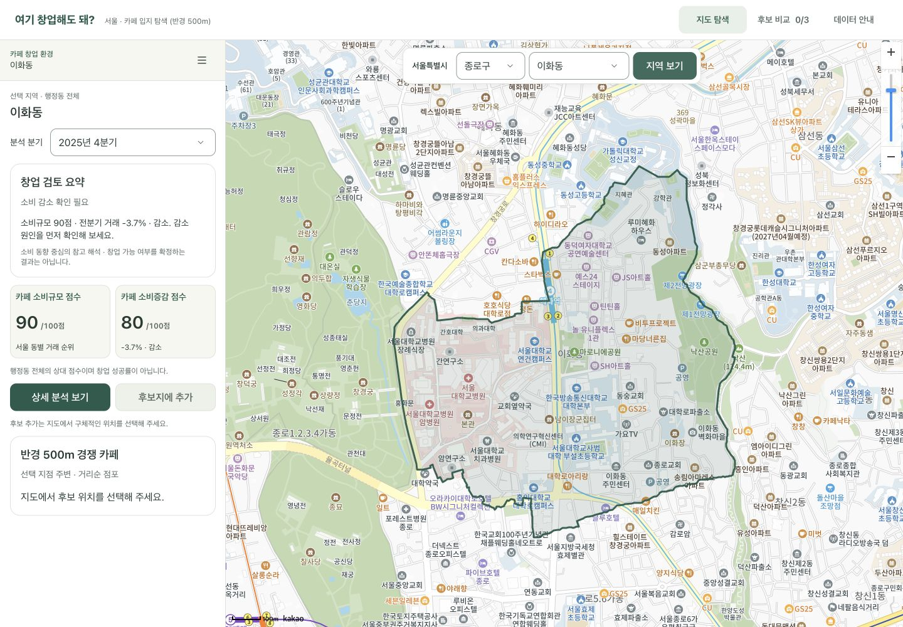
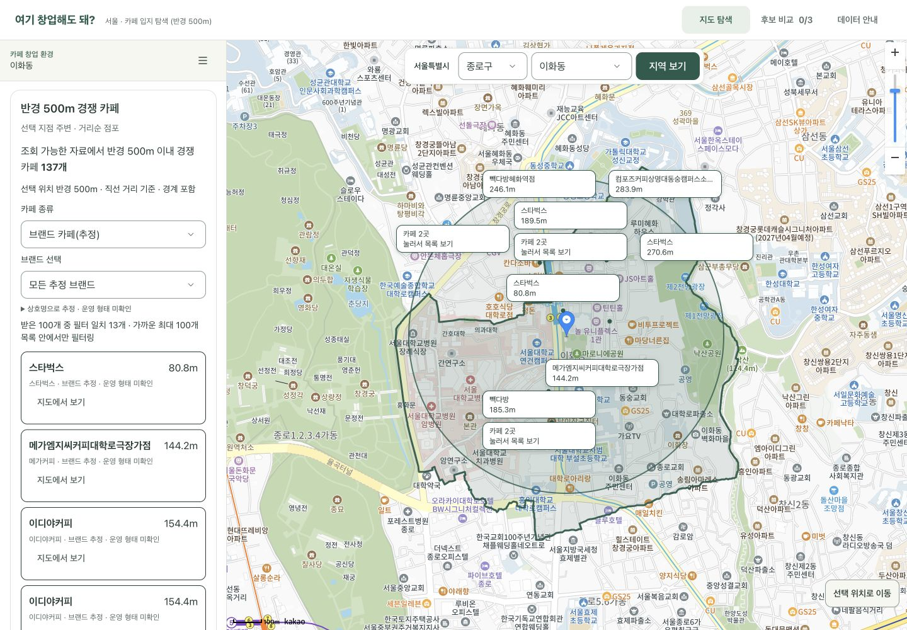
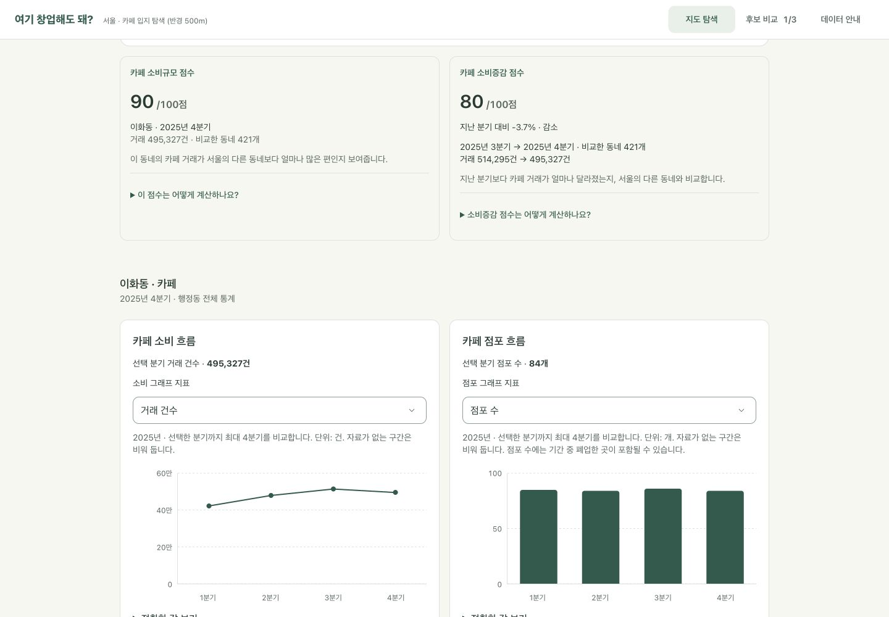
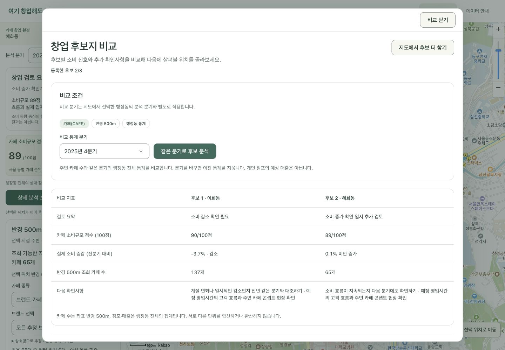
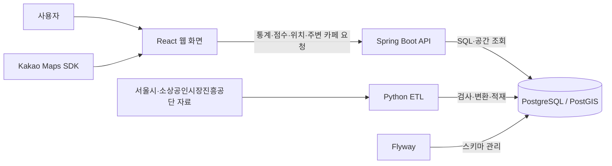

# 여기 창업해도 돼? — RecycleYoungs

## 프로젝트 소개

서울에서 창업을 준비하는 사람들을 위한 공공데이터 기반 MVP 서비스입니다. **현재는 카페 업종만 지원**합니다.

후보 지역의 소비 동향과 주변 경쟁 카페를 함께 살펴보고, 창업을 검토할 때 추가로 확인할 사항을 정리하도록 돕습니다. 지도에서 위치를 탐색하고 상세 근거를 확인한 뒤, 관심 있는 후보지를 최대 3곳까지 비교할 수 있습니다.

## 화면 미리보기

현재 구현된 데스크톱 화면입니다. 이미지를 누르면 원본 크기로 볼 수 있습니다.

| 지도 탐색·검토 요약 | 주변 카페·브랜드 필터 |
| :---: | :---: |
| [](docs/images/map-explore.jpg)<br>지역을 선택하고 소비 신호와 검토 요약을 확인합니다. | [](docs/images/nearby-cafes.jpg)<br>주변 카페의 위치·거리를 살펴보고 추정 브랜드로 목록을 좁힙니다. |
| **상세 분석** | **후보 비교** |
| [](docs/images/detail-analysis.jpg)<br>점수와 소비·점포 그래프로 지역의 변화를 살펴봅니다. | [](docs/images/candidate-comparison.jpg)<br>후보별 소비 신호·주변 카페 수·다음 확인사항을 같은 분기로 비교합니다. |

## 주요 기능

| 기능 | 설명 |
| --- | --- |
| 지도 탐색 | 서울 구·행정동 검색, 서울 외곽선·선택 동 경계 표시, 지점 선택과 행정동·상권 확인 |
| 검토 요약·점수 | 소비규모·소비증감의 100점 상대 점수, 실제 증감 방향과 추가 확인사항 안내 |
| 주변 카페 탐색 | 반경 500m 카페의 상호·직선거리와 밀집 점포 묶음, 11개 브랜드 추정·미식별 필터 제공 |
| 상세 분석 | 검토 근거·점수 설명·선택 분기 수치와 소비·점포 그래프 제공. 정확한 값과 세부지표는 펼쳐 보기 |
| 후보지 비교 | 최대 3곳의 소비 신호·주변 카페 수·확인사항 비교. 같은 행정동의 소비 근거는 공유 표시 |

## 프로젝트 한계 · 개선할 점

개선 방향은 후속 검토 과제이며, 자료 확보와 기준 검증을 거쳐 범위를 정합니다.

- **지원 범위:** 현재는 서울·카페만 지원합니다. 다른 지역·업종은 자료와 분류·비교 기준을 검증한 뒤 확장을 검토합니다.

- **창업 판단 근거:** 소비규모·증감 중심이며, 유동인구·시간대 수요·임대료·운영비·계절성은 종합 반영하지 않습니다. 기간·지역 단위를 맞춘 자료를 확충하고 지표·산식을 검증할 계획입니다.

- **분석 범위:** 통계·점수는 행정동 전체 기준이며 선택 지점 반경이나 개별 매장의 성과를 뜻하지 않습니다. 더 세밀한 공간 단위의 자료와 연결할 수 있는지 검토합니다.

- **주변 목록·필터:** 가까운 최대 100개 수신 목록에서만 필터링하며, 반경 전체의 브랜드 구성은 제공하지 않습니다. 전체 목록 조회와 서버 필터·집계 확장을 검토합니다.

- **점포 운영 형태:** 상호로 브랜드를 추정하며 가맹·직영·독립 운영 여부는 확인하지 못했습니다. 점포별 식별 정보·공식 근거·기준일을 확보해 분류를 검증해야 합니다.

- **데이터 시점·품질:** 통계와 점포 자료의 시점이 다르며 기준일·완전성·과거 경계와의 호환성은 미검증입니다. 출처·갱신 시점·경계 호환성을 관리하고 품질 확인을 강화할 계획입니다.

- **통계 갱신 자동화:** 별도 API 개발 환경에서 공식 API 수집·검증·버전 공개와 주간 예약 갱신을 구현했습니다. 최신 지원 분기와 서울 카페 목록을 전수 갱신하고 새 완료 분기를 탐색하며, 이전 분기는 보존합니다. 오래된 분기의 정정 재수집과 운영 알림·보존 정책은 후속 과제입니다.

- **다년도 분석:** 공개된 지원 분기로 조회·그래프·후보 비교를 연결했습니다. 현재 API 환경에서 2025년 1분기~2026년 2분기를 확인했으며, 지원 목록의 최신 분기를 기본으로 선택합니다. 과거 경계와 통계의 호환성은 별도 검증 대상입니다.

- **운영·사용성 검증:** 운영 배포·부하·다양한 실제 기기·포괄적 접근성 검증은 미완료입니다. 배포·성능 기준과 대표 환경의 검증을 단계적으로 준비합니다.

서울시 [행정동 점포 통계 Open API](https://data.seoul.go.kr/dataList/OA-22172/S/1/datasetView.do?tab=A)·[행정동 추정매출 Open API](https://data.seoul.go.kr/dataList/OA-22175/S/1/datasetView.do?tab=A)와 SEMAS 상가정보 API를 사용합니다. 확인한 2025년 통계는 기존 CSV와 전수 일치했고, 개별 점포는 API의 표기 차이를 보존합니다. 다른 기간·업종의 호환성이나 원천의 완전성을 보장하지 않으며, API를 사용해도 공표 주기와 지연은 그대로입니다.

API 응답의 코드·숫자·누락·중복 검사와 적재는 Python ETL이 담당합니다. 과거 버전·원본·검증 이력을 보존하며, 고정 CSV 기반 팀 환경과 GitHub `real-data-v2`도 유지합니다. 초기 경계는 이 공개 패키지에서 검증한 파일을 사용합니다.

## 사용 흐름

1. **지역·위치 선택:** 구·행정동을 검색해 지역을 살펴보거나 지도에서 실제 지점을 선택합니다. 주변 카페와 후보 추가는 실제 지점을 선택한 뒤 제공됩니다.
2. **요약·주변 확인:** 분석 분기를 정하고 검토 요약·두 점수·주변 카페를 함께 확인합니다.
3. **상세 근거 확인:** 상세 분석에서 소비·점포 흐름과 점수 산정 기준을 읽고, 현장 조사·임대료·운영비 등 추가 확인사항을 정리합니다.
4. **후보 비교:** 관심 지점을 저장하고 비교 창에서 공통 분기를 선택한 뒤 ‘같은 분기로 후보 분석’을 실행합니다.

## 기술 스택

| 영역 | 주요 기술 | 역할 |
| --- | --- | --- |
| Frontend | React, TypeScript, Vite | 지도·통계 화면과 후보지 비교 |
| UI | Tailwind CSS, shadcn/ui | 공통 컴포넌트와 반응형 스타일 |
| 지도 | Kakao Maps JavaScript SDK | 지도 표시, 위치 선택, 마커 |
| Backend | Java 21, Spring Boot, Spring MVC | REST API와 입력 검증 |
| DB 조회 | Spring JDBC / JdbcClient | SQL 조회와 응답 데이터 구성 |
| Database | PostgreSQL, PostGIS | 통계·점포 저장과 위치·거리 계산 |
| 데이터 처리 | Python, pandas, psycopg, Shapely, pyproj, pyshp | 통계·점포·경계 자료의 검사·변환·적재 |
| 개발 환경 | Flyway, Docker Compose | 스키마 관리와 데이터 준비 자동화 |
| 문서·테스트 | Springdoc OpenAPI, JUnit, Vitest, Testing Library, unittest | API 명세와 회귀 검증 |

사람이 읽을 상세 문서의 작성 범위는 [문서 안내](docs/README.md)에서 확인할 수 있습니다.

## 아키텍처



Frontend는 API 호출, 요청 상태, 화면 표시를 나눠 관리하고 API의 소비 지표를 검토 요약으로 설명합니다. Backend는 Controller → Service → Repository 구조로 통계·점수를 제공하고, PostGIS로 행정동·상권 포함 여부와 점포까지의 거리를 계산합니다.

데이터 준비와 사용자 조회는 별도 흐름입니다. ETL이 준비한 데이터를 API가 읽고, 화면은 이를 통계·지도·비교 결과로 보여줍니다.

## 배포 구조

docker compose + AWS EC2 예정, nginx + CI/CD 고려중

새 `docker-compose.api.yml`은 영속 API DB·Backend·예약 worker를 실행하고 Frontend는 호스트에서 실행합니다. 기존 `docker-compose.yml`은 고정 자료 팀 환경으로 보존합니다. 현재 API 구성은 준비된 로컬 이미지에서 검증했으며, 새 PC·서버용 이미지 빌드/배포와 nginx·일반 CI/CD는 후속 과제입니다.

## 데이터와 ETL

ETL은 원본 자료를 읽어 필요한 형식으로 바꾸고 데이터베이스에 저장하는 과정입니다. 이 프로젝트에서는 **지역별 통계**, **개별 점포**, **지역 경계**를 연결해 위치 기반 조회에 사용합니다.

### 사용하는 데이터

| 자료 | 출처·기간 | 서비스에서의 쓰임 |
| --- | --- | --- |
| 행정동 점포 통계 | 서울시 상권분석서비스 API, 확인 기간 2025년 1분기~2026년 2분기 | 점포·개업·폐업·프랜차이즈 수 등 조회 |
| 행정동 추정매출 | 서울시 상권분석서비스 API, 같은 기간 | 추정매출·매출 건수와 분기별 변화 조회 |
| 개별 점포 정보 | SEMAS API, 확인한 응답의 기준년월 202606·서울 카페 | 카페 위치와 반경 500m 내 경쟁 점포 조회 |
| 행정동 경계 | 서울시 행정동 영역 자료 | 선택 좌표가 속하는 행정동 판정 |
| 상권 경계 | 서울시 상권 영역 자료 | 선택 좌표가 포함되는 상권 확인 |

### 처리 흐름

1. **자료 확보:** 공식 API를 페이지 단위로 수집하고 원본·수집 이력을 비공개 저장합니다. 경계는 초기 준비 때 별도로 검증합니다.
2. **검사:** 필수 항목·건수·중복·누락·숫자·좌표와 이전 공개 기간의 보존을 확인합니다.
3. **버전 적재·공개:** 새 버전을 적재·검증한 뒤 공개 포인터를 전환합니다. 실패하면 기존 공개 자료를 유지합니다.
4. **조회 연결:** 같은 공개 버전의 통계·점포를 조회하며 기준년월·수집 시각을 표시합니다. 조회 도중 버전이 바뀌면 새 목록 확인을 안내합니다.

경계 자료는 원본과 서비스 조회에 사용하는 경계를 구분해 보존합니다. 여러 행정동이 겹치는 위치는 임의로 한 곳을 선택하지 않고 모호성을 표시합니다.

고정 공개 패키지의 파일 기준정보는 [manifest](data/manifest.json)에 정리돼 있습니다. API 수집·정규화 계약은 에이전트용 [기술 명세](docs/agents/technical.md#공공-api-전환-준비)에서 관리합니다.

### 원본 이용조건과 공개 고지

| 자료 | 공식 출처 | 이용조건 |
| --- | --- | --- |
| 행정동 점포 통계 | [서울시 OA-22172](https://data.seoul.go.kr/dataList/OA-22172/S/1/datasetView.do) | 공공누리 제1유형 |
| 행정동 추정매출 | [서울시 OA-22175](https://data.seoul.go.kr/dataList/OA-22175/S/1/datasetView.do) | 공공누리 제1유형 |
| 개별 점포 정보 | [소상공인시장진흥공단 상가(상권)정보](https://www.data.go.kr/data/15083033/fileData.do) | 이용허락범위 제한 없음 |
| 행정동 경계 | [서울시 OA-22160](https://data.seoul.go.kr/dataList/OA-22160/S/1/datasetView.do) | 공공누리 제1유형 |
| 상권 경계 | [서울시 OA-15560](https://data.seoul.go.kr/dataList/OA-15560/S/1/datasetView.do) | 공공누리 제1유형 |

서울시 자료는 [공공누리 제1유형](https://www.kogl.or.kr/info/licenseType1.do)의 출처표시 조건을 따릅니다. 개별 점포 자료에는 공개된 점포명·주소·좌표가 포함됩니다.

공개 데이터 패키지의 경계 검증·품질·보정 리포트 3개에는 프로젝트가 보유·관리하는 권리 범위에서 [CC BY 4.0](https://creativecommons.org/licenses/by/4.0/)을 적용합니다. 출처표시명은 **RecycleYoungs 프로젝트**이며, 재사용 시 출처·라이선스·변경 사항을 표시해야 합니다. 이 조건은 서울시·소상공인시장진흥공단 원본이나 제3자의 권리를 변경하지 않습니다. 자료별 고지는 [공개 데이터 계약](data/public-data-v2.json)에 정리돼 있습니다.

## 프로젝트 구조

```text
RecycleYoungs/
├── frontend/           # React 화면·API client·상태 관리
├── backend/            # Spring Boot API·SQL 조회
│   └── src/main/resources/db/migration/  # Flyway 스키마
├── etl/                # Python 데이터 검사·변환·적재
├── data/               # 데이터 목록·공개 데이터 계약
├── docker/             # 개발 환경과 데이터 준비 자동화
├── docker-compose.yml  # 개발 DB·데이터 준비 서비스 구성
├── docker-compose.api.yml  # 별도 영속 API DB·Backend·예약 worker
└── docs/               # 사람이 읽을 문서
    ├── README.md       # 문서 안내·작성 예정 범위
    ├── images/         # 실제 서비스 화면 미리보기
    └── agents/         # 에이전트용 작업 기준·구현 계약·검증 기록
```

DB 스키마의 기준은 [Flyway SQL](backend/src/main/resources/db/migration/)입니다.

## 실행 방법

Java 21, Node.js 24/npm, Python 3.12, Docker Engine 또는 Docker Desktop과 Compose v2를 사용합니다. 아래는 **준비된 현재 로컬 API 환경의 기본 실행 경로**입니다. DB·Backend·예약 worker는 Docker에서, Frontend는 호스트에서 실행합니다.

### 1. API 환경 확인·최초 준비

이미 준비한 환경은 아래 상태 확인부터 시작합니다. DB에 읽기 전용으로 접속하며 키 값은 출력하지 않습니다.

```sh
make api-status
```

처음 준비할 때만 Python 환경과 `etl/api.env`의 서울 일반 인증키·공공데이터포털 Decoding 키를 설정합니다. 빈 양식은 `etl/api.env.example`이며 실제 키 파일은 Git·Docker build에서 제외됩니다. 기존 키 파일을 덮어쓰지 않습니다.

```sh
python3 -m venv etl/.venv
etl/.venv/bin/pip install -r etl/requirements.txt
(cd etl && .venv/bin/python -m app.collect_main check-config --env-file api.env)
```

최초 준비 명령은 새 DB·영속 볼륨·역할을 만들고 API 자료·경계를 적재합니다. 동일 이름의 기존 자원이나 불완전한 이전 준비가 있으면 자동 채택·재실행하지 않습니다. **현재 코드는 검증한 PostGIS·Python worker·Java 이미지 ID가 로컬에 있어야 실행됩니다.** 새 PC에서의 이미지 준비와 배포용 빌드 경로는 아직 갖추지 않았습니다.

다음은 확인한 여섯 분기의 최초 수집 예시입니다. 서울 HTTP 사용을 허용한 설정은 이후 갱신에도 저장됩니다. HTTP에서는 인증키가 암호화되지 않은 URL로 전송되므로 이 옵션은 사용 여부를 결정한 환경에서만 지정합니다. SEMAS는 HTTPS를 사용합니다.

```sh
make api-init API_INIT_ARGS='--quarter 20251 --quarter 20252 --quarter 20253 --quarter 20254 --quarter 20261 --quarter 20262 --allow-seoul-http'
```

제어 기록·비밀번호·수집 원본·경계·백업은 프로젝트 밖 `$HOME/.config/recycleyoungs/api-dev`에 보관합니다. DB 포트는 호스트에 노출하지 않습니다. 기존 팀 환경과 이름·볼륨·접속 계정을 분리하며 대상 identity가 다르면 중단합니다.

### 2. Backend·예약 worker 실행

```sh
make api-up
make api-status
```

Backend jar를 빌드한 뒤 별도 API Compose 서비스를 시작합니다. API 문서는 [http://127.0.0.1:18090/api/docs](http://127.0.0.1:18090/api/docs)입니다. `IDLE`·`SUCCEEDED`는 다음 예약 실행이 가능한 상태입니다. `FAILED`·`RUNNING`이면 아래 복구 안내를 먼저 확인합니다.

### 3. Frontend 실행

의존성과 Kakao JavaScript 키를 준비합니다. 설정 파일이 없을 때만 예시를 복사합니다.

```sh
npm --prefix frontend ci
test -e frontend/.env.local || cp frontend/.env.local.example frontend/.env.local
```

`frontend/.env.local`의 `VITE_KAKAO_MAP_APP_KEY`에 본인의 Kakao JavaScript 키를 입력합니다. Kakao Developers에 웹 도메인 `http://localhost:5173`을 등록한 뒤 실행합니다.

```sh
make frontend-api
```

서비스는 [http://localhost:5173](http://localhost:5173)입니다. `frontend-api`는 `/api` 요청을 새 Backend의 `18090` 포트로 전달합니다.

### 갱신·상태·복구

Compose worker는 매주 월요일 04:30 한국 시간에 최신 지원 분기와 서울 카페를 수집합니다. 완료된 신규 분기를 순서대로 탐색해 점포·매출 양쪽에서 제공될 때 추가하며, 이전 분기 자료는 보존합니다. 탐색 간격이 4분기를 넘으면 자동 진행하지 않습니다. 한 작업은 최대 45분이며 동시 실행을 잠금으로 차단합니다. PC·Docker가 실행 중이어야 예약 작업이 동작합니다.

| 명령 | 영향 |
| --- | --- |
| `make api-status` | 현재 공개 버전·작업 상태·다음 실행·오류 코드를 읽기 전용 조회 |
| `make api-refresh` | 준비된 상태에서 즉시 실제 수집·검증·적재·공개 |
| `make api-reconcile` | 실패 원인을 확인한 뒤 실제 공개 버전과 원본 목록을 재검증하고 다음 예약 허용. 자료 재공개는 하지 않음 |
| `make api-backup` | snapshot에 결속한 DB 백업, 새 독립 DB 복원과 전수 대조. 백업·검증 자원 보존 |
| `make api-restart-check` | 새 API DB를 실제 재시작하고 identity·공개 버전의 지속성을 확인 |

실패하거나 중단돼 `RUNNING`이 남으면 자동 재수집하지 않습니다. 기존 공개 자료를 유지하고 상태·worker 로그로 원인을 확인한 뒤 명시적으로 정합성을 확인합니다. 외부 이메일·메신저 알림은 연결하지 않았습니다. `api-backup`은 DB 복원을 검증하며, registry가 참조하는 수집 원본 파일·제어 기록·secret의 별도 보존까지 대신하지 않습니다. 다른 장비에서 전체 worker를 복구하는 절차는 후속 과제입니다.

### 기존 고정 자료 팀 환경

`docker-compose.yml`, `make db`·`make etl`·`make backend`·`make frontend`는 기존 의미를 유지합니다. 새 API 실행 명령과 섞어 쓰지 않습니다. 기존 팀 환경·볼륨과 GitHub `real-data-v2`는 보존하며 `docker compose down -v`는 일반 실행 절차에 포함하지 않습니다.

## 검증과 현재 범위

Backend·Frontend·ETL의 회귀 테스트를 갖추고 있습니다. 2026-10-21 새 영속 API 환경에서 실자료 적재·예약 갱신·실패와 중단 차단·DB 재시작을 확인했습니다. 갱신 후 DB를 독립 복원해 19개 테이블·680,601행의 값·geometry·이력·권한·sequence를 대조했습니다. 실제 HTTP와 테스트 지도 SDK로 여섯 분기·3후보·모바일 화면도 확인했습니다. 실제 Kakao 인증·타일과 운영 서버 검증은 별도로 남아 있습니다.

현재 구현은 서울·카페 중심의 탐색·검토·비교 MVP입니다. 미지원 기능과 개선 방향은 [프로젝트 한계 · 개선할 점](#프로젝트-한계--개선할-점)에 정리했습니다. 종합 입지점수와 운영 배포·자동 배포는 아직 제공하지 않습니다.

개발·배포 상세 안내는 [문서 안내](docs/README.md)의 범위에 따라 별도로 작성할 예정입니다. 과거 테스트·시연 기록은 현재 환경의 정상 가동이나 운영 준비 완료를 보장하지 않습니다.

## 데이터 해석 시 유의사항

- 서비스는 창업 성공·수익·폐업을 예측하거나 보장하지 않습니다.
- **소비규모 점수**는 추정매출 자료의 거래 건수를 같은 분기 서울 행정동과 비교한 상대 순위입니다. **소비증감 점수**는 전분기 대비 거래 건수 변화율의 상대 순위입니다. 증감점수가 높아도 실제 거래가 감소할 수 있으므로 증감률·방향을 함께 봐야 합니다. 두 점수는 종합 입지점수나 성공 확률이 아닙니다.
- 주변 카페는 **선택 지점 반경 500m**, 점포·매출 통계와 점수는 **행정동 전체**를 기준으로 합니다. 같은 동의 후보는 소비 근거를 공유합니다. 행정동 추정매출은 후보 반경의 매출이나 개별 가게의 이익을 뜻하지 않습니다.
- 반경 전체 조회 수와 가까운 **최대 100개 수신 목록**은 다를 수 있습니다. 종류·브랜드 필터는 받은 목록 안에서만 적용합니다. 브랜드는 상호명으로 추정하며, 미식별 점포를 개인 카페로 확정하거나 브랜드 점포를 가맹점으로 단정하지 않습니다.
- 분기 통계와 점포 snapshot은 시점과 집계 단위가 다릅니다. 현재 확인한 점포 기준년월은 202606이며 정확한 관측일·완전성은 미확인입니다. 수집 시각을 관측일로 바꾸거나 자료 누락을 폐업으로 판단하지 않습니다.
- 현재 경계가 2025년 통계 당시 경계와 같은지는 확인되지 않았습니다. 원본 경계의 겹침과 홍지문 상권의 속성 충돌도 품질 정보로 표시합니다.
- 값이 없는 경우와 실제 0을 구분해 표시합니다.

## 관련 문서

| 문서 | 내용 |
| --- | --- |
| [문서 안내](docs/README.md) | 사람이 읽을 문서의 진입점과 작성 예정 범위 |
