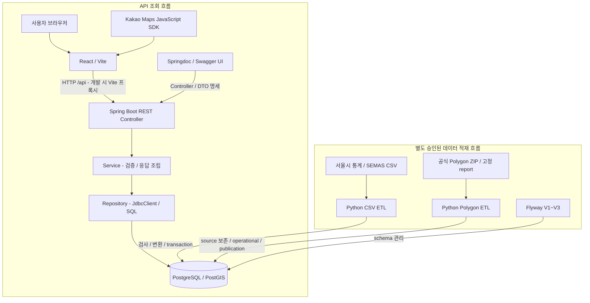
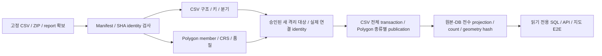

# 여기 창업해도 돼? — RecycleYoungs

## 프로젝트 소개

서울 지역의 창업 후보지를 공공데이터로 분석·비교하는 웹 서비스입니다. 예비 창업자가 지역 통계와 주변 경쟁 점포를 확인하고 후보지를 비교하도록 돕습니다. 현재는 카페 업종부터 지원합니다.

## 화면 미리보기

> 프론트엔드 개편 완료 후 실제 서비스 화면과 설명을 추가할 예정입니다.

## 주요 기능

> 프론트엔드 개편 및 최종 사용자 기능 확정 후 작성할 예정입니다.

## 기술 스택

버전은 [Gradle](backend/build.gradle)·[Wrapper](backend/gradle/wrapper/gradle-wrapper.properties), [npm 선언](frontend/package.json)·[lockfile](frontend/package-lock.json), [Python requirements](etl/requirements.txt)·[Dockerfile](etl/Dockerfile), [Compose](docker-compose.yml)를 대조했습니다. npm의 범위 선언과 lockfile의 실제 resolution을 구분합니다.

| 영역 | 기술·버전 | 실제 역할 |
| --- | --- | --- |
| Frontend | React / React DOM **19.3.0** | 화면 렌더링·지도 위치·후보 상태. package 선언은 `^19.2.8` |
| Frontend 빌드 | TypeScript **6.0.3**, Vite **8.3.0** | 타입 검사·개발 서버·번들·개발 `/api` 프록시. TypeScript 선언은 `~6.0.2` |
| UI | Tailwind CSS **4.3.3**, 수동 도입 shadcn Button/Card | 공통 스타일·접근성. Radix Slot 1.4.0, cva 0.7.1, clsx 2.1.1, tailwind-merge 3.7.0 사용 |
| 지도 | Kakao Maps JavaScript SDK | 지도·타일·클릭 좌표·마커·표준 줌. npm 패키지 대신 공식 SDK loader 사용 |
| Backend | **Java 21**, Spring Boot **4.1.1**, Spring MVC | REST Controller·엄격한 query 검사·Service·공통 오류 |
| SQL 조회 | Spring JDBC / **JdbcClient**, PostgreSQL JDBC driver | 명시적 SQL·행 매핑·읽기 전용 transaction. JDBC starter의 HikariCP 구성 |
| API 문서 | **springdoc-openapi-starter-webmvc-ui 3.1.1**, OpenAPI **3.1.0** | 7개 GET의 query·DTO·오류 schema 생성 및 Swagger UI. 기본 비활성화 |
| DB | PostgreSQL **16**, PostGIS **3.4** 계열 | 분기 집계·점포·공간 version 저장, 포함/거리 조회. Compose image `postgis/postgis:16-3.4` |
| Schema | Flyway **12.4.0** | Boot 관리 dependency 및 Compose migration image. V1~V3 SQL이 schema 기준 |
| ETL | Python **3.12**, pandas **2.2.3**, psycopg[binary] **3.2.3** | CSV 읽기·정규화·청크 처리·transaction 적재 |
| 공간 ETL | pyproj **3.7.0**, pyshp **3.1.6**, Shapely **2.1.2** | CRS 확인/변환·SHP/DBF 검사·source 보존·승인 repair |
| 테스트 | JUnit / Spring Test / Mockito, Vitest **5.0.3**, Testing Library **16.3.3**, jsdom **30.1.1**, unittest | DB 없는 회귀 및 별도 opt-in 통합 검사 |
| 도구 | Gradle Wrapper **9.7.1**, npm, ESLint **10.11.0**, Docker Compose, Makefile | 빌드·테스트·정적 검사·승인된 데이터 실행 진입점 |

Node.js는 24 계열로 개발 검증했으며 `engines`/`.nvmrc`로 고정돼 있지 않습니다. Python image는 `3.12-slim`입니다. Compose tag는 현재 실행 image identity나 정확한 DB patch 버전의 증거가 아닙니다. Lombok은 선언돼 있지만 현재 main Java에서 사용하지 않습니다. JPA·Spring Data JDBC·jOOQ·Nginx·AWS 배포는 현재 적용된 구성으로 표시하지 않습니다.

Springdoc 3.x는 Spring Boot 4 지원 계열입니다. 선택한 3.1.1의 [Maven Central POM](https://repo.maven.apache.org/maven2/org/springdoc/springdoc-openapi/3.1.1/springdoc-openapi-3.1.1.pom)은 Boot 4.1.0을 부모로 사용하며, 이 저장소에서는 Boot 4.1.1·Java 21에서 컴파일·전체 일반 테스트·HTTP·브라우저를 검증했습니다. [공식 저장소](https://github.com/springdoc/springdoc-openapi)와 [설치 안내](https://springdoc.org/getting-started.html)를 참고합니다.

## 아키텍처



일반 API는 적재한 DB를 조회하며 요청마다 ETL을 실행하지 않습니다. Frontend의 API client·types·hooks·components는 요청·계약·상태·표시를 나누고, Backend는 Controller → Service → Repository를 유지합니다. 통계 Service는 `READ ONLY / REPEATABLE READ`, 공간·경쟁 카페 Repository는 읽기 전용 SQL 경로를 사용합니다.

지도 좌표와 V1 점포·상권 대표 POINT는 EPSG:4326, Polygon source/operational geometry는 EPSG:5181입니다. 위치 판정은 query POINT만 5181로 변환해 `ST_Covers`를 적용합니다. 공유 경계나 overlap에 복수 행정동이 일치하면 모든 후보를 반환합니다. 경쟁 카페는 점포 POINT의 geography로 반경 500m를 판정합니다.

실자료 demo의 loopback bridge는 매 요청 원본 hash·identity 검사를 수행하는 별도 안전 경로입니다. 이 비용과 bridge의 직렬 lock은 일반 API 성능과 구분합니다.

## 배포 구조

배포 예정: Docker Compose로 전체 서비스를 구성한 후 AWS EC2에 배포하는 방안을 검토하고 있습니다. Nginx 도입도 고려 중입니다.

## ERD

정확한 DDL은 [V1](backend/src/main/resources/db/migration/V1__initial_schema.sql)·[V2](backend/src/main/resources/db/migration/V2__spatial_schema.sql)·[V3](backend/src/main/resources/db/migration/V3__semas_cafe_mapping_and_store_backfill.sql)를 기준으로 합니다. 핵심 컬럼과 **실제 DB FK만** 표시한 ERD입니다.


### V1 — 통계·점포·대표점

7개 테이블 모두 `BIGSERIAL id` PK를 갖습니다. mapping의 industry FK는 NOT NULL, 통계·매출·점포의 industry FK는 nullable입니다.

| 테이블 | 책임·주요 데이터 | UNIQUE·조회 인덱스 |
| --- | --- | --- |
| `industries` | 내부 업종 code·name·description, 기본 업종 5개 | `code` UNIQUE |
| `industry_mappings` | source별 원천 업종 code → 내부 업종 | `(source, source_code)` UNIQUE, `industry_id → industries.id` FK |
| `store_stats_dong` | 분기·행정동·업종의 점포·유사점포·개폐업·프랜차이즈 집계/비율 | `(quarter_code, dong_code, source_industry_code)` UNIQUE, 동/원천 업종/분기 lookup B-tree |
| `sales_dong` | 행정동 추정매출·거래건수 및 요일·시간·성별·연령 세부 원본. 금액/건수 BIGINT | 위와 같은 논리 key UNIQUE·lookup B-tree |
| `sales_commercial_area` | 상권·업종·분기 추정매출, 별도 공간 집계 | `(quarter_code, commercial_area_code, source_industry_code)` UNIQUE, 상권/원천 업종/분기 B-tree |
| `commercial_areas` | 상권 catalog·지역 속성·원본 X/Y·대표 `POINT(4326)` | 상권 code UNIQUE, location GiST·dong code B-tree |
| `stores` | 개별 SEMAS source ID·상호/지점·원천 분류·주소·행정/법정동·원본 좌표·`POINT(4326)` | source ID UNIQUE, location GiST·소분류/dong code B-tree |

`dong_code`, `commercial_area_code`의 통계·catalog·경계 간 조회 연결은 FK가 아닙니다. `sales_commercial_area.commercial_area_code`에도 catalog FK가 없습니다. 현재 Polygon을 역사적 통계에 FK로 묶어 같은 경계라고 가정하지 않습니다. 통계 행은 개별 점포의 매출·영업 상태가 아닙니다. V1은 분기 형식·지표 비음수·좌표 범위를 DB CHECK로 강제하지 않으므로 ETL/API 검사와 구분합니다.

### V2 — 공간 version·경계

| 테이블 | 책임·제약 |
| --- | --- |
| `spatial_dataset_versions` | BIGSERIAL PK. dataset/kind·ZIP/report/profile SHA·출처·날짜·역사적 호환성·feature count·publication. `(id, boundary_kind)`, `(dataset_id, source_file_sha256, processing_profile_sha256)` UNIQUE |
| `admin_dong_boundaries` | BIGSERIAL PK. `(dataset_version_id, boundary_kind)` 복합 FK → version `(id, boundary_kind)`. version 안의 dong code와 source feature index 각각 UNIQUE |
| `commercial_area_boundaries` | 위와 같은 복합 FK. version 안의 상권 code와 feature index 각각 UNIQUE. 원본 지역 code·속성 검증/충돌 보존 |

`ADMIN_DONG/OA-22160`, `COMMERCIAL_AREA/OA-15560`만 허용합니다. 종류별 current는 partial UNIQUE로 최대 1개이며 `PENDING → READY` publication을 관리합니다. trigger는 경계 UPDATE/DELETE를 거부하고 version metadata·READY 변경을 제한합니다. publication은 기대 feature count·가용 geometry 등 조건을 검사합니다.

source는 `GEOMETRY(GEOMETRY,5181)`, operational은 `GEOMETRY(MULTIPOLYGON,5181)`입니다. geometry의 NULL/존재와 NDR WKB SHA를 함께 검사하며 operational은 valid·nonempty입니다. operational non-NULL에 partial GiST가 있고 source GiST나 4326 Polygon 복제는 없습니다. 품질 상태 `VALID_SOURCE`, `REPAIRED_OPERATIONAL`, `REVIEW_REQUIRED`, `UNSUPPORTED`와 repair method/parameters/detail을 구분합니다. 현재 ETL은 예상 밖/미지원 원본을 자동 적재하지 않고 중단합니다.

다운로드일·파일 수정일·데이터 갱신일은 역사적 경계 기준일과 다릅니다. `reference_date_verified`는 reference date 존재와 일치해야 하며 역사적 호환성은 현재 `UNRESOLVED`입니다.

### V3 — SEMAS 카페 매핑·최소 backfill

테이블·컬럼·인덱스를 추가하지 않습니다. 실제 CAFE ID와 충돌을 검사하고 `SEMAS/I21201 → CAFE` mapping이 없을 때만 추가합니다. 기존 I21201 중 `industry_id IS NULL`만 보완하며 ID·원천 속성·POINT·다른 분류·이미 CAFE인 행을 보존합니다. lock·대상/영향 건수·잔존 NULL/충돌을 검사하고 stores sequence를 재시작하지 않습니다. `nextval`은 일반 MVCC rollback과 다르므로 실패 시 모든 sequence 값까지 원복된다고 보장하지 않습니다.

## ETL

### 입력·출처·기간

실자료는 Git에 포함되지 않습니다. 기본 Compose는 공개된 `real-data-v2` Release를 자동 다운로드하고 고정 bytes/SHA·CSV·Polygon/report 계약을 검증합니다. 아래 원본을 직접 준비하는 절차는 고급 Local mode에만 필요합니다. [manifest](data/manifest.json)와 [Polygon 고정 입력](etl/app/spatial_sources.py)은 원본 identity의 기준입니다.

| 입력 | 원천·구성 | 사용·한계 |
| --- | --- | --- |
| 점포-행정동 CSV | 서울시 상권분석서비스, CP949, 20251~20254 | `store_stats_dong` 분기 집계 |
| 추정매출-행정동 CSV | 서울시, CP949, 20251~20254 | `sales_dong` 원 단위 추정매출·거래건수 |
| 추정매출-상권 CSV | 서울시, CP949, 20251~20254 | `sales_commercial_area`. 행정동 매출과 구분 |
| 영역-상권 CSV | 서울시 catalog·X/Y·면적, CP949 | 대표 POINT. 원천 CRS 미확정으로 임의 적재 금지, Polygon 대체 불가 |
| 개별 점포 CSV | SEMAS `소상공인시장진흥공단_상가(상권)정보_서울_202606.csv`, UTF-8-SIG | `stores`. 파일명 기준 snapshot, 기준일·완전성 UNVERIFIED |
| 길단위인구-서울시 CSV | 서울 전체 2021 Q1~2026 Q2의 22행 | 지역별 수요 ETL에서 제외 |
| 행정동 Polygon ZIP | 서울시 [OA-22160](https://data.seoul.go.kr/dataList/OA-22160/S/1/datasetView.do), 425 feature·quality report | EPSG:5181 operational 경계 |
| 상권 Polygon ZIP | 서울시 [OA-15560](https://data.seoul.go.kr/dataList/OA-15560/S/1/datasetView.do), 1,650 feature·quality/repair report | overlap·H5 속성 충돌·승인 repair 보존 |

CSV의 정확한 파일명은 manifest에 있습니다. 공개 패키지의 SEMAS 공식 출처는 [파일데이터 15083033](https://www.data.go.kr/data/15083033/fileData.do)입니다. byte/hash 일치는 최초 취득 시점·정확한 원천 기준일의 증명과 다릅니다. UTF-8-SIG decoder만으로 BOM 존재를 단정하지 않습니다. manifest의 초기 CRS/BOM 기록과 후속 조사 범위 차이는 [기술 명세](docs/technical.md#manifest와-후속-검증의-범위)에 구분돼 있습니다.

### CSV ETL

[main.py](etl/app/main.py)는 `--data-dir`, `--only`, `--validate-only`를 제공합니다. [preflight.py](etl/app/preflight.py)는 존재·encoding·필수/중복 header·열 수·빈 key·중복 논리 key·필수 이름·2025년 네 분기 누락/범위를 검사합니다. 변환 모듈은 문자열 code·NULL·숫자·경위도·주소 등 원천 정보를 처리합니다.

서울시 업종은 `SEOUL`, 개별 점포 소분류는 `SEMAS` mapping으로 내부 업종에 연결합니다. `I21201 → CAFE` 외 SEMAS 확장은 검증 완료 상태가 아닙니다. 미매핑 점포를 임의로 카페로 분류하지 않습니다. 점포 경위도는 WGS84 POINT, 상권 X/Y는 근거 있는 `AREA_SOURCE_CRS` 확인 후 pyproj로 EPSG:4326 변환합니다.

**일반 CSV preflight는 manifest SHA-256 검증을 자동 수행하지 않습니다.** 실자료 demo는 manifest CSV identity·바이트·hash를 추가 검사합니다. 구조 검사와 원본 hash 검증을 혼동하지 않습니다.

선택한 CSV job 전체는 하나의 transaction에서 적재해 중간 실패 시 함께 rollback합니다. 통계/catalog loader는 삭제 후 재적재, stores full loader는 **TRUNCATE 및 ID 재시작**을 수행하므로 기존 DB backfill·일반 검증에 쓰지 않습니다. connection은 종료합니다. 단독 CLI의 DB 기본값은 identity 확인·실행 승인을 대신하지 않습니다.

### Polygon ETL

[spatial_main.py](etl/app/spatial_main.py)는 CSV와 독립돼 있습니다. 기본/`--validate-only`는 DB 미접속, `--load`는 명시적 `--dsn`과 함께 사용해야 합니다. 행정동에는 ZIP+quality report, 상권에는 ZIP+quality+repair report가 필요합니다.

[spatial_geometry.py](etl/app/spatial_geometry.py)는 ZIP·SHP/SHX/DBF/PRJ/CPG의 고정 SHA·구조·필드·feature index/code·count·CRS·encoding·2D geometry·report/profile을 검사합니다. 원본 SHP/ZIP/report를 수정하지 않습니다. source geometry를 보존하고 valid source는 `ST_Multi(source)`에 해당하는 operational MultiPolygon으로 사용합니다.

승인 repair 대상은 **3110137, 3110270, 3110234, 3110407, 3110515, 3110542** 여섯 상권뿐입니다. 고정 code·feature index·source WKB SHA·report ACCEPTABLE과 `make_valid(method="linework", keep_collapsed=True)` 결과 hash·hole·bbox·boundary·vertex set을 대조합니다. invalid source는 보존하고 operational만 보정합니다. valid source repair·`buffer(0)` fallback·line/point discard로 숨기지 않습니다.

geometry SHA는 **2D little-endian OGC WKB, SRID 미포함, ring/vertex normalize 없음**이며 ZIP/SHP SHA와 다릅니다. repair 직후 Polygon과 저장 MultiPolygon hash, `ST_Equals`와 byte/hash 동일성도 구분합니다.

[spatial_load.py](etl/app/spatial_load.py)는 종류별 transaction에서 PENDING version·경계·검사를 거쳐 READY/current를 publication합니다. 같은 고정 READY version 재사용도 무결성 확인을 수반합니다. 실패는 해당 transaction을 rollback하지만 종류 사이의 전역 rollback은 없습니다. 단독 CLI를 기존 DB 적용 안전 runner로 취급하지 않습니다. 승인된 격리 runner는 사전 검사와 실제 publication 연결 identity를 모두 확인합니다.



### 격리 실자료 검증·해석

2026-10-14 **기존 기록**은 새 격리 DB의 점포 통계 141,218행·행정동 매출 67,113행·SEMAS 554,092행·행정동 Polygon 425개·상권 Polygon 1,650개·I21201/CAFE 22,739행 대조입니다. demo는 CSV 3종과 Polygon 2종을 사용하며 상권 catalog/매출 CSV 전체를 적재한 것은 아닙니다. 현재 개발 DB 상태나 새 실행의 고정 기대값이 아닙니다.

서울시 **2025년 분기 집계**와 SEMAS **파일명 기준 2026-06 점포 snapshot**은 시점·단위가 다릅니다. 원천 snapshot catalog·전체 source의 원자적 publication·역사적 경계 호환성은 미완료입니다. 원본 overlap의 복수 `ST_Covers` match와 홍지문 H5 `CONFLICT_OBSERVED`를 숨기지 않습니다.

## 프로젝트 구조

Git 추적 파일과 실제 디렉터리를 기준으로 주요 책임을 정리했습니다. `data/raw/`는 별도 확보하는 Git 제외 원본 영역입니다.

```text
RecycleYoungs/
├── README.md / AGENTS.md
├── Makefile / docker-compose.yml / .env.example
├── backend/
│   ├── build.gradle / gradlew / gradle/wrapper/
│   └── src/
│       ├── main/java/com/example/backend/
│       │   ├── BackendApplication.java / WebConfig.java / OpenApiConfig.java
│       │   ├── admindong/       # lookup·통계·추세, query·오류·DTO
│       │   ├── location/        # 좌표→행정동·상권, 경계 metadata
│       │   └── nearby/          # CAFE/500m 점포·자료 품질
│       ├── main/resources/
│       │   ├── application.yaml
│       │   └── db/migration/    # V1~V3 SQL
│       ├── test/                # 일반 테스트·OpenAPI·문서 preview
│       ├── dbTest/              # 실제 DB opt-in smoke·fixture
│       ├── locationIntegration/ # 격리 Java runner·HTTP probe·Python 제어
│       └── demo/                # 일회용 실자료 Java 앱
├── frontend/
│   ├── package.json / package-lock.json / vite.config.ts / components.json
│   ├── .env.local.example
│   └── src/
│       ├── App.tsx
│       ├── api/                 # fetch client·공통 오류
│       ├── types/               # API·지도·후보 타입
│       ├── hooks/               # 요청 취소·후보 상태·비교 orchestration
│       ├── components/
│       │   └── ui/              # 기존 Button/Card 공통 UI
│       ├── lib/                 # Kakao SDK loader·공통 유틸리티
│       └── test/                # fixture·setup
├── etl/
│   ├── requirements.txt / Dockerfile
│   ├── app/                     # CSV·Polygon 검사/변환/적재
│   ├── control.py / control_backend.py / control_worker.py
│   ├── source_validation.py / source_control.py / source_audit.py
│   ├── demo.py / demo_worker.py / demo_checks.py / demo_safety.py
│   └── tests/                   # unittest·공간/점포 fixture·safety gate
├── data/
│   ├── manifest.json
│   └── raw/                     # 새 clone에 실자료 미포함
├── docs/
│   ├── project.md
│   ├── technical.md
│   └── db-safety.md
└── legacy/                      # 이전 실험 보존
```

`control*`는 기존 safety guard의 격리 실행 제어입니다. `source_validation.py`는 supplied before/after 순수 보존 비교, `source_control.py`는 NOT_READY inspect·비활성 SIMULATED_ONLY 모델, `source_audit.py`는 UNVERIFIED 계약 결속입니다. 실제 source collector/executor·durable crash 처리 경로는 미구현이며 모듈 PASS를 DB 적용 승인으로 해석하지 않습니다. `demo*`는 별도 일회용 실자료 경로입니다.

## 테스트 전략

| 범위 | 검증 내용 | DB·원본 조건 |
| --- | --- | --- |
| Backend 일반 JUnit | query 우선순위·HTTP/오류·Service·Repository SQL/매핑·NULL/0/숫자 문자열 | Service/JdbcClient mock. context는 DataSource/Flyway auto-configuration 제외·MockitoBean JdbcClient |
| Frontend Vitest | 렌더링·접근성·fetch/취소·후보 상태·SDK loader | mocked fetch/SDK, DB 불필요. 실제 타일·DB 성공 증거 아님 |
| ETL unittest | 구조/키·정규화·mapping·geometry·rollback·guard·source 계약 | DB/raw opt-in 없이 실행. 실제 DB/raw 필요 검사는 SKIP |
| 실제 DB opt-in | `dbTest`, ETL spatial/stores DB·raw 검사 | 승인된 격리 대상·fixture·safety gate. 일반 test와 별도, 자동 migration 가능 |
| 실자료 격리 E2E | ETL→PostGIS→Spring→React→Kakao·전수 대조·경계·3후보·복구·cleanup | 새 internal network·tmpfs DB·고정 image/input·실제 SDK. 실행별 승인 |
| Swagger/OpenAPI | context·OpenAPI 3.1 parse·7 GET·필수 query·DTO 21종·NULL union·오류·CAFE/500·기본 비활성화 | MockMvc+RANDOM_PORT loopback HTTP. DataSource/Flyway 없음·JdbcClient 미호출 검사 |
| Swagger UI | HTML·JS/CSS·swagger-config·JSON 및 브라우저 명세 표시 | `swaggerPreview` 테스트 서버만 사용. 실데이터 API 검증과 구분 |

**과거 기록:** 2026-10-14 실자료 최종 검증 당시 Backend **230 PASS**, Frontend **235 PASS**, ETL **277 PASS / 15 SKIP**. Bridge **33 PASS는 ETL 277에 포함**, 실제 TCP RST 후 복구 3회 PASS였습니다. 당시 승인·입력·환경의 결과입니다.

**이번 문서 경로 개선 검증:** Java **21.0.12** / Boot **4.1.1** / Springdoc **3.1.1**, Backend **244 PASS / 0 FAIL / 0 SKIP**(문서 테스트 14개 포함), `test build` PASS. DB 없는 preview의 새 공식 UI/JSON·redirect·JS/CSS/config·브라우저의 7 GET을 검증했습니다. 이전 README/OpenAPI 작업의 242 PASS와 구분하며, 기존 DB·Docker·raw E2E와 Frontend/ETL은 이번에 재실행하지 않았습니다.

### 데이터 해석·기술적 한계

서비스는 창업 성공·수익·폐업을 예측하거나 보장하지 않습니다. 출처·기간·집계 단위·한계를 함께 해석해야 하며, 행정동 추정매출을 후보 반경의 매출이나 개별 가게의 이익으로 환산하지 않습니다.

| 유지하는 상태·한계 | 의미 |
| --- | --- |
| 과거 기존 개발 DB **NOT_READY** | V1 BASELINE 상태에서 migration/ETL을 추가 적용하지 않음. 2026-10-14 별도 승인으로 읽기 전용 감사·백업·독립 복원·팀 DB 대조 후 기존 Docker 환경 제거. 백업은 비공개 로컬 보존 |
| SEMAS snapshot·원천 기준일 **UNVERIFIED** | 파일명의 `202606`은 완전한 영업 현황·정확한 기준일의 증명이 아님. 누락을 폐업으로 단정하지 않음 |
| 역사적 경계 호환성 **UNRESOLVED** | 확보한 operational 경계가 2025년 통계 당시 경계와 같다고 보증하지 않음 |
| source overlap·홍지문 H5 속성 충돌 | 원본 보존·모호성·품질 metadata 공개. 임의 보정·단일 후보 선택 금지 |
| Java/JDBC 즉시 query cancellation 미구현 | 브라우저 요청 취소가 진행 중 SQL의 즉시 취소를 보장하지 않음 |
| 운영 배포·부하·인증 미완료 | 일회용 MVP 검증을 운영 준비·보안 검증으로 확대하지 않음 |

상세 구현은 [기술 명세](docs/technical.md), 진행 기록은 [프로젝트 문서](docs/project.md), 실제 DB 작업의 승인·복구 정책은 [DB 안전 정책](docs/db-safety.md), 작업 규칙은 [AGENTS.md](AGENTS.md)를 기준으로 합니다.

## 실행 방법

### 팀원 빠른 시작

Java 21, Node.js/npm(현재 검증 Node 24), Python 3.12 권장, Docker Engine/Desktop와 Compose v2 이상을 준비합니다. Docker에 약 4GB 이상의 여유 메모리와 데이터·이미지용 디스크 공간이 필요합니다. Backend/Frontend는 호스트에서 실행합니다.

공개된 [real-data-v2 Release](https://github.com/jinwooorp/RecycleYoungs/releases/tag/real-data-v2)를 기본 `release` 모드로 사용합니다. CSV·Polygon을 따로 준비할 필요가 없습니다. 실제 공개 HTTPS 다운로드·패키지 무결성·cache 재사용은 검증했으며, **이 활성화 변경의 독립 DB·서비스 clean clone E2E는 아직 검증 대기**입니다. 운영 배포 완료를 뜻하지 않습니다.

```sh
git clone https://github.com/jinwooorp/RecycleYoungs.git
cd RecycleYoungs

# 최초 실행: DB 접속 없는 동일 이름 자원·포트 충돌 검사
python3 etl/team_dev.py preflight
docker compose up -d
```

기존 동일 이름 자원이 있으면 임의 재사용·삭제하지 않습니다. 이 저장소에서 이전에 준비한 환경은 아래 status로 소유권과 실제 준비 상태를 확인합니다. `COMPOSE_PROJECT_NAME`, `-p`, Compose override를 사용하지 않습니다.

`up -d` 반환은 ETL 완료가 아닙니다. 다음 명령에서 **READY**를 확인합니다. 아직 준비되지 않았으면 실패 단계의 로그를 확인하고 원인을 해결한 뒤 같은 `up -d`를 재실행합니다. status는 무한 대기하지 않습니다.

```sh
docker compose ps -a
docker compose logs --tail=30 inspect-proxy preflight data-init db-identity db-migrate etl-init
python3 etl/team_dev.py status
```

별도 터미널 두 개에서 실행합니다. `bootRun`은 READY·Docker 소유권·DB 전수 fingerprint를 검사하고, 새 팀 DB의 읽기 전용 계정만 사용합니다. 준비 전에는 명확한 오류로 종료합니다. process에 예전 `DB_*`/`PG*`/`FLYWAY_*`/`SPRING_*` 설정이 있으면 제거한 별도 셸을 사용합니다. 새 사용자는 루트 `.env` 없이 기본 v2를 사용합니다. **기존 v1 사용자는 아래 보존 설정을 먼저 적용해야 합니다.**

Backend:

```sh
cd backend
./gradlew bootRun
```

Frontend:

```sh
cd frontend
npm ci
# 기존 파일이 없을 때만 복사하고 본인 JavaScript 앱 키를 입력
test -e .env.local || cp .env.local.example .env.local
npm run dev
```

`frontend/.env.local`의 `VITE_KAKAO_MAP_APP_KEY`를 설정하고 Kakao Developers에 **http://localhost:5173** origin을 등록합니다. localhost와 127.0.0.1은 서로 다른 origin입니다. 키는 Git·Docker 이미지에 포함하지 않습니다. 키가 없으면 지도 SDK와 실제 클릭은 미검증이며, API·일반 UI 테스트는 따로 실행할 수 있습니다.

Docker socket은 전용 `inspect-proxy` 하나만 마운트합니다. 초기화 서비스는 host port가 없는 internal network에서 고정된 GET inspect와 필요한 metadata만 받습니다. 변경 요청·타 프로젝트·임의 경로는 거부합니다. socket의 `:ro`가 Docker API 권한을 제한하는 것은 아니며, proxy 자체가 침해되면 daemon 권한에 접근할 수 있습니다. 신뢰한 코드·고정 이미지로 구성된 로컬 개발 환경에서만 실행하며 운영 설정으로 사용하지 않습니다.

- 서비스: [http://localhost:5173](http://localhost:5173)
- API 예: [http://localhost:8080/api/industries](http://localhost:8080/api/industries)
- Swagger UI: [http://localhost:8080/api/docs](http://localhost:8080/api/docs)
- OpenAPI JSON: [http://localhost:8080/api/v3/api-docs](http://localhost:8080/api/v3/api-docs)

정상 흐름은 지도 클릭 → 행정동/상권 확인 → 2025년 분기·업종 통계 → 500m 주변 카페 → 최대 3후보 비교입니다. 서울시 분기 통계와 SEMAS 202606 snapshot의 시점은 다르며 성공·수익·폐업 예측이 아닙니다.

종료는 각 개발 서버 터미널에서 `Ctrl+C`입니다. DB/cache/control volume은 기본 보존합니다. DB를 멈출 때만 `docker compose stop team-postgres`를 사용하고, 재시작은 `docker compose up -d` 후 status로 확인합니다. `down -v`·volume 삭제·자동 재적재는 빠른 시작 절차에 없습니다. 다른 사람의 listener/process를 종료하지 않습니다.

### 기존 v1 보존과 고급 Local mode

기본 Dataset version은 **real-data-v2**입니다. 기존 v1 DB는 자동 업그레이드하지 않습니다. 기존 루트 `.env`를 덮어쓰지 말고 다음 두 설정을 직접 명시합니다. `.env` 전체를 source하지 않습니다.

```dotenv
TEAM_DATA_MODE=local
TEAM_DATA_VERSION=real-data-v1
```

기존 v1 Backend와 status를 실행할 **각 호스트 셸**에서도 `export TEAM_DATA_VERSION=real-data-v1`을 지정합니다. 루트 `.env`는 Compose만 읽으며 Python/Gradle에는 자동 전달되지 않습니다. version/contract가 기존 ledger·cache·DB와 다르면 자동 이관 대신 명확히 거부합니다. 원인을 확인하기 위해 기존 볼륨을 삭제하거나 초기화하지 않습니다.

Local mode는 원본 8개를 이미 가진 사용자를 위한 명시적 선택입니다. 기존 v1은 위 설정을 유지하고, **기존 v1과 분리된 새 daemon/VM**에서만 `TEAM_DATA_MODE=local TEAM_DATA_VERSION=real-data-v2 docker compose up -d`로 공개용 파생 report를 생성·검증할 수 있습니다. 해당 Backend/status 셸도 같은 버전을 사용해야 합니다. 다음은 Local mode 전용 저장소 상대 경로이며 새 사용자의 Release 빠른 시작에는 필요하지 않습니다.

| 입력 | 경로 |
| --- | --- |
| 점포 통계 CSV | `data/raw/dataset/서울시 상권분석서비스(점포-행정동)_2025년.csv` |
| 추정매출 CSV | `data/raw/dataset/서울시 상권분석서비스(추정매출-행정동)_2025년.csv` |
| SEMAS CSV | `data/raw/dataset/소상공인시장진흥공단_상가(상권)정보_서울_202606.csv` |
| 행정동 ZIP | `data/raw/spatial/서울시 상권분석서비스(영역-행정동).zip` |
| 행정동 report | `data/raw/spatial/validation-results.json` |
| 상권 ZIP | `data/raw/spatial/stage4-research-20261007/official-commercial-area.zip` |
| 상권 quality report | `data/raw/spatial/stage56-validation-20261007/results.json` |
| 상권 repair report | `data/raw/spatial/six-repair-validation-20261007/results.json` |

CSV는 [manifest](data/manifest.json)의 bytes/SHA/기간/행 수, Polygon/report는 [spatial_sources.py](etl/app/spatial_sources.py)의 고정 identity와 승인된 6개 repair 계약으로 검증합니다. 다른 기간·report로 대체하지 않습니다. `data-init`은 원본을 read-only로 읽고 검증된 byte-identical 사본만 전용 cache volume에 공개합니다.

### Release mode와 고정 데이터

현재 [release.json](data/release.json)은 실제 공개 asset을 `PUBLISHED`로 고정합니다. [런타임 선택](etl/team_dataset.py)은 v1/v2 allowlist, 선택 version과 같은 tag·asset·SHA를 검증하며 v2 archive SHA도 추가 고정합니다. `latest`·임의 URL·환경 변수 URL을 받지 않습니다. v1은 공개하지 않았으므로 `v1/local`을 명시하며, v2 Release 설정과 v1을 혼용하면 cache가 있어도 거부합니다.

- Tag: `real-data-v2`, asset: `recycleyoungs-real-data-v2.zip`.
- [고정 다운로드 URL](https://github.com/jinwooorp/RecycleYoungs/releases/download/real-data-v2/recycleyoungs-real-data-v2.zip), 87,870,777 bytes.
- SHA-256: `6b11901f46d1a207c5b36353483e209f00a10fb401edcc5fd036a3025238ff0b`.
- dataset contract: `0d27a0e526cd249d7adebf374b7be646fd5122ba5cede8b558117dd11d761994`.

공개된 asset·tag·계약은 불변입니다. 데이터 갱신은 새 버전·hash와 별도 검증이 필요하며 기존 DB는 자동 업데이트하지 않습니다. 독립 환경의 clean clone DB·서비스 E2E는 아직 대기 중입니다.

다운로드는 HTTP 상태/redirect host/길이/전체 SHA → 안전한 ZIP 경로 → 버전별 내부 SHA·중복 없는 JSON·report/ETL 계약을 검증합니다. v1은 9 members, v2는 ATTRIBUTION을 포함한 10 members입니다. 부분 파일이나 손상 cache는 정상 처리하지 않습니다. cache는 version별 디렉터리와 즉시 실패하는 writer lock을 사용하며, 검증 성공 후에만 공개합니다. 실패 staging은 보존하고 프로세스 종료 시 lock은 해제돼 안전한 재시도가 가능합니다. 동일 버전 재실행은 전체 cache를 재검증하며 다운로드와 destructive ETL을 생략합니다.

기존 `real-data-v1` 후보는 원본 리포트의 개인 임시 경로를 포함해 **공개하지 않습니다**. 원본 8개와 기존 후보 ZIP은 보존하며, 현재 READY DB도 계속 v1 계약을 사용합니다.

공개된 **`real-data-v2`**는 아래 원본·파생본을 묶은 고정 패키지입니다. 새 사용자는 이미 검증된 asset을 다운로드하며 재패키징하지 않습니다.

CSV 3개·Polygon ZIP 2개의 bytes/SHA는 v1과 동일합니다. 리포트 3개는 경로·실행 명령·컨테이너 metadata만 명시적으로 제거한 파생본이며, 원본 hash·변경 항목·보존한 검증 엔진 버전을 기록합니다. 공간 수치·판정·features·재현 hash·6개 repair 결과는 보존합니다. 8개 입력과 `ATTRIBUTION.json`·`dataset.json`, 총 10개 member입니다. [공개 데이터 계약](data/public-data-v2.json)이 리포트 hash와 출처를 고정합니다. 실자료·ZIP·리포트를 Git blob에 추가하지 않습니다.

`team_public_data.py`는 offline 파생/패키징 전용이며, `team_dataset.py`가 버전별 다운로드/cache/순수 ETL 준비를 담당합니다. DB 초기화는 기존 `team_db.py` 경로를 재사용합니다. control ownership·DB state·Flyway 연결·Backend proof에 선택 version과 contract를 결속하며 SID·volume·full fingerprint·reader 검사를 유지합니다. 기존 v1 ledger에 version이 없으면 v1로만 해석하고, v2 선택 시 chmod·credential 생성·SQL 쓰기 모드 전환 전에 거부합니다. READY 재실행은 setup DDL·checkpoint·loader를 실행하지 않습니다.

새 환경 기본값은 v2/release이며 기존 READY DB를 v2로 선언하거나 재적재하지 않습니다. **같은 Docker daemon에서 기존 v1과 v2를 별도 project override로 병행 실행하지 않습니다.** 기존 v1 DB가 있는 경우 v2 최초 실행은 독립 daemon/VM/runner에서만 수행합니다. 공개 HTTPS → 새 빈 cache → 10개 member/입력/geometry 검증 → cache 재사용은 확인했고, 실제 v2 DB 적재·API·지도·clean clone E2E는 별도 검증 범위입니다.

### 원본 이용조건과 공개 고지

2026-10-15 공식 페이지 재확인 결과입니다. 공공누리 1유형은 출처표시 조건으로 공유·상업적 이용·변경을 허용하며 기관 후원으로 오인시키면 안 됩니다([일반증서](https://www.kogl.or.kr/info/licenseType1.do)). 같은 날 공식 파일을 다시 읽어 로컬 원본 CSV 3개와 Polygon ZIP 2개의 bytes/SHA 일치를 확인했습니다. 이는 최초 취득 시점·경계 기준일을 확정하거나 프로젝트 리포트에 별도 공개 허락을 부여하는 증거가 아닙니다. 기존 manifest의 NULL은 보존합니다.

| 자료 | 공식 출처·이용조건 | 공개 고지·남은 한계 |
| --- | --- | --- |
| 점포-행정동 2025 | [서울시 OA-22172](https://data.seoul.go.kr/dataList/OA-22172/S/1/datasetView.do), 공공누리 1유형 | 공식 2025 ZIP member와 byte 일치. 기관·자료명·링크·이용조건을 후보에 고지. 최초 다운로드 시점 UNKNOWN |
| 추정매출-행정동 2025 | [서울시 OA-22175](https://data.seoul.go.kr/dataList/OA-22175/S/1/datasetView.do), 공공누리 1유형 | 위와 동일 |
| SEMAS 서울 202606 | [파일데이터 15083033](https://www.data.go.kr/data/15083033/fileData.do), 이용허락범위 제한 없음 | 공식 20260630 전국 ZIP의 서울 202606 member와 byte 일치. 최초 취득 시점·정확한 snapshot 기준일은 미확인. 공개 점포명·주소·좌표 포함 고지 |
| 행정동 Polygon | [서울시 OA-22160](https://data.seoul.go.kr/dataList/OA-22160/S/1/datasetView.do), 공공누리 1유형 | 공식 ZIP 전체 byte 일치. 출처표시 고지. 실제 경계 기준일 UNKNOWN |
| 상권 Polygon | [서울시 OA-15560](https://data.seoul.go.kr/dataList/OA-15560/S/1/datasetView.do), 공공누리 1유형 | 위와 동일. source 원본 보존, operational repair 6개 고지 |
| 행정동 validation report | 프로젝트 생성 기록·사용자 진술 확인, v2는 파생본. 보유·관리 권리 범위의 CC BY 4.0 | 개인 임시 경로 제거. 사용자가 공개 권한·필요 동의 확인 후 Public 업로드 승인. 제3자 권리는 별도 조건 |
| 상권 quality report | 위와 동일 | 원본 판정·통계 보존, 불필요한 재사용 경로 제거. 보조자료 인용 관계 고지 |
| 상권 repair report | 위와 동일 | 실행 환경 제거, 검증 엔진 버전·6개 승인 결과·replay 보존. 동일한 Public 공개 승인 범위 |

공개 상태는 **PUBLISHED**입니다. 사용자 명시 승인 후 검증된 코드 커밋을 대상으로 `real-data-v2`를 공개하고 서버 digest·실제 HTTPS 다운로드를 검증했습니다. 추가 데이터나 새 버전의 공개 승인을 대신하지 않습니다. 서울시 2024년 이후 집계 기준 변경, 역사적 경계 호환성 UNRESOLVED·H5 충돌·source overlap 한계는 그대로 유지합니다.

사용자는 보유하거나 적법하게 관리하는 권리 범위에서 공개용 report 3개의 [CC BY 4.0](https://creativecommons.org/licenses/by/4.0/) 배포조건을 선택했고, 출처표시명은 **RecycleYoungs 프로젝트**입니다. 공유·재배포·변경·상업적 이용을 허용하며 출처·라이선스 링크·변경 고지와 후원 오인 금지 조건을 따릅니다. 허용된 이용을 추가로 제한할 수 없으며 조건을 준수하는 이용허락은 임의 철회할 수 없습니다. 이 조건은 프로젝트가 허락할 수 있는 리포트의 표현과 산출물에만 적용하고 서울시·SEMAS 원본 및 다른 권리자의 권리를 변경하지 않습니다. 검토한 기록에서 팀원·학교 등의 별도 권리 약정은 찾지 못했지만 기록 밖의 계약은 UNKNOWN입니다. 별도 권리가 있다면 해당 권리자의 동의나 이용조건 확인이 필요합니다.

이 고지를 `ATTRIBUTION.json`에 반영해 공개한 ZIP은 **87,870,777 bytes**, SHA-256 `6b11901f46d1a207c5b36353483e209f00a10fb401edcc5fd036a3025238ff0b`입니다. 이전 v2 후보·원본·v1 계약·기존 READY DB는 보존합니다. 공개된 `real-data-v2`는 이 계약으로 고정하며 이전 미공개 후보/cache와 혼용하지 않습니다. 신규 기본값 변경은 기존 v1의 데이터나 설정을 자동 변경하지 않습니다.

### DB 없는 문서·회귀 검사와 기존 DB 보호

DB 없는 Swagger는 `cd backend && ./gradlew swaggerPreview`로 127.0.0.1:18080에서 실행합니다. mock 문서 서버이며 실제 데이터 조회 성공 증거가 아닙니다. 일반 회귀는 [테스트 전략](#테스트-전략)을 따릅니다.

기존 DB `startup_analysis`, container `startup-analysis-postgres`, volume `recycleyoungs_postgres_data`는 **2026-10-14 별도 승인된 백업·독립 복원·전수 데이터 대조 후 제거**했습니다. 팀 공통 개발 환경은 위 `recycleyoungs-team-dev` / `127.0.0.1:55432`이며 새 Compose는 기존 이름·5432 host port를 사용하지 않습니다. 같은 이름의 자원이 다시 생겨도 자동으로 연결·재사용·삭제하지 않습니다. 기존 자원의 SQL·migration·ETL·start/stop/recreate·mount/restore/delete는 이 빠른 시작 범위에 포함되지 않습니다. 백업과 보호 정책은 [db-safety](docs/db-safety.md#2026-10-14-로컬-환경-통일), 과거 일회용 검증은 [technical](docs/technical.md#실자료-격리-시연)을 참고합니다.

## API 문서

[통계 Controller](backend/src/main/java/com/example/backend/admindong/AdminDongController.java)·[위치](backend/src/main/java/com/example/backend/location/LocationController.java)·[경쟁 카페](backend/src/main/java/com/example/backend/nearby/NearbyController.java)의 어노테이션과 validator·Service·DTO·ExceptionHandler가 기준입니다. 문서 어노테이션은 기존 HTTP 상태·DTO·검사·비즈니스 로직을 바꾸지 않습니다.

### 7개 GET API

| Endpoint | 필수 query | 정상 200 응답·의미 | 오류 HTTP |
| --- | --- | --- | --- |
| `/api/admin-dongs` | 없음, query 금지 | `NamedCode[]`: 매핑된 통계·매출에서 조회 가능한 동 code/name | 400, 500 |
| `/api/industries` | 없음, query 금지 | `NamedCode[]`: 서울시 mapping·자료가 있는 내부 업종 | 400, 500 |
| `/api/quarters` | 없음, query 금지 | `Quarter[]`: 실제 lookup code/label. 현재 검증 입력 20251~20254 | 400, 500 |
| `/api/admin-dong-stats` | dongCode, industryCode, quarterCode | `Stats`: 동·업종·분기·점포/매출·missingReasons. 행 부재도 200 | 400, 500 |
| `/api/admin-dong-trends` | dongCode, industryCode | `Trend`: 항상 20251~20254 오름차순 4개, 누락 분기도 유지 | 400, 500 |
| `/api/locations/resolve` | lat, lng | `Resolution`: coordinate·adminDong·commercialArea·dataset/품질. 모호성/미지원도 200 | 400, 500, 503 |
| `/api/nearby-stores` | lat, lng, radius, industryCode | `NearbyStoresResult`: 전체 count·최대 100개·거리·품질/snapshot | 400, 500, 503 |

query는 **허용된 이름만 각각 정확히 한 번** 전달합니다. 미정의·중복·누락·빈 값은 400 `INVALID_PARAMETER`이며 공백을 trim해서 보정하지 않습니다. lookup에는 query가 전혀 없습니다.

| 파라미터 | 형식·지원 범위 |
| --- | --- |
| `dongCode` | ASCII 8자리 `^[0-9]{8}$`. 실제 지원값 `/api/admin-dongs` |
| 통계 `industryCode` | `^[A-Z][A-Z0-9_]{0,29}$`. 내부 업종·지원값 `/api/industries`. 현재 고정 통계 자료 CAFE/HAIR/KFOOD/PUB와 경쟁 카페 전용 조건 구분 |
| `quarterCode` | `^[1-9][0-9]{3}[1-4]$`, 예: 20251. 실제 `/api/quarters` 확인. 추세는 quarterCode를 받지 않음 |
| `lat` / `lng` | 위도 -90~90 / 경도 -180~180, 최대 64자 십진수·지수 표기·유한값. NaN/Infinity/공백/0 underflow 거부, 원래 십진수로 범위 검사 |
| 경쟁 카페 `radius` | 문자열 **500만** 허용(m). 500.0/+500/0500 미지원 |
| 경쟁 카페 `industryCode` | 대문자 **CAFE만** 허용 |

### DTO·NULL·0·metadata

OpenAPI components는 실제 record DTO **21종**의 필드와 대조합니다. 중첩 JSON Schema는 UI의 Schema와 `/api/v3/api-docs`에서 확인합니다.

| 계약 | 실제 표현 |
| --- | --- |
| lookup | `NamedCode {code,name}`, `Quarter {code,label}` 배열. 빈 배열도 정상 200 |
| 통계/추세 | dong·industry·분기·storeStats·salesStats·missingReasons. 점포 5개 건수, 매출은 추정매출·거래건수·평일/주말 매출 4개 필드 |
| 행 없음 | storeStats/salesStats 객체 **null**, 해당 missingReasons **NO_ROW** |
| 개별 NULL | 객체는 존재하고 지표만 **null**, missingReasons는 null |
| 정상 0 | 점포 건수 **정수 0**, 매출/거래건수 **문자열 `"0"`**. 금액 원·건수 건 |
| 큰 정수 | 매출/거래건수는 부호 있는 10진 BIGINT 문자열(`^-?[0-9]+$`). 공간 dataset version·카페 totalCount/quality 7개 건수도 문자열. JS safe integer 밖 정밀도 보존 |
| 행정동 | `RESOLVED` 단일 동, `AMBIGUOUS_BOUNDARY` 모든 candidates+resolvedDong=null, `OUTSIDE_OR_UNSUPPORTED` 0개/투영 미지원+reason=`NO_COVERING_OPERATIONAL_BOUNDARY` |
| 상권 | MEMBERSHIP/NO_MEMBERSHIP·모든 memberships. pointRelation INTERIOR/BOUNDARY, source 속성 UNVERIFIED/CONFLICT_OBSERVED |
| dataset | version/id/name/sourceUrl/sourceCrs/referenceDate/referenceDateVerified/historicalCompatibilityStatus/validationStatus/loadedAt. 기준일·역사적 UNRESOLVED 유지 |
| 경쟁 카페 | radiusMeters=500, totalCount 문자열, listedCount·listLimit=100·listComplete·stores. 거리 오름차순·동률 sourceStoreId C collation, SEMAS/I21201 |
| 정상 카페 0개 | 가용 자료에서 totalCount=`"0"`·stores=[]·listedCount=0·listComplete=true. 자료/매핑 미준비는 503 |
| snapshot | AVAILABLE_RECORDS·UNVERIFIED, referenceDate/loadedAt=null. 누락/미분류/좌표 품질을 따로 제공 |

nullable 객체는 OpenAPI 3.1의 `anyOf(객체 schema, null)`로 표현해 `$ref` 옆 type 배열이 실제 null을 잘못 거부하지 않도록 보정합니다. 서울시 매출은 SEMAS 반경 점포의 매출이 아니며 같은 행정동 후보는 같은 집계를 공유할 수 있습니다.

### 공통 오류

JSON은 `{code,message,field}`입니다. 400은 오류 query 이름, 500/503은 field=null이며 내부 SQL·credentials·예외 세부 정보를 노출하지 않습니다.

| HTTP | code | 적용·의미 |
| --- | --- | --- |
| 400 | INVALID_PARAMETER | 미정의/중복/누락/빈 query. lookup은 추가 query만 해당 |
| 400 | INVALID_DONG_CODE, INVALID_INDUSTRY_CODE | 통계/추세 code 형식 오류 |
| 400 | INVALID_QUARTER | 단일 분기 통계 형식 오류 |
| 400 | UNKNOWN_DONG, UNKNOWN_INDUSTRY | 통계/추세 lookup에 없는 코드 |
| 400 | UNSUPPORTED_INDUSTRY | 통계/추세 mapping·자료 미지원, 경쟁 카페 CAFE 외 입력 |
| 400 | UNSUPPORTED_QUARTER | 단일 통계 lookup 미지원 분기 |
| 400 | INVALID_COORDINATE | 위치/경쟁 카페 좌표 형식·길이·유한값·범위 |
| 400 | UNSUPPORTED_RADIUS | 경쟁 카페 문자열 500 이외 |
| 503 | BOUNDARY_DATA_UNAVAILABLE | 위치의 current READY 경계 부재·미준비 |
| 503 | CAFE_MAPPING_UNAVAILABLE | CAFE/SEMAS I21201 mapping 부재·불일치 |
| 503 | STORES_DATA_UNAVAILABLE | 전체 점포 자료 없음 |
| 503 | CAFE_DATA_UNAVAILABLE | 가용 카페 자료 없음 |
| 500 | DATA_INTEGRITY_ERROR | lookup/분류·중복·건수·경계·목록 등 무결성 오류 |
| 500 | INTERNAL_ERROR | 기타 내부 예외 |

### Swagger 활성화 정책

| 실행 환경 | 공식 Swagger UI | 공식 OpenAPI JSON | 검증 범위 |
| --- | --- | --- | --- |
| READY team-dev의 `./gradlew bootRun` | [http://localhost:8080/api/docs](http://localhost:8080/api/docs) | [http://localhost:8080/api/v3/api-docs](http://localhost:8080/api/v3/api-docs) | 팀 전용 reader·실자료 API·실제 UI/JSON 검증 |
| DB 없는 preview | [http://127.0.0.1:18080/api/docs](http://127.0.0.1:18080/api/docs) | [http://127.0.0.1:18080/api/v3/api-docs](http://127.0.0.1:18080/api/v3/api-docs) | 실제 HTTP·브라우저 PASS |

`/api` 자체는 Swagger UI 주소가 아닙니다. `/api/docs`는 302로 내부 `/api/swagger-ui/index.html`에 이동하며 JS/CSS/initializer도 `/api/swagger-ui/`에서 로딩됩니다. `/api/v3/api-docs/swagger-config`의 명세 URL은 `/api/v3/api-docs`입니다. 별도 context path·rewrite·resource handler를 추가하지 않았고 기존 비즈니스 API 7개도 `/api/` 그대로입니다.

일반 `application.yaml`/bootJar는 **OPENAPI_ENABLED=false가 기본**이며 새 JSON·swagger-config·UI와 이전 `/v3/api-docs`, `/swagger-ui.html` 등 접근의 404를 테스트했습니다. 일반 `bootRun`은 READY를 확인한 team-dev profile에서 JSON/UI를 명시 활성화하므로 추가 환경 변수가 필요하지 않습니다. DB 없는 `swaggerPreview`도 별도로 활성화합니다. 루트 `.env`는 Spring에 전달되지 않으며 Swagger 활성화는 DB/migration 허가가 아닙니다. `disable-swagger-default-url=true`로 Petstore fallback을 제거했습니다.

인증은 미구현입니다. 활성화하면 명세·Swagger 요청 실행 기능이 접근 가능한 사용자에게 노출되며 API를 숨기거나 권한을 추가하는 보안 기능이 아닙니다. 운영 기본 비활성화를 유지하고 접근 제한은 별도 설계해야 합니다. `/api/**`의 새 Controller는 명세에 자동 포함될 수 있어 7개 경로 테스트가 변경 검토를 요구합니다. 기존 API 접근 제어·CORS는 변경하지 않았습니다.

## 환경 변수

루트 `.env`는 Compose, `frontend/.env.local`은 Vite가 읽습니다. Spring은 루트 `.env`를 읽지 않습니다. 기존 개인 설정을 덮어쓰지 않습니다.

| 설정 | 적용 범위 | 기본값·정책 |
| --- | --- | --- |
| `TEAM_DATA_MODE` | 새 팀 Compose의 data-init | 기본 `release`. 기존 v1 사용자는 개인 `.env`에 `local` 명시 |
| `TEAM_DATA_VERSION` | Compose worker·Flyway / 호스트 status·bootRun | 기본 `real-data-v2`. 기존 v1은 개인 `.env`와 각 호스트 셸에 `real-data-v1` 명시. 루트 `.env`는 Python/Gradle에 자동 전달되지 않음 |
| Dataset version / URL / SHA | [data/release.json](data/release.json)·[런타임 선택](etl/team_dataset.py) | `PUBLISHED`, 정확한 v2 tag/asset/SHA 고정. v1/v2 계약 분리, 임의 URL/latest·자동 DB version 변경 금지 |
| DB host port·이름·role | 새 팀 Compose / guarded bootRun | `127.0.0.1:55432/recycleyoungs_team_dev`. 고정 identity, 비밀번호는 control volume에서 임의 생성 |
| `TEAM_DEV_*` | Gradle → team-dev JVM 내부 전달 | metadata/READY 확인 후 메모리로 전달. 직접 설정하거나 로그에 출력하지 않음 |
| `DB_*`, `PG*`, `FLYWAY_*`, `SPRING_*` | 기존 일반 실행·독립 ETL 또는 기존 테스트 | 새 Compose는 참조하지 않음. 일반 `bootRun`에서는 process 주입을 거부. 보호 DB 접속 승인 아님 |
| `COMPOSE_PROJECT_NAME`, `-p`, Compose override | Compose | 팀 환경에서는 사용하지 않음. 고유 service key로 기존 postgres reconciliation을 피하고 guard가 다른 project를 거부 |
| `VITE_KAKAO_MAP_APP_KEY` | Frontend | 본인 JavaScript 키. `frontend/.env.local`에만 보관, localhost:5173 origin 등록 |
| `RECYCLEYOUNGS_DEMO_API_PROXY` | 기존 일회용 demo Vite process | 미설정 시 localhost:8080. demo용 명시 loopback endpoint만 허용 |
| `OPENAPI_ENABLED` | 일반 application.yaml/bootJar | 기본 **false** 유지. 팀 개발 profile과 DB 없는 swaggerPreview에서만 명시 활성 |
| `FRONTEND_ORIGINS` | Spring CORS | localhost:5173 / 127.0.0.1:5173. 인증 기능이 아님 |
| `AREA_SOURCE_CRS`, `DATA_DIR`, `STORE_CHUNK_SIZE` | 기존 독립 CSV ETL | 기존 계약 유지. 팀 pipeline은 명시 입력 3개·검증된 Polygon 경로를 사용 |
| `SPATIAL_TEST_DSN`, `STORES_TEST_DSN`, `STORES_REAL_DSN` 등 | 기존 DB/raw opt-in 테스트 | 일반 회귀에서 미설정. 새 팀 검증은 별도 명시적 `team_checks.py --owned-team-db` 사용 |

API key·비밀번호·credential DSN·백업·private evidence를 Git·공개 로그에 저장하지 않습니다. team-dev의 host 연결은 새 DB 한 곳만 허용하며 운영 설정으로 사용하지 않습니다.
