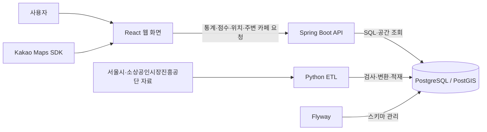

# 여기 창업해도 돼? — RecycleYoungs

## 프로젝트 소개

서울에서 창업을 준비하는 사람들을 위한 공공데이터 기반 MVP 서비스입니다. **현재는 카페 업종만 지원**합니다.

후보 지역의 소비 동향과 주변 경쟁 카페를 함께 살펴보고, 창업을 검토할 때 추가로 확인할 사항을 정리하도록 돕습니다. 지도에서 위치를 탐색하고 상세 근거를 확인한 뒤, 관심 있는 후보지를 최대 3곳까지 비교할 수 있습니다.

## 화면 미리보기

현재 구현된 데스크톱 화면입니다. 이미지를 누르면 원본 크기로 볼 수 있습니다.

| 지도 탐색·검토 요약 | 주변 카페·브랜드 필터 |
| :---: | :---: |
| [](docs/images/map-explore.jpg)<br>지역을 선택하고 소비 신호와 검토 요약을 확인합니다. | [](docs/images/nearby-cafes.jpg)<br>주변 카페의 위치·거리를 살펴보고 추정 브랜드로 목록을 좁힙니다. |
| **상세 분석** | **후보 비교** |
| [](docs/images/detail-analysis.jpg)<br>점수와 소비·점포 그래프로 지역의 변화를 살펴봅니다. | [](docs/images/candidate-comparison.jpg)<br>후보별 소비 신호·주변 카페 수·다음 확인사항을 같은 분기로 비교합니다. |

## 주요 기능

| 기능 | 설명 |
| --- | --- |
| 지도 탐색 | 서울 구·행정동 검색, 서울 외곽선·선택 동 경계 표시, 지점 선택과 행정동·상권 확인 |
| 검토 요약·점수 | 소비규모·소비증감의 100점 상대 점수, 실제 증감 방향과 추가 확인사항 안내 |
| 주변 카페 탐색 | 반경 500m 카페의 상호·직선거리와 밀집 점포 묶음, 11개 브랜드 추정·미식별 필터 제공 |
| 상세 분석 | 검토 근거·점수 설명·선택 분기 수치와 소비·점포 그래프 제공. 정확한 값과 세부지표는 펼쳐 보기 |
| 후보지 비교 | 최대 3곳의 소비 신호·주변 카페 수·확인사항 비교. 같은 행정동의 소비 근거는 공유 표시 |
| 참고 자료·세부 매출 | 지도 요약·비교의 인구 참고, 상세의 인구·시설 종류·상권변화와 카페 세부 매출 |
| 현재 원천 목록 | 버스 정류장·공영주차장·지하철 상가 계약의 검증된 원천 목록 조회 |

## 프로젝트 한계 · 개선할 점

제공 중인 참고 정보와 창업 판단에 사용할 수 있는 지표를 구분합니다. 추가 지표는 자료의 의미·비교 기준·산식을 검증한 뒤 도입합니다.

- **지원 범위:** 현재는 서울·카페만 지원합니다. 다른 지역·업종은 원천과 분류·비교 기준을 확인한 뒤 확장을 검토합니다.
- **판단 지표:** 소비규모·소비증감 점수는 같은 카페 거래 자료를 공유합니다. 인구·시설·상권변화는 참고값으로 제공하며, 영역별·종합 점수의 산식·가중치·민감도는 아직 검증하지 않았습니다.
- **교통·비용 정보:** 버스 정류장·공영주차장·지하철 상가 계약은 검증된 목록과 일부 원값만 제공합니다. 주변 접근성·승하차 수요·실시간 빈 주차면·일반 카페 임대료를 나타내는 지표는 제공하지 않습니다.
- **공간·시점:** 통계·점수는 행정동 전체, 주변 카페는 선택 지점 반경 500m 기준입니다. 통계·점포·현재 원천 목록의 시점이 다르며, 실제 관측일·과거 경계 호환성·원천의 완전성은 확인되지 않은 부분이 있습니다. 연간 값의 분기 반복과 인구 자료 간 중복도 유의해야 합니다.
- **주변 목록·운영 형태:** 종류·브랜드 필터는 가까운 최대 100개 수신 목록에만 적용합니다. 반경 전체의 브랜드 구성은 제공하지 않으며, 상호 추정만으로 가맹·직영·독립 운영 여부를 확정하지 않습니다. 전체 목록 조회·서버 필터와 공식 분류 근거를 보강해야 합니다.
- **보류·제외 자료:** 지역소비는 음수·집계 주기 충돌로 전체 보류합니다. 아파트·아파트 구분 가구 항목·정의가 불명확한 시설 총수와 검증되지 않은 좌표·요금·임대료는 활용에서 제외합니다. 없는 값을 추정해 채우지 않습니다.
- **갱신·복구:** 주간 갱신·이전 분기 보존·실패 시 기존 공개 유지와 명시적 복구를 지원하며, 같은 PC의 전체 백업·독립 복원을 확인했습니다. 오래된 카페 통계 분기의 정정 재수집·외부 실패 알림·다른 장비/매체 복구·운영 보존 자동화는 남아 있습니다.
- **정보 구성·사용성:** 원천별 정보는 연결했지만 사용자 질문에 맞춘 정보 선별·가공·집계·비교·표현 기준을 더 정리해야 합니다. 실제 Kakao 인증·타일, 다양한 실제 기기·포괄적 접근성, 운영 배포·부하 검증도 남아 있습니다.

## 사용 흐름

1. **지역·위치 선택:** 구·행정동을 검색해 지역을 살펴보거나 지도에서 실제 지점을 선택합니다. 주변 카페와 후보 추가는 실제 지점을 선택한 뒤 제공됩니다.
2. **요약·주변 확인:** 분석 분기를 정하고 검토 요약·두 점수·주변 카페를 함께 확인합니다.
3. **상세 근거 확인:** 상세 분석에서 소비·점포 흐름과 점수 산정 기준을 읽고, 현장 조사·임대료·운영비 등 추가 확인사항을 정리합니다.
4. **후보 비교:** 관심 지점을 저장하고 비교 창에서 공통 분기를 선택한 뒤 ‘같은 분기로 후보 분석’을 실행합니다.

## 기술 스택

| 영역 | 주요 기술 | 역할 |
| --- | --- | --- |
| Frontend | React, TypeScript, Vite | 지도·통계 화면과 후보지 비교 |
| UI | Tailwind CSS, shadcn/ui | 공통 컴포넌트와 반응형 스타일 |
| 지도 | Kakao Maps JavaScript SDK | 지도 표시, 위치 선택, 마커 |
| Backend | Java 21, Spring Boot, Spring MVC | REST API와 입력 검증 |
| DB 조회 | Spring JDBC / JdbcClient | SQL 조회와 응답 데이터 구성 |
| Database | PostgreSQL, PostGIS | 통계·점포 저장과 위치·거리 계산 |
| 데이터 처리 | Python, pandas, psycopg, Shapely, pyproj, pyshp | 통계·점포·경계 자료의 검사·변환·적재 |
| 개발 환경 | Flyway, Docker Compose | 스키마 관리와 데이터 준비 자동화 |
| 문서·테스트 | Springdoc OpenAPI, JUnit, Vitest, Testing Library, unittest | API 명세와 회귀 검증 |

사람이 읽을 상세 문서의 작성 범위는 [문서 안내](docs/README.md)에서 확인할 수 있습니다.

## 아키텍처



Frontend는 API 호출, 요청 상태, 화면 표시를 나눠 관리하고 API의 소비 지표를 검토 요약으로 설명합니다. Backend는 Controller → Service → Repository 구조로 통계·점수를 제공하고, PostGIS로 행정동·상권 포함 여부와 점포까지의 거리를 계산합니다.

데이터 준비와 사용자 조회는 별도 흐름입니다. ETL이 준비한 데이터를 API가 읽고, 화면은 이를 통계·지도·비교 결과로 보여줍니다.

## 배포 구조

docker compose + AWS EC2 예정, nginx + CI/CD 고려중

기본 `docker-compose.yml`은 개발용 Vite·Backend·API 자료·DB·예약 worker를 준비합니다. 배포용 Frontend 정적 산출물도 소스로 빌드할 수 있으며 nginx·일반 CI/CD·EC2 배포는 데이터·화면·점수 검증 뒤 진행할 계획입니다. 고정 CSV 팀 환경과 별도 API 환경의 Compose·실행 진입점은 퇴역했습니다.

## 데이터와 ETL

공식 API로 카페 통계·점포와 참고자료를 수집하고, 검증한 자료를 버전별로 적재·공개합니다. 새 환경도 **2021년 1분기부터 제공 가능한 카페 자료·참고자료 5종·현재 원천 3종**을 준비합니다. 현재 확인한 카페 통계 범위는 2021년 1분기~2026년 2분기, 22분기입니다.

### 사용하는 데이터

| 자료 | 출처·기간 | 서비스에서의 쓰임 |
| --- | --- | --- |
| 행정동 점포 통계 | 서울시 상권분석서비스 API, 제공 가능한 완료 분기 | 점포·개업·폐업·프랜차이즈 수 등 조회 |
| 행정동 추정매출 | 서울시 상권분석서비스 API, 같은 기간 | 추정매출·거래 건수와 요일·시간대·성별·연령별 구성, 두 소비 지표 |
| 개별 점포 정보 | SEMAS API, 응답에 명시된 기준년월(확인분: 202606)·서울 카페 | 카페 위치·반경 500m 내 경쟁 점포 조회 |
| 길단위인구·상주인구·직장인구 | 서울시 상권분석서비스 API, 원천 공표 분기·연간 값 | 행정동·분기별 인구 참고값. 서로 더하거나 고유 고객 수로 해석하지 않음 |
| 시설 종류별 개수 | 서울시 상권분석서비스 API, 원천 공표 값 | 공공기관·학교·의료·교통 등 시설 종류별 환경 참고 |
| 상권변화 지표 | 서울시 상권분석서비스 API, 분기 | 변화 유형·평균 영업기간 참고. 카페 성과 지표로 사용하지 않음 |
| 버스 정류장 목록 | 서울 열린데이터광장, 수집 시점의 원천 목록 | 정류소 번호·명칭·종류 조회 |
| 공영주차장 목록 | 서울 열린데이터광장, 수집 시점의 원천 목록 | 관리번호별 명칭·주소·총 주차구획수 참고 |
| 지하철 상가 계약 | 서울교통공사 API, 수집 시점의 원천 목록 | 역명·업종·계약기간·원천 보고 면적 참고 |
| 행정동 경계 | 서울시 행정동 영역 자료 | 선택 좌표가 속하는 행정동 판정 |
| 상권 경계 | 서울시 상권 영역 자료 | 선택 좌표가 포함되는 상권 확인 |

인구 3종·시설·상권변화의 **참고자료 5종**과 **현재 원천 목록 3종**은 점수에 합산하지 않습니다. 현재 원천 목록은 과거 분기·행정동·반경 통계로 변환하지 않습니다. 지역소비는 품질 사유로 전체 보류하고 아파트는 활용에서 제외합니다.

### 처리 흐름

1. **자료 확보:** 공식 API를 페이지 단위로 수집하고 원본·기간·수집 이력을 비공개 저장합니다. 경계 ZIP은 공식 HTTPS 주소의 고정 크기·SHA-256을 확인하며 공개 검증 리포트도 함께 검증합니다.
2. **품질 검사:** 필수 항목·건수·중복·누락·정밀 숫자·좌표와 제공 기간을 검사합니다. 행정동 매출의 승인된 미지원 업종 문제 2행은 원본과 근거를 보존하며 격리합니다. 나머지 항목도 정책에 따라 검증·보류하며 승인 범위 밖 오류는 수집을 중단합니다. 문제값을 정상적인 0이나 원천 NULL로 대체하지 않습니다.
3. **묶음 검증·적재:** 정상화 자료·원본·품질·격리 근거를 함께 묶어 다시 검증한 뒤 적재합니다. 검증한 원본 묶음은 보존하며, 최초 준비에서는 의존이 없어진 중복 수집본을 정리합니다.
4. **버전 공개:** 카페·참고자료와 현재 원천 목록을 검증한 후 함께 공개합니다. 카페·참고자료의 공개 버전과 현재 목록의 버전은 구분하며, 실패하면 기존 공개 자료를 유지합니다.
5. **갱신·조회:** 매주 월요일 11:00(한국 시간)에 최신 지원 분기·점포·참고자료·현재 목록을 갱신하고 새 완료 분기를 탐색합니다. 이전 분기와 등록 원본을 보존하며, 화면에는 자료 버전·출처·기간·단위·한계를 표시합니다. 조회 중 버전이 바뀌면 재조회를 안내합니다.

자료 없음·원천 NULL·실제 0·품질 보류를 구분합니다. 수집 시각을 실제 관측일로 바꾸거나 자료 누락을 폐업으로 판단하지 않습니다. 경계는 원본과 조회용 도형을 구분해 보존하고, 여러 경계가 겹치는 위치를 임의로 한 곳에 배정하지 않습니다.

과거 수동 CSV 입력의 목록·검사 기록은 [manifest](data/manifest.json)에 보존합니다. 현재 초기화는 해당 CSV 묶음이나 GitHub Release를 다운로드하지 않습니다. 수집·정규화 상세 계약은 에이전트용 [기술 명세](docs/agents/technical.md#공공-api-전환-준비)에서 관리합니다.

### 원본 이용조건과 공개 고지

| 자료 | 공식 출처 | 이용조건 |
| --- | --- | --- |
| 행정동 점포 통계 | [서울시 OA-22172](https://data.seoul.go.kr/dataList/OA-22172/S/1/datasetView.do) | 공공누리 제1유형 |
| 행정동 추정매출 | [서울시 OA-22175](https://data.seoul.go.kr/dataList/OA-22175/S/1/datasetView.do) | 공공누리 제1유형 |
| 개별 점포 정보 | [소상공인시장진흥공단 상가(상권)정보](https://www.data.go.kr/data/15012005/openapi.do) | 이용허락범위 제한 없음 |
| 인구 참고자료 3종 | 서울시 [길단위인구 OA-22178](https://data.seoul.go.kr/dataList/OA-22178/S/1/datasetView.do)·[상주인구 OA-22183](https://data.seoul.go.kr/dataList/OA-22183/S/1/datasetView.do)·[직장인구 OA-22184](https://data.seoul.go.kr/dataList/OA-22184/S/1/datasetView.do) | 공공누리 제1유형 |
| 시설 종류 | [서울시 OA-22169](https://data.seoul.go.kr/dataList/OA-22169/S/1/datasetView.do) | 공공누리 제1유형 |
| 상권변화 | [서울시 OA-15575](https://data.seoul.go.kr/dataList/OA-15575/S/1/datasetView.do) | 공공누리 제1유형 |
| 버스 정류장 | [서울시 OA-15067](https://data.seoul.go.kr/dataList/OA-15067/S/1/datasetView.do) | 공공누리 제1유형 |
| 공영주차장 | [서울시 OA-13122](https://data.seoul.go.kr/dataList/OA-13122/S/1/datasetView.do) | 공공누리 제1유형 |
| 지하철 상가 계약 | [서울교통공사 OA-21305](https://data.seoul.go.kr/dataList/OA-21305/S/1/datasetView.do) | 공공누리 제1유형 |
| 행정동 경계 | [서울시 OA-22160](https://data.seoul.go.kr/dataList/OA-22160/S/1/datasetView.do) | 공공누리 제1유형 |
| 상권 경계 | [서울시 OA-15560](https://data.seoul.go.kr/dataList/OA-15560/S/1/datasetView.do) | 공공누리 제1유형 |

위 서울 열린데이터광장 자료는 [공공누리 제1유형](https://www.kogl.or.kr/info/licenseType1.do)의 출처표시 조건을 따릅니다. 개별 점포 자료에는 공개된 점포명·주소·좌표가 포함됩니다.

경계 검증·품질·보정 리포트 3개에는 프로젝트가 보유·관리하는 권리 범위에서 [CC BY 4.0](https://creativecommons.org/licenses/by/4.0/)을 적용합니다. 출처표시명은 **RecycleYoungs 프로젝트**이며, 재사용 시 출처·라이선스·변경 사항을 표시해야 합니다. 이 조건은 서울시·소상공인시장진흥공단 원본이나 제3자의 권리를 변경하지 않습니다. [공개 리포트 snapshot](data/boundaries/public-reports.json)은 과거 공개 고지와 리포트 원본 바이트를 보존합니다. gzip/base64는 저장 표현만 바꾸며 새 검증 결과를 만들거나 원본 geometry를 보정하지 않습니다.

## 프로젝트 구조

```text
RecycleYoungs/
├── frontend/           # React 화면·API client·상태 관리
├── backend/            # Spring Boot API·SQL 조회
│   └── src/main/resources/db/migration/  # Flyway 스키마
├── etl/                # Python 데이터 검사·변환·적재
├── data/               # 데이터 목록·경계 공개 리포트 snapshot
├── docker/             # 개발 환경과 데이터 준비 자동화
├── docker-compose.yml  # API 데이터·DB·Backend·Frontend 자동 준비
└── docs/               # 사람이 읽을 문서
    ├── README.md       # 문서 안내·작성 예정 범위
    ├── images/         # 실제 서비스 화면 미리보기
    └── agents/         # 에이전트용 작업 기준·구현 계약·검증 기록
```

DB 스키마의 기준은 [Flyway SQL](backend/src/main/resources/db/migration/)입니다.

## 실행 방법

Git과 Docker Engine/Desktop(API 1.49+)·Buildx·Compose 2.24.4+가 필요합니다. macOS/Linux 또는 WSL2에서 Docker Unix 소켓을 사용하며, ARM 환경은 Linux amd64 실행을 지원해야 합니다.

### 1. 클론·환경 파일 준비

```sh
git clone https://github.com/jinwooorp/RecycleYoungs.git
cd RecycleYoungs
test -e etl/api.env || cp etl/api.env.example etl/api.env
chmod 600 etl/api.env
test -e frontend/.env.local || cp frontend/.env.local.example frontend/.env.local
```

환경 파일에 아래 키를 입력합니다. 루트 `.env`는 필요하지 않습니다.

| 파일 | 설정 |
| --- | --- |
| `etl/api.env` | `SEOUL_OPENAPI_KEY`: 서울 일반 인증키, `SEMAS_SERVICE_KEY`: 공공데이터포털 **Decoding** 키 |
| `frontend/.env.local` | `VITE_KAKAO_MAP_APP_KEY`: Kakao JavaScript 키. 없으면 지도만 표시되지 않습니다. |

Kakao Developers에 접속 도메인 `http://localhost:5173` 또는 `http://127.0.0.1:5173`을 등록합니다. 서울 점포·매출 API는 HTTP를 사용해 키가 요청 URL에 포함됩니다. 허용하지 않으려면 `DEV_ALLOW_SEOUL_HTTP=false`를 지정합니다.

### 2. 실행

```sh
docker compose up -d
docker compose ps -a
```

최초 실행은 이미지 빌드와 공식 자료 수집에 시간이 걸립니다. 준비 단계의 `Exited (0)`는 정상 종료입니다.

- 웹: [http://localhost:5173](http://localhost:5173)
- API 문서: [http://localhost:5173/api/docs](http://localhost:5173/api/docs)
- 중지: `docker compose stop` — 데이터 볼륨은 유지합니다.

새 환경은 **2021년 1분기부터 제공 가능한 카페 자료·인구 등 참고자료 5종·현재 원천 3종**을 수집합니다. Docker가 실행 중이면 매주 월요일 11:00(한국 시간)에 갱신합니다. 실패 시 볼륨을 삭제하거나 초기화를 반복하지 말고 로그를 확인합니다.

## 데이터 해석 시 유의사항

- 서비스는 창업 성공·수익·폐업을 예측하거나 보장하지 않습니다.
- **소비규모 점수**는 추정매출 자료의 거래 건수를 같은 분기 서울 행정동과 비교한 상대 순위입니다. **소비증감 점수**는 전분기 대비 거래 건수 변화율의 상대 순위입니다. 증감점수가 높아도 실제 거래가 감소할 수 있으므로 증감률·방향을 함께 봐야 합니다. 두 점수는 종합 입지점수나 성공 확률이 아닙니다.
- 주변 카페는 **선택 지점 반경 500m**, 점포·매출 통계와 점수는 **행정동 전체**를 기준으로 합니다. 같은 동의 후보는 소비 근거를 공유합니다. 행정동 추정매출은 후보 반경의 매출이나 개별 가게의 이익을 뜻하지 않습니다.
- 반경 전체 조회 수와 가까운 **최대 100개 수신 목록**은 다를 수 있습니다. 종류·브랜드 필터는 받은 목록 안에서만 적용합니다. 브랜드는 상호명으로 추정하며, 미식별 점포를 개인 카페로 확정하거나 브랜드 점포를 가맹점으로 단정하지 않습니다.
- 분기 통계와 점포 snapshot은 시점과 집계 단위가 다릅니다. 현재 확인한 점포 기준년월은 202606이며 정확한 관측일·완전성은 미확인입니다. 수집 시각을 관측일로 바꾸거나 자료 누락을 폐업으로 판단하지 않습니다.
- 현재 경계가 2025년 통계 당시 경계와 같은지는 확인되지 않았습니다. 원본 경계의 겹침과 홍지문 상권의 속성 충돌도 품질 정보로 표시합니다.
- 현재 원천 목록은 과거 분기·행정동·반경 500m 통계가 아니며 점수에 합산하지 않습니다.
- 값이 없는 경우와 실제 0을 구분해 표시합니다.

## 관련 문서

| 문서 | 내용 |
| --- | --- |
| [문서 안내](docs/README.md) | 사람이 읽을 문서의 진입점과 작성 예정 범위 |
