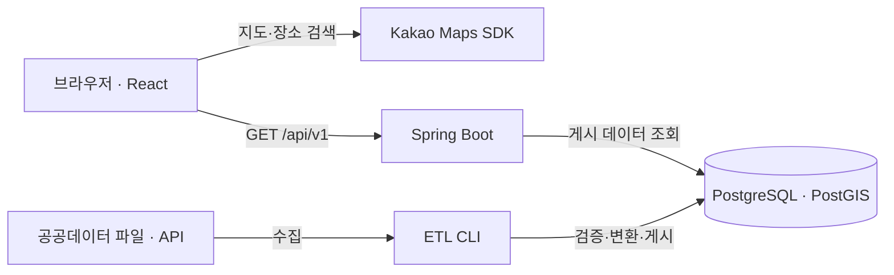

# 시스템 아키텍처

처음 합류했거나 기능의 변경 위치를 찾는 개발자를 위한 문서입니다.

브라우저는 지도 기능을 제공하는 SDK와 조회 API를 사용합니다.

조회용 데이터는 별도 ETL 작업으로 준비합니다.

[화면 요구사항](PRD.md) · [로컬 실행](SETUP.md)

## 현재 구현된 구조

| 구성 요소 | 역할과 코드 위치                                                                                                                                                                                      |
| --------- | ----------------------------------------------------------------------------------------------------------------------------------------------------------------------------------------------------- |
| Frontend  | React·TypeScript로 랜딩과 탐색 화면을 제공합니다. Kakao Maps JavaScript SDK는 지도와 장소 검색에, Spring Boot API는 지역·카페·상권 데이터 조회에 사용합니다. [라우팅](../apps/web/src/app/routes.tsx) |
| Backend   | Java 21의 Spring Boot와 Spring JDBC를 사용합니다. Controller가 요청을 검증하고, Service가 데이터 준비 상태를 판정하며, Repository가 SQL로 조회합니다. [REST API](API.md)                              |
| DB        | PostgreSQL에 지역·카페·통계·적재 배치를 저장합니다. PostGIS는 경계·반경 검색을 담당하고, Flyway는 스키마(테이블 구조) 변경을 적용합니다. [테이블과 인덱스](DATABASE.md)                               |
| ETL       | Node.js·TypeScript CLI로 공공데이터 파일·API를 수집하고 검사합니다. 검증된 데이터를 게시해 조회할 수 있게 합니다. [ETL 진입점](../apps/etl/src/index.ts) · [ETL 절차](ETL.md)                         |

## 웹 소스 구조

`apps/web/src`는 앱·페이지·위젯·기능·도메인·공통 계층을 사용합니다. 화면과 조회 상태를 함께 바꿀 때는 해당 기능 디렉터리부터 확인합니다.

| 계층       | 역할과 주요 이동                                                                                                                                                                                                                              |
| ---------- | --------------------------------------------------------------------------------------------------------------------------------------------------------------------------------------------------------------------------------------------- |
| `app`      | `main.tsx`와 `routes.tsx`가 앱을 시작하고 `/`, `/explore`, 404를 연결합니다.                                                                                                                                                                  |
| `pages`    | 기존 `App.tsx`는 `pages/explore/explore-page.tsx`가 되어 지도·검색·패널 상태를 조합합니다. 랜딩의 화면·모션·이미지는 `pages/landing`에 모았습니다.                                                                                            |
| `widgets`  | `explore-workspace`에 Dock과 패널 껍데기, `explore-map`에 지도와 정보창·마커·카메라 처리를 둡니다.                                                                                                                                            |
| `features` | `cafe-exploration`은 목록·페이지네이션·반경 조회를, `region-selection`은 서울 구·동 선택을, `market-analysis`는 상권 통계 화면을, `candidate-analysis`는 후보지 관리·비교·메모를 담당합니다. 장소 검색과 기준 분기 도구도 각각 기능에 둡니다. |
| `entities` | 기존 `lib`에 있던 카페·지역·후보지·통계의 타입, 검증, API를 도메인별로 나눴습니다. 통계 요청 훅은 상권과 후보지에서 공유합니다.                                                                                                               |
| `shared`   | 화면에서 공유하는 UI·출처 표기, 요청 상태 처리, Kakao SDK 로더, 전역 스타일과 디자인 토큰을 둡니다.                                                                                                                                           |

제품 코드의 import는 `app → pages → widgets → features → entities → shared` 순서에서 같은 계층이나 하위 계층을 향합니다. 기능끼리는 서로의 내부 파일을 import하지 않으며, 탐색 페이지가 상태와 콜백을 전달합니다. 카페 목록과 상권 분석은 지역 상태 중 각 화면에 필요한 필드만 받습니다. 테스트는 통합 흐름을 확인할 때 실제 페이지까지 조합할 수 있습니다.

`@/`는 `apps/web/src/`를 가리킵니다. 단위·컴포넌트 테스트는 대상 코드 옆에 두고, E2E와 브라우저용 합성 데이터는 `apps/web/e2e`에서 관리합니다.

[탐색 페이지](../apps/web/src/pages/explore/explore-page.tsx) · [지도 위젯](../apps/web/src/widgets/explore-map/) · [공통 스타일](../apps/web/src/shared/styles/index.css) · [테스트](TESTING.md)

## 웹 요청과 배치 게시

호스트 개발에서는 Vite가, 전체 Docker 실행에서는 Nginx가 `/api` 요청을 Backend에 전달합니다.

전체 Docker의 Nginx는 빌드된 Frontend도 제공합니다.

Backend의 조회 API는 `db` 프로필에서 게시된 데이터를 읽습니다.

공공데이터 수집은 별도의 수동 CLI 작업입니다.

[Vite 설정](../apps/web/vite.config.ts) · [Nginx 설정](../nginx/default-dev.conf) · [개발용 Compose](../docker-compose.yml)

## 개발 환경과 향후 배포

현재 제공하는 실행 환경은 호스트 실행, DB만 컨테이너로 띄우는 하이브리드, 전체 Docker 개발 스택, 합성 Demo입니다.

운영용 Compose, Nginx·Certbot 운영 설정, GitHub Actions 배포 자동화는 후속 범위입니다.

운영용 비밀정보·DB 권한·백업 복구와, ETL의 로컬 DB 제한을 유지한 검증 데이터 반입 방법을 함께 검토합니다.

[실행 방식 선택](SETUP.md#팀원-클론과-실행-방식) · [현재 CI](TESTING.md#github-actions-ci)

## 업종과 지역을 확장할 때 검토할 사항

현재 흐름은 서울의 카페 MVP를 기준으로 합니다.

업종이나 지역 지원을 확대할 때 아래 연결을 확인합니다.

이 항목은 검토 범위이며 실제 지원 계획과 도입 상태는 제품 요구사항에서 관리합니다.

[현재 범위와 향후 확장](PRD.md#현재-범위와-향후-확장)

| 구성 요소      | 검토할 변경                                                                      |
| -------------- | -------------------------------------------------------------------------------- |
| Frontend       | 업종·지역 선택과 검색 결과, 지도 경계, 지표 이름과 자료 없음 표시                |
| Backend·DB     | 조회 조건과 응답 계약, 업종·지역 식별자, 경계의 좌표계와 공간 검색 조건          |
| ETL            | 기관별 원천과 분류 체계, 판본·지역 범위 확인, 실패 시 재실행과 출처 보존         |
| 개발·검증 환경 | 추가 연결 설정과 인증키, 합성 데이터, 새 업종·지역의 경계와 조회를 확인할 테스트 |

지원할 업종·지역과 도입 시점은 미확정입니다.

기관별 데이터를 공통 처리 방식으로 묶을지와 지역 코드 체계를 어떻게 연결할지도 정해지지 않았습니다.

[저장 구조](DATABASE.md) · [원천과 게시 절차](ETL.md) · [응답 계약](API.md)
