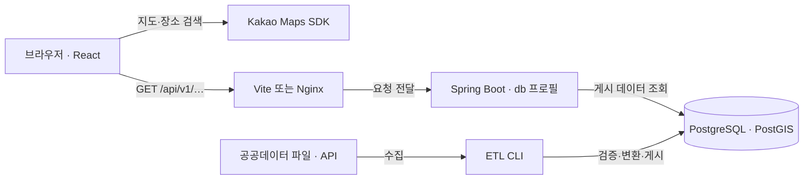

# 시스템 아키텍처

탐색 화면은 Kakao Maps SDK로 지도와 장소 검색을 제공하고, Spring Boot API로 지역·카페·상권 데이터를 조회합니다. ETL CLI는 공공데이터를 검증해 PostgreSQL에 게시합니다. [화면 요구사항](PRD.md) · [로컬 실행](SETUP.md)

## 현재 구현된 구조

브라우저의 요청 경로와 ETL이 조회용 데이터를 준비하는 경로가 DB에서 만납니다.

| 구성 요소 | 역할과 코드 위치 |
| --- | --- |
| Frontend | React·TypeScript로 랜딩과 탐색 화면을 제공합니다. 탐색 코드와 지도 모듈은 `/explore`에 진입할 때 불러옵니다. [라우팅](../apps/web/src/app/routes.tsx) |
| Backend | Java 21, Spring Boot와 Spring JDBC를 사용합니다. Controller가 요청을 검증하고, Service가 데이터 준비 상태를 판단하며, Repository가 SQL로 조회합니다. [카페 조회 패키지](../apps/api/src/main/java/kr/ac/recycleyoungs/cafe/) · [REST API](API.md) |
| DB | PostgreSQL에 지역·카페·통계·적재 배치를 저장합니다. PostGIS는 경계·반경 검색을 담당하고, Flyway는 테이블 구조 변경을 적용합니다. [데이터 설계](DATABASE.md) |
| ETL | Node.js·TypeScript CLI로 공공데이터 파일과 API 응답을 검증하고 게시합니다. [ETL 진입점](../apps/etl/src/index.ts) · [ETL 절차](ETL.md) |

## 웹 요청과 배치 게시

1. 브라우저에서 지역·카페·상권 API를 호출하면 호스트 개발 환경의 Vite 또는 전체 Docker 환경의 Nginx가 `/api` 요청을 Backend로 전달합니다. 전체 Docker의 Nginx는 빌드된 Frontend도 제공합니다.
2. Backend는 `db` 프로필에서 조회 API를 열고, 조회 조건에 맞는 게시 데이터를 읽습니다. 테이블 구조가 준비됐어도 필요한 게시 데이터가 없으면 API가 준비 상태에 따라 응답합니다.
3. 조회에 필요한 데이터를 준비할 때는 개발자가 ETL CLI를 별도로 실행합니다. API 요청에서 ETL을 호출하는 경로는 없습니다.

[Vite 설정](../apps/web/vite.config.ts) · [Nginx 설정](../nginx/default-dev.conf) · [개발용 Compose](../docker-compose.yml) · [API 오류와 데이터 상태](API.md#공통-오류와-데이터-상태)

## 웹 소스 구조

`apps/web/src`에서 기능 하나의 동작을 바꿀 때는 `features`에서, 지도와 여러 기능을 연결하는 상태를 바꿀 때는 탐색 페이지에서 시작합니다.

| 계층 | 담당 코드 |
| --- | --- |
| `app` | `main.tsx`가 앱을 시작하고 `routes.tsx`가 `/`, `/explore`, 404를 연결합니다. |
| `pages` | `explore/explore-page.tsx`에서 지도·검색·패널의 상태를 연결합니다. `landing`에는 랜딩의 화면·모션·이미지를 둡니다. |
| `widgets` | `explore-workspace`는 Dock과 패널 배치를, `explore-map`은 지도·정보창·마커·지도 중심과 확대 수준을 관리합니다. |
| `features` | `cafe-exploration`은 카페 목록·페이지 이동·반경 조회, `region-selection`은 구·동 선택, `market-analysis`는 상권 통계, `candidate-analysis`는 후보지 관리·비교·메모를 담당합니다. 장소 검색과 기준 분기는 각각 `place-search`, `statistics-quarter`에 둡니다. |
| `entities` | 카페·지역·후보지·통계의 타입, 검증 코드와 API를 도메인별로 둡니다. 통계 요청 훅은 상권 분석과 후보지 분석에서 공유합니다. |
| `shared` | 공통 UI와 출처 표기, 요청 상태 처리, Kakao SDK 로더, 전역 스타일과 디자인 토큰을 둡니다. |

제품 코드는 `app → pages → widgets → features → entities → shared` 순서에서 같은 계층이나 하위 계층을 참조합니다. 기능 사이의 상태와 콜백은 탐색 페이지에서 전달하고, 각 기능 내부 파일은 해당 기능에서 사용합니다. 카페 목록과 상권 분석은 지역 상태 중 각 화면에 필요한 필드만 받습니다. 테스트에서는 통합 흐름을 확인하기 위해 실제 페이지까지 조합할 수 있습니다.

`@/`는 `apps/web/src/`를 가리킵니다. 단위·컴포넌트 테스트는 대상 코드 옆에 두고, E2E와 브라우저용 합성 데이터는 `apps/web/e2e`에서 관리합니다.

모바일 하단 시트는 `explore-workspace`에서 현재 메뉴의 높이 단계와 포인터 입력을 관리합니다. 단계별 높이는 상단 도구와 Dock 사이 공간을 기준으로 CSS에서 계산합니다. 핸들의 드래그와 정착은 기존 패널 크기 전환을 공유하고, 지도 정보창은 정착 후 최종 영역을 기준으로 위치를 확인합니다. 탐색 페이지는 `visualViewport`를 관찰해 가상 키보드가 가린 영역을 패널 배치에 전달합니다.

[탐색 페이지](../apps/web/src/pages/explore/explore-page.tsx) · [지도 위젯](../apps/web/src/widgets/explore-map/) · [공통 스타일](../apps/web/src/shared/styles/index.css) · [테스트](TESTING.md)

## 개발 환경과 향후 배포

현재 제공하는 실행 환경은 호스트 실행, DB만 컨테이너로 띄우는 하이브리드, 전체 Docker 개발 스택, 합성 Demo입니다.

운영용 Compose, Nginx·Certbot 운영 설정, GitHub Actions 배포 자동화는 후속 범위입니다.

운영용 비밀정보·DB 권한·백업 복구와, ETL의 로컬 DB 제한을 유지한 검증 데이터 반입 방법을 함께 검토합니다.

[실행 방식 선택](SETUP.md#팀원-클론과-실행-방식) · [현재 CI](TESTING.md#github-actions-ci)

## 업종과 지역을 확장할 때 검토할 사항

현재 구조는 서울 카페 MVP를 기준으로 합니다. 지원 업종과 지역을 넓힐 때는 다음 연결을 검토합니다. 도입 범위와 상태는 제품 요구사항에서 관리합니다. [현재 범위와 향후 확장](PRD.md#현재-범위와-향후-확장)

| 구성 요소      | 검토할 변경                                                                      |
| -------------- | -------------------------------------------------------------------------------- |
| Frontend       | 업종·지역 선택과 검색 결과, 지도 경계, 지표 이름과 자료 없음 표시                |
| Backend·DB     | 조회 조건과 응답 계약, 업종·지역 식별자, 경계의 좌표계와 공간 검색 조건          |
| ETL            | 기관별 원천과 분류 체계, 판본·지역 범위 확인, 실패 시 재실행과 출처 보존         |
| 개발·검증 환경 | 추가 연결 설정과 인증키, 합성 데이터, 새 업종·지역의 경계와 조회를 확인할 테스트 |

지원할 업종·지역과 도입 시점은 미확정입니다.

기관별 데이터를 공통 처리 방식으로 묶을지와 지역 코드 체계를 어떻게 연결할지도 정해지지 않았습니다.

[저장 구조](DATABASE.md) · [원천과 게시 절차](ETL.md) · [응답 계약](API.md)
