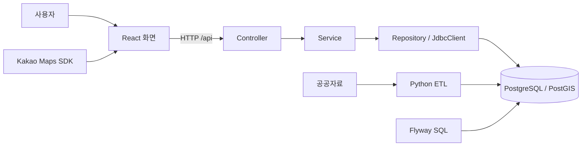
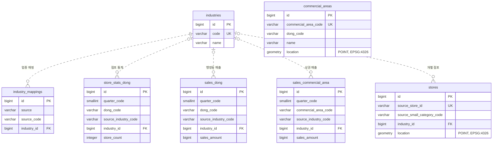
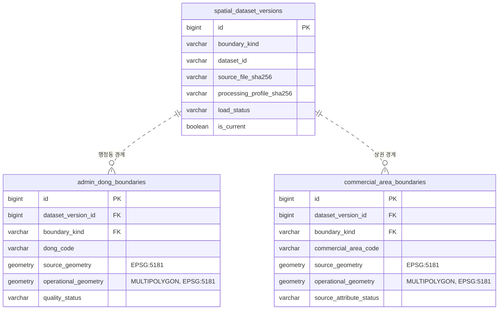

# 기술 명세와 개발 안내

> **에이전트용 문서:** 작업 기준·구현 계약·검증 기록을 관리합니다. 사람이 읽을 문서는 [문서 안내](../README.md)에서 확인하며, 이 문서는 일반 독자의 필수 읽기 대상이 아닙니다.

에이전트가 구현 계약과 개발·검증 기준을 확인하는 참고 문서입니다. 현재 기능과 우선순위는 [프로젝트 현황](project.md), DB 변경·복구 조건은 [DB 안전 정책](db-safety.md)에 둡니다.

문서·구현 대조 기준일은 **2026-10-21**입니다. 공식 API 전수 수집·CSV 대조, 격리 검증에 이어 [영속 API 환경](#영속-api-개발-환경과-예약-갱신)의 실제 DB·예약 갱신·백업/복원·HTTP·테스트 지도 화면을 확인했습니다. 기존 팀 환경·Releases는 보존했습니다. 아래 전환 준비 절의 과거 단계와 현재 영속 계약을 구분하며, nginx·일반 CI/CD·새 PC/서버 이미지 준비·Frontend 구조 정리는 [다음 작업](project.md#다음-작업)입니다.

## 목차

- [시스템과 기술 선택](#시스템과-기술-선택)
- [통계 조회 한 번 따라가기](#통계-조회-한-번-따라가기)
- [읽기 지도와 용어](#읽기-지도와-용어)
- [코드 구조와 진입점](#코드-구조와-진입점)
- [기술 스택과 선택 이유](#기술-스택과-선택-이유)
- [개발 환경과 안전한 시작](#개발-환경과-안전한-시작)
- [팀 공통 실자료 개발 환경](#팀-공통-실자료-개발-환경)
- [데이터 출처와 의미](#데이터-출처와-의미)
- [공공 API 전환 준비](#공공-api-전환-준비)
- [영속 API 개발 환경과 예약 갱신](#영속-api-개발-환경과-예약-갱신)
- [DB schema와 Flyway](#db-schema와-flyway)
- [CSV ETL](#csv-etl)
- [Polygon ETL과 공간 한계](#polygon-etl과-공간-한계)
- [현재 GET API 계약](#현재-get-api-계약)
- [공간 조회 설계 — API·격리 검증](#공간-조회-설계--api격리-검증)
- [Frontend 화면과 요청 상태](#frontend-화면과-요청-상태)
- [테스트와 안전 모듈](#테스트와-안전-모듈)
- [검증 이력](#검증-이력)

## 시스템과 기술 선택

프로그램은 데이터를 준비하는 흐름과 사용자가 조회하는 흐름으로 나뉩니다. Python ETL은 API·파일 자료를 검사·변환해 버전별로 DB에 저장합니다. React는 사용자의 요청을 Spring API에 보내고 결과를 표시합니다.



- Controller는 요청 형식을 검사합니다.
- Service는 지원 조건과 데이터의 일관성을 확인하고 응답을 구성합니다.
- Repository는 매개변수를 바인딩한 SQL로 DB를 조회합니다.
- PostGIS는 좌표가 경계 안에 있는지, 점포가 반경 안에 있는지 계산합니다.

브라우저는 DB에 직접 연결하지 않습니다. 사용자 조회가 원본 수집이나 ETL을 다시 실행하지도 않습니다.

## 통계 조회 한 번 따라가기

청운효자동·카페·2025년 1분기를 선택했다고 가정합니다. 아래는 흐름 설명용 예시이며 현재 DB 조회 결과가 아닙니다.

| 선택 | 요청 값 |
| --- | --- |
| 청운효자동 | `dongCode=11110515` |
| 카페 | `industryCode=CAFE` |
| 2025년 1분기 | `quarterCode=20251` |

1. [RegionSelector](../../frontend/src/components/RegionSelector.tsx)에서 구·행정동을 선택하고 ‘지역 보기’로 확정합니다. 화면은 지원 목록과 공식 지역 목록을 읽고 CAFE 제공 여부를 확인합니다. 분기는 실제 지원 최신값에서 시작하며 패널에서 변경할 수 있습니다.
2. 지역·분기가 확정되면 [API client](../../frontend/src/api/adminDongApi.ts)가 단일 분기와 추세를 병렬 요청합니다. 소비규모·소비증감 점수와 표시 경계는 별도 읽기 전용 API로 조회합니다.
3. [Service](../../backend/src/main/java/com/example/backend/admindong/AdminDongService.java)가 형식·지원 조건을 확인합니다.
4. [Repository](../../backend/src/main/java/com/example/backend/admindong/AdminDongRepository.java)가 점포 통계와 매출을 따로 조회합니다.
5. 화면은 통계·추세의 로딩·오류를 각각 처리하고, 선택 분기 값과 그래프를 함께 표시합니다. 두 점수는 같은 동·분기의 응답인지 확인한 뒤 검토 요약과 상세 근거에 사용하며, 자료가 부족하거나 일치하지 않으면 해석을 보류합니다.

```text
GET /api/admin-dong-stats?dongCode=11110515&industryCode=CAFE&quarterCode=20251
GET /api/admin-dong-trends?dongCode=11110515&industryCode=CAFE
```

첫 요청은 선택 분기, 두 번째는 2025년 네 분기 표를 위한 것입니다. 한 요청의 실패가 다른 결과를 지우지 않습니다.

소비증감은 정확한 직전 분기와 비교합니다. 예를 들어 2025년 1분기는 2024년 4분기와 비교하며, 직전 분기가 지원 목록에 없으면 산정할 수 없습니다. 산정 불가를 0점이나 소비 감소로 표시하지 않습니다. 두 점수의 요청·산식은 [소비규모](#카페-소비규모-점수--실제-거래-집계-연동)와 [소비증감](#카페-소비증감-점수와-상세-분석)에 정리합니다.

각 HTTP 요청 내부의 통계 조회는 읽기 전용 `REPEATABLE READ` 트랜잭션을 사용합니다. 별도 HTTP 요청들이 정확히 같은 DB 시점을 읽는다는 보장은 없습니다.

## 읽기 지도와 용어

실행이 목적이면 [개발 환경](#개발-환경과-안전한-시작), API를 수정한다면 [API 계약](#현재-get-api-계약)부터 확인합니다. 자료 해석은 [출처와 의미](#데이터-출처와-의미), DB 변경은 [안전 정책](db-safety.md)을 먼저 읽습니다.

| 용어 | 이 문서에서의 의미 |
| --- | --- |
| ETL | 파일을 읽어 검사·변환하고 DB에 저장하는 과정 |
| POINT / Polygon | 한 위치의 좌표 / 지역의 다각형 경계 |
| 좌표계·SRID | 좌표를 해석하는 기준과 그 식별자 |
| 원본 경계 | 수정하지 않고 보존하는 도형, 코드에서는 source geometry |
| 조회용 경계 | 서비스 판정에 쓰는 도형, 코드에서는 operational geometry |
| 업종 매핑 | 원천 업종 코드를 서비스 업종에 연결하는 규칙 |
| 데이터 계약 | 파일 구성·형식·해시 등 반드시 맞아야 하는 기준 |
| fingerprint | DB의 값·ID·sequence 등을 전체 비교하기 위한 해시 |
| publication | 검사한 경계 버전을 READY/current 상태로 공개하는 처리 |
| provenance | 사용한 입력·코드·검사 과정의 출처 기록 |
| mock / fixture | 가짜 응답·연결 / 테스트용 데이터 |
| opt-in 테스트 | 별도 설정으로 활성화해야 하는 검사 |
| backfill | 기존 행의 특정 빈 필드를 제한된 조건으로 채우는 작업 |

혼동하기 쉬운 버전과 시점은 구체적으로 구분합니다.

- `V1/V2/V3`는 **Flyway 스키마 버전**입니다.
- `real-data-v2`는 **배포 데이터 패키지 버전**입니다.
- 공간 응답의 `dataset.version`은 **DB에 저장된 경계 버전 ID**입니다.
- 점포 자료의 기준 시점과 DB 트랜잭션의 조회 시점은 서로 다릅니다.
- 이 문서의 “기존 개발 DB”는 과거 보호·퇴역 대상입니다. 원본 파일과 구분합니다.

## 코드 구조와 진입점

| 작업 | 시작할 위치 |
| --- | --- |
| 화면 입력·통계 | [ManualStatistics](../../frontend/src/components/ManualStatistics.tsx), [통계 hook](../../frontend/src/hooks/useAdminDongStats.ts) |
| 지도·위치 분석 | [KakaoMap](../../frontend/src/components/KakaoMap.tsx), [분석 hook](../../frontend/src/hooks/useLocationAnalysis.ts) |
| 후보 비교 | [비교 hook](../../frontend/src/hooks/useCandidateComparison.ts), [컴포넌트](../../frontend/src/components) |
| 통계·추세 API | [admindong](../../backend/src/main/java/com/example/backend/admindong) |
| 위치·카페 API | [location](../../backend/src/main/java/com/example/backend/location), [nearby](../../backend/src/main/java/com/example/backend/nearby) |
| 스키마 | [Flyway migration](../../backend/src/main/resources/db/migration) |
| 파일 처리 | [etl/app](../../etl/app) |
| 개발 환경 | [Compose](../../docker-compose.yml), [호스트 검사](../../etl/team_dev.py), [DB 초기화](../../etl/team_db.py) |
| 테스트 | [Backend](../../backend/src/test), [Frontend](../../frontend/src), [ETL](../../etl/tests) |

Frontend는 API client·types·hooks·components를 분리합니다. Backend는 Controller → Service → Repository 구조와 JdbcClient를 유지합니다.

## 기술 스택과 선택 이유

| 영역 | 저장소에서 확인한 기술 | 선택 이유 |
| --- | --- | --- |
| Backend | Java 21, Spring Boot 4.1.1, Spring MVC | 요청 검증과 계층별 책임 분리 |
| SQL | Spring JDBC / JdbcClient | 집계·공간 SQL을 명시적으로 관리 |
| DB | PostgreSQL 16 / PostGIS 3.4 계열 | 관계형 통계와 공간 연산을 함께 처리 |
| 스키마 | Flyway 12.4.0 | 버전별 SQL과 적용 이력 관리 |
| Frontend | React 19, TypeScript 6, Vite 8 | 타입이 있는 화면·요청 상태 관리 |
| UI | Tailwind CSS 4, shadcn 기반 Button·Card·Table·NativeSelect 등, @shadcn/lint | 공통 스타일·접근성과 UI 규칙 재사용 |
| ETL | Python 3.12, pandas, psycopg | CSV 처리와 트랜잭션 적재 |
| 경계 처리 | pyshp, Shapely, pyproj | 파일 구조·도형 품질·좌표 변환 |
| 명세·테스트 | Springdoc 3.1.1, JUnit, Vitest, unittest | API 명세와 계층별 회귀 검사 |

정확한 버전은 [Gradle](../../backend/build.gradle), [npm 선언](../../frontend/package.json)·[lockfile](../../frontend/package-lock.json), [Python requirements](../../etl/requirements.txt)를 기준으로 합니다. 선언 범위와 실제 설치 버전은 구분합니다.

JPA로 전환하거나 새로운 상태 관리 라이브러리를 도입한 구조가 아닙니다. SQL·화면 계약을 유지하며 필요한 범위만 변경합니다.

## 개발 환경과 안전한 시작

권장 API 실행 순서는 [루트 README](../../README.md#실행-방법)와 [영속 API 계약](#영속-api-개발-환경과-예약-갱신)에 있습니다. 새 API Compose는 DB·Backend·예약 worker를 실행하고 Frontend는 호스트에서 실행합니다. 아래 준비·호스트 서버·팀 환경 절은 보존한 고정 자료 팀 경로를 설명합니다. 기존 명령의 대상을 바꾸지 않았습니다.

### 준비와 정상 실행

Java 21, Node.js 24/npm, Python 3.12, Docker와 Compose v2를 준비합니다. 데이터 처리 라이브러리는 컨테이너에 설치됩니다. 호스트의 `team_dev.py`는 Python 표준 라이브러리로 실행됩니다.

- 새 환경은 루트 `.env` 없이 기본 공개 데이터 패키지를 사용합니다.
- `data/raw/dataset/.gitkeep`는 Compose 입력 디렉터리를 유지합니다. 공개 데이터 실행에 수동 원본 준비는 필요하지 않습니다.
- 최초용 `preflight`는 DB에 접속하지 않고 이름·포트 충돌을 확인합니다.
- 기존 팀 자원이 있으면 `status`로 소유권과 실제 준비 상태를 확인합니다.
- `status`는 승인된 팀 DB를 읽기 전용으로 조회합니다. 문서 검사에 대신 사용하지 않습니다.
- `up -d` 반환과 ETL 완료는 다릅니다. `status=READY`를 확인합니다.

루트 `.env`는 Compose가 읽으며 Spring이나 호스트 Python이 자동으로 읽지 않습니다. 기존 설정을 덮어쓰거나 `.env` 전체를 셸에 불러오지 않습니다.

### 지도와 호스트 서버

Frontend의 `frontend/.env.local`에 `VITE_KAKAO_MAP_APP_KEY`를 설정합니다. Kakao Developers의 웹 도메인에 `http://localhost:5173`을 등록합니다. `127.0.0.1`은 별도 origin입니다.

Vite는 `/api`를 `http://localhost:8080`으로 전달합니다. 지도 키·비밀번호는 Git이나 이미지에 넣지 않습니다.

`bootRun`은 다음 조건으로 시작합니다.

1. `team_dev.py backend-proof`로 팀 DB의 준비 상태와 전체 fingerprint를 확인합니다.
2. 검사 결과와 reader 비밀번호를 Gradle이 메모리로 전달합니다. 출력물을 저장하거나 공개하지 않습니다.
3. `team-dev` profile과 읽기 전용 계정을 사용하고, Flyway 자동 실행은 끕니다.
4. 실제 JDBC 연결에서도 DB 식별자·소유권·버전·계약·경계 정보를 확인합니다.

셸에 남은 `DB_*`, `PG*`, `FLYWAY_*`, `SPRING_*` 설정과 CLI override는 거부합니다. 일반 `bootJar`·`application.yaml`의 동작과 팀 `bootRun`을 혼동하지 않습니다.

### 준비 실패 시

먼저 서비스 상태와 초기화 로그를 확인합니다.

```sh
docker compose ps -a
docker compose logs --tail=30 inspect-proxy preflight data-init db-identity db-migrate etl-init
```

오류 코드로 실패 단계를 확인합니다. DB·계약·버전 불일치를 해결하려고 볼륨을 삭제하거나 다시 적재하지 않습니다. 원인을 검토한 뒤 허용된 같은 환경의 준비·검증 경로를 사용합니다.

`COMPOSE_PROJECT_NAME`, `-p`, Compose override로 기존 자원을 우회하지 않습니다. 같은 daemon의 Docker context 두 개를 별도 격리 환경으로 보지도 않습니다.

개발 서버는 해당 터미널의 `Ctrl+C`로 종료합니다. DB를 멈출 필요가 있을 때만 대상·범위를 확인하고 `docker compose stop team-postgres`를 사용합니다. DB·cache·control 볼륨은 보존합니다.

### 명령별 영향

| 명령 | 실제 영향 |
| --- | --- |
| `docker compose up -d`, `make db`, `make etl` | 팀 환경 생성·시작, 필요한 초기화 또는 기존 상태 검증 |
| `make db-info`, `make check-db` | 팀 DB 소유권·READY·fingerprint의 읽기 전용 검사 |
| `make db-stop` | 팀 DB 서비스 중지 |
| `make db-migrate`, `make db-baseline` | 현재 Makefile에서 거부 |
| 독립 Flyway·전체 loader·`dbTest` | 별도 대상 검토 필요. 일반 사전 점검에 사용하지 않음 |

문서에 명령이 있다는 사실은 DB 실행·변경 승인을 뜻하지 않습니다. 접속·변경·정리 범위는 [안전 정책](db-safety.md)에 따릅니다.

## 팀 공통 실자료 개발 환경

현재 Compose의 기본값은 `TEAM_DATA_VERSION=real-data-v2`, `TEAM_DATA_MODE=release`입니다. 과거 데이터 선택 경로는 코드 호환성으로 남아 있지만, 현행 개발 절차에는 포함하지 않습니다.

### 자동 준비 단계

| 서비스 | 책임 |
| --- | --- |
| `inspect-proxy` | 다른 초기화 서비스에 필요한 Docker 조회 정보만 제공 |
| `preflight` | 전용 자원의 소유권·저장된 식별 정보 확인 |
| `data-init` | 공개 패키지 다운로드와 파일 검증 |
| `team-postgres` | 고정 PostgreSQL/PostGIS 이미지로 DB 제공 |
| `db-identity` | 실제 DB 연결 대상과 초기 상태 확인 |
| `db-migrate` | 연결 검사 후 원본 V1~V3 migration 적용 |
| `etl-init` | CSV·경계 적재와 전수 대조 후 READY 기록 |

`depends_on`은 DB의 healthy 상태와 초기화 서비스의 정상 종료를 구분합니다. 어느 단계든 실패하면 뒤의 성공을 가정하지 않습니다.

팀 DB는 `recycleyoungs_team_dev`, 호스트 주소는 `127.0.0.1:55432`입니다. `PGDATA`는 `/var/lib/postgresql/data/team`이며 별칭 `postgres`는 내부 네트워크에서 사용합니다.

### 패키지와 재실행

다운로드 설정의 기준은 [release.json](../../data/release.json)입니다. 태그·asset·URL·크기·해시를 고정하며 임의 URL이나 `latest`를 받지 않습니다.

[team_dataset.py](../../etl/team_dataset.py)는 HTTP 응답과 redirect host를 검사합니다. 안전한 ZIP 경로, 구성 파일 10개, 내부 해시, CSV·경계 리포트, 출처 고지도 확인합니다.

cache 작성자는 하나로 제한됩니다. 검증 후에만 최종 cache를 공개하며, 실패한 중간 파일과 손상 cache는 자동 삭제·교체하지 않습니다.

데이터 버전·계약·소유권은 cache, control 기록, DB 상태에 함께 저장됩니다. 값이 다르면 쓰기 전에 거부합니다. 버전 정보가 없는 과거 기록을 새 버전으로 자동 승격하지 않습니다.

같은 READY DB를 재실행하면 전체 데이터를 재검증하고 적재를 생략합니다. 값·ID·sequence·경계 버전과 `loaded_at`을 보존합니다.

- CSV 저장과 `CSV_DONE` 기록은 같은 트랜잭션입니다.
- CSV 전의 빈 DB만 허용된 초기 적재 대상으로 사용합니다.
- `CSV_DONE` 이후에는 원본과 저장값을 대조하고 기존 경계 공개 결과를 확인합니다.
- 알 수 없는 비어 있지 않은 DB를 자동 TRUNCATE하거나 갱신하지 않습니다.

### Docker와 연결 보호

Docker socket은 `inspect-proxy`만 받습니다. proxy는 고정된 GET inspect를 허용하고 변경 요청·타 프로젝트·임의 경로를 거부합니다.

socket의 `:ro`는 Docker API 권한을 제한하지 않습니다. proxy가 침해되면 daemon 권한에 접근할 수 있으므로 신뢰한 로컬 개발 환경에서만 사용합니다.

이미지의 manifest digest와 config digest는 다른 값입니다. guard는 고정 참조·실제 image ID·플랫폼을 함께 확인합니다. 데이터 버전과 `team-development-v1`이라는 인프라 label도 서로 다른 개념입니다.

초기화 서비스에는 전용 내부 네트워크를 사용합니다. DB의 호스트 포트는 loopback으로 제한하며, 호스트 연결용 네트워크에는 DB만 참여합니다.

출처·geometry·리포트·처리 도구의 해시까지 확인한 뒤 경계 정보를 Backend에 전달합니다. 로그는 고정 오류 코드·허용 예외 타입·형식이 확인된 SQLSTATE만 사용합니다. 비밀번호·DSN·원행은 출력하지 않습니다.

## 데이터 출처와 의미

### 원천·기간·집계 단위

| 자료 | 기간·집계 단위 | 현재 용도 |
| --- | --- | --- |
| 서울시 점포-행정동 | 2025년 1~4분기, 행정동·업종 | 점포 통계 API |
| 서울시 추정매출-행정동 | 같은 기간, 행정동·업종 | 매출 통계 API |
| 서울시 추정매출-상권 | 같은 기간, 상권·업종 | 별도 공간 집계. 현재 행정동 응답과 구분 |
| 서울시 영역-상권 CSV | 상권 코드·대표 X/Y·면적 | 대표점 목록. 경계 판정을 대신하지 않음 |
| SEMAS 서울 점포 | 파일명 기준 2026년 6월 | 개별 점포·주변 카페 조회 |
| 길단위인구-서울시 | 2021년 1분기~2026년 2분기, 서울 전체 22행 | 위치별 수요 분석에서 제외 |
| 행정동·상권 경계 ZIP | 확보일 2026-10-07, 실제 기준일 미확인 | 위치 판정용 경계 |

행정동 자료와 반경 점포는 서로 다른 공간 단위입니다. 2025년 통계와 2026년 6월 점포도 같은 기간의 관측으로 취급하지 않습니다.

파일에 점포가 없다는 이유만으로 폐업을 판정하지 않습니다. 행정동 매출·서울 전체 인구를 반경 면적 비율로 배분하지 않습니다.

공식 출처와 이용조건은 [README 고지](../../README.md#원본-이용조건과-공개-고지)에 있습니다. 추가 자료는 [상권 매출 OA-15572](https://data.seoul.go.kr/dataList/OA-15572/S/1/datasetView.do), [SEMAS 분류표](https://bigdata.sbiz.or.kr/#/notice/267352041576902656)를 참고합니다.

### Manifest와 후속 검증의 범위

[manifest](../../data/manifest.json)는 원본 파일 목록·형식·크기·해시·기간의 조사 기록입니다. 기록된 행 수는 현재 DB의 행 수가 아닙니다.

초기 조사에서 영역-상권 CSV 좌표계는 미확인이었습니다. 후속 공식 조사로 EPSG:5181 정책을 정했으므로 초기 metadata와 최종 정책을 구분합니다.

서울시 CSV는 CP949, SEMAS는 UTF-8-SIG로 읽습니다. UTF-8-SIG decoder를 쓴다는 사실만으로 실제 BOM이 있다고 단정하지 않습니다.

과거 원본 조사에서는 점포 통계와 매출 통계의 업종·조합별 행 존재가 달랐습니다. 행정동 lookup은 통계에서 만들며, 399개 동을 가진 영역 CSV로 대체하지 않습니다.

원본과 리포트를 같은 버전의 다른 파일로 덮어쓰지 않습니다. 공개 패키지 준비와 원본 직접 조사도 구분합니다.

### 업종 연결

| 내부 업종 | 서울시 코드 | SEMAS 코드 |
| --- | --- | --- |
| CAFE | CS100010 | I21201 |
| HAIR | CS200028 | 미확정 |
| KFOOD | CS100001 | 미확정 |
| PUB | CS100009 | 미확정 |
| GYM | 미매핑 | 미확정 |

원천 구분은 각각 `SEOUL`, `SEMAS`입니다. 점포의 소분류는 SEMAS 매핑만 사용하며, 빈 코드·미매핑 코드는 `industry_id=NULL`로 둡니다.

CAFE 경쟁군은 I21201의 통합 범주 전체입니다. 커피전문점 외 주스·다방·일부 테마 카페가 포함될 수 있습니다. 다른 소분류의 빵·빙수·편의점·스터디카페 등을 상호명이나 KSIC로 다시 분류하지 않습니다.

## 공공 API 전환 준비

### 검토 범위와 확인 수준

**수집 준비 단계**에서 DB 없는 수집·정규화·키 설정·CSV 대조 CLI를 구현하고 README 개선 항목을 검토했습니다. 사용자 선택에 따라 서울시는 공식 HTTP, SEMAS는 HTTPS로 인증 전체 수집을 수행했습니다. 서울시 2025년 전체 키·정규화 필드는 CSV와 일치하며 SEMAS는 명칭 구두점 차이를 보존했습니다. 이후 API 버전 적재/공개·앱 기간 확장·실제 격리 검증과 [영속 서비스/예약 갱신](#영속-api-개발-환경과-예약-갱신)까지 연결했습니다. 키 값·요청 URL은 출력하지 않으며 원문은 프로젝트 밖 private 실행 위치에 보존합니다. 기존 팀 DB·기존 raw는 변경하지 않았습니다.

| 원천 | 확인한 계약 | 아직 확인할 사항 |
| --- | --- | --- |
| [점포-행정동 OA-22172](https://data.seoul.go.kr/dataList/OA-22172/S/1/datasetView.do?tab=A) | `VwsmAdstrdStorW`, 12개 응답 필드, 20251~20262 전체 paging·정규화, 2025년 CSV 전수 일치 | 다른 기간·향후 원천 정정 영향·역사적 경계 |
| [추정매출-행정동 OA-22175](https://data.seoul.go.kr/dataList/OA-22175/S/1/datasetView.do?tab=A) | `VwsmAdstrdSelngW`, 53개 응답 필드, 위 범위 전체 paging와 NULL·정밀 값 대조 | 다른 기간·향후 원천 정정 영향 |
| [SEMAS 상가업소정보 API](https://www.data.go.kr/data/15012005/openapi.do) | `/storeListInDong` HTTPS·root `header/body`·기준년월, 서울 CAFE 22,739개 ID·코드·좌표 대조와 API 구두점 표기 보존 | 다른 업종·snapshot 안정성·정확한 영업 관측일·운영 호출 한도 |
| 행정동·상권 경계 | 기존 Polygon 자료와 공간 계약 유지 | 통계의 과거·개정 집계 경계와 호환성. 통계·점포 API가 경계 ZIP까지 대체하지 않음 |

초기 조사에서 서울시 두 서비스에 `.../sample/json/{서비스}/1/1/{분기}`를 호출해 아래 응답을 관찰했습니다. 이 표는 **sample 응답의 `list_total_count`이며 전체 다운로드·DB 행 수가 아닙니다.** 각 정상 응답에서 실제 1행의 분기 코드도 요청값과 일치했습니다. 이후 수행한 인증 전체 수집은 아래 전수 실행 결과와 구분합니다.

| 조회 분기 | 점포 통계 선언 건수 | 매출 통계 선언 건수 |
| --- | --- | --- |
| 20201 | `INFO-200` | `INFO-200` |
| 20211 | 35,105 | 17,536 |
| 20244 | 35,197 | 16,871 |
| 20251 | 35,281 | 16,770 |
| 20252 | 35,294 | 16,794 |
| 20253 | 35,326 | 16,831 |
| 20254 | 35,317 | 16,718 |
| 20261 | 35,313 | 16,659 |
| 20262 | 35,301 | 16,659 |
| 20263·20264 | `INFO-200` | `INFO-200` |

조회한 분기 중 최신 정상 응답은 **2026년 2분기**입니다. 전 기간의 제공·완전성을 확인한 결과는 아닙니다. 2025년 선언 건수 합계는 점포 141,218행·매출 67,113행으로 [기존 manifest](../../data/manifest.json)의 조사 건수와 같습니다. sample의 건수 일치와 이후 전수 대조에서 확인한 키·정규화 필드 일치를 구분하며, 어느 쪽도 역사적 경계의 호환성을 증명하지 않습니다.

서울시 안내에는 2026-07-03 기준 공간 기반 변경에 따른 추정치 개편과 2021년 이후 제공 방침이 있습니다. 동일 분기의 재수집도 과거 파일과 달라질 수 있으므로 원천 공지·수집 버전·변경 내역을 기록합니다. 아직 조회하지 않은 2021~2024년 모든 분기까지 제공된다고 확정하지 않습니다. `INFO-200`은 해당 조회의 자료 없음으로 기록하며 최신 분기나 완전한 0건 자료로 공개하지 않습니다.

### README 개선 항목별 대응

| 개선 항목 | 검토 결과와 구현 방향 | 10/31 우선 범위 |
| --- | --- | --- |
| 지원 지역·업종 | 서울시 통계는 기존 업종 매핑을 유지할 수 있고 SEMAS는 전국 조회 계약이 있음. 다른 지역의 동등한 매출·경계·비교 기준은 별도 확보 필요 | 서울·CAFE 유지. 일반 통계 API의 기존 업종 보존 |
| 판단 근거: 시간대·고객 구성 | 매출 API에 요일·6개 시간대·성별·연령대별 금액과 건수가 있음. 기존 `sales_dong`에도 대응 컬럼이 있으나 화면·응답 확장은 별도 작업 | 전체 필드 수집·보존, 현재 소비 지표 우선. 후속 상세 화면 후보 |
| 판단 근거: 인구·임대료·운영비·계절성 | [길단위인구-행정동 OA-22178](https://data.seoul.go.kr/dataList/OA-22178/S/1/datasetView.do?tab=A)은 후속 원천 후보이며 실제 필드·기간·집계 기준 검증 필요. 현재 서울 전체 22행으로 대체하지 않음. 개별 임대료·운영비는 위 통계·점포 API에 없음. 전년 동분기 비교도 충분한 과거 분기와 기준 일치가 전제 | 새 종합점수 제외. 자료 부족 안내 유지 |
| 분석 공간 세분화 | [추정매출-상권 OA-15572](https://data.seoul.go.kr/dataList/OA-15572/S/1/datasetView.do)는 후속 후보. 행정동·상권 통계를 500m나 개별 가게에 면적 배분할 수 없음 | 행정동 통계·500m 점포 단위 구분 유지 |
| 주변 목록·필터 | 원천 교체보다 Backend의 반경 전체 집계·서버 필터·페이지 계약과 Frontend 변경이 핵심. 기존 최대 100개에 대한 필터 결과는 전체 구성으로 표시할 수 없음 | 현행 제한 표시. 후속 서버 조회 확장 분리 |
| 점포 운영 형태 | SEMAS 명세에는 상호·분류·주소·ID가 있으나 가맹·직영·독립 확정 필드는 없음. 통계의 가맹점 수는 개별 점포 판정 근거가 아님 | 브랜드 추정 표시 유지. 점포별 공식 근거 확보는 후속 |
| 시점·품질 | API의 분기·SEMAS `stdrYm`·수집 시각을 구분하고 범위·중복·누락·경계 호환성을 검증. 최근 수집만으로 완전성 보장 불가 | provenance·공개 버전·품질 상태 설계·검증 |
| 자동 갱신 | 전체 수집 완료 → 검증 → 새 데이터 버전 → 검증 후 공개. 새 분기와 과거 정정을 별도 기록 | 수동 실행 가능한 수집·검증·격리 연결 우선. 정기 실행은 같은 성공·실패 계약 이후 |
| 다년도 분석 | ETL·추세 API·Frontend의 2025 고정을 함께 제거해야 함. 과거 버전·분기 보존 필요 | 2025년과 새 지원 분기 연결, Q1 전분기 계산을 위한 20244 검증 |
| 운영·사용성 | nginx·CI/CD·부하·기기·접근성은 데이터 API로 해결되지 않음 | 데이터 작업과 병행할 별도 배포·회귀 작업 |

시간대 매출은 해당 시간의 추정 소비이며 유동인구·방문자 수와 같지 않습니다. 거래 건수도 고유 고객 수가 아닙니다. 성별·연령대 합계를 새 고객 수나 점포 이익으로 바꾸지 않습니다.

### 원천 필드와 정규화 계약

서울시 요청은 공식 문서의 `http://openapi.seoul.go.kr:8088/{KEY}/json/{SERVICE}/{START}/{END}/{STDR_YYQU_CD}` 형식입니다. [공통 안내](https://data.seoul.go.kr/together/guide/useGuide.do)는 요청당 최대 1,000행·sample 최초 5행 제한을 명시합니다. 두 서비스에서 확인한 추가 검색 조건은 분기이며, 동·업종 필터를 임의 URL 인자로 붙이지 않습니다. 분기 전체 수집 후 내부 업종을 연결합니다. HTTP sample 응답은 확인했으나 이번 환경의 HTTPS 두 후보 주소는 연결에 실패했습니다. 실제 인증키 사용 전 공식 지원 전송 경로를 확인하고, HTTPS 실패를 이유로 실제 키를 HTTP로 자동 전송하지 않습니다.

| 점포 API 필드 | 정규화 필드 |
| --- | --- |
| `STDR_YYQU_CD`, `ADSTRD_CD`, `ADSTRD_CD_NM` | `quarter_code`, `dong_code`, `dong_name` |
| `SVC_INDUTY_CD`, `SVC_INDUTY_CD_NM` | `source_industry_code`, `source_industry_name` → 기존 SEOUL 업종 매핑 |
| `STOR_CO` | `store_count` |
| `SIMILR_INDUTY_STOR_CO` | `similar_store_count` |
| `OPBIZ_RT`, `OPBIZ_STOR_CO` | `opening_rate`, `opening_store_count` |
| `CLSBIZ_RT`, `CLSBIZ_STOR_CO` | `closing_rate`, `closing_store_count` |
| `FRC_STOR_CO` | `franchise_store_count` |

현재 API 설명은 `STOR_CO`를 일반 점포 수, `SIMILR_INDUTY_STOR_CO`를 전체 점포 수로 구분합니다. 기존 CSV의 ‘점포 수·유사 업종 점포 수’와 이름만 보고 의미가 같다고 처리하지 않습니다. 위 매핑은 대조 대상이며 정의·값 검증을 통과한 뒤 확정합니다. 개·폐업률도 임의 분모로 재계산하지 않습니다.

| 매출 API 필드군 | 기존 `sales_dong` 정규화 대상 |
| --- | --- |
| 공통 분기·동·업종 5필드 | 점포 통계와 같은 원천 코드 보존·업종 연결 |
| `THSMON_SELNG_AMT`, `THSMON_SELNG_CO` | `sales_amount`, `transaction_count` |
| `MDWK`, `WKEND`의 `_SELNG_AMT`·`_SELNG_CO` | `weekday_sales_amount`·`weekend_sales_amount`, `weekday_transactions`·`weekend_transactions` |
| `MON`, `TUES`, `WED`, `THUR`, `FRI`, `SAT`, `SUN`의 같은 suffix | `mon`~`sun`의 `_sales_amount`·`_transactions` |
| `TMZON_00_06`, `06_11`, `11_14`, `14_17`, `17_21`, `21_24`의 같은 suffix | `time_00_06`~`time_21_24`의 `_sales`·`_transactions` |
| `ML`, `FML`의 같은 suffix | `male_sales`·`female_sales`, `male_transactions`·`female_transactions` |
| `AGRDE_10`, `20`, `30`, `40`, `50`, `60_ABOVE`의 같은 suffix | `age_10`~`age_60_plus`의 `_sales`·`_transactions` |

53필드는 공통 키 5개와 금액·건수 각각 24개입니다. 기존 CSV 건수 컬럼의 특이한 시간대 표기를 새 API 이름으로 문자열 치환하지 않고 명시적 매핑을 사용합니다. sample 숫자는 소수점 표기를 포함하므로 `json`의 정수·`Decimal`로 읽고, 정수 대상은 유한한 정수인지·BIGINT 범위인지 검사합니다. `float`를 거쳐 큰 금액을 반올림하지 않습니다. 누락·빈 값·NULL·실제 0·행 없음과 외부 응답의 BIGINT 문자열 계약을 보존합니다.

SEMAS는 `https://apis.data.go.kr/B553077/api/open/sdsc2/storeListInDong`의 GET으로 시작합니다. `ServiceKey`, `pageNo`, `numOfRows`, `divId`, `key`가 필수이며 `type=json`을 지정합니다. 서울 전체 후보 조건은 `divId=ctprvnCd&key=11`, 카페만 수집하는 후보는 여기에 `indsSclsCd=I21201`입니다. 처음에는 소량 인증 응답으로 envelope·필터 적용·총건수·페이지 크기·코드를 검증하며, `storeListInDong`의 최대 페이지 크기를 다른 endpoint의 제한으로 추정하지 않습니다.

| SEMAS 필드 | 기존 점포 정규화 대상 |
| --- | --- |
| `bizesId`, `bizesNm`, `brchNm` | `source_store_id`, `name`, `branch_name` |
| `indsLclsCd/Nm`, `indsMclsCd/Nm`, `indsSclsCd/Nm` | 대·중·소분류 코드/명 → 기존 SEMAS 업종 매핑 |
| `ksicCd/Nm` | 표준산업분류 코드/명 |
| `signguCd/Nm`, `adongCd/Nm`, `ldongCd/Nm` | 시군구·행정동·법정동 코드/명 |
| `lnoAdr`, `rdnmAdr`, `lon`, `lat` | 지번·도로명 주소, 경도·위도 → 기존 공간 정책에 따른 `location` |
| `header.stdrYm` | 실제 인증 응답의 원천 기준년월 metadata → 각 정규화 행의 `source_reference_month`. 원문 행에 임의 필드를 넣지 않으며 수집 시각·정확한 영업 관측일과 구분 |

원천 ID는 문자열로 보존하고 내부 surrogate ID를 수집 때마다 재발급하는 정책은 별도 검토합니다. SEMAS 행정동 코드와 서울시 통계 코드의 체계를 실제로 대조하기 전에는 단순 절단·이름 조인하지 않습니다. 명세의 `lon`·`lat` 설명에는 둘 다 위도라고 적혀 있으므로 실제 값·축 순서·공간 범위를 검증하며 자동 교환하지 않습니다. 결측 좌표의 기존 NULL 정책과 원본 값 보존을 유지합니다.

`/storeListByDate`는 날짜 `key=YYYYMMDD` 기준 변경 목록과 `chgGb=C/U/D`, `chgDt`를 명세에 제공합니다. 다만 전체 baseline 확보, 변경 이력 제공 기간·ID 안정성·누락·삭제 의미 검증 전에는 증분 갱신에 사용하지 않습니다. API의 `D`나 snapshot 누락을 실제 폐업으로 단정하지 않습니다. 수집은 읽기 endpoint만 허용하며, 같은 Swagger에 있는 `/reqStoreModify` 같은 수정 요청은 호출하지 않습니다.

### 수집 결과와 공개 조건

구현할 수집기·검증기는 기본적으로 DB에 연결하지 않습니다. 원문과 정규화 결과, 검증 리포트·manifest를 분리하고 저장 위치를 명시하게 합니다. 실제 원문·private evidence는 승인된 Git 밖 위치에 보관하며 secret·키가 들어간 URL·응답을 로그나 Git에 남기지 않습니다. 테스트 fixture는 합성 자료를 사용합니다.

- **수집 manifest:** 원천·서비스·분기 또는 snapshot 범위·지역/업종 필터·수집 시작/종료·원천 기준 시점·원천 공지·schema 버전·선언/수신/고유 키 건수·page 수·내용 hash·검증 결과·완전성 한계를 기록합니다. 토큰·인증 URL은 제외합니다.
- **통계 키:** `(quarter_code, dong_code, source_industry_code)`를 검사합니다. page 누락·중복 키·요청과 다른 분기·필수 필드 누락·알 수 없는 오류 응답·건수 불일치는 공개를 막습니다. 새 업종 코드를 임의 CAFE로 바꾸지 않습니다.
- **점포 범위:** 서울 전체와 서울 CAFE만 수집한 결과를 구분합니다. CAFE 부분 수집으로 기존 서울 전체 점포를 교체하거나 다른 업종을 삭제하지 않습니다. paging 중 총건수·기준년월 변화나 중복을 검사하고, 일치해도 원천이 동일 시점 snapshot을 보장하는지는 별도로 기록합니다.
- **오류·재실행:** timeout·일시적 서버 오류·호출 제한은 횟수가 제한된 재시도 대상으로 설계합니다. 인증·schema·의미 검증 실패는 중단하고 불완전한 실행은 공개 대상에서 제외합니다. 같은 입력·정규화 버전의 재실행은 같은 결과를 내고 새 정정은 이전 자료를 덮어쓰지 않는 버전으로 식별합니다.
- **최신값:** 수집 시각이나 달력에서 계산하지 않습니다. 점포 통계·매출의 지원 분기 교집합과 검증 완료 버전에서 선택합니다. 두 자료·점수·비교 응답이 같은 공개 버전을 가리키도록 metadata·전환 계약을 함께 설계합니다.
- **변경 대조:** 인증 전체 수집 후 승인된 기존 원천과 키 집합·필드별 NULL/0·정수·비율·업종·동 코드를 비교합니다. 차이는 원천 개편·정정·변환 오류로 분류하고, 원인을 설명하지 못한 차이는 통과시키지 않습니다. API 전환 전에 기존 자료·원본·검증 이력을 보존합니다.

현재 `etl_store_stats.py`·`etl_sales.py`에는 2025년 삭제 후 적재, `etl_stores.py`에는 `TRUNCATE ... RESTART IDENTITY`가 있습니다. 이 경로를 새 분기 갱신용으로 호출하지 않습니다. 현재 team-dev의 고정 fingerprint도 우회하지 않습니다. 새 버전의 검증 후 공개·이전 버전 보존·원자적 전환·실패 시 기존 공개 버전 유지를 위한 별도 설계가 필요합니다. DB schema 변경·격리 자원 생성·실제 적재는 [DB 안전 정책](db-safety.md)의 대상·범위 검증과 명시적 승인 이후입니다.

### 2번 구현의 작업 순서와 완료 조건

아래는 전체 전환 순서입니다. 1~3의 DB 없는 수집기·정규화·합성 검증을 구현하고 아래 범위의 실제 인증 전체 수집·CSV 대조를 수행했습니다. 명칭 차이 처리·적재·정기 갱신 완료를 뜻하지 않습니다. 새 dependency·스케줄러 없이 Python 표준 라이브러리를 사용합니다. 기존 `source_*`는 DB 감사·보호 도구이므로 공공 API 수집기와 혼용하지 않습니다.

| 순서 | 구현 단위·변경 대상 | 검증·완료 조건 |
| --- | --- | --- |
| 1 | `etl/app/api_http.py` 공통 GET·오류/키 마스킹, `seoul_api.py` 점포 page 수집·정규화, `collect_main.py` 수집/검증 전용 진입점 | DB·raw opt-in 없이 합성 응답 테스트. 정상/빈 결과/오류 HTTP 200/인증 실패/제한/timeout/깨진 JSON/누락·중복 page/분기 불일치/정밀 숫자 검사. 인증키와 전송 경로 확인 후 실제 한 분기 전체 수집 |
| 2 | `seoul_api.py` 매출 53필드 확장, `etl/tests/`의 매핑·대조 테스트 | 모든 매출·건수 필드 보존. 2025년 4분기 전체 비교 리포트와 차이 원인 기록. 20244·20261·20262 제공·품질 검증. 건수 일치만으로 CSV 경로 제거 금지 |
| 3 | `etl/app/semas_api.py` 점포 baseline 수집·정규화 | 인증 응답 envelope·필터·코드/ID·축·기준년월·paging 안정성 확인. 수집 범위 명시·좌표 NULL 보존. 증분 API는 별도 후속 |
| 4 | 데이터 버전·publication·metadata 설계와 적재 모듈 분리, 필요 migration 설계 | 대상·권한·이전 버전 보존·실패 처리·공개 전환 방법 검토 후 승인된 격리 환경에서 중복 실행·부분 실패·정정·rollback 검증. 기존 DB 미변경 |
| 5 | `etl/app/main.py`의 `QUARTERS_2025`, `AdminDongService`의 `TREND_QUARTERS`, `frontend/src/api/adminDongApi.ts`·`hooks/useCandidateComparison.ts` 등의 2025 검사·추세 화면 확장 | 실제 지원 분기 기반 조회·그래프. 연도 경계의 전분기·전년 동분기·행 없음·혼합 버전 응답 검사. 기존 2025년·일반 업종·BIGINT·취소·결측 계약 회귀 |
| 6 | API 자료의 Backend 조회·Frontend 통합, 이후 정기 수집 연결 | 격리 환경에서 수집 → 검증 → 공개 → 지도/상세/동일 분기 3후보 비교. 실패 시 이전 공개 자료 유지. nginx·일반 CI·CD는 별도 작업으로 연결 |

1~3의 검증 결과와 미검증 범위는 아래에 기록합니다. 20244 전체 수집·다른 업종의 SEMAS 대조·증분 갱신은 이번 실행 범위에 포함하지 않았습니다. 실제 적재에는 별도의 격리 대상·변경 범위 확정이 필요하며 기존 CSV 경로와 데이터 패키지는 보존합니다.

#### 2026-10-21 수집기 구현 계획

사용자가 두 키 발급 완료 후 로컬 설정·DB 없는 수집기 구현을 요청했습니다. 위 설계를 기준으로 현재 main과 기존 변경을 보존하며 직접 구현합니다. 새 문서·dependency·DB 연결·스케줄러·commit은 추가하지 않습니다.

- [x] `api_config.py`·`api_http.py`: 키 파일의 신규 생성·명시적 로딩, 환경변수 두 개, 제한된 GET·재시도·정밀 JSON·오류 마스킹을 구현했습니다. 사용자 요청으로 키 파일은 `etl/api.env`로 옮겼으며 해당 경로만 프로젝트 내부에서 허용합니다. 실제 키 값을 에이전트가 열람하지 않았습니다.
- [x] `api_records.py`·`seoul_api.py`·`semas_api.py`: 명시적 필드 매핑과 streaming page 수집을 구현했습니다. 중복·건수 변화·누락·기간·범위·좌표·NULL·큰 정수·API 오류를 합성 응답으로 검증했습니다.
- [x] `collect_main.py`·`api_artifacts.py`·`etl/api.env.example`: `init-config`, `check-config`, `probe`, `collect`를 제공합니다. 명시한 프로젝트 밖 새 실행 디렉터리에 원문 page·정규화 JSONL·hash·미공개 manifest를 보존합니다. 기존 경로는 덮어쓰지 않고 실패 산출물은 미완료 상태로 남깁니다.
- [x] 전용 테스트·기존 `make check-etl`·공개 sample 확인을 실행했습니다. 아래 검증 결과에서 환경 부족·인증 미검증과 PASS를 구분합니다.

사용자는 서울시 공식 HTTP 경로 사용을 선택했습니다. 서울시 실행 명령에는 `--allow-seoul-http`를 명시하며, SEMAS는 HTTPS로 고정합니다. 브라우저에 원천 키를 넣거나 요청 URL을 로그에 남기지 않습니다. HTTPS 실패 후 자동 HTTP fallback은 하지 않습니다. `probe`는 전체 수집과 구분하며 어떤 성공 결과도 DB 적재·공개 승인을 뜻하지 않습니다.

후속 공개 sample 진단에서 `https://openapi.seoul.go.kr:8088`은 `SSL: WRONG_VERSION_NUMBER`, 기본 HTTPS 443은 이번 환경에서 timeout, 공식 `http://openapi.seoul.go.kr:8088`은 HTTP 200·`INFO-000`을 반환했습니다. 공식 HTTP 포트에 HTTPS로 연결한 프로토콜 불일치가 원인으로 확인됐으며 키 인증 이전에 실패합니다. 인증서 검증 해제·TLS 버전 강제로 해결할 문제가 아닙니다. 사용자에게 전송 특성을 설명한 뒤 HTTP 사용 선택을 받았고 아래 실행 명령에 명시했습니다. 전 구간 암호화가 필요하면 제공기관의 공식 HTTPS 주소를 확인해야 합니다. 자체 nginx의 HTTPS 설정은 서울시까지의 HTTP 구간을 암호화하지 않습니다.

#### 로컬 키 설정과 수집 실행

다음 명령은 프로젝트 루트에서 시작합니다. 수집기 자체는 Python 3.12 이상 표준 라이브러리만 사용하며 별도 패키지 설치·DB·Docker가 필요하지 않습니다. 일반 ETL 전체 검증에는 기존 `requirements.txt`의 준비된 환경이 필요합니다.

```sh
cd etl
python3 -m app.collect_main init-config --env-file api.env
```

신규 파일만 생성합니다. 실제 키 파일은 **`etl/api.env`**이며 Git과 루트·ETL Docker build context에서 제외합니다. 파일 권한은 0600이고 symlink·다른 소유자·공개 권한의 키 파일은 거부합니다. 프로젝트 내부에서는 이 정확한 경로만 허용하며, 다른 외부 private 키 파일을 명시할 경우 부모 0700·파일 0600과 Git 밖 경로 조건을 적용합니다. 기존 파일이나 권한을 자동 변경하지 않습니다. `api.env`를 로컬 편집기로 열어 `SEOUL_OPENAPI_KEY=`와 `SEMAS_SERVICE_KEY=` 뒤에 실제 키를 입력합니다. 공공데이터포털은 **Decoding 키**를 사용하며 collector가 URL encoding을 한 번 적용합니다. 따옴표·shell 표현식 없이 입력하며 앱의 `VITE_*` 설정에 넣지 않습니다.

```sh
python3 -m app.collect_main check-config --env-file api.env
python3 -m app.collect_main --help
```

`check-config`는 네트워크 없이 각 키의 `SET/MISSING`만 출력합니다. 두 키가 모두 있어야 종료 코드 0이며 누락/설정 오류는 2입니다. `--env-file`을 지정하면 그 파일만 사용하고, 생략하면 프로세스의 두 환경변수만 사용합니다. 프로젝트 `.env`나 DB 설정은 자동 탐색·로딩하지 않습니다.

처음에는 각 원천의 한 page·최대 5행만 확인합니다. `--output`은 기존에 없는 절대 경로이며 private 0700 부모 디렉터리 아래여야 합니다. 아래 명령의 경로가 이미 있으면 새로운 실행 번호를 사용합니다. 실패 디렉터리도 자동 삭제·재사용하지 않습니다.

```sh
python3 -m app.collect_main probe seoul-stores --quarter 20251 --allow-seoul-http --env-file api.env --output "$HOME/.config/recycleyoungs/probe-seoul-stores-001"
python3 -m app.collect_main probe seoul-sales --quarter 20251 --allow-seoul-http --env-file api.env --output "$HOME/.config/recycleyoungs/probe-seoul-sales-001"
python3 -m app.collect_main probe semas-stores --industry I21201 --env-file api.env --output "$HOME/.config/recycleyoungs/probe-semas-cafe-001"
```

서울시 실행은 위 명령처럼 `--allow-seoul-http`로 공식 HTTP 주소를 명시적으로 선택합니다. 인증키는 서울시까지 HTTP URL에 포함되어 전송되므로 원천 키는 ETL에서만 사용하고 요청 URL을 로그에 남기지 않습니다. 실행마다 **새 output 경로**를 사용합니다. 옵션을 생략하면 HTTPS를 시도하며 현재 확인된 공식 HTTP endpoint와 맞지 않아 실패합니다. 자동 fallback은 없습니다. `sample` 키는 `probe`·5행 이하로만 허용하며 인증 전체 수집 근거로 사용하지 않습니다.

소량 응답·권한·할당량·전송 경로 확인 후 분기나 점포 범위를 명시해 전체 수집합니다. 서울시는 모든 원천 업종을 받아 기존 매핑을 보존합니다. SEMAS의 `--industry I21201`은 서울 카페만, 생략은 서울 전체 업종입니다. 이 둘은 교체 가능한 같은 snapshot이 아닙니다.

```sh
python3 -m app.collect_main collect seoul-stores --quarter 20251 --page-size 1000 --allow-seoul-http --env-file api.env --output "$HOME/.config/recycleyoungs/collect-seoul-stores-20251-001"
python3 -m app.collect_main collect seoul-sales --quarter 20251 --page-size 1000 --allow-seoul-http --env-file api.env --output "$HOME/.config/recycleyoungs/collect-seoul-sales-20251-001"
python3 -m app.collect_main collect semas-stores --industry I21201 --env-file api.env --output "$HOME/.config/recycleyoungs/collect-semas-cafe-001"
```

원천별 `pages/*.json`, 정규화 `normalized.jsonl`, `manifest.json`을 저장합니다. 정규화 정수·비율·좌표는 정확한 문자열, 누락은 JSON null입니다. 명시적 키·필드·분기·범위·page 길이/순서·총건수·기준년월 검사를 통과해야 하며, SEMAS 코드는 절단하거나 이름으로 조인하지 않습니다. HTTP 요청은 20초 timeout·최대 3회·1/2초 간격 재시도, page당 응답 상한 16MiB이며 redirect를 따라가지 않습니다. 전체 수집 상한은 10,000 page이고 `probe`에는 전체 건수에 따른 page 상한을 적용하지 않습니다. 새 dependency와 DB 모듈 import는 없습니다.

| manifest 상태 | 의미 |
| --- | --- |
| `IN_PROGRESS` 또는 manifest 없음 | 실행 중이거나 중단된 불완전 산출물. 적재·공개 불가 |
| `FAILED` | 실패 이전의 검증 page만 남김. 기존 run·공개 데이터에 영향 없음 |
| `PROBE_ONLY` | 소량 응답 확인. `complete=false`, 전체 수집 아님 |
| `EMPTY_UNPUBLISHED` | 해당 조회의 자료 없음. `complete=false`, 실제 0·최신 분기로 승격하지 않음 |
| `COLLECTED_UNPUBLISHED` | 선언 건수·고유 키·필드 검증을 통과한 비어 있지 않은 수집 결과. 원천 snapshot 보장·기존 자료 대조·경계 호환성·적재·공개는 별도 |

모든 결과는 `published=false`입니다. 실패·중단 시 원문·정규화 파일의 일부가 남을 수 있으므로 성공 manifest와 hash 없이 재사용하지 않습니다. 수집 raw와 manifest는 기본적으로 private이며 공개 전 별도 검토 대상입니다. CLI 실패는 값·URL을 포함하지 않는 오류 코드로 보고합니다. 실제 API의 새로운 envelope·필드·코드 체계는 추측해서 통과시키지 않고 검증 오류로 남깁니다.

#### 인증 전체 수집과 CSV 대조

2026-10-21 사용자가 Python 환경 준비·인증 전체 수집·기존 원천 대조를 승인했습니다. 기존 `requirements.txt` 그대로 Python 3.12.13의 `etl/.venv`를 준비했으며 dependency 선언은 추가하지 않았습니다. 키는 `etl/api.env`에서 명시적으로 읽고 값·요청 URL을 출력하지 않았습니다. 서울시는 승인된 공식 HTTP, SEMAS는 HTTPS를 사용했습니다. DB·Docker·앱 서버에는 접속하지 않았습니다.

| 분기 | 서울시 점포 통계 | 서울시 매출 | page 수(점포/매출) |
| --- | ---: | ---: | ---: |
| 20251 | 35,281 | 16,770 | 36 / 17 |
| 20252 | 35,294 | 16,794 | 36 / 17 |
| 20253 | 35,326 | 16,831 | 36 / 17 |
| 20254 | 35,317 | 16,718 | 36 / 17 |
| 20261 | 35,313 | 16,659 | 36 / 17 |
| 20262 | 35,301 | 16,659 | 36 / 17 |

SEMAS는 서울(`11`)·CAFE(`I21201`) 22,739행·228page를 수집했고 모든 page의 헤더 기준년월은 `202606`입니다. 원래 13개 범위는 총 335,002행·546page이며 각 범위에서 선언 건수=수신 건수=고유 키 건수, `complete=true`, `COLLECTED_UNPUBLISHED`, `published=false`를 확인했습니다. 이 수치는 서로 다른 분기·자료 유형의 행을 합친 것으로 고유 점포 수가 아닙니다. 조회한 서울시 분기 중 최신은 20262이며 원천의 전체 지원 기간이나 SEMAS의 실제 관측일·동일 시점 완전성을 보장하지 않습니다.

비교 기준은 고정 공개 릴리스 `real-data-v2`입니다. 기존 검증기로 ZIP SHA-256(`6b11901f46d1a207c5b36353483e209f00a10fb401edcc5fd036a3025238ff0b`)·패키지 계약·개별 파일 hash를 확인한 뒤 프로젝트 밖 private 실행 디렉터리에 CSV 3개만 준비했습니다. 기존 프로젝트 raw·DB를 교체하지 않았습니다.

- **서울시 2025년 MATCH:** 점포 통계 141,218행·매출 67,113행, 합계 208,331행의 분기/동/원천 업종 키 집합과 정규화 전체 필드가 일치합니다. 추가·누락·변경 행은 0이며 NULL/실제 0·큰 정수·비율을 구분해 비교했습니다. 기존 패키지에 없는 20261·20262는 수집·품질 검사만 수행했고 CSV 일치로 보고하지 않습니다.
- **SEMAS 엄격 대조 DIFFERENT:** 비교 범위 22,739개 점포 ID가 모두 일치하고 추가·누락은 없습니다. 기존 CSV의 전체 554,092행 중 서울 CAFE만 대조했으며 나머지 업종은 검증하지 않았습니다. 기준월 비교는 API 헤더와 기존 CSV 파일명 `202606` 사이의 일치이며 정확한 관측일의 일치가 아닙니다.
- **외곽 공백 정규화:** 처음 수집한 v1에서는 API 중분류명 전체의 끝 공백과 상호 1건의 외곽 공백 차이가 있었습니다. 기존 CSV ETL의 `clean_text`처럼 외곽 공백만 제거하고 빈 문자열을 NULL로 만드는 `normalizer_version=2`를 적용했습니다. ID의 선행 0·내부 공백·구두점은 유지하며 지역/업종 검사·파생 업종도 정규화한 코드로 판정합니다. 원래 run·raw·대조 리포트를 보존하고 저장된 raw의 hash를 확인해 별도 v2 run으로 offline 재정규화했습니다.
- **남은 표기 차이:** v2에서 상호 110건·표준산업분류명 64건, 겹치는 1개를 포함한 173개 점포가 다릅니다. 모두 API의 쉼표가 CSV에서 세미콜론으로 표시된 차이이며, 그 외 비교 필드(분류 코드·주소·좌표·NULL 포함)는 일치합니다. 구두점을 자동 치환하거나 실제 상호 변경·폐업·원천 정정으로 추론하지 않습니다. 원천 표기 보존과 화면 표시 정책을 정하기 전 `MATCH`로 승격하지 않습니다.
- **무결성 PASS:** 원래 13개 run과 SEMAS v2 replay 1개, 총 14개 run의 완료 상태·건수·774개 raw page hash·정규화 hash/행 수를 재검사했습니다. replay는 새 API 호출이나 새로운 시점의 snapshot이 아닙니다. 최종 코드로 재정규화한 결과도 저장된 v2 hash와 일치합니다.

`etl/app/api_compare.py`는 DB 모듈을 import하지 않고 SHA로 고정한 CSV와 완료·미공개 run을 대조합니다. 기존 ETL의 literal 필드 매핑을 읽어 비교하고 값 대신 집계 리포트를 저장합니다. 파생 geometry `location`은 직접 필드 비교에서 제외하며 좌표는 비교합니다. SEMAS의 `source_reference_month`는 필드 대조와 구분해 manifest 기준월과 명시한 CSV 기준월로 확인합니다. 이 대조는 공간 포함 판정·역사적 경계·원천 최신성 검증이 아닙니다.

```sh
cd etl
.venv/bin/python -m app.api_compare --run /absolute/private/run --csv /absolute/private/stats.csv --csv-sha256 REPLACE_WITH_VERIFIED_SHA256 --report /absolute/private/new-comparison.json
# SEMAS는 추가로 --baseline-reference-month 202606을 명시합니다.
```

위 `REPLACE_WITH_VERIFIED_SHA256`은 검증된 파일 hash로 대체합니다. 실제 실행에는 기존에 없는 report 경로와 Git 밖 private 부모가 필요하며 덮어쓰지 않습니다. 종료 코드는 MATCH 0, DIFFERENT 3, 오류 2입니다. 원문·CSV·개별 값·실제 private 경로는 Git 문서에 넣지 않고 승인된 private 실행 위치에 보존합니다. 다음 단계는 명칭 정책과 데이터 버전·검증 후 공개·이전 버전 보존 설계를 확정하는 것이며, 이 실행은 실제 DB 적재·공개 승인이 아닙니다.

#### 수집기 검증 결과

- **수집기 단계의 회귀 PASS:** 버전 적재 코드 추가 전 `make check-etl PYTHON=/absolute/project/etl/.venv/bin/python`에서 405개 중 390개 PASS·15개 SKIP, 실패·오류 0을 확인했습니다. Python 3.12.13·기존 requirements를 사용하고 DB/raw opt-in과 키를 전달하지 않았습니다. 이후 419개와 최신 430개 실행은 아래 버전 적재·격리 통합 검증 절에 구분합니다.
- **기존 수집·대조 API 회귀:** 위 수집기 단계 실행에는 API 전용 39개가 포함됩니다. SHA 변경·중복 키·미완료 probe·NULL/0·정밀 정수·구두점 차이 보존과 공백 정규화 후 업종 판정을 검사했습니다. 추가 회귀 RED→GREEN과 독립 코드 리뷰 후 재검토를 수행했습니다.

다음은 전체 수집 이전의 단계별 확인 기록입니다. 과거 환경 오류는 위 준비된 환경에서 해소했습니다.

- **PASS:** `cd etl && python3 -m unittest discover -s tests -p 'test_api_*.py' -v` — 합성 테스트 28개. 최초 모듈 부재 RED, 구현 GREEN, 대규모 source의 probe·잘린 HTTP 응답 재시도·프로젝트 내 키 파일 경로·SEMAS 헤더 기준년월 회귀를 포함합니다. 실제 DB 결과가 아닙니다.
- **PASS:** 공개 `sample`·HTTP 명시 선택으로 20251 점포/매출 각 1행을 메모리에서 수집·정규화했습니다. 정규화 필드는 각각 13·54개이며 선언 총건수 35,281·16,770을 확인했습니다. 실제 인증키나 수집 원문 파일은 사용·저장하지 않았습니다.
- **PASS:** 처음 생성한 외부 키 파일은 사용자 요청으로 `etl/api.env`에 이동했습니다. 값은 읽지 않고 파일 자체를 이동했으며 주석을 현재 위치에 맞췄습니다. 실제 키 값은 입력·열람하지 않았습니다.
- **PASS:** 사용자의 키 입력 후 `check-config`는 두 키 모두 `SET`을 반환했습니다. SEMAS는 HTTPS로 서울·I21201 최대 5행을 메모리에서 인증 조회·정규화했으며 기준년월 `202606`, 선언 총건수 22,739, 정규화 24필드를 확인했습니다. 전체 수집·동일 시점 완전성·실제 영업일의 검증은 아닙니다.
- **PASS:** 사용자가 HTTP 사용을 선택한 뒤 서울시 점포·매출을 `allow_http=True`·20262·최대 5행으로 메모리에서 실제 키 인증 조회·정규화했습니다. 점포는 5행·선언 총건수 35,301·정규화 13필드, 매출은 5행·선언 총건수 16,659·정규화 54필드입니다. 키·원문은 출력·저장하지 않았으며 DB 접속·적재는 하지 않았습니다. 선언 총건수는 전체 수집 성공의 증거가 아닙니다.
- **호환성 수정:** 최초 SEMAS 인증 응답에서 `stdrYm`이 행에 없어 `SCHEMA_MISMATCH`가 났습니다. 실제 위치인 `header.stdrYm`을 검사하고 정규화에 전달하도록 수정했습니다. page 간 기준년월 변경·행/헤더 충돌·잘못된 월은 실패하며, 빈 결과도 헤더 metadata를 보존합니다. 합성 회귀 RED→GREEN과 실제 5행 재조회로 확인했습니다.
- **과거 환경 오류·현재 해소:** 최초 `make check-etl PYTHON=python3`는 341개 실행 중 기존 requirements의 의존성 누락·연쇄 import 오류 15개로 실패했습니다. 이후 기존 requirements에 맞는 환경을 준비해 위 전체 회귀를 통과했습니다.
- **현재 미실행:** 실제 DB·UI·배포·정기 갱신. 이 작업에서 기존 DB·원본을 변경하지 않았습니다.

### API 버전 적재와 기간 확장 — 코드 구현·DB 미실행

2026-10-21 최초 승인한 네 작업(반영 기준·버전 적재 경로·연도 고정 제거·테스트/문서)의 코드 구현 기록입니다. 이 최초 단계에서는 DB·Docker를 실행하지 않았습니다. 이후 별도 승인한 실제 격리 실행은 [API 격리 통합 검증](#api-격리-통합-검증과-전환-준비)에 구분합니다. 기존 CSV loader·V1/V2/V3·고정 패키지 contract·키 파일은 변경하지 않았습니다.

| 변경 대상 | 책임·계약 |
| --- | --- |
| `etl/app/api_release.py` | `prepare_release(paths)`로 완료 run 검증·내용 기반 공개 ID 생성. `stage_release(conn, release, verify_identity=...)`와 `publish_release(conn, version, expected_current=..., verify_identity=...)`는 승인된 adapter가 제공할 동일 연결을 사용 |
| [선택적 V4 SQL](../../backend/src/main/resources/db/api-migration/V4__api_release_publication.sql) | `api_releases`·자료별 `api_*` 테이블·단일 `api_current_release`·`published_*` 조회 view. 기존 CSV 테이블 보존 |
| `DataPublication`·통계/점수/주변 Repository·Service | 명시한 reader 모드·공개 metadata·동일 버전 검사와 읽기 전용 REPEATABLE_READ. 기본 모드는 legacy |
| Frontend API·hooks·추세/비교/자료 안내 | 연도 고정 검사 제거, 공개 버전 pin·늦은 응답 취소·버전 혼합 차단, 기준년월·수집 시각·미검증 상태 표시 |

**원천 표기:** `SOURCE_TEXT_OUTER_STRIP_ONLY`를 사용합니다. 외곽 공백·빈 문자열만 기존 규칙대로 처리하고 API의 쉼표를 CSV의 세미콜론으로 바꾸지 않습니다. 앞서 확인한 SEMAS 173개 점포의 차이는 그대로 보존하며 엄격 CSV 대조 결과 `DIFFERENT`를 `MATCH`로 바꾸지 않습니다. 이 정책은 값 보존 기준이며 실제 공개 승인이 아닙니다.

**공개 묶음:** 포함한 모든 분기에 서울시 점포 통계·매출 한 쌍과 서울 SEMAS snapshot 하나가 필요합니다. 각 run의 완료·미공개 상태, 정확한 원천/지역/업종/기간, page 순서·raw hash·정규화 hash/건수·중복·필드·NULL·정밀도·업종 코드·정규화 규칙을 검사합니다. API 점포 건수는 기존 DB INTEGER 범위도 확인합니다. 같은 원천·분기·동의 이름 충돌은 거부하고, 통계와 매출 사이의 이름 차이는 기존 계약대로 보존합니다. SHA만 다시 계산한 불완전한 묶음도 구조 검사에서 거부합니다.

`release_id`는 경로를 제외한 원천 정보·정규화 행·hash·정책·수집 시각의 canonical JSON SHA-256입니다. 입력 run 순서를 바꿔도 같습니다. `collectedAt`은 묶음 내 원래 수집 종료 시각의 최댓값이며 개별 점포 자료의 수집일이 아닙니다. offline replay의 수집 시각은 raw page 목록·hash·기간이 일치하는 원래 수집 manifest에서 가져오며 replay 종료 시각으로 최신성을 표시하지 않습니다. 데이터·원문·개별 명칭·private 경로를 Git에 보관하지 않습니다.

**적재·공개 분리:** stage는 idle/autocommit 연결의 단일 transaction에서 identity verifier를 먼저 실행하고 새 버전의 행을 COPY한 뒤 건수를 확인해 READY로 봉인합니다. 같은 READY 내용의 stage 재실행은 no-op입니다. 부분 COPY·mapping·건수·identity 실패는 예외를 전파하고 transaction을 벗어나며 현재 공개 pointer는 변경하지 않습니다. 공개는 READY 확인·기대 현재 버전 비교·pointer 잠금을 거쳐 별도 짧은 transaction으로 전환합니다. 성공 응답 유실 후 같은 버전으로 재시도하면 no-op, 다른 공개 버전으로 진행됐다면 충돌입니다. 이미 공개한 분기를 누락하거나 전체 업종에서 카페로 범위를 축소하는 전환은 거부합니다. 이전 행·버전은 삭제하지 않으며 임의의 과거 버전 복원·보존 기간 정리는 별도 설계·승인 대상입니다.

V4는 READY 데이터/metadata의 UPDATE·DELETE와 TRUNCATE를 거부하고, PREPARING 시작·READY 건수/기간·점포 범위를 검사하는 trigger를 포함합니다. 카페 전용 snapshot은 서울 카페 범위만 교체하고 다른 범위의 기존 CSV 행을 유지합니다. 다른 업종까지 최신 API로 전환된 자료로 표시하지 않습니다. API 전체 업종 snapshot에서 카페 전용으로 좁힐 때 이전 API 비카페 자료를 CSV로 되돌리지 않도록 공개 단계에서 차단합니다. snapshot 누락은 폐업 증거가 아닙니다.

**실행 경계:** CLI는 다음처럼 private release JSON을 준비할 뿐 DB connection·stage·publish를 호출하지 않습니다. 실제 실행에는 포함할 모든 분기의 run을 반복 지정합니다.

```sh
cd etl
.venv/bin/python -m app.api_release --run /absolute/private/stats-run --run /absolute/private/sales-run --run /absolute/private/stores-run --output /absolute/private/new-release.json
```

프로젝트 밖 0700 부모·신규 0600 output 규칙을 따릅니다. 최초 단계에는 실제 adapter가 없었으며, 후속 단계에서 격리 전용 adapter를 추가했습니다. 영속 환경 adapter·권한·복구 검증은 남아 있습니다. callback이나 READY를 사람 승인으로 취급하지 않고 기존 DB guard를 우회하지 않습니다.

V4를 기본 `db/migration`에 넣으면 현재 고정 데이터 패키지가 추가 migration을 거부하므로 별도 `db/api-migration` 위치로 분리했습니다. 기존 검증을 완화하지 않았고 기본 Flyway 경로도 변경하지 않았습니다. 후속 승인된 격리 검증에서만 V1/V2/V3와 이 위치를 명시적으로 선택합니다. Backend의 `app.data.api-release-enabled`는 기본 false이며, schema·권한·공개 검증 후 별도 승인으로 true를 설정해야 합니다. API 모드의 실패·누락 pointer를 legacy 자료로 자동 fallback하지 않습니다.

**일반 검증:** Backend 274개 PASS(실패·SKIP 0), Frontend 34개 파일·337개 PASS, `make check-frontend`의 TypeScript/Vite·ESLint/shadcn lint PASS, ETL 419개 중 404개 PASS·15개 SKIP입니다. DB/raw opt-in·키를 테스트 환경에 전달하지 않았습니다. ETL SKIP은 공간 DB 8개·고정 raw ZIP 2개·점포 DB 4개·실제 점포 DB 1개입니다. 새 회귀의 RED→GREEN과 독립 코드 리뷰 후 재검토를 수행했습니다. 이름 충돌·범위 축소·버전 혼합·동일 공개 요청 재시도 지적을 수정했습니다. COPY·commit/rollback·trigger·잠금·권한·geometry의 실제 DB 결과를 mock으로 증명하지 않습니다.

**실자료 offline 준비 검사:** 기존 수집본 13개(서울시 20251~20262 쌍·SEMAS v2 replay) 335,002행을 새 `prepare_release`에 넣어 `VALIDATED_UNPUBLISHED`를 확인했습니다. 공개 후보 ID는 `3f3311b71f2f6839cfb959b989704cff366ad11aa7952ddfdb389b3c61b3652e`, 점포 기준년월은 202606·범위는 I21201입니다. 메모리 검사만 수행했고 새 bundle 파일·DB 행·공개 pointer는 만들지 않았습니다. 이 성공은 실제 DB 적재·공개·동일 시점 완전성의 증거가 아닙니다.

이 최초 코드 단계는 기존 서비스의 데이터를 갱신한 결과가 아닙니다. 실제 격리 검증과 그 이후 남은 운영 전환 범위는 다음 절을 따릅니다.

### API 격리 통합 검증과 전환 준비

후속 사용자 승인 범위는 **새 격리 DB의 실제 검증·격리 서비스의 API 모드·갱신 경로 준비·기존 구성 전환 목록 정리**입니다. 기존 팀 DB·Compose 자원·볼륨·원격 Releases·Git index는 변경하지 않았습니다. 아래의 공개는 격리 DB의 reader pointer이며 인터넷 데이터 배포를 뜻하지 않습니다.

**실행 경로:** [controller](../../etl/api_integration.py)는 새 nonce·internal network·고정 PostGIS 이미지·data/init tmpfs·DB host port/기존 mount 없음 조건을 적용합니다. 기존 `control.check_target`·`flyway_init_sql`을 재사용하며 실제 full ID·network·label·SID를 대조합니다. Flyway는 선택적 V4 위치를 명시해 새 DB에만 V1~V4를 적용합니다. 기본 팀 Compose·Flyway 위치·고정 데이터 guard는 그대로입니다. 비밀번호는 메모리·stdin/명시한 환경으로 전달하고 명령 인자·공개 출력에 넣지 않습니다. API 키 파일이나 프로젝트 전체를 컨테이너에 bind mount하지 않습니다.

[격리 adapter](../../etl/api_isolation.py)는 이름·actor·image·SID·경로·port를 제한하고 ambient DB 설정을 거부합니다. Python 연결과 Java reader는 사용할 같은 연결에서 database/current_user/session_user/SID/PGDATA/port/timeout/READ ONLY를 검사합니다. `api_writer`는 API append·status 봉인·pointer 전환과 전용 sequence 권한을, `api_reader`는 SELECT와 READ ONLY를 사용합니다. 이 역할을 영속 환경에 그대로 만들 수 있다는 승인이나 운영 권한 검증은 아닙니다.

**실제 검증:** [opt-in worker](../../etl/tests/integration_api.py)는 일반 unittest 자동 검색에서 실행되지 않습니다. 실수집본 13개·335,002행과 승인된 고정 경계 bytes(행정동 425·상권 1,650)를 사용했습니다. 실자료 공개 ID는 `3f3311b71f2f6839cfb959b989704cff366ad11aa7952ddfdb389b3c61b3652e`, 통계 분기는 20251~20262, 점포 기준년월은 202606입니다.

| 실제 검사 | 결과·한계 |
| --- | --- |
| V1~V4 migration·COPY·READY·공개 | 새 격리 DB에서 실행. 정규화 원본의 전체 컬럼 값·NULL·수치 형식과 모든 점포 좌표 전수 대조 |
| NULL·실제 0·큰 정수 | 별도 합성 fixture로 NULL/0 구별과 `9007199254740993` 정확성 확인 |
| 부분 COPY 실패 | 앞선 원천 적재 후 trigger 실패를 주입해 해당 release·행 rollback 및 기존 pointer 유지 확인 |
| 재실행·불변성 | 동일 READY stage·응답 유실 후 같은 공개 재시도 no-op, UPDATE/DELETE/TRUNCATE 거부 |
| 공개 충돌·복구 | 동시 기대 버전 공개에서 한 요청만 성공, 기간 누락 거부, 보존한 전체 release 재공개 |
| 카페 scope·기존 자료 | 서울 카페만 교체하고 다른 범위의 합성 legacy 행을 유지. 기존 팀 DB 전수 보존·백업/복원 증명이 아님 |
| 역할·sequence | 읽기 전용 reader와 쓰기 권한 부재 확인. 비 API sequence 값 보존은 격리 합성 상태로 한정 |

**서비스·화면:** [격리 Java 진입점](../../backend/src/locationIntegration/java/com/example/backend/location/ApiIntegrationApplication.java)은 Flyway를 끄고 `app.data.api-release-enabled=true`와 검증한 reader만 사용합니다. [서비스 controller](../../etl/api_integration_service.py)는 DB host port 없이 내부 API를 loopback HTTP로 전달합니다. 기존 `make backend`/team-dev 진입점은 바뀌지 않습니다. `prepareLocationIntegration --offline`로 이 opt-in harness를 준비하며 일반 test/bootRun이 실행하지 않습니다.

실제 HTTP에서 여섯 분기 통계·BIGINT 문자열·연도 경계 추세·점수 metadata와 잘못된 버전 pin의 HTTP409를 확인했습니다. Chrome/Playwright로 최신 지원 기본 분기 20262, 점포 기준년월/수집 종료 표시, 2025~2026 전체 표, 명동·서교동·성수2가3동 세 후보 비교와 1440×1000·390×844 화면을 확인했습니다. API·DB는 실제 격리 대상, 지도 SDK는 테스트 대역입니다. 실제 Kakao 타일·키·도메인 인증 및 모든 모바일/접근성 흐름은 미검증입니다. Vite 오류 overlay·JS 예외·API 오류는 없었고 브라우저의 자동 `favicon.ico` 요청 404는 별도로 관찰했습니다. 시각 증거·원본·실행 상세는 프로젝트 밖 private 위치에 보존합니다.

**갱신 준비:** [api_refresh](../../etl/app/api_refresh.py)는 명시한 최대 40개 분기를 다시 수집하고, 이전 완전한 run 목록에서 나머지 분기를 보존한 뒤 서울 카페 snapshot 하나와 검증한 release를 만듭니다. 비어 있거나 실패한 원천·불완전 이력·점포월 후퇴·전체 업종에서 카페로의 범위 축소는 공개 후보를 만들지 않습니다. 달력만 보고 최신 분기를 추정하거나 빈 응답을 성공으로 건너뛰지 않습니다. 각 실행의 신규 0700 디렉터리·0600 파일을 사용하고 원본/실패 증거를 덮어쓰거나 삭제하지 않습니다.

`refresh_release(conn, release, expected_current=..., verify_identity=...)`는 실제 current ID·점포 기준월도 같은 검증 연결에서 확인합니다. stale 이전 run 목록으로 현재보다 오래된 점포월을 준비해도 자동 공개하지 않습니다. 이후 경쟁은 기존 publish CAS가 거부합니다. 승인된 이전 버전 복원은 별도 `publish_release` 경로로 구분합니다.

```sh
# DB 없는 수집·검증 준비 예시. 이전 묶음의 모든 run을 반복 지정합니다.
cd etl
.venv/bin/python -m app.api_refresh --env-file api.env --output /absolute/private/new-run --quarter 20262 --previous-run /absolute/private/old-stats-run --previous-run /absolute/private/old-sales-run --previous-run /absolute/private/old-stores-run --allow-seoul-http
```

[job entry point](../../etl/app/api_refresh_job.py)는 private 전체 run 경로 목록과 output 부모를 받고 새 실행 디렉터리를 만듭니다. OS 파일 잠금으로 동시 실행을 거부하며 실패한 전체 작업을 자동 재실행하지 않습니다. [service 예시](../../docker/api-refresh/refresh-collect.service.example)·[timer 예시](../../docker/api-refresh/refresh-collect.timer.example)는 **설치·활성화하지 않은 수집 전용 초안**입니다. 월요일 04:30 한국 시간/최대 10분 지연·45분 상한은 제안값입니다. 영속 writer·배포 환경·주기/호출 한도·이전 run 목록 승계·실패 알림을 확정한 뒤 수집→검증→적재→공개를 연결해야 합니다. 현재 job은 `PREPARED_UNPUBLISHED`만 만들며 자동 DB 공개·새 분기 탐색·오래된 증거 정리를 수행하지 않습니다.

최초 격리 실행은 initdb 임시 Unix 서버를 준비 완료로 오인해 migration 전에 중단됐습니다. 원인을 검토해 최종 TCP 서버 준비를 확인하도록 바꾸고 새 실행 ID에서 통과했습니다. 중단된 자원·private 증거는 보존했으며 실패한 target을 자동 재실행하거나 기존 환경을 복구/초기화하지 않았습니다.

**최종 검증:** Backend `./gradlew test --offline` 274개 PASS(실패/SKIP 0), Frontend `npm run test` 337개 PASS, `make check-frontend` build/lint PASS, `make check-etl` 430개 중 415개 PASS·기존 DB/raw 조건 15개 SKIP입니다. 일반 테스트에는 DB/raw opt-in·실제 키를 전달하지 않았습니다. 별도 실제 격리 실행은 35개 검사를 통과했고 실자료 bundle도 신규 private 0600 파일에 보존했습니다. Java harness는 `prepareLocationIntegration --offline`로 컴파일했습니다. systemd 예시는 대상 Linux에서 설치·기동 검증하지 않았습니다.

독립 리뷰가 실제 current와 stale 이전 목록 사이의 점포 기준월 후퇴를 지적해 회귀 RED→GREEN으로 수정했습니다. 새 격리 실행에서 합성 202607 공개 뒤 202606 자동 갱신 거부·별도 명시적 복원을 확인했고 재검토에서 추가 결함은 없었습니다. 이 합성 7월 자료를 실제 원천 최신 데이터로 표시하지 않으며 최종 pointer는 전수 검증한 실제 202606 release로 복구했습니다. 기존 팀 DB의 현재 상태는 조회하지 않았습니다.

### Compose·실행 명령·문서·Releases 전환 목록

다음 표는 영속 구현 전의 조사 결과와 전환 목록입니다. 후속 승인으로 별도 API Compose·영속 역할·reader·Make 진입점·주간 공개를 구현했으며 현행 동작은 [다음 절](#영속-api-개발-환경과-예약-갱신)이 기준입니다. 기존 팀 구성·원격 Releases 삭제를 실행한 기록이 아닙니다.

| 대상 | 이번 결정 | 실제 전환 때 필요한 작업 |
| --- | --- | --- |
| `docker-compose.yml`, `docker/team-dev/`, team DB/control/cache 볼륨 | 현행 고정 데이터 환경 보존 | 새 API용 project·영속 volume·역할·identity/READY 계약을 별도 준비. 기존 볼륨 채택/재생성 금지 |
| `data-init`·`etl-init`·`team_dataset`·`team_db`·고정 fingerprint | 현재 재현/보존 경로 유지 | API 갱신으로 fingerprint를 다시 찍어 기존 guard를 통과시키지 않음. 초기 공간 자료와 API 통계/점포 갱신 책임 분리 |
| V1~V3·선택적 V4·Backend reader | 기존 기본값 legacy 유지 | 승인된 영속 대상에 migration·권한·공개 검증 후 전용 API reader profile/실행 경로로 전환 |
| `Makefile`의 `db`·`etl`·`backend`, `bootRun` | 기존 팀 실행 의미 유지 | API 초기 준비·수집·검증·stage·publish·status를 구분하는 명령 추가. 기존 명령을 다른 대상으로 조용히 변경하지 않음 |
| 수집 job·systemd 예시 | 미활성 수집 초안 준비 | 영속 adapter·CAS/current 확인·주기/한도·오류 알림·이전 run 승계·용량/보존·복구 정책 확정 후 연결 |
| `data/release.json`·`public-data-v2.json`·GitHub `real-data-v2` | 유지 | 현재 Compose가 다운로드하며 경계 원본·검증 자료도 포함. API용 경계 배포·과거 재현 대체 경로를 마련하기 전 삭제 금지 |
| GitHub Releases | 메타데이터 읽기만 수행 | 2026-10-21 조회 결과 공개 tag 1개 `real-data-v2`, ZIP 87,870,777 bytes, SHA `6b11901f46d1a207c5b36353483e209f00a10fb401edcc5fd036a3025238ff0b`. 전환 후 과거 고정 버전으로 표시/보존 권고. 삭제는 별도 범위 |
| `.github/workflows/v2-clean-clone-e2e.yml` | 과거 제한 E2E로 보존 | 특정 branch/before/run_number guard를 일반 CI로 오해하지 않음. 일반 test/build CI와 승인된 migration/데이터 갱신/앱 CD를 분리 설계 |
| 루트 README·사람용 실행/데이터/배포 문서 | 전환 뒤 기본 실행 설명 갱신 대상으로 지정 | 새 경로를 실제 기본값으로 적용한 뒤 명령·기간·키·상태·복구 안내를 함께 변경. 현재 격리 성공을 기본 팀 환경 전환으로 적지 않음 |
| CSV loader·과거 파일·release asset | 즉시 삭제하지 않음 | 새 초기 준비/과거 분기/경계/검증 재현과 복구 경로 확보, 호출처 조사 및 승인 후 단계적으로 퇴역 |

위 조사 후 영속 대상·역할·별도 실행·자동 공개까지 연결했습니다. 외부 알림·전체 worker 복구·배포 이미지·과거 구성 퇴역 판단은 남아 있습니다. nginx·일반 CI/CD·Frontend 책임 재정리는 별도 작업입니다. 기존 DB를 변경한다면 [DB 안전 정책](db-safety.md)의 새 백업·독립 복원·전수 보존 비교를 먼저 수행해야 합니다.

### 영속 API 개발 환경과 예약 갱신

2026-10-21 사용자가 승인한 다섯 작업은 **별도 영속 환경·실자료/복원 검증·갱신 승계·Compose 주간 worker·실행 안내 전환**입니다. 기존 팀 DB·Compose·Releases·Git index는 보존했습니다. 이는 현재 PC에서 검증한 로컬 개발 경로이며 운영 배포나 새 PC 이미지 준비 완료를 뜻하지 않습니다.

**진입점·대상:** [api_dev](../../etl/api_dev.py)와 [API Compose](../../docker-compose.api.yml)가 `recycleyoungs-api-dev` project, `recycleyoungs_api_dev` DB, `recycleyoungs-api-dev-db` 영속 볼륨을 관리합니다. `api-postgres:5432`는 Docker 내부에서만 접근하며 Backend HTTP는 `127.0.0.1:18090`입니다. [api_runtime](../../etl/api_runtime.py)은 daemon·full container/network ID·내부 network·이미지·owner label·볼륨 생성 정보·mount·port와 실제 연결의 DB/current_user/session_user/SID/PGDATA/timeout/읽기 전용·DB owner nonce를 확인합니다. ambient DB/Compose override를 거부하며 다른 DB를 채택하지 않습니다.

**스키마·권한:** 최초 신규 DB에만 고정 V1~V3와 선택적 V4를 적용합니다. [runtime SQL](../../backend/src/main/resources/db/api-runtime/schema.sql)은 별도 `api_runtime`에 불변 artifact registry와 단일 작업 상태를 만듭니다. 기본 Flyway 위치·기존 fingerprint를 변경하지 않습니다. `ry_api_owner`는 최초 준비·snapshot 백업 전용, `api_writer`는 API 적재/공개·runtime 상태, `api_reader`는 SELECT/READ ONLY입니다. [api-dev profile](../../backend/src/main/resources/application-api-dev.yaml)과 [DataSource](../../backend/src/main/java/com/example/backend/apidev/ApiDataSourceConfiguration.java)는 Flyway를 끄고 실제 reader identity 및 READY+registry를 검사합니다. 기본 `bootRun`은 기존 팀 경로입니다.

**파일 경계:** 기본 private home은 `$HOME/.config/recycleyoungs/api-dev`이며 0700 디렉터리·0600 파일을 사용합니다. 비밀번호·target/Compose 설정·수집본·경계·백업은 프로젝트 밖에 보존합니다. API 키는 사용자가 요청한 프로젝트 내 `etl/api.env`를 유지하며 Git/build에서 제외하고 worker의 개별 read-only 파일로만 mount합니다. 프로젝트 전체나 키가 포함된 디렉터리를 mount하지 않습니다. 초기 경계는 SHA가 고정된 `real-data-v2` 패키지를 검증한 뒤 경계 2개와 공개 리포트 3개만 사용합니다. 패키지의 통계 CSV를 새 API 조회 자료로 적재하지 않습니다.

**갱신 계약:** [api_worker](../../etl/api_worker.py)는 DB advisory lock을 보유하고 실제 current release의 registry를 다음 입력으로 사용합니다. 최신 지원 분기를 전수 재수집하고, 마지막 지원 분기 이후 달력상 완료된 분기를 최대 4분기 탐색합니다. 점포·매출 probe 양쪽에 자료가 있을 때 순서대로 추가하며 첫 미제공 분기에서 멈춥니다. 요청 실패를 빈 자료로 간주하지 않습니다. 서울 카페 snapshot을 다시 수집하고 나머지 과거 분기 run은 보존합니다. 오래된 분기의 정정까지 자동 재수집하는 정책은 아닙니다. HTTP 허용 여부는 최초 `--allow-seoul-http` 선택을 `data/transport.json`에 저장해 후속 수집에도 적용합니다. 키와 URL 원문은 로그에 남기지 않습니다.

registry 등록 → RUNNING candidate 기록 → 실제 current/점포월 검사·CAS 공개 → SUCCEEDED 순서입니다. 공개된 새 자료의 다음 입력 경로가 사라지는 틈을 만들지 않습니다. 실패하면 FAILED, 프로세스가 중단되면 RUNNING이 남아 자동 재시도를 차단합니다. `api-reconcile`은 같은 잠금에서 실제 current와 보존한 run을 검증해 향후 예약만 허용하며 이전 버전을 재공개하지 않습니다. 부분 적재 실패는 pointer를 바꾸지 않고, 공개 직후 중단된 경우에는 이미 공개한 새 current를 유지합니다.

**예약·명령:** `make api-init`은 새 환경 생성/수집/DDL/DML, `api-up`은 Backend build 및 별도 서비스 시작, `api-status`는 readonly 조회, `api-refresh`는 즉시 실제 갱신, `api-reconcile`은 상태 변경, `api-restart-check`는 새 API DB 실제 restart입니다. 매주 월요일 04:30 KST를 `next_due_at`으로 저장하고 30초 간격으로 확인합니다. 실행 상한은 45분이며 동시·실패 작업을 자동 반복하지 않습니다. Docker/PC가 내려가 있으면 정시에 실행할 수 없고, 이미 due인 정상 상태는 다음 worker 기동 뒤 한 번 실행합니다. 수집 전용 systemd 예시는 미활성 과거 초안이며 이 Compose worker와 함께 설치하지 않습니다. 외부 알림은 연결하지 않았고 상태·고정 오류 코드·worker 로그를 제공합니다.

**백업 경계:** [api_backup](../../etl/api_backup.py)은 같은 advisory lock과 READ ONLY 반복 가능 읽기 transaction에서 export한 snapshot으로 `pg_dump -Fc`를 실행합니다. 새 nonce·별도 internal network·tmpfs DB에 역할/권한을 유지해 복원하고 [snapshot 비교기](../../etl/api_snapshot.py)로 모든 테이블 컬럼·NULL·숫자·EWKB·이력·sequence 상태, catalog/ACL/역할을 대조합니다. 복원 DB에 실제 `api_reader`로 로그인해 READ ONLY·쓰기 권한 부재도 확인합니다. PostgreSQL dump/restore의 varchar literal 배열 cast deparse 차이만 값 보존 회귀로 검증한 좁은 정규화를 적용합니다. 새 backup·restore 자원은 보존하며 자동 삭제하지 않습니다.

이 백업은 **DB-only**입니다. registry의 `/api-data` 경로가 가리키는 원본 run 파일·경계·제어 기록·secret은 dump에 들어가지 않습니다. 현재 원본은 private home에 별도 보존하며 다른 장비에서 원본/경로/권한/새 identity까지 복구하는 전체 worker 절차와 정기 백업·보존 정책은 남아 있습니다. 독립 DB 복원 성공을 전체 서비스 복구 성공으로 표시하지 않습니다.

**실제 검증:** 최초 13 run·335,002행·20251~20262·점포 기준년월 202606을 적재했습니다. 실패 주입으로 FAILED+기존 공개 유지, 재시도 거부와 명시적 정합성 회복을 확인했습니다. 공개 후 중단에 해당하는 RUNNING을 주입해 자동 차단·current 보존도 확인했습니다. 다음 시각을 테스트용으로 당겨 실제 주간 worker의 공식 API 수집→검증→적재→공개→다음 주 예약을 실행했고 worker 재시작 후에도 유지됐습니다. 테스트 후 다음 시각은 **2026-10-26 04:30 KST**입니다.

최초 공개 ID는 `3f3311b71f2f6839cfb959b989704cff366ad11aa7952ddfdb389b3c61b3652e`, 실제 갱신 후 ID는 `cd8df454e80415cad4ec03dc792f014390044017d1f43b7416cc5b2b9efb6633`입니다. DB 재시작 후 보존과 갱신 전·후의 독립 restore 전수 비교를 확인했습니다. 최종 비교는 **19테이블·680,601행 PASS**이며 source/restore reader와 catalog도 확인했습니다. 최초 비교에서 constraint의 표현 차이만 발견해 원인을 분리·좁은 회귀 수정 후 새 백업에서 통과했습니다. 중단·실패 증거도 보존합니다.

새 Backend/HTTP와 Vite에서 최신 기본 분기 20262, 점포월·수집 종료 표시, 2025~2026 추세와 명동·서교동·성수2가3동 3후보 비교를 1440×1000·390×844로 확인했습니다. API 33요청의 오류·JS 예외는 없었고 자동 favicon 요청 404만 별도 관찰했습니다. 이전 버전을 고정한 유효 점수 요청은 HTTP409를 반환했습니다. 지도 SDK는 테스트 대역이므로 실제 Kakao 인증·타일 검증을 뜻하지 않습니다.

**일반 회귀:** Backend `./gradlew test --offline --rerun-tasks` 276개 PASS·실패/SKIP 0, Frontend `npm run test` 337개 PASS, `make check-frontend` build/lint PASS, `make check-etl` 437개 중 422개 PASS·기존 DB/raw 조건 15개 SKIP입니다. 일반 검사에는 DB/raw opt-in이나 실제 API 키를 전달하지 않았습니다. 대상 거부·reader identity·분기 탐색·주간 시각·실패 차단·deadline·constraint literal 보존을 회귀에 추가했습니다. 독립 읽기 전용 코드 리뷰에서 Critical/Important 결함은 없었으며 과거 분기 재수집 범위와 DB-only 복구 경계를 문서에 명시했습니다.

**남은 실행 범위:** 로컬에 검증한 세 이미지가 있어야 preflight가 통과합니다. 현재 controller는 이미지를 pull/build하지 않으며 새 PC·서버용 이미지 빌드/배포는 미구현입니다. nginx/HTTPS·일반 CI/CD·EC2·Kakao 배포 도메인·외부 알림·전체 worker 복구·용량/보존·과거 분기 정정 정책은 후속 작업입니다. 기존 팀 볼륨·고정 데이터 Releases·CSV 경로의 삭제/퇴역은 실행하지 않았습니다.

## DB schema와 Flyway

정확한 DDL은 [migration SQL](../../backend/src/main/resources/db/migration)이 기준입니다. 아래의 V1~V3는 데이터 패키지 버전과 다릅니다.

### ERD

Flyway V1·V2가 정의한 업무 테이블 10개를 두 영역으로 나눴습니다. 그림은 주요 컬럼만 표시하며, 운영용 상태·Flyway 이력 테이블은 생략합니다. V3는 기존 행을 보완하며 테이블을 추가하지 않습니다.

`PK`는 기본키, `FK`는 외래키, `UK`는 단일 컬럼의 고유 키입니다. `||`는 정확히 1개, `o|`는 0개 또는 1개, `o{`는 0개 이상을 뜻합니다.

모든 테이블은 자체 ID를 기본키로 사용합니다. 부모 키를 자식의 기본키에 포함하지 않는 관계이므로 FK 연결은 점선으로 표시합니다.

**통계·점포 — V1**

업종 매핑은 반드시 하나의 내부 업종을 참조합니다. 통계·점포의 업종은 아직 매핑되지 않은 경우 NULL일 수 있습니다.



`commercial_areas`에는 다른 테이블을 참조하는 FK가 없습니다. 통계·점포·대표점의 지역 코드는 조회에 사용하지만 FK 관계는 아니므로 선으로 연결하지 않았습니다. 복합 UNIQUE 조건은 아래 V1 설명을 참고합니다.

**공간 경계 — V2**

한 경계 버전은 행정동 또는 상권 중 한 종류를 관리합니다. 각 경계 행은 반드시 해당 종류의 버전을 참조합니다.



두 경계 테이블의 FK는 `(dataset_version_id, boundary_kind)`를 묶어 부모의 `(id, boundary_kind)`를 참조합니다. 컬럼별 독립 FK 두 개가 아닙니다. 같은 경계 코드는 다른 버전에 다시 존재할 수 있습니다.

현재 경계와 과거 통계 사이에는 FK가 없습니다. 도형의 소속 판정과 코드로 통계를 조회하는 과정은 별개이며, 같은 역사적 경계라는 뜻으로 해석하지 않습니다.

### V1 — 통계·점포·대표점

| 테이블 | 책임 |
| --- | --- |
| `industries` | 내부 업종 코드·이름 |
| `industry_mappings` | 원천별 업종 코드 연결 |
| `commercial_areas` | 상권 속성과 대표 POINT |
| `store_stats_dong` | 행정동 점포·개폐업·프랜차이즈 통계 |
| `sales_dong` | 행정동 추정매출·거래건수와 세부 원본 |
| `sales_commercial_area` | 상권 추정매출 |
| `stores` | SEMAS 점포 ID·분류·주소·좌표 |

모든 테이블은 `BIGSERIAL id`를 기본키로 사용합니다. 논리 식별자는 별도로 관리합니다.

- 업종은 `code`, 매핑은 `(source, source_code)`가 UNIQUE입니다.
- 통계는 `분기 + 동/상권 코드 + 원천 업종 코드`가 UNIQUE입니다.
- 점포는 `source_store_id`, 상권 목록은 상권 코드가 UNIQUE입니다.
- 매핑의 업종 FK는 필수이며, 통계·점포의 업종 FK는 nullable입니다.
- 점포·상권 대표점은 `POINT(4326)`이며 공간 GiST 인덱스를 사용합니다.

현재 경계를 역사적 통계의 FK로 연결하지 않습니다. 대표점 하나가 지역 전체 경계를 뜻하지도 않습니다.

V1은 분기 형식·지표 비음수·비율·좌표 범위를 모두 DB CHECK로 강제하지 않습니다. ETL·API 검사와 DB 제약을 구분합니다.

### V2 — 공간 version과 경계

| 테이블 | 책임 |
| --- | --- |
| `spatial_dataset_versions` | 출처·입력/처리 해시·품질·기준일·공개 상태 |
| `admin_dong_boundaries` | 버전별 행정동 원본·조회용 경계 |
| `commercial_area_boundaries` | 버전별 상권 경계와 원본 속성 충돌 |

허용 조합은 `ADMIN_DONG/OA-22160`, `COMMERCIAL_AREA/OA-15560`입니다. 원본·조회용 경계는 EPSG:5181을 사용합니다.

버전 ID와 경계 종류를 묶은 복합 FK로 종류를 검사합니다. 한 버전 안에서 코드와 원본 feature index는 각각 유일합니다. 서로 다른 버전에 같은 코드를 저장할 수 있습니다.

원본은 `GEOMETRY(GEOMETRY,5181)`, 조회용은 `GEOMETRY(MULTIPOLYGON,5181)`입니다. 조회용 도형은 비어 있지 않고 유효해야 하며, 도형과 해시의 NULL 여부도 일치해야 합니다.

조회용 경계의 non-NULL 행에는 partial GiST를 둡니다. 원본 GiST나 EPSG:4326 경계 복제는 없습니다. 작은 테이블의 순차 조회를 오류로 보거나 인덱스 사용을 강제하지 않습니다.

### 불변성과 publication

경계 공개는 **준비 → 전수 검사 → READY → 현재 버전 선택** 순서입니다.

1. 새 버전은 `PENDING`, `is_current=false`, `loaded_at=NULL`로 시작합니다.
2. PENDING인 부모를 잠근 뒤에만 경계를 추가할 수 있습니다.
3. 경계 UPDATE·DELETE와 READY 이후 추가 INSERT는 거부합니다.
4. 기대 행 수·사용 가능한 도형·검증 상태를 확인하고 한 번만 READY로 전환합니다.
5. 같은 종류의 이전 current를 해제하고 새 current를 활성화합니다.

종류별 advisory transaction lock을 사용합니다. 한 종류의 적재·READY·current 교체는 하나의 트랜잭션이며, 행정동과 상권 전체가 하나의 트랜잭션인 것은 아닙니다.

종류별 current는 최대 하나입니다. 가장 큰 ID나 최신 날짜로 임의 선택하지 않습니다. 실패한 종류는 rollback하며 이전 current를 보존합니다.

같은 READY 버전은 모든 행·도형·해시·metadata의 동등성을 확인한 뒤 재사용합니다. ID·`loaded_at`을 유지하고, 불완전 PENDING을 삭제·upsert로 숨기지 않습니다.

출처·검사·처리 정보나 적재 시점은 공개 후 임의 변경하지 않습니다. 새 보정이나 입력 변경은 새 처리 기준과 버전이 필요합니다.

### V3 — SEMAS CAFE 최소 backfill

새 테이블·컬럼·인덱스를 만들지 않습니다. `SEMAS/I21201 → CAFE` 매핑이 없을 때만 추가하고, 기존 I21201 중 `industry_id IS NULL`인 행만 채웁니다.

테이블 잠금과 CAFE 참조 잠금으로 분류 충돌을 검사합니다. 실제 대상 수와 변경 수가 같고, 잔존 NULL·충돌이 없는지 확인합니다.

다른 소분류, 이미 CAFE인 행, ID·원본 속성·POINT는 보존합니다. 빈 stores의 backfill은 0건입니다. 과거 점포 수를 실행 기대값으로 고정하지 않습니다.

매핑 INSERT는 해당 sequence를 사용하지만 stores sequence는 재시작하지 않습니다. sequence 값은 일반 행 rollback과 다르므로 별도 검사합니다.

## CSV ETL

### 입력과 검사 순서

독립 [CSV CLI](../../etl/app/main.py)는 상권 목록·행정동 점포·행정동/상권 매출·개별 점포의 5개 작업을 지원합니다. 팀 Compose는 이 중 행정동 통계 2종과 개별 점포를 사용합니다.

`--only`로 선택한 입력을 모두 검사한 뒤 적재합니다. `--validate-only`는 DB 연결 없이 끝납니다.

[preflight](../../etl/app/preflight.py)는 다음을 검사합니다.

- 파일 탐색·엄격한 문자 해석·CSV 구조
- 필수·중복 header, 열 수, 빈 키·필수 이름
- 복합 키 중복, 예상 밖 분기, 네 분기 누락, 빈 입력

일반 CSV 사전 검사는 manifest 해시를 자동 대조하지 않습니다. 입력 hash 검사는 [integration_check](../../etl/tests/integration_check.py)와 팀 데이터 준비 경로에서 따로 수행합니다.

문자열 코드는 앞자리 0과 literal NA를 유지합니다. 정수는 int/Decimal로 처리해 큰 값의 정밀도를 보존합니다.

점포 경위도는 유한값·전 지구 범위를 검사합니다. 두 축이 있어야 POINT를 만들며, 한 축만 있으면 원본 scalar를 보존하고 POINT는 NULL입니다.

상권 대표 X/Y의 승인 좌표계는 `AREA_SOURCE_CRS=EPSG:5181`입니다. pyproj의 `always_xy`와 변환 오류 검사를 사용합니다. CSV 구현은 다른 유효 CRS도 해석할 수 있으나 승인 정책과 구분해야 합니다.

### 적재와 재실행의 의미

| 작업 | 쓰기 범위 |
| --- | --- |
| 상권 목록 | 원본 X/Y 보존 후 4326 변환, TRUNCATE·ID 재시작 |
| 통계·매출 | 해당 2025 분기 삭제 후 복합 키 기준 upsert |
| 개별 점포 | 매핑 검사 후 TRUNCATE·ID 재시작·청크 COPY |

선택한 모든 작업은 하나의 트랜잭션에 참여합니다. COPY 청크가 트랜잭션을 나누지는 않습니다. 점포 매핑 오류는 TRUNCATE 전에 거부합니다.

실패한 행 변경은 rollback 대상이지만 sequence 보존은 별도 검사합니다. 값이 같다는 사실과 ID·sequence가 같다는 사실도 구분합니다.

**전체 loader는 기존 DB backfill이나 일반 검증에 사용하지 않습니다.** V2/V3/경계만 적용하는 승인에 전체 CSV·점포 재적재를 포함하지 않습니다.

## Polygon ETL과 공간 한계

### 고정 입력과 처리 profile

[spatial_sources](../../etl/app/spatial_sources.py)가 ZIP·구성 파일·리포트·예상 도형 수와 보정 대상을 고정합니다. 처리 profile은 입력과 도구 버전으로 계산한 재현 기준입니다.

검사 순서는 다음과 같습니다.

1. 실행 도구 버전과 리포트 해시·승인 상태를 확인합니다.
2. ZIP·구성 파일의 해시, 경로·이름·문자 해석을 확인합니다.
3. PRJ의 EPSG:5181, DBF 구조·삭제 표식, SHP 형식·좌표 차원을 검사합니다.
4. 도형과 속성 행의 대응, 코드·이름·중복을 확인합니다.
5. 전체 도형 수·종류·유효성 및 처리 profile을 대조합니다.

ZIP 이름은 CP949, DBF/CPG는 엄격한 UTF-8 정책을 적용합니다. DBF 우측 저장 padding 외에 코드·이름을 임의 정규화하지 않습니다.

고정 실행 조건은 pyshp 3.1.6·Shapely 2.1.2·GEOS 3.13.1입니다. Python·pyproj·PROJ·구현 해시도 profile에 포함합니다.

DB 공개 시 실제 PostgreSQL/PostGIS/GEOS/PROJ와 적재 코드 해시를 추가합니다. 실행 시각·물리 입력 경로·DB ID는 버전 식별에서 제외하지만 논리 리포트 경로와 내용은 포함합니다.

### Geometry 품질·repair·hash

| 상태 | 의미 |
| --- | --- |
| `VALID_SOURCE` | 유효한 원본. 조회용은 원본을 MultiPolygon으로 표현 |
| `REPAIRED_OPERATIONAL` | 잘못된 원본 보존, 승인된 조회용 도형만 보정 |
| `REVIEW_REQUIRED` | 의미·구성 검토 필요. 조회용 도형·보정값은 NULL, current 금지 |
| `UNSUPPORTED` | 비어 있거나 미지원 원본. 사유 보존, 조회용 도형은 NULL, current 금지 |

DB는 네 상태를 표현하지만 현재 준비 코드는 예상 밖·미지원 입력에서 중단합니다. 미지원 행을 자동 적재하지 않습니다.

유효한 원본에는 `make_valid`를 호출하지 않습니다. 승인 보정 대상은 상권 **3110137, 3110270, 3110234, 3110407, 3110515, 3110542**입니다.

`make_valid(method="linework", keep_collapsed=True)`를 사용합니다. 코드·feature index·원본 WKB 해시·ACCEPTABLE 리포트와 결과를 대조합니다. hole·bbox·경계·vertex 집합도 검사합니다.

원본은 수정하지 않습니다. `buffer(0)` 대체 처리나 line·point 자동 제거로 오류를 숨기지 않습니다.

도형 해시는 다음 표현을 사용합니다.

- 2D little-endian OGC WKB
- SRID 미포함
- ring·vertex 정규화 없음

파일 해시와 도형 해시는 다릅니다. 보정 직후 Polygon과 저장 MultiPolygon의 해시도 다를 수 있습니다. `ST_Equals`와 byte·해시 동일성은 별도로 검사합니다.

### 미해결 원본 한계

- 실제 경계 기준일과 2025년 통계 경계의 호환성은 미확인입니다. `B/UNRESOLVED` 상태를 유지합니다.
- 과거 검사에서 행정동의 양의 면적 겹침 13쌍이 확인됐습니다. snap·round·trim·`LIMIT 1`로 숨기지 않습니다.
- 상권 1,650개 중 원본 유효 1,644개·보정 대상 6개는 고정 입력의 검사 기록입니다.
- 홍지문 `3110531`은 `H5/CONFLICT_OBSERVED`입니다. `SIGNGU_CD=11110`, `ADSTRD_CD=11410660`과 CSV 귀속의 충돌을 보존합니다.
- 이름 차이·매출 행 부재는 도형 오류와 별개입니다. raw 속성을 fallback이나 canonical FK로 사용하지 않습니다.

다운로드일·수정일·검증일·적재일을 실제 경계 기준일로 바꾸지 않습니다. `referenceDate=null`은 미확인 상태이며 `loadedAt`으로 대체하지 않습니다.

### Standalone CLI와 guarded runner

[Polygon CLI](../../etl/app/spatial_main.py)는 기본적으로 검사만 수행합니다. 적재하려면 `--load`, 명시적 `--dsn`, 선택한 경계의 모든 고정 입력이 필요합니다.

단독 CLI의 기본 `psycopg.connect(dsn, autocommit=True)`에는 실제 연결 대상 검사가 없습니다. DSN을 명시했다는 이유만으로 기존 DB에 안전하게 적용할 수는 없습니다.

격리 [control_worker](../../etl/control_worker.py)는 연결 factory를 주입해 같은 반환 연결의 DB·사용자·시스템 식별자·timeout을 확인합니다. 팀 Compose의 publication 연결도 별도 검사를 거칩니다.

기존 DB를 위한 실행 경로와 승인은 [연결·권한 정책](db-safety.md#연결-identitywriter권한)을 따릅니다.

## 현재 GET API 계약

현재 비즈니스 API는 GET 11개입니다. 통계·추세·위치·주변 카페와 지역 검색·표시 경계·카페 소비규모/소비증감 점수를 제공합니다. 성공률·종합 입지 추천 API는 없습니다.

| 경로 | 필수 query | 결과 |
| --- | --- | --- |
| `/api/admin-dongs` | 없음 | 행정동 code·name 배열 |
| `/api/industries` | 없음 | 통계 지원 업종 code·name 배열 |
| `/api/quarters` | 없음 | 지원 분기 code·label 배열 |
| `/api/admin-dong-stats` | dongCode, industryCode, quarterCode | 단일 분기 통계 |
| `/api/admin-dong-trends` | dongCode, industryCode | 공개 지원 기간의 분기 추세·중간 누락 분기 |
| `/api/locations/resolve` | lat, lng | 행정동·상권과 경계 정보 |
| `/api/nearby-stores` | lat, lng, radius, industryCode | 반경 500m 카페 |
| `/api/regions` | 없음 | 공식 서울 구·행정동 계층, CAFE 통계·경계 지원 여부, 목록·경계 버전 |
| `/api/regions/admin-dongs/{dongCode}/boundary` | 없음, 선택 query datasetVersion | 현재 operational geometry의 EPSG:4326 GeoJSON 및 품질·역사적 호환성 |
| `/api/cafe-consumption-scores` | dongCodes, quarterCode | 1~3개 행정동의 카페 소비규모 점수와 산정 근거 |
| `/api/cafe-change-scores` | dongCodes, quarterCode | 1~3개 행정동의 소비증감 상대 점수·실제 증감률·산정 근거 |

### 지역 목록과 표시 경계

`RegionCatalog`는 공식 OA-22160의 425개 행정동과 OA-22161의 25개 자치구 파일(포털 파일 수정일 2023-10-31)을 UTF-8 TSV로 보존한 표시 목록입니다. 두 자료의 동일 주민행정 코드 체계에서 모든 동의 5자리 구 코드 접두사가 공식 자치구 목록에 존재함을 검사했습니다. 최신 행정구역이나 2025년 경계 호환성을 보증하지 않습니다. 통계 지원 여부는 CAFE 매핑 원천에서 계산하며 특정 분기 행 존재를 보장하지 않습니다.

선택 동은 현재 READY·검증 통과 버전의 `VALID_SOURCE/REPAIRED_OPERATIONAL` operational geometry를 읽어 `ST_Transform(...,4326)`과 GeoJSON으로 제공합니다. MultiPolygon·내부 구멍을 유지하고 원본·운영 geometry는 변경하지 않습니다. 경계 버전 불일치는 400 `BOUNDARY_VERSION_CHANGED`, 경계 미제공은 400 `BOUNDARY_DATA_UNAVAILABLE`입니다. 기존 위치 판정의 복수 match 정책은 변경하지 않습니다. 지도 이동 범위는 받은 좌표에서 계산하고 상단 조작 영역만큼 여백을 둡니다.

서울 외곽선은 별도 [OA-22162 공식 자료](https://data.seoul.go.kr/dataList/OA-22162/S/1/datasetView.do)의 EPSG:5181 도형을 50m topology-preserving 단순화 후 EPSG:4326으로 변환한 정적 표시 자산입니다. source·단순화·변환 후 유효성을 확인했고 runtime 의존성은 추가하지 않았습니다. 출처는 서울특별시/서울신용보증재단, 공공누리 제1유형이며 지도에서 표시합니다. 파일 수정일과 실제 경계 기준일은 구분하고 포털 갱신일을 기준일로 대체하지 않습니다.

| 공식 ZIP | 이번 취득 SHA-256 |
| --- | --- |
| [OA-22160 행정동](https://data.seoul.go.kr/dataList/OA-22160/S/1/datasetView.do) | `969f7033bd3609a5fd586790f5b2cfedc638d7647ef45c78f9c75e1dabf79f68` |
| [OA-22161 자치구](https://data.seoul.go.kr/dataList/OA-22161/S/1/datasetView.do) | `abd34d82897f0c2191fe4095df55a4aacfe8fce815fa4dacf730cc34c6dd962c` |
| OA-22162 서울 | `bd600d9f21d73755c0e03a0698c1bd9ca0d73a5618cf11bb170d85e44b2a2622` |

### 공통 규칙과 lookup

응답은 UTF-8 JSON·camelCase입니다. 목록은 배열, 통계는 객체를 직접 반환합니다. 별도 data wrapper나 pagination은 없습니다. 주변 카페 응답의 `data`는 자료 설명 필드입니다.

lookup은 선택 가능한 코드 목록을 뜻합니다. 동·업종은 서울시 업종 매핑과 점포·매출 중 하나 이상의 자료를 기준으로 만듭니다. 지원 분기는 점포 통계·매출 양쪽에 존재하는 분기의 교집합입니다. API 모드의 분기 항목에는 동일한 공개 metadata가 포함됩니다.

모든 동·업종·분기 조합에 점포·매출 행이 모두 있다는 뜻은 아닙니다. GYM은 내부 등록만 돼 있고 통계 매핑이 없어 미지원입니다.

조회 가능한 목록이 비어 있으면 200·빈 배열입니다. 코드순으로 반환하며 이름은 표시용입니다. 내부 DB ID나 서울시 원천 업종 코드를 요청 식별자로 쓰지 않습니다.

### 요청과 검증 순서

필수 query를 각각 정확히 한 번 전달해야 합니다. 목록 API에는 query를 허용하지 않습니다. 통계·추세·두 점수는 선택 query `dataVersion`을 한 번 허용합니다. 64자리 소문자 SHA-256 또는 `legacy-unversioned`이며 중복·공백·빈 값은 거부합니다.

공백 제거·대소문자 보정·기본값·최신 분기 자동 선택은 없습니다. 같은 값을 두 번 보내도 중복입니다.

| 필드 | 전체 문자열 형식·범위 |
| --- | --- |
| `dongCode` | ASCII `[0-9]{8}`, 실제 지원 목록 포함 |
| 통계 `industryCode` | `[A-Z][A-Z0-9_]{0,29}`, 등록·매핑·자료 조건 충족 |
| `quarterCode` | `[1-9][0-9]{3}[1-4]`, 실제 지원 분기 |
| `lat`, `lng` | 최대 64자 유한 십진수, 지수 표기 허용 |
| 좌표 범위 | 위도 -90~90, 경도 -180~180 |
| 카페 `radius` | 문자열 `500`만 허용 |
| 카페 `industryCode` | `CAFE`만 허용 |

좌표는 원래 십진수로 범위를 확인합니다. double 변환의 반올림이나 0으로의 underflow로 잘못된 입력을 허용하지 않습니다.

통계 요청의 검증 순서는 다음과 같습니다.

1. 허용 필드의 중복을 dongCode → industryCode → quarterCode 순서로 확인합니다.
2. 미정의 key가 있으면 문자열순 첫 key를 거부합니다.
3. 같은 필드 순서로 누락·빈 값, 이후 형식을 검사합니다.
4. 읽기 전용 트랜잭션에서 전체 매핑·자료 무결성을 확인합니다.
5. 동 → 업종 → 분기의 지원 여부를 확인합니다.

추세에는 quarterCode와 분기 지원 검사가 없습니다. year·fromQuarter·toQuarter·limit도 미정의 query입니다. 미정의 필드 검사는 필수값 누락보다 먼저입니다.

### SQL·무결성과 transaction

통계 Service는 한 요청의 검사·조회에 읽기 전용 `REPEATABLE READ`를 적용합니다. 여러 HTTP 요청 간 동일한 조회 시점을 보장하지는 않습니다.

다음은 `DATA_INTEGRITY_ERROR`입니다.

- 내부 업종에 서울시 매핑이 여러 개 존재
- 매핑된 행의 industry_id가 NULL이거나 매핑과 불일치
- 논리 키 중복, 같은 테이블·분기·동의 이름 충돌
- 저장된 분기 형식 위반

요청하지 않은 조합의 오류도 전체 무결성 검사에서 발견될 수 있습니다. 지원 여부를 확인하기 전에 500이 발생할 수도 있습니다.

동 이름은 최신 분기를 우선하며, 같은 분기는 점포 통계 이름을 우선합니다. 분기별 이름 변경이나 두 통계 테이블 간 이름 차이만으로 오류로 보지는 않습니다.

추세는 테이블별 다중 분기 SQL을 사용합니다. 모호한 행을 임의 선택하거나 합산하지 않습니다.

### DTO와 숫자 계약

통계 최상위 필드는 `dong`, `industry`, `quarter`, `storeStats`, `salesStats`, `missingReasons`입니다. 동·업종은 code/name, 분기는 code/label을 제공합니다.

| 통계 필드 | JSON 타입 | 단위 |
| --- | --- | --- |
| storeCount | integer 또는 null | 개 |
| similarStoreCount | integer 또는 null | 개 |
| openingStoreCount | integer 또는 null | 개 |
| closingStoreCount | integer 또는 null | 개 |
| franchiseStoreCount | integer 또는 null | 개 |
| estimatedSalesAmount | 정수 문자열 또는 null | 원 |
| transactionCount | 정수 문자열 또는 null | 건 |
| weekdayEstimatedSalesAmount | 정수 문자열 또는 null | 원 |
| weekendEstimatedSalesAmount | 정수 문자열 또는 null | 원 |

점포 수는 DB INTEGER, 금액·거래건수는 signed BIGINT 범위입니다. BIGINT 범위는 -9223372036854775808~9223372036854775807입니다.

BIGINT는 부호가 있는 10진 정수 문자열입니다. 소수점·지수·구분자·JSON number로 반환하지 않습니다. `"9007199254740993"` 같은 값을 Number·parseInt·parseFloat로 바꾸지 않습니다.

공간 버전 ID, 카페 전체 수·품질 건수도 BIGINT 문자열입니다. Frontend는 문자열을 유지하고, 범위 검사·표시에 BigInt를 사용합니다.

점포 수는 개, 금액은 원, 거래건수는 건입니다. 원본의 `당월` 열 이름을 근거 없이 월평균·분기 총액·연간액으로 재해석하지 않습니다.

기본 통계·추세 API는 원지표를 반환하며 증감률을 계산하지 않습니다. 거래 건수의 직전 분기 대비 증감률과 상대 점수는 별도 [소비증감 API](#카페-소비증감-점수와-상세-분석)가 제공합니다. 점포당 매출·성공률은 계산하지 않으며 개폐업률·연령대·시간대 상세는 현재 최소 통계 응답에 없습니다.

### NULL·0·NO_ROW와 추세

| 자료 상태 | 응답 |
| --- | --- |
| 행 존재 | 통계 객체, 해당 missingReasons=null |
| 행 없음 | 통계 객체=null, 해당 missingReasons=NO_ROW |
| 행의 개별 값 없음 | 해당 필드=null, 객체와 행은 유지 |
| 실제 0 | 점포는 0, BIGINT는 `"0"` |

필드가 NULL이어도 생략하지 않습니다. 행 존재를 첫 지표의 NULL·0으로 판단하지 않습니다.

양쪽 행이 없어도 유효한 조회는 200입니다. 통신·DB 실패를 NO_ROW나 0으로 바꾸지 않습니다.

추세 응답은 `dong`, `industry`, `quarters`이며 API 모드에서는 `metadata`가 추가됩니다. 공개 지원 분기의 최초~최종 사이를 오름차순으로 반환하고 중간 달력 분기를 유지합니다. 400분기 간격을 초과하는 비정상 축은 거부합니다.

각 항목은 `quarter`, `storeStats`, `salesStats`, `missingReasons`를 가집니다. 지원 분기가 20254·20262이면 축은 20254·20261·20262이며 중간 누락은 객체 null·NO_ROW입니다. 전분기 계산을 건너뛰지 않으며 최신 기본 선택은 공개 지원 목록의 마지막 분기입니다.

분기별 역사 이름을 만들지 않고 최상위 동 이름 하나를 사용합니다. 무결성·DB 오류는 요청 전체 실패이며 오류 분기를 NO_ROW로 바꾸지 않습니다.

### 오류 계약과 적용 범위

애플리케이션 오류는 `{code, message, field}`입니다. 조건 분기는 code, 사용자 안내는 message를 사용합니다.

| HTTP | code | 의미 |
| --- | --- | --- |
| 400 | INVALID_PARAMETER | 미정의·중복·누락·빈 query |
| 400 | INVALID_DONG_CODE / UNKNOWN_DONG | 동 형식 오류 / 목록 부재 |
| 400 | INVALID_INDUSTRY_CODE / UNKNOWN_INDUSTRY | 업종 형식 오류 / 미등록 |
| 400 | UNSUPPORTED_INDUSTRY | 등록됐지만 통계 미지원, 또는 카페 외 반경 조회 |
| 400 | INVALID_QUARTER / UNSUPPORTED_QUARTER | 분기 형식 오류 / 미지원 분기 |
| 400 | INVALID_COORDINATE / UNSUPPORTED_RADIUS | 좌표 오류 / 500 외 반경 |
| 400 | BOUNDARY_DATA_UNAVAILABLE | 표시 경계 API: 해당 동의 경계 미제공, field=dongCode |
| 400 | BOUNDARY_VERSION_CHANGED | 표시 경계 API: 요청 버전과 현재 버전 불일치, field=datasetVersion |
| 409 | DATA_VERSION_CHANGED | 통계·추세·점수의 공개 버전 불일치. field=null, 조회 목록 갱신 필요 |
| 503 | BOUNDARY_DATA_UNAVAILABLE | 위치 판정 API: 현재 경계 부재·미준비, field=null |
| 503 | CAFE_MAPPING_UNAVAILABLE | 카페 매핑 부재·불일치 |
| 503 | STORES_DATA_UNAVAILABLE | 전체 점포 자료 없음 |
| 503 | CAFE_DATA_UNAVAILABLE | 조회 가능한 카페 자료 없음 |
| 500 | DATA_INTEGRITY_ERROR / INTERNAL_ERROR | 무결성 오류 / 예상 밖 내부 오류 |

400의 field는 validator·Service가 지정한 요청 필드명이며 경로의 dongCode도 포함합니다. 500·503은 null입니다. 같은 BOUNDARY_DATA_UNAVAILABLE 코드라도 표시 경계 API는 400, 위치 판정 API는 503이므로 경로와 HTTP 상태를 함께 확인합니다. SQL·예외 세부·인증정보를 반환하지 않습니다.

미존재 URL·미지원 HTTP method처럼 프레임워크가 처리하는 모든 오류에 이 형식을 일반화하지 않습니다.

### 단위와 metadata

통계 기간은 quarter로 제공합니다. 선택적 API 공개 catalog·읽기 모드를 새 격리 DB·서비스에서 검증했으며 기존 팀/영속 서비스는 전환하지 않았습니다. API 모드의 분기·통계·추세·두 점수와 주변 카페 `data`에는 `metadata`로 `dataVersion`, `collectedAt`, `storeReferenceMonth`, `storeScope`, `sourceSnapshotStatus=UNVERIFIED`를 제공합니다. 수집 종료·재정규화·DB 적재 시각·실제 영업 관측일은 구분하며 정확한 원천 관측일·완전성은 여전히 미검증입니다.

기본 legacy 모드는 catalog를 읽거나 metadata를 임의 생성하지 않습니다. 프론트는 기존 응답을 호환 처리하되 버전·수집 시각 미제공을 표시합니다. API 모드에서는 lookup의 공개 버전을 요청에 고정하고 읽기 전용 REPEATABLE_READ에서 동일 공개본을 조회합니다. 다른 요청 사이에 공개가 바뀌면 409로 차단하며 조회 조건 갱신·재조회를 제공합니다. 같은 공개 ID도 원천별 동일 관측 시점·같은 공간 경계를 보증하지 않습니다.

공간 dataset의 출처·품질·버전은 통계·점포의 원본 버전을 대신하지 않습니다. 요청 중 CSV·manifest를 읽어 누락된 metadata를 임의 생성하지 않습니다.

### 카페 소비규모 점수 — 실제 거래 집계 연동

`ConsumptionScoreService`는 기존 업종 매핑·중복·이름 무결성 검사를 유지하고 동일 분기 CAFE 원천의 유효 서울 행정동 거래 건수를 한 읽기 전용 REPEATABLE_READ 트랜잭션에서 비교합니다. `N`은 비음수·비NULL 집단 수, `L`은 대상보다 작은 값 수, `E`는 동점 수이며 `round(100 × (L + (E-1)/2) / (N-1))`입니다. Java 정수 비교·BigDecimal 반올림을 사용합니다. 동점은 중간 순위, 모두 동점은 50점, 최소 N=30은 실험적 운영 기준입니다.

`dongCodes`는 쉼표 구분 중복 없는 8자리 코드 1~3개, `quarterCode`는 지원 YYYYQ를 정확히 한 번 전달합니다. 잘못된 코드는 400이며 공식 목록의 정상 동에 집계가 없으면 200 `UNAVAILABLE/NO_ROW`입니다. NULL_VALUE·INVALID_VALUE·INSUFFICIENT_COHORT를 구분하고 실제 0은 유효 순위로 계산합니다. 원 거래 건수는 BIGINT 문자열입니다.

응답은 분기·모델 `cafe-transactions-percentile-v1`·유효 집단 수·최소 집단·출처·UNVERIFIED 원본 snapshot 상태·지역별 점수/사유를 제공합니다. `baselineId`는 분기·CAFE 매핑·조회 행의 SHA-256으로 조회 당시 비교 기준을 식별하며 원본 CSV snapshot 검증값이 아닙니다. 매 요청 다시 계산하여 오래된 점수 캐시를 제공하지 않습니다.

이 값은 추정매출 자료의 행정동 전체 거래 규모이며 큰 면적에 유리할 수 있습니다. 거래 밀도·점포당 매출·500m 점수·종합 환경·성공률이 아닙니다. 유동인구·경쟁·점포 유형·임대료·전년 변화는 반영하지 않습니다.

### 카페 소비증감 점수와 상세 분석

`GET /api/cafe-change-scores?dongCodes=11110515&quarterCode=20254`는 소비규모 API와 동일한 중복 없는 1~3개 코드·지원 분기 검증/공통 오류를 사용합니다. `ChangeScoreService`의 read-only REPEATABLE_READ 트랜잭션에서 현재와 정확한 직전 분기 CAFE 서울 거래 행을 조회합니다. 연도 경계 20251→20244를 처리하고 직전 분기 미지원 시 다른 분기로 대체하지 않습니다. migration·ETL은 없습니다.

대상 증감률은 `(현재-직전)/직전`입니다. 두 비율 순서는 BigInteger 교차 곱으로 비교하고 소비규모와 같은 중간 순위 공식을 적용합니다. 최소 N=30, 모두 동점=50이며 증가·감소 방향은 점수와 별개입니다. 원 BIGINT 두 값은 문자열, API 증감률은 퍼센트 소수 넷째 자리 HALF_UP입니다. 현재 0/직전 양수는 -100%이며 전분기 0·NULL·행 없음·음수와 현재 NULL·행 없음·음수는 산정하지 않습니다.

응답은 현재/직전 분기, 모델 `cafe-transactions-change-percentile-v1`, 유효 집단 수, 원 거래값·증감률·방향·점수 또는 사유, 출처·UNVERIFIED를 제공합니다. `baselineId`는 두 분기·CAFE 매핑·정렬한 조회 행·모델을 식별하며 원본 snapshot 검증 증거가 아닙니다. 계절성 미보정이며 성공·이익·종합 입지를 예측하지 않습니다.

화면의 반올림·상세 경로·그래프 연결은 [점수 표시와 상세 분석](#점수-표시와-상세-분석)을 참고합니다.

### Swagger와 OpenAPI

팀 Backend 실행 후 `http://localhost:8080/api/docs`에서 확인합니다. JSON은 `/api/v3/api-docs`이며 `/api` 자체가 Swagger 주소는 아닙니다.

`/api/docs`는 내부 `/api/swagger-ui/index.html`로 이동합니다. 설정은 `/api/v3/api-docs/swagger-config`를 사용합니다.

일반 application.yaml·bootJar는 `OPENAPI_ENABLED=false`가 기본입니다. 팀 bootRun과 DB 없는 문서 preview만 명시적으로 활성화합니다.

nullable 객체는 OpenAPI 3.1의 `anyOf(객체 schema, null)`로 표현합니다. 명세는 실제 Controller·DTO·validator·ExceptionHandler와 함께 변경해야 합니다.

Swagger 활성화는 인증·접근 제한이나 DB 변경 승인이 아닙니다. 운영 노출과 접근 통제는 별도 설계가 필요합니다.

## 공간 조회 설계 — API·격리 검증

### 후보 POINT와 행정동

위치 API는 업종과 무관한 읽기 전용 조회입니다. 경위도 POINT는 EPSG:4326, 경계는 EPSG:5181입니다.

조회 POINT만 변환하고 저장 경계는 변환하지 않습니다. `ST_Covers`는 내부·외곽·공유 경계·hole ring을 포함하고 hole 내부를 제외합니다.

투영 지원 범위는 위도 33.96~38.33, 경도 126~128입니다. 이 bbox 자체가 서울 경계는 아닙니다.

유효하지만 지원 범위 밖인 좌표는 도형 변환을 생략합니다. 경계가 준비돼 있으면 미지원·소속 없음 결과를 반환하며, 이를 서울 밖이라는 확정 사유로 해석하지 않습니다.

| 행정동 일치 수 | 상태 |
| --- | --- |
| 0 | OUTSIDE_OR_UNSUPPORTED, reason=NO_COVERING_OPERATIONAL_BOUNDARY |
| 1 | RESOLVED, 확정 동 제공 |
| 2개 이상 | AMBIGUOUS_BOUNDARY, 모든 후보 제공 |

0개·복수일 때 resolvedDong은 null입니다. 복수 후보는 코드순이며 한 곳을 임의 선택하지 않습니다. 단일 확정의 candidates는 빈 배열입니다.

상권은 0~N개입니다. 0개는 `NO_MEMBERSHIP`, 하나 이상은 `MEMBERSHIP`입니다. 복수를 오류로 보거나 자동 합산하지 않습니다.

두 종류의 current, 행 수·품질과 소속 결과는 한 SELECT의 같은 조회 시점에서 읽습니다. READY와 `PASSED/PASSED_WITH_LIMITATIONS`인 조회용 경계만 사용합니다.

current가 없는 경우와 준비된 경계에서 일치하지 않는 경우를 구분합니다. 기대 수·실제 수·가용 수 불일치나 중복 식별자는 무결성 오류입니다.

### 응답과 통계 연결

위치 응답은 coordinate, adminDong, commercialArea로 구성됩니다. 각 영역에는 상태·소속 결과·dataset 정보가 있습니다.

소속 항목은 code/name, datasetVersion, qualityStatus/qualityDetail, pointRelation을 제공합니다. pointRelation은 `INTERIOR` 또는 `BOUNDARY`입니다.

상권에는 sourceAttributeStatus/sourceAttributeDetail을 추가합니다. 내부 경계 ID·도형·raw 지역 코드는 노출하지 않습니다.

각 dataset은 다음 필드를 가집니다.

- version, datasetId, datasetName, sourceUrl, sourceCrs
- referenceDate, referenceDateVerified
- historicalCompatibilityStatus, validationStatus, loadedAt

version은 공간 테이블 ID의 BIGINT 문자열이며 sourceCrs는 5181입니다. 행정동과 상권 버전은 독립적입니다.

단일 확정 동이 통계 목록에 있을 때만 조회 조건에 연결합니다. 통계 목록 부재·NO_ROW를 지역 판정 실패로 바꾸지 않습니다. 대표점이나 통계가 없어도 소속 결과는 유지합니다.

경계 근처의 변환·측위 오차를 없앤다고 보장하지 않습니다. snap·반올림·epsilon buffer로 복수 일치를 제거하지 않습니다.

### 반경 500m 경쟁 카페 API

`radius=500`, `industryCode=CAFE`만 지원합니다. 카페는 SEMAS I21201 코드와 CAFE 매핑이 모두 일치해야 합니다.

상호명·KSIC·행정동 속성으로 카페를 다시 분류하지 않습니다. 원본 POINT와 분류도 수정하지 않습니다.

유효한 location POINT를 거리·응답 좌표의 기준으로 사용합니다. 분류 NULL이나 비어 있거나 범위 밖인 POINT는 제외하며, 원본 좌표의 불완전 건수도 별도 제공합니다.

거리는 WGS84 geography의 `ST_Distance(..., true)`로 계산합니다. **반환 거리 ≤ 500m**가 최종 포함 기준입니다.

`ST_DWithin(..., 501, true)`는 정밀도 차이로 후보를 놓치지 않기 위한 넓은 필터입니다. 분석 반경을 501m로 바꾼 것은 아닙니다.

기존 geometry 인덱스를 위한 bbox 후보 조건도 적용합니다. 고위도·날짜변경선 부근에는 누락을 피하도록 넓은 bbox를 사용합니다. 최종 판정은 항상 geography 거리입니다.

매핑·전체 품질·반경 count·최대 100개 목록은 한 SELECT에서 읽습니다. 거리순이며 동거리에서는 `source_store_id COLLATE "C"`로 정렬합니다.

응답 필드는 다음과 같습니다.

- coordinate, industryCode, radiusMeters
- totalCount, listedCount, listLimit, listComplete
- stores: sourceStoreId, name, coordinate, distanceMeters
- data: 출처·가용성·기준일·품질 정보

totalCount와 품질 건수는 BIGINT 문자열입니다. listedCount/listLimit은 정수이며, 좌표·거리는 숫자입니다. name=null은 상호명 미확인입니다.

전역 카페 자료가 준비돼 있고 반경에만 없으면 200·`totalCount="0"`입니다. 전체 점포·매핑·가용 카페가 없으면 각각 503으로 구분합니다. I21201의 non-CAFE 분류 충돌은 500 무결성 오류입니다.

data의 출처는 `SEMAS/I21201`, availability는 `AVAILABLE_RECORDS`입니다. snapshotStatus는 `UNVERIFIED`, referenceDate·loadedAt은 null입니다.

quality에는 다음 7개 건수가 있습니다.

- totalStoreCount, cafeSourceCount, usableCafeCount
- unclassifiedCafeCount, missingLocationCafeCount
- invalidLocationCafeCount, incompleteSourceCoordinateCafeCount

품질 사유는 중복될 수 있습니다. 0개 결과는 조회 가능한 자료의 결과이며 실제 경쟁 점포의 부재를 보장하지 않습니다.

## Frontend 화면과 요청 상태

### 화면 구조와 상태 소유

첫 화면은 상단 내비게이션 아래 전체 높이의 지도 작업 공간입니다. 데스크톱은 360px 왼쪽 패널과 남은 영역 전체 지도로 나누고, 모바일은 지도와 하단 분석 패널로 배치합니다. 패널 내부만 스크롤하며 낮은 모바일 높이(600px 이하)에서는 페이지 세로 스크롤로 조작 영역의 잘림을 방지합니다.

`App`이 위치 분석·후보 비교 hook을 한 번씩 소유하고 `ExploreWorkspace`가 지도와 패널을 배치합니다. 패널은 지역명·분기·창업 검토 요약·작은 두 점수·상세/후보 추가와 주변 카페 탐색을 제공합니다. `/analysis` 상세는 `ManualStatistics`의 분기 조건을 검토 근거·점수·그래프 앞에 두고 선택 분기 수치·원값·지역 근거를 조립합니다. 실제 지점의 주변 카페 UI는 메인/상세 중 표시 중인 한 곳에서 같은 결과와 선택 상태를 사용합니다. 행정동 전용 상세에는 가상의 위치나 주변 카페를 만들지 않습니다.

패널을 접으면 남는 열 없이 지도를 확장합니다. 햄버거는 열린 패널 헤더와 접힌 지도 위 중 한 곳에만 표시하며 구·동 검색이나 지도 위치 선택은 패널도 엽니다. 비교·데이터 안내·2025년 전체 자료 표는 native dialog이며 닫을 때 초점을 복원합니다. 지도는 상세·대화상자 전환 중에도 mounted 상태를 유지하며 화면 전환 자체가 요청 취소는 아닙니다. 지역 검색은 SDK 오류와 무관하게 사용할 수 있습니다.

실제 지점을 선택하면 메인 패널에서 가까운 카페5개와 종류 필터를 확인합니다. 필터는 먼저 받은 전체 stores에 적용하고 그 결과를 접어 표시합니다. 펼치기는 이미 받은 최대100개 목록만 보여주며 API 추가 요청이나 pagination이 아닙니다. 반경 전체 조회 수·수신 개수·필터 일치 개수·현재 표시 개수를 구분하고 새 위치 결과가 오면 다시 접습니다. 원본 기준일·완전성 미검증 안내는 요약에 남기고 상세 출처·품질 근거는 펼쳐 읽습니다.

`cafeBrands`는 명시적인 상호명/별칭 규칙의 추정 분류입니다. 전체·브랜드 추정·브랜드 미식별과 등록한 브랜드를 선택할 수 있으나 가맹·직영·독립 운영을 판정하지 않습니다. 필터는 지도와 목록만 바꾸며 원 반경 건수·후보·행정동 점수는 그대로입니다. 운영 형태 확정에는 점포 연결 정보·명시적인 점포별 근거·출처/기준일/확인 상태가 필요하며 현재 API/원 DB를 이를 위한 확정 자료로 해석하지 않습니다.

사전은 스타벅스·컴포즈·메가·매머드와 투썸플레이스·이디야커피·빽다방·더벤티·할리스·파스쿠찌·탐앤탐스의11개입니다. 정규화·명시적 별칭/지점 접두 규칙을 사용하며 무관한 다른 상호의 부분 문자열을 무조건 브랜드로 인정하지 않습니다. 따라서 실제 브랜드라도 등록 규칙 밖의 이름은 미식별로 남을 수 있습니다.

지도는 CustomOverlay 이름표에 상호·직선거리를 표시합니다. `mapLabels`는 화면 좌표에서 이름표와 컨트롤·후보 핀·선택 위치를 피하고 밀집 점포를 그룹화합니다. 선택/가까운 점포를 우선하며 배치 공간이 부족한 항목은 그룹 목록에 포함합니다. 이름표와 실제 좌표는 연결선으로 구분합니다. 지도 idle·크기 변경 시 다시 배치하고 그룹/이름표 선택은 메인 목록과 연결하며 새 기준 위치를 만들지 않습니다. 너무 작은/숨긴 지도나 SDK 표시 실패에서는 목록을 정보 접근 경로로 유지합니다.

`mapConnectors`는 배치된 이름표 가장자리까지 선을 계산하고 모든 이름표·조작 영역과 교차하는 구간을 제외합니다. 선은 이름표보다 낮은 공통 SVG CustomOverlay에 모으며 초점·선택 점포/그룹을 강조합니다. 지도 canvas는 `overflow: clip`으로 SDK의 기본 hidden 스크롤을 차단해 키보드 초점 때문에 DOM만 밀리고 투영 좌표와 선이 어긋나는 문제를 막습니다. 선 레이어도 오버레이 재배치·지도 정리 때 해제합니다.

`cafeReview`는 요청한 동·분기에 맞는 소비규모/증감 응답과 거래 원값 일치를 검사하는 순수 해석 함수입니다. 로딩·오류·결측·조건 불일치는 해석 보류 상태로 반환합니다. 실제 증가·감소·유지를 설명하며 상대 점수만으로 방향을 정하지 않습니다. 같은 좌표의 주변 총수가 있으면 관측 근거로만 포함합니다. `CafeReviewSummary`는 메인 짧은 해석을, `CafeReviewDetails`는 근거·다음 조사·반영하지 못한 정보를 제공합니다. 기존 요청 결과를 공유하므로 요약용 API는 추가하지 않았습니다. 종합점수·가중치·성공 판정은 미연동 상태입니다.

### 통계·지도

처음에는 lookup 세 개와 지역 목록을 요청합니다. 각 목록의 로딩·실패·빈 상태를 구분하고 재시도를 제공합니다. 지역 선택 초안은 검색 확정 전까지 현재 분석을 바꾸지 않으며 구 변경 시 동 초안을 비웁니다.

화면 업종은 CAFE로 고정하며 일반 통계 API의 기존 업종 계약과 구분합니다. 확정 지역 또는 단일 판정 동과 지원 분기가 있으면 통계·추세를 자동 병렬 요청합니다. 상세의 분기 변경도 자동 조회하며 ‘통계 다시 불러오기’로 재조회할 수 있습니다. CAFE가 catalog에 없으면 다른 업종으로 대체하지 않습니다. 상세 조회 결과는 항목명과 값을 같은 행에 두고 정확한 BIGINT 전체를 표시합니다. 그래프는 선택 분기까지 최대 4분기를, 전체 자료 표는 공개 지원 기간 전체를 별도 창으로 제공합니다. 제목·분기 선택·응답 검사는 연도에 고정하지 않습니다. 결과의 로딩·성공·오류는 독립적이며 같은 조건의 진행 중 중복 조회를 막습니다. lookup 버전이 바뀌면 이전 요청을 취소하고 새 버전으로 조회합니다.

`AnalysisCharts`가 선택 분기 핵심 값·지표 선택·그래프를 통합합니다. 별도 중복 `StatsResult`는 제거했습니다. ‘정확한 값 보기’는 그래프의 정확한 분기 표, ‘선택 분기 세부지표’는 현재 선택 지표 외의 점포/매출 값을 제공합니다. 접힌 표는 펼칠 때만 생성합니다. 통계와 추세는 같은 동·CAFE·분기인지 확인하며, 선택 분기의 그룹 유무나 값이 서로 다르면 해당 그룹을 합치지 않고 불일치를 알립니다. 한 요청의 실패가 다른 유효 응답을 지우지 않으며 NULL·실제0·행 부재를 구분합니다.

지역 검색은 기존 실제 지점의 지역·주변 요청을 취소하고 지점 선택을 비웁니다. 동 중심점이나 500m 후보를 생성하지 않습니다. 실제 지점 선택 후에만 주변 조회와 후보 추가가 가능하며 저장 후보는 유지합니다. 경계·점수는 지역·분기·버전·요청 세대를 확인해 늦은 응답을 무시합니다.

조건 변경과 앱 언마운트 시 요청을 취소합니다. 내비게이션으로 숨긴 화면은 종료가 아닙니다. AbortController와 요청 식별자를 확인해 늦은 성공·오류가 현재 화면을 덮지 못하게 합니다.

두 점수 hook은 `useScoreRequestKey`로 조건 전환 세대를 구분합니다. 분기 A→B→A로 돌아와도 이전 A 결과를 현재 응답으로 재활성화하지 않으며 재조회에도 새 세대를 사용합니다. 카드 공통 구조는 `ScoreCardFrame`을 사용하고 두 열 상세의 높이·산식 펼치기 위치를 맞춥니다. 세로로 쌓이는 좁은 화면은 본문 길이에 따라 자연스럽게 늘어납니다.

client는 숫자 범위, 응답의 요청 조건, NULL·missingReasons, 추세 순서·길이를 검사합니다. 클라이언트의 NETWORK_ERROR·HTTP_ERROR·INVALID_RESPONSE는 서버 오류 코드와 구분합니다.

Kakao SDK는 `autoload=false`로 읽고 `kakao.maps.load` 완료 후 지도를 만듭니다. 진행 중 Promise를 공유해 중복 script를 막습니다.

초기 지도 중심은 선택 위치가 아니며 좌표 state는 null로 시작합니다. 지도 클릭 또는 지도 자체에 초점을 둔 상태의 Enter로 위치를 정합니다. 방향키는 지도 중심만 이동하고 선택을 확정하지 않습니다. 조작법은 지도 초점 안내와 상단 ‘데이터 안내’에서 확인합니다. 선택 마커와 반경 500m Circle을 유지하며 저장 후보는 번호, 표시 중인 점포는 상호·거리 또는 밀집 묶음 이름표로 연결합니다. 주변 목록에서 점포를 선택하면 지도 탐색으로 돌아가 해당 점포로 중심을 옮기고, 지도 점포·묶음을 선택하면 같은 분석 지점의 목록 선택 상태와 연결합니다. ‘선택 위치로 이동’은 이미 선택한 지점으로 돌아갑니다. 좌표는 내부 정밀도를 보존하고 화면에는 지역명·점포명·거리를 표시합니다.

키 누락·SDK 실패·초기화 실패를 지도 영역에서 안내합니다. 실패·언마운트 시 리스너·resize 처리·마커·Circle·오버레이 참조를 정리하며 공유 SDK는 임의 제거하지 않습니다. 점포 이름표는 ID별 노드를 재사용하고 선택·응답 변경은 레이블/aria를 갱신해 키보드 초점을 유지합니다. 삭제된 오버레이의 이벤트와 map 연결만 해제합니다.

지도 재클릭은 이전 지역·카페·종속 통계를 무효화합니다. 사용자가 직접 동을 고르면 진행 중 위치 응답이 수동 선택을 덮지 않습니다.

지역과 카페는 독립 요청입니다. 한쪽 실패가 다른 성공을 지우지 않으며 위치 판정에 실패해도 지도 상단 지역 선택기로 행정동 분석을 열 수 있습니다.

### 최대 3곳 후보 비교 — Frontend orchestration

후보 비교는 단일 위치 분석과 별도의 hook으로 관리합니다. 선택한 원본 좌표를 복사해 최대 3곳을 저장하며, 가까운 좌표를 반올림해 합치지 않습니다.

새 지도 클릭은 저장 후보를 바꾸지 않습니다. 내부 ID는 삭제 후 재사용하지 않고 표시 번호의 빈자리만 재사용합니다. 새로고침 후 영속 저장은 지원하지 않습니다.

비교 조건은 CAFE·500m·SEMAS I21201·공개 목록이 지원하는 분기 하나·행정동 통계입니다. 통계·점수는 공개 버전을 요청에 고정하며 다른 버전의 응답은 통합 근거에서 제외합니다. 주변 점포 버전이 후보끼리 다르면 카페 수 차이를 계산하지 않습니다.

기본 비교 표는 후보를 열로 두고 검토 요약·소비규모 점수·실제 전분기 증감·반경 카페 수·다음 확인사항의5개 행을 정렬합니다. `cafeReview`의 해석을 공유하며 같은 동의 소비 근거는 첫 후보를 참조합니다. 기존 점포·매출의9개 지표와 점수는 ‘전체 통계 비교’에 보존합니다. 카드·표·담은 후보·지도는 공통 `candidatePresentation`으로 지역명과 판정 상태를 표시하며 늦게 도착한 지역명도 갱신합니다. 값 없음(NULL)·조회 행 없음(NO_ROW)·실제0·미조회·실패를 구분합니다. 후보별 상세 근거와 개별 재조회는 접었다 펼칠 수 있습니다. 모호한 지역·판정 실패는 후보 보관 영역에서도 완료 상태와 구분해 표시합니다.

| 동작 | 요청 |
| --- | --- |
| 후보 추가 | 해당 위치 지역·카페 API 각 1개 |
| 같은 분기로 후보 분석 | 조회 가능한 후보당 통계 API 1개와 중복 동을 합친 소비규모/소비증감 batch 각1개 |
| 개별 재조회 | 선택한 후보의 해당 결과만 요청 |
| 조건 목록 | 단일 화면의 lookup 공유 |

비교용 추세 요청은 없습니다. 같은 동·분기의 요청도 후보별로 처리하며 캐시로 묶지 않습니다.

점수도 분기를 선택한 직후가 아니라 분석 버튼 실행 후 조회합니다. 선택 분기·유효 동 집합·비교 revision을 적용 키로 사용하며 분석 실행마다 두 점수 요청도 새로 시작해 분기 왕복·후보 변경·지역 재조회 때 이전 점수를 다시 활성화하지 않습니다. 표를 먼저 보여주고 동별 원값·산식·metadata는 ‘동별 점수 산정 근거’에서 펼쳐 읽습니다. 표는 내부 스크롤과 지표명 열/후보명 헤더 고정을 제공합니다. 각 HTTP 요청의 독립 오류 처리는 유지하며 같은 실행이 하나의 DB snapshot을 보장하지는 않습니다.

지역이 단일 RESOLVED이고 동·CAFE·분기가 지원 목록에 있을 때만 통계를 요청합니다. 판정 중이거나 모호한 동을 다른 동으로 대체하지 않습니다.

- 분기를 바꾸면 이전 통계·오류·요청을 무효화하고 지역·카페 결과는 유지합니다.
- 새 분기는 버튼으로 조회합니다. 판정 중인 후보는 판정 완료 후 다시 조회해야 합니다.
- 삭제하면 해당 후보의 모든 요청을 취소하고 늦은 응답을 무시합니다.
- 지역 재조회는 종속 통계를 무효화합니다.
- 한 후보의 오류가 다른 후보의 결과를 지우지 않습니다.

지역·카페·통계마다 요청 세대와 controller, 후보 entry, mounted 상태를 확인합니다. 분기 A→B→A 변경과 삭제·재등록 뒤에도 오래된 응답을 적용하지 않습니다.

후보 간 경계 버전이 다르면 경고하고 지역 재조회를 안내합니다. 같은 버전이라도 여러 HTTP 요청이 정확히 같은 시점의 조회라는 뜻은 아닙니다.

점포 원본의 기준일·완전성은 UNVERIFIED입니다. 같은 분기 코드를 선택했다는 사실을 원본 snapshot 검증 완료로 표현하지 않습니다.

### 접근성과 스타일

화면은 한국어 lang, label과 입력 연결, 제목·section·table 의미 구조를 사용합니다. 상태는 status/alert와 polite 안내로 전달합니다.

Button은 최소 44px 조작 영역·focus·disabled 상태를 지원합니다. Card의 asChild를 사용할 때 section·aria-labelledby를 유지합니다.

Tailwind CSS 4의 의미 기반 토큰으로 딥 그린 `#245B4B`·아이보리 `#F7F7F2`·흰 카드 테마를 적용합니다. 기존 Button/Card에 Card 구성 요소·Badge·Alert·Table·NativeSelect·Field·Empty를 보완하며 런타임 의존성은 추가하지 않았습니다. `@shadcn/lint`는 raw color·inline style·동적 class·공통 컴포넌트 재스타일 규칙을 실제 활성화합니다. UI 원본에서의 variant 정의는 재스타일 규칙에서 제외합니다.

모바일은 지도와 하단 패널로 배치하고 넓은 표는 내부 스크롤을 사용합니다. Button의 nav 크기와 Card의 compact density를 공통 variant로 제공하며 Tailwind 공통 UI를 전역 CSS로 임의 덮어쓰지 않습니다.

공통 NativeSelect는 native select의 label·키보드·모바일 선택 동작을 유지하고, 장식용 화살표를 오른쪽에서 16px 띄워 배치합니다. 일반 본문은 한국어 단어 단위 줄바꿈과 문장 균형을 적용하고 긴 식별값은 별도로 줄바꿈합니다. 출처·경계·점수 설명은 쉬운 뜻과 한계를 먼저 안내하며 `DataProvenance`의 ‘자료 식별 정보’에 코드·버전·검증 상태를 보존합니다.

패널의 열/행 크기와 불투명도는 200ms 동안 전환합니다. 접힌 내용은 mounted 상태를 유지하되 inert·aria-hidden으로 키보드·보조기기 탐색에서 제외하고, 전환 후 보이는 햄버거에 초점을 둡니다. `prefers-reduced-motion: reduce`에서는 전환을 끕니다. 상세 화면은 높이를 viewport 안에 유지하고 내용 영역에서만 스크롤하며, 낮은 지도 화면의 문서 스크롤 예외와 구분합니다. 이러한 구현이 실제 기기·보조기기의 포괄적 접근성 검증 완료를 뜻하지는 않습니다.

### 카페 상권환경지수 — 초안과 미연동 계약

`lib/cafeScore.ts`는 수요 35(인구 노출 25·고객층 10), 경쟁 25(수요/운영 점포 15·동일 콘셉트 밀도 역방향 10), 소비 25(거래 밀도 15·전년 동기 거래 변화 10), 변동성 15(원천 분모를 확인한 폐업률 역방향)를 가중 합산하는 순수 초안입니다. `CAFE_ENV_V0_1_DRAFT`이며 검증된 성공/수익 모델이 아닙니다. 현재 UI는 계산값을 요청하거나 표시하지 않고 자료 미연동 상태와 기준을 안내합니다.

`CafeScoreEvidence` 입력은 검증된 동일 분기·행정동·CAFE·운영 시나리오의 기준 집단 ID와 각 지표의 백분위·기간·단위·검증 여부를 요구합니다. 선택한 후보 2~3곳을 기준 집단으로 쓰지 않습니다. 30개 미만 집단 차단은 실험적 최소 정책이며 통계적 타당성 보장이 아닙니다. 결측·비정상 점수·서로 다른 집단/단위/분기·미검증 입력·전년 동기 미확보는 `UNAVAILABLE`과 null total로 반환하고 나머지를 100점으로 확대하지 않습니다. 원본 BIGINT는 기존 API 경로에서 계속 문자열로 유지하며 지수 입력은 원본 값을 Number로 바꾼 값이 아닌 검증된 백분위입니다.

모의 산식 결과는 `DRAFT`, 영역별 점수, 모델 버전, 영역 가중치를 ±20% 조정·재정규화한 민감도 최소/최대를 반환합니다. 이 범위는 신뢰구간이 아닙니다. 실제 점수에는 인구·동일 유형 점포·전년 자료·면적/운영 점포 분모·서울 전체 기준 집단을 새로 확인해야 합니다. 같은 행정동의 지역 지수는 같으며 반경 500m 입지 점수로 환산하지 않습니다.

이 종합지수의 후속 API는 미구현입니다. 행정동·분기·운영 시나리오, 산정 상태·결측 사유·항목 원본/단위·기준 집단·원천 검증·가중치 계약이 필요합니다. [소비규모 점수 API](#카페-소비규모-점수--실제-거래-집계-연동)와 구분하며 기존 통계 응답만으로 종합지수 입력이 충족됐다고 간주하지 않습니다.

### 점수 표시와 상세 분석

두 점수의 산식·응답 계약은 [소비규모 API](#카페-소비규모-점수--실제-거래-집계-연동)와 [소비증감 API](#카페-소비증감-점수와-상세-분석)에 둡니다. 패널은 숫자/100점 요약, 상세와 후보 비교는 원지표·산식도 표시합니다. 비교 후보의 중복 동은 한 batch에서 중복 제거합니다.

화면은 API가 반환한 소비증감률 문자열을 BigInt로 반올림해 소수 한 자리와 방향을 표시하고, 0으로 반올림되는 변화는 ‘0.1% 미만 증가/감소’로 구분합니다. API의 소수 넷째 자리 값은 상세 카드의 ‘자료 식별 정보’에 보존하며 표시 반올림이 순위를 바꾸지 않습니다.

`useAnalysisRoute`는 `/analysis`의 형식/중복 파라미터와 history 전환을 처리합니다. 과거·직접 URL의 통계는 `useAnalysisStatistics`로 지도 상태와 분리하고 응답 조건·AbortSignal·요청 key를 검증합니다. 일치하는 지도 분석은 재사용합니다. 상세 분기는 지도 분기와 독립이며 정확한 지점은 URL에 넣지 않습니다. 내부 history point key가 실제 선택과 맞을 때만 주변 결과를 연결하고 새로고침·지역 전용 링크로 점을 만들지 않습니다.

소비는 거래/추정매출 선 그래프, 점포는 집계/개업/폐업 막대 그래프를 제공합니다. 선택 분기까지 최대 4개만 그리며 전체 원자료 추세는 공개 지원 기간의 달력 축으로 제공하고 중간 누락을 유지합니다. 세로축은 0부터 시작하고 건·원·개 단위와 눈금·격자선을 표시합니다. BigInt로 상한과 눈금을 정하고 같은 상한으로 선·막대 높이를 계산합니다. 눈금은 만·억 등으로 줄여 표시하되 정확한 원값 표와 초점/hover 안내를 유지합니다. NULL/행 부재는 비워 두고 음수는 그리지 않되 원 표에 남기며 실제 0은 구분합니다. 새 런타임 의존성은 없습니다. 지도는 처음 양수 크기를 확보하면 서울 전체에 한 번 맞추며 숨김 중 relayout하지 않습니다. 조작은 지도 자체의 방향키/Enter와 데이터 안내에 모았습니다.

이 구현과 대표 브라우저 검증은 포괄적인 WCAG·대비·screen reader 인증을 뜻하지 않습니다.

## 테스트와 안전 모듈

### DB 없는 일반 검증

준비된 환경에서 DB·원본 opt-in 변수를 설정하지 않고 실행합니다.

```sh
(cd backend && ./gradlew test)
(cd frontend && npm run test)
make check-frontend
(cd etl && python -m unittest discover -s tests -v)
```

ETL 테스트는 [requirements](../../etl/requirements.txt)에 맞는 Python 환경이 필요합니다. 명시적 interpreter를 쓰려면 `make check-etl PYTHON=/path/to/prepared/python`을 사용합니다.

| 검사 | 확인하는 것 | 한계 |
| --- | --- | --- |
| Backend 일반 test | 요청·서비스·SQL 매핑·OpenAPI | DB/Flyway 자동 설정 제외, mock 사용 |
| Frontend test | 화면·응답 검사·취소·후보 상태 | mock fetch·SDK |
| ETL unittest | 파일·도형 처리·매핑·실행 guard | DB·실제 원본 필요 항목은 SKIP |
| lint·build | 정적 검사·타입·번들 | 실제 지도·DB 연결 성공을 뜻하지 않음 |

일반 테스트의 PASS·SKIP과 격리 DB 검증을 합쳐 보고하지 않습니다. 명령·환경·실패·미실행 범위를 기록합니다.

### DB·원본이 필요한 검증

`SPATIAL_TEST_DSN`, `STORES_TEST_DSN`, `STORES_REAL_DSN` 등은 별도 대상 승인 없이 설정하지 않습니다.

`dbTest`는 실제 DB와 Flyway를 사용할 수 있습니다. 과거 V1 전용 기대값도 있으므로 현재 팀 DB 사전 점검에 사용하지 않습니다.

[locationIntegration](../../backend/src/locationIntegration)과 [demo 도구](../../etl/demo.py)는 새 격리 대상용입니다. 빌드 준비와 실제 runner 실행을 구분합니다. 실행·실패 주입·정리는 별도 범위로 검토합니다.

격리 fixture의 빠른 응답이나 인덱스 사용을 운영 부하 결과로 일반화하지 않습니다. 실제 4326 입력과 정확한 5181 경계 검사는 따로 확인해야 합니다.

### 실행 보호와 source 계약

이 절의 source는 기존 DB 감사·보존 검증을 뜻합니다. 앞으로 만들 공공 API 수집기나 정기 데이터 갱신 작업과 구분합니다.

[control 도구](../../etl/control.py)는 승인된 격리 실행을 제어합니다. 기존 DB 실행 모드는 없습니다.

[source_validation](../../etl/source_validation.py)은 전달받은 전후 자료를 비교합니다. [source_audit](../../etl/source_audit.py)는 출처 기록 형식을 검사합니다. [source_control](../../etl/source_control.py)은 실제 실행을 거부하는 모의 단계 모델입니다.

이 모듈들의 성공은 실제 DB 자료 수집·적용·복구의 증거가 아닙니다. 실제 수집기·실행기·재시작 후 중단 상태 처리 기능은 미구현입니다.

상세 계약은 [기존 DB 감사 수집기 요구사항](db-safety.md#기존-db-감사-수집기와-provenance-요구)에 둡니다.

## 검증 이력

### 2026-10-18 README 화면 미리보기 캡처

기존 localhost:5173 앱과 8080 API를 통해 1440×1000 데스크톱 화면 4장을 캡처해 [이미지 폴더](../images)에 저장했습니다. 이화동 지역 검색·경계/점수 요약, 실제 지점의 주변 카페·브랜드 추정 필터, 상세 점수/소비·점포 그래프, 이화동·혜화동 2후보의 2025년 4분기 분석 완료 화면을 확인했습니다. 행정동만 선택한 첫 장과 실제 지점을 선택한 주변 탐색 장면을 구분합니다. 당시 주변 조회는 137개/100개 수신, 브랜드 추정 필터 일치 13개였고 비교의 두 번째 후보는 65개였으며, 이 수치는 해당 캡처의 사례입니다.

브라우저 캡처 원본은 JPEG이므로 `.jpg`로 저장했으며 이미지 합성·수치/화면 내용 수정은 하지 않았습니다. 앱 화면만 담아 브라우저 주소창·개발 도구·다른 앱을 제외했고 지도 출처·자료 범위 안내를 유지했습니다. 마지막 console error/warn은 없었습니다. README에 2열 미리보기·원본 링크·대체 텍스트·한 줄 설명과 한계·개선 방향 안내를 추가했습니다. JPEG 형식·해상도, 이미지 4개(총 804,112바이트), 문서 내부 경로·앵커 134개와 이미지 참조, 표·코드블록 구조·diff-check를 확인했고 독립 리뷰의 지적은 없었습니다. 검증 탭을 닫고 viewport 설정을 복원했습니다. 실제 GitHub 게시 후 렌더링, 서버 재기동·DB 직접 접속·migration·ETL·제품 코드/의존성 변경·전체 테스트 재실행은 하지 않았습니다. 실제 기기·다른 브라우저·포괄적 접근성·데이터 정확성을 새로 검증한 결과는 아닙니다.

### 2026-10-18 README·연결 문서 정합성 점검

README를 서울 창업 준비자를 위한 MVP 소개·현재 카페 지원 범위·5개 기능·사용 흐름으로 정리했습니다. 두 상대 점수와 실제 증감 방향, 행정동/500m 범위, 최대100개 수신 목록의 브랜드 추정 필터, 구현/후속 과제를 구분했습니다. project의 MVP 범위와 technical의 두 점수·검토 요약·지도 이름표 설명을 현재 코드에 맞췄습니다. Makefile·Compose·Gradle·Vite와 DB 안전 문서의 실행 안내를 대조했으며, db-safety의 정책·기준일은 변경하지 않았습니다.

문서4개의 내부 경로·앵커126개, 코드블록 닫힘·표 열 수, `git diff --check`를 확인했습니다. 출처·라이선스 고지와 아래의 과거 실행 검증 기록은 원문을 보존했습니다. 독립 문서 리뷰의 Critical·Important·Minor 지적은 모두0건입니다. 이번에는 문서·관련 코드·설정을 읽고 정적 검사만 수행했습니다. DB·Docker·서비스·runtime 테스트·외부 출처 최신성·브라우저 렌더링을 재검증한 결과가 아닙니다.

### 2026-10-17 창업 검토 요약·근거 비교·상세 통합

기존 소비규모/증감 결과를 이용한 검토 요약과 상세 근거·추가 확인사항을 연결했습니다. 실제 증감 방향을 우선하고 자료 부족·동/분기 불일치·서로 다른 거래 원값은 해석을 보류합니다. 후보 비교는5개 핵심 행을 먼저 보이고 같은 동의 소비 자료를 공유 표시하며 전체 통계는 펼쳐 읽습니다. 상세의 선택 분기 값·그래프·정확한 표·세부지표를 통합하고 중복 StatsResult를 제거했습니다. 브랜드 추정 사전은11개로 확장했습니다. 선은 공통 하위 레이어에서 이름표/조작 영역과 교차하는 구간을 제외하며 선택·초점 그룹을 강조합니다. 공통 점수 프레임으로 두 열 카드 높이와 설명 위치를 맞췄습니다.

`npm run test`31개 파일330개 PASS, `make check-frontend`의 TypeScript/Vite·ESLint/shadcn lint PASS, `git diff --check` PASS를 확인했습니다. 추가 브랜드·선 교차·검토 해석·NULL/0/NO_ROW·통계/추세 불일치·정확한 표 펼치기·비교 공유 근거·늦은 응답 회귀를 포함합니다. 독립 소스 리뷰의 Important1건(비교 분기 왕복 후 재실행에서 과거 점수가 보일 수 있음)은 재요청과 회귀로 수정했습니다. 동일 조건 왕복 문제를 두 점수 hook에서도 재현해 요청 세대를 분리했습니다. Minor1건(선택/초점 연결선 강조)도 반영했습니다.

실제 localhost·Kakao 지도에서1280×720·390×844·320×700·768×900·844×390을 확인했습니다. 명동의 반경206개/수신100개에서 브랜드 추정18개, 투썸 필터3개를 관측했으며 원 반경 총수는 유지됐습니다. 밀집 이름표12개·선14개 상태에서 선과 이름표 내부 교차0건을 DOM 좌표로 확인했습니다. 키보드 초점·그룹 목록 연결·강조, 지도 확대·드래그·선택 위치 복귀를 확인했습니다. 초점 이동으로 SDK canvas만 세로 스크롤되던 현상을 `overflow: clip`으로 막은 뒤 scrollTop0과 SVG/지도 영역 일치를 확인했습니다. 메인 두 카드 높이는 약116.8px로 같았고1280px 상세 두 카드는299px로 같았습니다. 좁은 상세는 한 열의 자연 높이를 유지합니다. Enter로 정확한 값, Space로 세부지표 펼치기, 같은 동2후보의 공유 소비 근거와 반경206/121개 차이, 모바일 비교 닫기와 가로 넘침 없음을 확인했습니다. 마지막 새로고침 이후 console error/warn은 없었고 검증 탭을 닫아 viewport 설정을 복원했습니다. 관측 수치는 그 조회의 사례이며 현재 DB 건수 보장이 아닙니다.

실제 기기·다른 브라우저·200% 확대·OS 움직임 줄이기 전환·포괄적 접근성·브랜드/운영 형태 정확도·창업 결과 예측은 검증하지 않았습니다. 브라우저 전용 플러그인이 없어 사용 가능한 CUA의 브라우저 UI로 점검했습니다. 중단돼 있던 Vite 개발 서버만 localhost로 다시 실행했으며 backend·컨테이너·기존 DB 직접 접속/변경·migration·ETL은 실행하지 않았습니다. API·점수 산식·의존성 추가는 없습니다. 종합 환경점수와 신규 자료/API는 후속입니다.

### 2026-10-17 주변 카페 탐색·브랜드 추정·비교 실행 개선

메인에 주변 카페 목록과 상호 기반 종류/브랜드 필터를 연결했습니다. 지도 이름표는 상호와 직선 거리를 별도 줄로 표시하며, 화면 좌표·조작 영역을 고려해 밀집 점포를 묶음 목록으로 연결합니다. 필터는 받은 최대100개에만 적용하며 원 반경 총수와 행정동 점수는 바꾸지 않습니다. 가맹·직영·독립 운영은 미확인이며, 브랜드 미식별을 개인 카페로 확정하지 않습니다. 상세 분기 선택을 점수 앞에 두고 비교표를 근거 카드 앞에 배치했습니다. 비교 점수·통계는 같은 분기로 분석 버튼을 누른 뒤 요청하며 분기 왕복·후보 변경 때 이전 실행을 무효화합니다.

Frontend28개 파일·308개 테스트와 `make check-frontend`(TypeScript/Vite·ESLint/shadcn lint)를 검증했습니다. 브랜드 분류·전체 수신 목록 필터·이름표 배치/연쇄 묶음·메인 목록·미지원 상태·비교 실행·상세 왕복 초점·지도 크기 변경 중 SDK 중심 이벤트는 새 회귀로 확인했습니다. 독립 소스 리뷰에서 발견한 상세 이동 시 점포 목록의 초점 탈취와 긴 상호의 거리 잘림을 수정했습니다. 초기 점검의 간헐적인 화면 복귀 실패는 이후 전체 실행에서 재현되지 않아 원인 해결로 단정하지 않으며, 최종 표시는 실제 복귀를 기다리도록 검사합니다.

기존 localhost 앱과 Kakao 지도에서 1280×720·768×900·390×844·320×700·844×390을 확인했습니다. 이화동 수신100개/반경140개에서 브랜드 추정7개와 빈 필터를 확인했고, 필터로 원 총수를 바꾸지 않았습니다. 겹친 목록 선택·모바일 패널 열림 후 초점·상호 줄바꿈·거리 표시, 상세 첫 화면 분기·지도 복귀 초점, 이화동/혜화동의 동일 분기 비교표를 확인했습니다. 안내320px·비교390px/가로 화면·전체 자료320px에서 끝까지 스크롤한 닫기 버튼 중심 hit test가 성공했습니다. 크기 변경 전 SDK 중심 이벤트가 잘못된 위치를 기억하던 경로를 차단한 뒤 새 인스턴스의1280→320 전환에서도 주변 이름표가 유지됐습니다. 새로고침 이후 새 console error/warn은 없었고 viewport override를 복원했습니다. 실제 기기·다른 브라우저·200% 확대·포괄적 접근성 및 운영 형태 정확도는 검증하지 않았습니다. DB 직접 접속/변경·migration·ETL·컨테이너 조작·서버 재시작은 하지 않았습니다.

### 2026-10-17 화면 가독성·점수 설명·그래프·패널 전환

공통 NativeSelect의 장식용 화살표·여백, 한국어 줄바꿈, 상세 통계의 같은 행 배치, 쉬운 점수·자료 설명을 적용했습니다. 점수 산식·API·DB 계약은 바꾸지 않았습니다. 증감률은 BigInt로 소수 한 자리를 표시하고 원래 API 값은 별도로 보존합니다. 그래프는 BigInt 기반 공통 상한으로 눈금·선·막대를 배치하며 정확한 표를 유지합니다. 패널은 mounted 상태를 유지하고 200ms 전환·inert·초점 이동·reduced-motion 규칙을 적용했습니다. 사용되지 않는 과거 AnalysisPanel·CandidateTray와 관련 스타일은 제거했습니다.

Frontend25개 파일·299개 테스트, `make check-frontend`(TypeScript/Vite·ESLint/shadcn lint), diff-check를 검증했습니다. 새 눈금·증감률·필터·차트·패널 회귀는 RED→GREEN을 확인했습니다. 삭제한 미사용 CandidateTray의 테스트3개를 제외하고 기존 요청 취소·정밀도·결측·경로 회귀를 유지했습니다. 독립 읽기 전용 리뷰와 후속 확인에서 구체적 회귀는 발견되지 않았습니다.

실행 중인 localhost 화면에서 1280×720·768×900·390×844·320×700·844×390을 확인했습니다. 모바일 상세 문서 높이가 viewport와 같고 내부에서만 스크롤되며, 320px 통계 항목·값이 같은 행에 놓이고 그래프 눈금·분기 표기가 넘치지 않습니다. 패널 반복 전환·단일 햄버거·지역 검색·상세 이동·안내/비교 모달을 확인했습니다. 짧은 지도 화면의 페이지 스크롤은 유지하고 패널을 접으면 화면 높이로 복귀합니다. 새로고침 이후 새 console error/warn은 없었고 viewport override는 복원했습니다. 실제 모바일 기기·다른 브라우저·200% 확대·OS 움직임 줄이기 전환·포괄적 접근성은 미실행입니다. 새 DB 검증·직접 DB 접속/변경·migration·ETL·컨테이너 조작·서버 재시작은 하지 않았습니다.

### 2026-10-16 지도 조작·상세 분석·소비증감 점수

Frontend23개 파일·296개 테스트, Backend 일반268개 테스트(실패/오류/SKIP0), `make check-frontend`와 diff-check를 검증했습니다. 상세 URL의 형식·지원 조건·history·새로고침, 점수 정밀 순위/결측/분모0, 이전 응답 차단, 양수 viewport에서 초기 서울 범위1회 적용을 검사합니다. 독립 리뷰에서 발견한 상세 의존성 오류·새 지도 선택 유실·미확정 과거 지점의 잘못된 동 연결3건을 수정하고 후속 확인했습니다.

실제 reader 전용/Flyway 비활성 앱에서 신규 점수 API를 확인했습니다. 이번20254 조회에서 비교 집단421개, 청운효자동98점(+16.3041%)·소공동5점(-24.8254%)·명동59점(-10.3417%)을 관측했습니다. 당시 상대 점수이며 고정 DB 상태·사업 타당성 증거가 아닙니다. 보호 DB 직접 접속/변경, migration·ETL·컨테이너 조작은 하지 않았습니다.

1280×720 초기 서울 전체·단일 햄버거·nav 아래656px 지도, 320×700 접힘 지도와390×844 상세·그래프, 844×390 비교 창을 확인했습니다. 직접 상세 URL은 가상 좌표를 만들지 않고 실제 지점 상세에서만 주변 결과를 표시했습니다. 실제 후보 저장·상세·뒤로 복귀와 키보드 선택을 확인했고 새로고침 이후 새 콘솔 error/warn은 없었습니다. viewport override는 복원했습니다. 실제 기기·200% 확대·포괄적 접근성·부하 검증은 미실행입니다.

### 2026-10-16 지역 검색·소비규모 점수 연결

공식 서울 외곽선·구/동 목록, 선택 동 강조, 패널 완전 접기, 좁은 통계 요약·추세 상세, 소비규모 점수와 후보 비교를 연결했습니다. Backend 일반 테스트 259개(실패·SKIP 0), Frontend 19개 파일·277개, `make check-frontend`(TypeScript/Vite·ESLint/shadcn lint), `git diff --check`를 검증했습니다. 새 API 계약·산식·결측·정밀 정수·지도 링 변환·요청 취소는 DB 없는 일반 테스트이며 공간 SQL의 새 격리 DB 감사로 간주하지 않습니다.

기존 guard의 reader 전용/Flyway 비활성 bootRun으로 앱을 재시작하고 실제 팀 API와 Kakao 화면을 확인했습니다. 이번 20254 조회에서 유효 소비규모 비교 집단 421개, 청운효자동 82점·소공동 99점·명동 99점을 관측했습니다. 이는 당시 조회 결과이며 고정된 DB 상태·모델 타당성 보장이 아닙니다. 공식 425개 목록과 현재 통계 목록의 코드 누락이 없음을 HTTP로 확인했습니다. DB 직접 접속·DDL/DML·migration/ETL·컨테이너 재시작은 하지 않았습니다.

1280×720에서 긴 금액 셀 폭 약 277px·전체 금액 표시, 패널 접힘 후 지도 폭 1280px, 실제 동 강조·추세 상세·후보 비교 점수를 확인했습니다. 390×844·320×700과 844×390에서 가로 넘침 없이 지역 선택과 패널 접기를 확인했습니다. 모바일 상세 창 닫기/화면 전환 때 숨김 안내가 문서 스크롤을 늘리던 현상은 패널 내 위치 기준을 지정해 해결했습니다. 콘솔 error/warn 조회는 비어 있었습니다. 실제 모바일 기기·200% 확대·포괄적 접근성·부하 검증은 미실행입니다.

독립 읽기 전용 리뷰에서 공식 목록에만 있는 동의 점수 상태가 잘못 안내되는 문제를 발견했습니다. 공식 정상 동은 `UNAVAILABLE/NO_ROW`로 응답하도록 회귀 테스트 RED→GREEN 후 수정했고 후속 리뷰에서 잔여 Important 결함은 발견하지 못했습니다. 종합환경지수·유동인구 연결·역사적 경계 호환성은 보류 상태를 유지합니다.

### 2026-10-16 프론트엔드 화면 개편

딥 그린·아이보리 테마와 탐색/비교/직접 조회 화면을 반영한 작업 트리에서 Frontend 테스트 13개 파일·245개, lint, build, diff-check가 통과했습니다. 기존 KakaoMap 예외 mock의 Vitest 경고 1건은 테스트 PASS와 별개로 남았습니다.

같은 날 지도 작업 공간·지역명 후보 식별·카페 전용 조회·비교 대화상자·초안 지수 계약을 반영한 후 Frontend 15개 파일·269개 테스트와 `make check-frontend`(build/lint)가 통과했습니다. 이는 앞선 245개 실행과 별도 실행입니다. 지수 산식 검증은 합성 자료만 사용했으며 실제 지역 점수의 검증·산정 완료가 아닙니다.

localhost:5173의 실제 Kakao SDK와 기존 API를 통해 명동·소공동의 세 후보 저장, 2025년 4분기 공통 분석, 동일 행정동 안내, 관측 카페 수 차이, 지역명 표기, 카페 고정 직접 조회를 확인했습니다. 1440×900에서 지도 canvas 1080×779, 390×844에서 페이지 가로 넘침 없음·비교표 내부 가로 스크롤을 확인했고, 844×390에서는 페이지 세로 스크롤로 하단 조작에 접근합니다. Escape/진입 버튼 초점 복원, 지도 마커 키보드 초점 유지, 접힌 패널에서 직접 조회 이동, 화면 크기 변경 후 지도 중심 보존을 확인했습니다. 콘솔 error/warn 조회는 비어 있었습니다. 브라우저 확인은 새 DB 검증이나 원본 정확성 감사가 아닙니다. 200% 실제 확대·별도 모바일 기기·다른 브라우저는 이번 실행에서 검증하지 않았습니다.

IAB에서 1440×1000과 390×844로 실제 Kakao 지도·팀 backend를 사용해 위치 선택·후보 3곳·공통 분기 비교·비카페 업종 직접 조회·화면 왕복 후 결과 보존을 확인했습니다. 모바일 페이지 가로 넘침 없이 표 내부 스크롤과 키보드 목록 5→100→5 조작을 확인했습니다. 하단 보관 영역이 지도를 덮는 배치를 제거하고 본문 포커스·스크롤 이동을 검증했습니다.

실패 주입·경계 모호성·늦은 응답 차단은 일반 mock 회귀 결과이며, 이번 실브라우저에서의 실제 장애 복구 실측은 아닙니다. DB mutation·migration·ETL·원본 재검증·포괄적 접근성 인증을 수행한 기록도 아닙니다.

아래는 기존 실행 기록의 요약입니다. 이 문서 개편에서 재실행한 결과가 아니며 현재 DB의 행 수·READY·권한을 증명하지 않습니다.

### 2026-10-14 실자료 격리 시연

새 격리 DB에서 원본·SQL·API·실제 Kakao 지도와 최대 3후보를 대조했습니다.

- 대표 경계 2개와 지도 클릭 4곳을 검사했습니다.
- 최종 3후보의 Q3 통계 9개 지표를 SQL·API·UI로 대조했습니다.
- 후보 제한·삭제·교체·분기 변경·부분 실패·늦은 응답 차단을 검사했습니다.
- bridge의 TCP RST 뒤 정상 응답 복구를 3회 확인했습니다.
- 실행 전후 전수 무결성을 비교하고 생성한 격리 자원을 정리했습니다.

같은 시기의 팀 환경 구축 기록에는 최초 적재, 실제 지도, 재실행 보존과 실패 주입이 있습니다. 이후 보안 검토에서는 inspect proxy와 환경 주입 거부를 확인했습니다.

브라우저 요청 취소가 진행 중인 Java/JDBC SQL의 즉시 취소를 보장하지는 않습니다. 대표 경계 성공도 모든 좌표의 소속을 보장하지 않습니다.

### 공개 데이터와 독립 Ubuntu E2E

공개 패키지는 [고정 Release](https://github.com/jinwooorp/RecycleYoungs/releases/tag/real-data-v2)에 있습니다. 파일 크기·해시는 [release.json](../../data/release.json), 자료 고지는 [공개 데이터 계약](../../data/public-data-v2.json)이 기준입니다.

[run 4](https://github.com/jinwooorp/RecycleYoungs/actions/runs/38731532178)는 commit `794e78c7f60d41276018cca848ab66c78bee3cae`의 새 Ubuntu runner에서 실행됐습니다.

실제 공개 다운로드, Flyway V1~V3, CSV·경계 적재, READY, GET 7개·Swagger·Vite 프록시와 재실행 보존을 확인했습니다.

[run 5](https://github.com/jinwooorp/RecycleYoungs/actions/runs/38733807824)는 commit `2ae9964ec9bc278ccb639b5560315b2d21cd72c3`의 새 runner에서 같은 흐름을 확인했습니다.

실제 0·NO_ROW를 SQL·API로 비교했습니다. 지원 snapshot에서 NULL 지표 사례는 없어 `NOT_PRESENT_IN_SUPPORTED_SNAPSHOT`으로 남겼습니다. NULL 동작은 별도 fixture 검증이며 실제 HTTP 관측으로 보고하지 않습니다.

| 고정 입력 대조 | 당시 기록 |
| --- | --- |
| 행정동 점포 통계 | 141,218행 |
| 행정동 매출 | 67,113행 |
| SEMAS 점포 / I21201 카페 | 554,092행 / 22,739행 |
| 행정동 / 상권 경계 | 425개 / 1,650개 |
| 상권 보정 | 6개 |

서로 다른 DB의 fingerprint에는 생성 이력이 포함될 수 있습니다. 같은 DB 안의 재실행 보존과 원본 projection 대조를 기준으로 판단합니다.

독립 runner는 실제 Kakao SDK·타일·3후보 UI를 검증하지 않았습니다. 과거 실제 지도 시연과 합쳐 최신 v2의 전체 브라우저 검증 완료로 표현하지 않습니다.

### 과거 기록을 찾는 방법

개편 전 상세 수치·명령·검증 범위는 [기존 기술 문서](https://github.com/jinwooorp/RecycleYoungs/blob/e1668ca1100616b3f19d984fc6942ebc28b827b8/docs/technical.md)에 보존돼 있습니다.

과거 “main 반영 대기”, v1 수동 절차, 일회용 demo 재현 명령은 해당 시점의 기록입니다. 현재 실행은 README를 따릅니다. workflow 파일의 존재도 새 실행 승인을 뜻하지 않습니다.

추가 실행에서는 대상·입력·코드 버전·명령·PASS/FAIL/SKIP·정리 범위를 새로 기록합니다. 과거 백업·완료 건수·commit을 현재 상태로 고정하지 않습니다.
