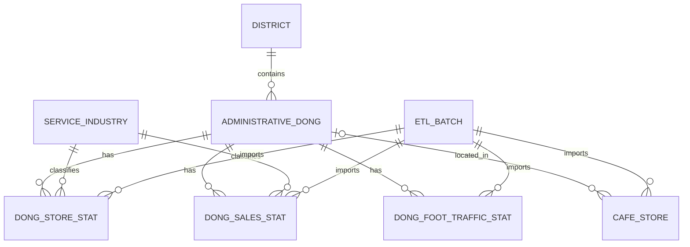

# 데이터 설계

- [README의 상세 기술 문서 안내](../README.md#상세-기술-문서)

현재 구현된 Flyway V1~V4 및 ETL·API 데이터 계약을 정리합니다. Flyway는 SQL 마이그레이션의 적용 이력을 관리하는 도구입니다. 8개 테이블은 구현되었고 `region_score`는 계획입니다. 적용된 마이그레이션은 수정하지 않으며 후속 스키마는 새 버전으로 관리합니다.

이 문서의 구현 계약과 향후 계획을 다음과 같이 구분합니다.

| 구분                  | 범위                                                                                                                      |
| --------------------- | ------------------------------------------------------------------------------------------------------------------------- |
| 구현 완료·확정된 계약 | Flyway V1~V4의 8개 테이블·제약조건, 구현된 ETL의 검증·게시 규칙, 행정구역 API 5개와 행정동 점포 통계 API의 입력·응답·오류 |
| 구현 예정             | 구 단위 합산·추정매출·유동인구·주변 카페·점수 API와 `region_score`                                                        |
| 확정 전               | 점수 알고리즘·계산 시점·결과 저장 스키마, 후속 API의 상세 계약                                                            |

V3 점포 통계 조회 API를 구현했습니다. 추정매출·유동인구와 V4 카페는 저장·ETL 계약까지 구현했으며 조회 API는 아직 제공하지 않습니다. 아래 점수 관련 설계 원칙은 향후 구현의 요구사항이며 현재 동작이 아닙니다.

## 목차

- [데이터 모델](#데이터-모델)
- [주요 데이터 관계](#주요-데이터-관계)
- [주요 설계 원칙](#주요-설계-원칙)
- [DB 마이그레이션 방향](#db-마이그레이션-방향)
  - [V3 통계 컬럼과 저장 정책](#v3-통계-컬럼과-저장-정책)
  - [V4 카페 컬럼과 ETL 계약](#v4-카페-컬럼과-etl-계약)
- [행정구역 REST API 계약](#행정구역-rest-api-계약)
- [행정동 점포 통계 REST API 계약](#행정동-점포-통계-rest-api-계약)

## 데이터 모델

다음 9개 테이블을 중심으로 설계하고 있으며, V1~V4에서 `cafe_store`를 포함한 8개 테이블을 구현했습니다. `region_score`는 후속 구현 대상입니다. V4는 격리 DB 검증과 개발 DB 적용을 완료했습니다.

| 테이블                   | 역할                            | 주요 식별 기준       |
| ------------------------ | ------------------------------- | -------------------- |
| `district`               | 서울시 자치구 정보 및 공간 경계 | 자치구 코드          |
| `administrative_dong`    | 행정동 정보 및 공간 경계        | 행정동 코드          |
| `service_industry`       | 서울시 서비스 업종 코드         | 업종 코드            |
| `dong_store_stat`        | 행정동별 점포 수·개업·폐업 통계 | 분기 + 행정동 + 업종 |
| `dong_sales_stat`        | 행정동별 추정매출 및 소비 통계  | 분기 + 행정동 + 업종 |
| `dong_foot_traffic_stat` | 행정동별 유동인구 통계          | 분기 + 행정동        |
| `cafe_store`             | 개별 카페 정보 및 위치          | 소진공 상가업소번호  |
| `etl_batch`              | 공공데이터 수집·검증·적재 이력  | ETL 배치 ID          |
| `region_score`           | 창업 환경 점수와 계산 근거      | 평가 결과 ID         |

`region_score`는 평가 알고리즘을 확정한 뒤 구체적인 스키마와 저장 방식을 결정할 예정입니다.

## 주요 데이터 관계



위 ERD는 주요 테이블 관계를 나타낸 1차 설계입니다. V1~V4의 컬럼·제약조건과 경계·서비스 업종·점포·추정매출·유동인구 통계 ETL의 배치 이력 연결은 구현했으며, 미구현 테이블과 정기 갱신·후속 서비스 조회의 상세 설계는 후속 단계에서 확정할 예정입니다.

## 주요 설계 원칙

### 1. 행정구역 및 식별자

- 자치구와 행정동을 별도 테이블로 관리합니다.
- 행정동 이름이 아닌 행정동 코드를 기준으로 관련 통계를 연결합니다.
- 원본 행정구역 코드의 형식을 유지하고 외래키로 데이터 정합성을 관리합니다.
- 서울시 서비스 업종 코드와 소상공인시장진흥공단 업종 코드는 별도로 관리합니다.

### 2. 통계 데이터

- 점포·추정매출은 `분기 + 행정동 + 업종` 단위로 저장합니다.
- 길단위인구는 `분기 + 행정동` 단위로 저장합니다.
- 개업률·폐업률은 원본 집계 방식에 따라 100%를 초과할 수 있으므로 일률적인 상한을 적용하지 않습니다.
- V3의 점포 수·매출액·매출 건수는 `BIGINT`, 비율·추정 유동인구는 정밀도 손실을 피하기 위해 `NUMERIC`으로 저장합니다.
- 실제 값이 `0`인 경우와 데이터가 제공되지 않은 경우를 구분합니다.
- 서로 다른 집계 단위의 통계를 결합할 때 중복 집계되지 않도록 처리합니다.

### 3. 공간 데이터

PostGIS는 PostgreSQL의 공간 연산 확장입니다. EPSG:4326은 WGS84 경도·위도 좌표계를 뜻하며, 원본 경계의 EPSG:5181은 미터 기반 투영 좌표계입니다.

- 경계 ETL은 원본 행정동 경계의 EPSG:5181 좌표계를 검증하고, EPSG:4326으로 변환해 DB에 저장합니다.
- 자치구 경계는 같은 자치구에 속한 행정동 경계를 결합해 생성합니다.
- 행정동 경계와 개별 카페 위치는 PostGIS 공간 컬럼으로 저장합니다.
- 주변 카페 조회에는 미터 단위 반경 검색과 행정구역 경계 판정을 활용합니다.
- 공간 검색에 필요한 GiST 인덱스를 적용하고 실제 조회 성능에 따라 추가 인덱스를 검토합니다.

### 4. 개별 카페와 행정동 통계의 구분

- 개별 카페 위치는 소상공인시장진흥공단의 상가(상권)정보를 기반으로 관리합니다.
- 행정동별 카페 점포 통계는 서울시 상권분석서비스의 별도 집계값으로 관리합니다.
- 두 데이터의 카페 수가 일치하지 않더라도 동일한 데이터로 간주하거나 임의로 보정하지 않습니다.
- 반경 내 카페 정보와 행정동 전체의 점포·매출·유동인구 통계를 구분해 제공합니다.
- 개별 카페가 최신 수집 결과에서 누락되었다는 이유만으로 폐업했다고 판단하지 않습니다.

### 5. 평가 결과의 재현성

다음은 점수 기능 구현 시 지킬 요구사항입니다. `region_score` 스키마와 점수 API는 아직 확정하지 않았습니다.

- 창업 환경 점수는 구 또는 행정동 단위로 계산합니다.
- 점수 계산에 사용한 데이터의 기준 시점과 알고리즘 버전을 관리합니다.
- 가중치, 정규화 기준, 입력 지표, 항목별 점수 등 산출 근거를 보존하는 방향으로 설계합니다.
- 필요한 통계가 누락된 경우 임의의 값을 채워 점수를 계산하지 않습니다.
- 여러 자치구의 점수를 합산하거나 서로 다른 집계 단위의 점수를 동일한 기준으로 비교하지 않습니다.

## DB 마이그레이션 방향

DB 스키마는 Flyway를 이용해 관리합니다.

`V1__enable_postgis.sql`은 PostGIS 확장을 활성화하고, `V2__create_core_tables.sql`은 ETL 이력·자치구·행정동·서비스 업종 테이블과 제약조건·인덱스를 생성합니다. `V3__create_dong_stat_tables.sql`은 행정동별 점포·추정매출·유동인구 통계 테이블을 생성하고, `V4__create_cafe_store.sql`은 개별 카페 테이블과 조회 인덱스를 생성합니다.

현재 마이그레이션 구성과 후속 구현 계획은 다음과 같습니다.

| 단계 | 주요 내용                                                           |
| ---- | ------------------------------------------------------------------- |
| V1   | PostGIS 확장 활성화 (구현 완료)                                     |
| V2   | ETL 이력 및 행정구역·업종 기준 테이블 (구현 완료)                   |
| V3   | 점포·추정매출·길단위인구 통계 테이블 (구현 완료)                    |
| V4   | 개별 카페 및 공간 검색 인덱스 (구현·격리 DB 검증·개발 DB 적용 완료) |
| 이후 | 평가 알고리즘 확정 후 점수 관련 테이블                              |

Flyway는 테이블, 제약조건, 인덱스 등 DB 스키마 변경을 관리합니다. 경계 파일·서비스 업종 기준 데이터·점포·추정매출·유동인구 통계 적재는 별도 ETL로 구현했으며, 카페 데이터도 별도 API ETL로 실제 인증 검증·수집·21,996건 적재를 완료했습니다.

### V3 통계 컬럼과 저장 정책

서울 열린데이터광장의 [점포-행정동](https://data.seoul.go.kr/dataList/OA-22172/S/1/datasetView.do?tab=A), [추정매출-행정동](https://data.seoul.go.kr/dataList/OA-22175/S/1/datasetView.do?tab=A), [길단위인구-행정동](https://data.seoul.go.kr/dataList/OA-22178/S/1/datasetView.do?tab=A) 컬럼 설명과 공개 API 표본을 확인했습니다. 공통 분기 필드는 `STDR_YYQU_CD`이며, DB의 `quarter_code`에는 `20261`처럼 연도 4자리와 분기 1~4를 저장합니다.

#### 점포 통계

`dong_store_stat`의 원천 필드와 저장 컬럼입니다.

| DB 컬럼                 | 원천 필드               | 의미·자료형                   |
| ----------------------- | ----------------------- | ----------------------------- |
| `store_count`           | `SIMILR_INDUTY_STOR_CO` | 전체 점포 수 · `BIGINT`       |
| `general_store_count`   | `STOR_CO`               | 일반 점포 수 · `BIGINT`       |
| `franchise_store_count` | `FRC_STOR_CO`           | 프랜차이즈 점포 수 · `BIGINT` |
| `opened_store_count`    | `OPBIZ_STOR_CO`         | 개업 점포 수 · `BIGINT`       |
| `closed_store_count`    | `CLSBIZ_STOR_CO`        | 폐업 점포 수 · `BIGINT`       |
| `opening_rate`          | `OPBIZ_RT`              | 개업률(%) · `NUMERIC`         |
| `closure_rate`          | `CLSBIZ_RT`             | 폐업률(%) · `NUMERIC`         |

#### 추정매출 통계

`dong_sales_stat`의 원천 필드와 저장 컬럼입니다.

| DB 컬럼                | 원천 필드          | 의미·자료형                    |
| ---------------------- | ------------------ | ------------------------------ |
| `monthly_sales_amount` | `THSMON_SELNG_AMT` | 당월 추정매출액(원) · `BIGINT` |
| `monthly_sales_count`  | `THSMON_SELNG_CO`  | 당월 매출 건수 · `BIGINT`      |
| `weekday_sales_amount` | `MDWK_SELNG_AMT`   | 주중 매출액(원) · `BIGINT`     |
| `weekend_sales_amount` | `WKEND_SELNG_AMT`  | 주말 매출액(원) · `BIGINT`     |

#### 유동인구 통계

`dong_foot_traffic_stat`의 원천 필드와 저장 컬럼입니다.

| DB 컬럼               | 원천 필드      | 의미·자료형                    |
| --------------------- | -------------- | ------------------------------ |
| `total_foot_traffic`  | `TOT_FLPOP_CO` | 전체 추정 유동인구 · `NUMERIC` |
| `male_foot_traffic`   | `ML_FLPOP_CO`  | 남성 추정 유동인구 · `NUMERIC` |
| `female_foot_traffic` | `FML_FLPOP_CO` | 여성 추정 유동인구 · `NUMERIC` |

#### 공통 키와 수치 저장 정책

- 점포·매출의 기본키는 `(dong_code, industry_code, quarter_code)`, 유동인구는 `(dong_code, quarter_code)`입니다. 행정동·업종 및 수집 출처인 `source_batch_id`는 기존 기준 테이블을 참조하며 필수 값입니다. 추가 인덱스는 만들지 않고 기본키 인덱스를 사용합니다.
- [매출 API 표본](http://openapi.seoul.go.kr:8088/sample/json/VwsmAdstrdSelngW/1/5/)에는 7,081,380,548원처럼 32비트 정수 범위를 넘는 금액이 있습니다. 정수 의미 값도 `.0`이나 지수 표기로 반환됩니다. 원천의 ‘당월’ 필드명과 분기 기준을 그대로 유지하며 월평균으로 환산하지 않습니다.
- [유동인구 API 표본](http://openapi.seoul.go.kr:8088/sample/json/VwsmAdstrdFlpopW/1/5/)에서 확인한 값은 정수였지만, 공식 스키마에 정수 보장이나 반올림 규칙은 없습니다. 비율·추정 유동인구는 소수부를 임의로 손실시키지 않도록 고정 정밀도·소수 자릿수 없는 `NUMERIC`을 선택했습니다.
- 모든 측정값은 NULL을 허용하고 기본값을 두지 않습니다. 누락·빈 값을 임의로 `0`으로 채우지 않으며 실제 `0`과 구분합니다. 저장되는 값은 유한한 0 이상 수여야 합니다.
- 개업률·폐업률의 100% 초과를 허용하고, 전체·세부 수치의 합계 일치를 강제하지 않습니다. 유동인구 표본에서도 전체와 성별 합계가 1명 차이 나는 경우를 확인했습니다.

### V4 카페 컬럼과 ETL 계약

`cafe_store`는 소진공 원본 식별자와 위치를 저장합니다. V4 스키마는 개발 DB 적용을 완료했습니다. 카페 ETL은 모의 API·격리 DB 테스트와 실제 API 검증을 거쳐 개발 DB에 21,996건을 적재했습니다. 재실행 `SKIPPED`와 기존 게시 출처 보존도 확인했습니다. 조회 API는 아직 구현하지 않았습니다.

#### 업소 식별자와 명칭

| DB 컬럼           | 원천 필드   | 저장 정책                               |
| ----------------- | ----------- | --------------------------------------- |
| `bizes_id`        | `bizesId`   | `VARCHAR(20)` PK, 공백 없는 원본 문자열 |
| `store_name`      | `bizesNm`   | 상호명 필수 · `TEXT`                    |
| `branch_name`     | `brchNm`    | 지점명 선택 · `TEXT`                    |
| `source_batch_id` | ETL 배치 ID | 필수 · `etl_batch` FK                   |

`bizes_id`는 숫자로 변환하지 않으며 접두사를 고정하지 않습니다. PK는 기본키, FK는 기준 테이블을 참조하는 외래키입니다.

#### 업종 분류와 값 검증

소진공은 소상공인시장진흥공단을 뜻하며, KSIC는 별도의 표준산업분류입니다.

| DB 컬럼               | 원천 필드    | 저장 정책                             |
| --------------------- | ------------ | ------------------------------------- |
| `semas_industry_code` | `indsSclsCd` | 소진공 업종 코드 필수 · `VARCHAR(8)`  |
| `semas_industry_name` | `indsSclsNm` | 소진공 업종 명칭 필수 · `TEXT`        |
| `ksic_code`           | `ksicCd`     | 표준산업분류 코드 선택 · `VARCHAR(6)` |
| `ksic_name`           | `ksicNm`     | 표준산업분류 명칭 선택 · `TEXT`       |

- 서울시 `service_industry`와 소진공 업종은 별도 체계이며 두 테이블 사이에 업종 FK를 만들지 않습니다. 특정 카페 코드를 SQL에 고정하지 않았습니다. 카페 ETL은 실행 시 공식 분류 API와 인증된 업소 응답에서 코드·명칭·기준년월을 검증하며, 미검증 분류는 게시하지 않습니다.
- 필수 값과 선택 TEXT 값이 공백만 있는 경우를 거부합니다. 카페 ETL은 선택 항목의 빈 값을 NULL로 정규화합니다. 업종 코드는 공백 없는 영문 대문자·숫자로 저장하되 실제 코드 목록의 소속 여부는 SQL이 보장하지 않습니다.

#### 행정동 연결

| DB 컬럼            | 원천 필드        | 저장 정책                              |
| ------------------ | ---------------- | -------------------------------------- |
| `source_dong_code` | `adongCd`        | 원본 숫자 문자열, 선택 · `VARCHAR(20)` |
| `dong_code`        | 검증한 `adongCd` | 검증된 행정동 FK, 그 외 NULL           |

- 정확한 8자리이며 기준 테이블에 존재하는 경우만 `dong_code`에 FK로 연결합니다.
- 원본 행정동 코드는 임의로 절단하지 않습니다. 미연결 코드는 원본에 남기고 `dong_code=NULL`로 보존합니다. FK가 있으면 원본 코드도 존재하며 같아야 합니다. 원본 코드가 변경되거나 연결에 실패한 갱신에서는 이전 FK를 그대로 남기지 않습니다.

#### 주소와 좌표 검증

| DB 컬럼        | 원천 필드    | 저장 정책                                     |
| -------------- | ------------ | --------------------------------------------- |
| `road_address` | `rdnmAdr`    | 도로명주소 선택 · `TEXT`                      |
| `lot_address`  | `lnoAdr`     | 지번주소 선택 · `TEXT`                        |
| `geom`         | `lon`, `lat` | 선택 · `GEOMETRY(Point,4326)`, 경도·위도 순서 |

- 좌표가 모두 없으면 `geom=NULL`로 보존하고 지도 검색에서 제외합니다. 일부만 있거나 잘못된 좌표는 카페 ETL에서 오류로 처리합니다. DB는 제공된 Point의 SRID·차원·비어 있지 않음·유효성 및 경도 `[-180,180]`·위도 `[-90,90]` 범위를 검증하며 NaN·무한대를 허용하지 않습니다. 주소나 행정동 대표점을 실제 좌표 대신 넣지 않습니다.
- 행정동 경계와 좌표의 불일치는 공간 진단 대상으로 남기고 자동 보정하지 않습니다. 행정동·좌표가 모두 누락된 행도 보관할 수 있으나, 서울 소속은 API의 명시적인 서울 요청 조건과 응답 행정구역 코드로 검증합니다.

#### 공간 인덱스와 검색

PK 외에 생성하는 조회 인덱스입니다.

| 용도                  | 인덱스 방식 | 대상                           |
| --------------------- | ----------- | ------------------------------ |
| 최신 배치·행정동 조회 | B-tree      | `(source_batch_id, dong_code)` |
| 지도 영역 검색        | GiST        | `(geom)`                       |
| 미터 반경 검색        | GiST        | `((geom::geography))`          |

반경은 `ST_DWithin(geom::geography, 중심점::geography, 미터)`로 판정하며 geometry 인덱스만으로 geography 조회까지 지원한다고 가정하지 않습니다. 실제 성능 검증은 후속 조회 구현에서 진행합니다.

#### 서울 전체 최신 목록을 위한 ETL 계약

여기서 게시는 검증을 마친 배치를 `PUBLISHED` 상태로 확정하는 것을 뜻합니다.

1. **게시 범위와 출처 기록**
   - `SEMAS_CAFE_STORE` 데이터셋의 게시 단위는 **서울 전체의 완전한 수집**입니다.
   - `source_type='API'`, `scope_type='SEOUL'`, `scope_code=NULL`을 사용합니다.
   - 검증된 JSON 문자열을 `source_reference` TEXT에 기록하고, `collection_mode='FULL_SEOUL'`, `complete=true`, 엔드포인트·허용된 요청 조건·원천 기준년월·분류 버전·페이지 및 품질 건수를 포함합니다.
   - API 키와 키가 포함된 URL·오류는 기록하지 않습니다.
   - 원천 `YYYYMM`은 분기 컬럼에 넣지 않고 `period_from/to`는 NULL로 둡니다.

2. **전체 수집 검증과 원자적 게시**
   - 모든 페이지·원천 건수·중복 업소번호·분류 및 범위·기준년월을 검증하고, 스테이징의 실제 건수를 대조한 뒤 Upsert와 `PUBLISHED`를 한 트랜잭션으로 확정합니다.
   - 일부 행정동·반경 표본·페이지 누락·실패 수집은 이 데이터셋의 `PUBLISHED`나 전체 목록으로 취급하지 않으며 `cafe_store`에 반영하지 않습니다.
   - 페이지·건수 검사는 원천 API의 동시 갱신까지 원자적인 스냅샷이라고 보장하지 않습니다.

3. **최신 목록의 기준 배치**
   - 새 `PUBLISHED`에서는 수집한 **모든 업소**의 `source_batch_id`를 새 배치로 연결합니다.
   - 값이 동일한 행도 포함합니다.
   - 최신 목록은 해당 데이터셋·서울 범위·완전 수집 메타데이터를 충족하는 최신 `PUBLISHED` 배치를 선택한 뒤, 그 배치를 참조하는 행만 조회합니다.
   - 테이블 전체나 가장 최근 실행 배치를 그대로 전체 목록으로 사용하지 않습니다.

4. **재실행과 과거 데이터 보존**
   - `SKIPPED`는 완전한 동일 원본과 실제 DB 값·출처가 일치할 때만 기록하고 기존 정상 행의 출처를 유지합니다.
   - `SKIPPED`, `RUNNING`, `FAILED`는 최신 목록 기준 배치를 대체하지 않습니다.
   - 입력에서 누락된 기존 업소는 삭제하거나 폐업으로 단정하지 않으며, 이전 배치의 행으로 보존하고 최신 목록과 구분합니다.

이 계약의 수집·검증·게시·재실행은 카페 ETL이 담당합니다. V4의 FK·CHECK가 배치 상태까지 강제하지는 않으며, 향후 조회 코드도 위 최신 목록 조건을 준수해야 합니다.

## 행정구역 REST API 계약

`db` 프로필에서 Controller → Service → JdbcClient Repository로 조회합니다. [실행 설정](development.md#3-backend)을 먼저 확인하세요.

### 공통 오류 응답

공통 오류 응답은 `application/problem+json`의 ProblemDetail이며 `type`, `title`, `status`, `detail`, `instance`와 서비스 오류 `code`를 제공합니다. 예외 원문·SQL·접속 정보와 거부된 입력값은 포함하지 않습니다.

| 오류 코드              | HTTP 상태 | 처리 대상                                                  |
| ---------------------- | --------- | ---------------------------------------------------------- |
| `INVALID_PARAMETER`    | 400       | 필수 파라미터 누락·형식·본문 오류, 명시적인 입력 검증 실패 |
| `REGION_NOT_FOUND`     | 404       | 서비스에서 명시적으로 판정한 지역 미존재                   |
| `DATA_NOT_READY`       | 503       | 서비스에서 명시적으로 판정한 데이터 준비 전 상태           |
| `DATABASE_UNAVAILABLE` | 503       | DB 연결·자원 접근 실패, 조회 시간 초과                     |
| `INTERNAL_ERROR`       | 500       | SQL 문법·매핑·무결성 오류 및 예상하지 못한 구현 오류       |

미등록 경로의 404와 지원하지 않는 HTTP 메서드의 405 등은 MVC 상태·헤더를 유지하고 서비스 오류 코드는 붙이지 않습니다.

### 조회 엔드포인트

행정구역 조회 API는 아래 계약을 사용합니다. DTO는 응답 데이터의 필드 구조를 뜻하며, 각 구조는 다음 소제목에서 확인할 수 있습니다.

| GET 엔드포인트                              | 응답 DTO                                   |
| ------------------------------------------- | ------------------------------------------ |
| `/api/v1/districts`                         | `DistrictList`                             |
| `/api/v1/districts/{districtCode}/dongs`    | `DongList`                                 |
| `/api/v1/districts/{districtCode}/boundary` | `BoundaryFeature` (자치구 GeoJSON Feature) |
| `/api/v1/dongs/{dongCode}/boundary`         | `BoundaryFeature` (행정동 GeoJSON Feature) |
| `/api/v1/regions/nearby`                    | `NearbyRegions`                            |

목록은 코드 오름차순입니다. 구 코드는 ASCII 숫자 5자리, 동 코드는 8자리 문자열로 검증하며 선행 0을 보존합니다.

### 목록 응답 DTO

```text
DistrictList
└─ items: District[]
   ├─ districtCode: 문자열
   └─ districtName: 문자열

DongList
└─ items: Dong[]
   ├─ dongCode: 문자열
   ├─ districtCode: 문자열
   ├─ dongName: 문자열
   └─ labelPoint: GeoJSON Point 객체
```

행정동 목록의 `labelPoint`는 저장된 `administrative_dong.label_point`를 PostGIS에서 생성한 WGS84 GeoJSON Point 객체(`{type:"Point",coordinates:[경도,위도]}`)입니다. 경계 중심으로 재계산하지 않습니다.

#### 행정구역 목록 JSON 예시

아래와 다음 주변 조회 예시는 모두 **응답 구조 설명용 합성 데이터**입니다. 코드·이름·좌표·배치 ID·게시 시각은 실제 DB 조회 결과가 아닙니다. 필드와 자료형은 현재 DTO 계약을 따릅니다.

`GET /api/v1/districts` → `DistrictList`

```json
{
  "items": [{ "districtCode": "00110", "districtName": "예시구" }]
}
```

`GET /api/v1/districts/00110/dongs` → `DongList`

```json
{
  "items": [
    {
      "dongCode": "00110001",
      "districtCode": "00110",
      "dongName": "예시동",
      "labelPoint": { "type": "Point", "coordinates": [127.0, 37.0] }
    }
  ]
}
```

### 경계 응답 DTO

경계 응답은 `application/geo+json`입니다.

```text
BoundaryFeature
├─ type: "Feature"
├─ id: 문자열
├─ geometry: WGS84(EPSG:4326) GeoJSON 객체
└─ properties: BoundaryProperties
   ├─ regionType: 문자열
   ├─ regionCode: 문자열
   ├─ regionName: 문자열
   ├─ districtCode: 문자열
   └─ boundaryBatch: PublishedBatch
      ├─ batchId: UUID 문자열
      └─ publishedAt: ISO 8601 문자열
```

`geometry`는 PostGIS에서 생성하며, 좌표는 경도·위도 순서입니다.

### 주변 행정구역 응답 DTO

```text
NearbyRegions
├─ boundaryBatch: PublishedBatch
│  ├─ batchId: UUID 문자열
│  └─ publishedAt: ISO 8601 문자열
├─ districts: NearbyDistrict[]
│  ├─ districtCode: 문자열
│  ├─ districtName: 문자열
│  └─ containsCenter: boolean
└─ dongs: NearbyDong[]
   ├─ dongCode: 문자열
   ├─ districtCode: 문자열
   ├─ dongName: 문자열
   └─ containsCenter: boolean
```

`containsCenter`는 해당 지역 경계의 내부 또는 경계 위에 중심점이 있는지를 뜻합니다. 구·동 목록은 각각 코드순이며 응답에 최신 `boundaryBatch:{batchId,publishedAt}`을 포함합니다.

#### 주변 조회 JSON 예시

`GET /api/v1/regions/nearby?longitude=127&latitude=37&radiusM=500` → `NearbyRegions`의 합성 데이터 예시입니다. `containsCenter`는 boolean이며, 목록과 게시 배치 정보는 서로 다른 최상위 필드입니다.

```json
{
  "boundaryBatch": {
    "batchId": "00000000-0000-0000-0000-000000000001",
    "publishedAt": "2026-10-01T00:00:00Z"
  },
  "districts": [
    {
      "districtCode": "00110",
      "districtName": "예시구",
      "containsCenter": true
    }
  ],
  "dongs": [
    {
      "dongCode": "00110001",
      "districtCode": "00110",
      "dongName": "예시동",
      "containsCenter": true
    }
  ]
}
```

### 게시 배치 선택과 상태 판정

- `SEOUL_DONG_BOUNDARY`, `SHAPEFILE`, `SEOUL`, `scope_code IS NULL`, `PUBLISHED`, `published_at IS NOT NULL`을 모두 충족하는 배치 중 `published_at → started_at → batch_id` 내림차순의 첫 배치를 사용합니다.
- 그 배치를 참조하는 구·동만 노출하며, 동의 부모 구도 같은 게시본이어야 합니다. `SKIPPED`·실패·과거 출처는 제외합니다.
- 형식 오류는 DB 접근 전에 400, 현재 게시본에 없는 지역은 404, 정상 게시 배치가 없으면 503입니다.
- 최신 게시 배치를 참조하는 구·동 경계 행이 모두 없을 때도 `DATA_NOT_READY`(503)로 처리하고 과거 배치로 대체하지 않습니다.
- 경계 행이 있는 게시본에서 존재하는 구에 현재 행정동이 없거나 검색 반경과 겹치지 않으면 정상 빈 목록입니다.
- 배치 선택과 지역 조회는 읽기 전용 `REPEATABLE_READ` 트랜잭션에서 처리합니다.

### 주변 행정구역 조회 조건

#### 좌표와 반경

| 파라미터    | 필수 여부 | 허용 범위·기본값                        |
| ----------- | --------- | --------------------------------------- |
| `longitude` | 필수      | WGS84 경도 `[-180,180]`                 |
| `latitude`  | 필수      | WGS84 위도 `[-90,90]`                   |
| `radiusM`   | 선택      | 생략 시 500m, `1~1000` 범위의 소수 허용 |

좌표·반경의 NaN·무한대·빈 값과 단일 파라미터 중복은 400입니다.

#### 구 선택과 공간 판정

- `districtCodes=11110&districtCodes=11140`처럼 구 코드를 반복해 선택할 수 있습니다. 생략하면 반경 내 모든 현행 서울 지역을 검색하고 중복 코드는 제거합니다.
- 쉼표 목록이나 잘못된 코드는 400, 현재 게시본에 없는 지정 구는 반경과 무관하게 404입니다.
- 구 선택은 반경을 확장하지 않으며 행정동은 반경·선택 구·동 경계의 실제 교집합으로 판정합니다.
- 거리는 geography 기반 미터 단위로 계산하고 반경 접촉을 포함합니다.
- 게시본이 있어도 공간적으로 겹치지 않으면 서울 밖 좌표를 포함해 200과 두 빈 목록을 반환합니다.

## 행정동 점포 통계 REST API 계약

`db` 프로필에서만 제공하며 Controller → Service → JdbcClient Repository와 [공통 ProblemDetail 오류](#공통-오류-응답)를 사용합니다. 구 단위 합산·추정매출·유동인구·점수 조회는 포함하지 않습니다.

### 요청 조건

`GET /api/v1/dongs/{dongCode}/stats/stores?quarterCode=20262&industryCode=CS100010`

| 항목           | 위치 | 필수 형식                                       |
| -------------- | ---- | ----------------------------------------------- |
| `dongCode`     | 경로 | ASCII 숫자 정확히 8자리                         |
| `quarterCode`  | 쿼리 | ASCII 연도 4자리 + 분기 `1~4`, 예: `20262`      |
| `industryCode` | 쿼리 | 서울시 서비스 업종 코드 `CS` + ASCII 숫자 6자리 |

코드는 문자열로 유지합니다. 필수 쿼리 누락·빈 값·공백·잘못된 형식·중복 전달은 DB 조회 전에 `INVALID_PARAMETER`(400)로 처리합니다. 동일 값 중복도 거부하며 trim·숫자 변환·쉼표 분할로 보정하지 않습니다. 형식이 정상인 업종 코드에 통계가 없으면 `data: null`이며, 별도의 업종 오류 코드를 만들지 않습니다.

### 응답과 NULL·정밀도

응답은 `application/json`의 `StoreStatResponse`입니다.

```text
StoreStatResponse
├─ dongCode: 문자열
├─ quarterCode: 문자열
├─ industryCode: 문자열
└─ data: StoreData 또는 null
   ├─ storeCount: 문자열 또는 null (전체 점포 수)
   ├─ generalStoreCount: 문자열 또는 null (일반 점포 수)
   ├─ franchiseStoreCount: 문자열 또는 null
   ├─ openedStoreCount: 문자열 또는 null
   ├─ closedStoreCount: 문자열 또는 null
   ├─ openingRate: 문자열 또는 null (개업률 %)
   ├─ closureRate: 문자열 또는 null (폐업률 %)
   └─ sourceBatch: PublishedBatch
      ├─ batchId: UUID 문자열
      └─ publishedAt: ISO 8601 문자열
```

- V3의 5개 `BIGINT`와 2개 `NUMERIC` 측정값을 JDBC에서 문자열로 읽어 숫자형 JSON으로 변환하지 않습니다. JavaScript 안전 정수 범위를 넘는 정수와 긴 소수부·저장된 소수 자릿수를 보존합니다.
- 원본 `NULL`은 JSON `null`, 실제 0은 `"0"` 등 저장된 값의 문자열입니다. 비율을 반올림하거나 100%로 제한하지 않으며 전체와 세부 수치의 합을 보정하지 않습니다.
- 조건에 맞는 행이 없으면 요청 식별자와 `data: null`을 반환합니다. 다른 분기나 0으로 대체하지 않습니다. 모든 측정값이 NULL인 행이 존재하면 `data` 객체와 그 행의 `sourceBatch`는 유지합니다.
- `sourceBatch`는 경계 배치가 아닌 해당 통계 행의 실제 게시 출처입니다. 원본 경로·체크섬·인증정보는 응답에 포함하지 않습니다.

다음은 **응답 구조 설명용 합성 데이터**이며 실제 DB 조회 결과가 아닙니다.

```json
{
  "dongCode": "00110001",
  "quarterCode": "20262",
  "industryCode": "CS100010",
  "data": {
    "storeCount": "9007199254740993",
    "generalStoreCount": null,
    "franchiseStoreCount": "0",
    "openedStoreCount": "9223372036854775807",
    "closedStoreCount": "1",
    "openingRate": "123.456789012345678901234567890",
    "closureRate": "0.000000000000000000001",
    "sourceBatch": {
      "batchId": "00000000-0000-0000-0000-000000000002",
      "publishedAt": "2026-10-02T00:00:00Z"
    }
  }
}
```

통계 미존재의 합성 예시입니다.

```json
{
  "dongCode": "00110001",
  "quarterCode": "20263",
  "industryCode": "CS100010",
  "data": null
}
```

### 게시 배치 선정과 상태 판정

1. [행정구역 API의 최신 정상 경계 게시본 규칙](#게시-배치-선택과-상태-판정)을 재사용합니다. 해당 배치의 경계 행이 전혀 없거나 정상 배치가 없으면 `DATA_NOT_READY`(503)입니다.
2. 행정동과 부모 구가 모두 해당 경계 배치를 참조해야 합니다. 없는 행정동·과거 경계에만 남은 동·부모 구의 출처가 다른 동은 `REGION_NOT_FOUND`(404)입니다. 이 검증은 점포 데이터셋 준비 상태보다 먼저 수행합니다.
3. 통계 행의 `source_batch_id`로 `etl_batch`를 연결해 `dataset_code='SEOUL_DONG_STORE_STAT'`, `source_type='CSV'`, `scope_type='SEOUL'`, `scope_code IS NULL`, `status='PUBLISHED'`, `published_at IS NOT NULL`을 모두 검사합니다. `SKIPPED`·`FAILED`·`RUNNING`과 다른 데이터셋·수집 방식·범위·게시 시각 없는 이력은 조회 대상이 아닙니다.
4. **통계에는 전역 최신 배치 제한을 적용하지 않습니다.** ETL은 새 입력에 없는 기존 키를 보존하므로 과거 정상 배치의 유효한 분기도 조회합니다. 더 최신의 빈 게시 배치나 `SKIPPED` 이력도 이 자료를 가리지 않습니다.
5. 위 조건을 충족하는 실제 `dong_store_stat` 행이 전체에 하나도 없으면 데이터셋 미준비로 `DATA_NOT_READY`(503)입니다. 게시 이력만 있고 실제 유효 행이 없는 경우도 포함합니다. 하나라도 있으면 데이터셋은 준비된 상태이며, 요청한 분기·동·업종의 유효 행 미존재는 `200`과 `data: null`입니다.
6. 경계 선택·행정동 검증·통계 준비 확인·통계와 출처 조회 전체를 읽기 전용 `REPEATABLE_READ` 트랜잭션으로 처리합니다. 조회 도중 별도 ETL 트랜잭션이 새 경계·통계·게시 이력을 확정해도 한 응답에서 이전과 이후 상태가 섞이지 않습니다.
