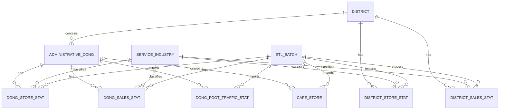

# 데이터 설계

- [README의 상세 기술 문서 안내](../README.md#상세-기술-문서)

현재 구현된 Flyway V1~V6 및 ETL·API 데이터 계약을 정리합니다. Flyway는 SQL 마이그레이션의 적용 이력을 관리하는 도구입니다. 10개 테이블은 구현되었고 `region_score`는 계획입니다. 적용된 마이그레이션은 수정하지 않으며 후속 스키마는 새 버전으로 관리합니다.

이 문서의 구현 계약과 향후 계획을 다음과 같이 구분합니다.

| 구분                  | 범위                                                                                                                                                               |
| --------------------- | ------------------------------------------------------------------------------------------------------------------------------------------------------------------ |
| 구현 완료·확정된 계약 | Flyway V1~V6의 10개 테이블·제약조건, 구현된 ETL의 검증·게시 규칙, 행정구역 API 5개와 행정동 점포·추정매출·유동인구·공식 자치구 점포·주변 카페 API의 입력·응답·오류 |
| 구현 예정             | 자치구 추정매출 API·유동인구 적재·API와 점수 API, `region_score`                                                                                                   |
| 확정 전               | 점수 알고리즘·계산 시점·결과 저장 스키마, 후속 API의 상세 계약                                                                                                     |

V3 점포·추정매출·유동인구 통계와 V4 카페의 주변 반경·지도 영역 조회 API를 구현했습니다. [현재 개발 현황](../README.md#현재-개발-현황)과 같이 실제 화면·구 단위 집계·점수는 후속 구현 대상입니다. 아래 점수 관련 설계 원칙은 향후 구현의 요구사항이며 현재 동작이 아닙니다.

공식 자치구 점포의 실제 CSV 54,765행을 `district-stores --probe`로 검증했고, V5 테이블과 적재 ETL을 추가했습니다. 공식 점포·매출·길단위인구의 자치구 차원과 집계 제한은 [자치구 통계 정책](district-statistics-policy.md), 실행법은 [ETL 가이드](etl-guide.md#자치구-점포-읽기-전용-검증)를 따릅니다. 공식 자치구 점포 REST API도 구현했습니다. 자치구 점포의 이후 실제 개발 DB 적용·적재 결과는 [ETL 가이드의 검증 기록](etl-guide.md#실제-개발-db-적용적재-검증-2026-10-31)에 구분합니다. 자치구 추정매출은 DB 없는 원본 probe를 유지하면서 V6와 적재 ETL을 추가했습니다. 실제 개발 DB는 V5 상태로 자치구 매출은 미적재이며, 자치구 매출 API·인구 적재·API는 후속 범위입니다. 기존 행정동 V3 계약은 유지합니다.

## 목차

- [데이터 모델](#데이터-모델)
- [주요 데이터 관계](#주요-데이터-관계)
- [주요 설계 원칙](#주요-설계-원칙)
- [DB 마이그레이션 방향](#db-마이그레이션-방향)
  - [V3 통계 컬럼과 저장 정책](#v3-통계-컬럼과-저장-정책)
  - [V4 카페 컬럼과 ETL 계약](#v4-카페-컬럼과-etl-계약)
  - [V5 자치구 점포 컬럼과 ETL 계약](#v5-자치구-점포-컬럼과-etl-계약)
  - [V6 자치구 추정매출 컬럼과 ETL 계약](#v6-자치구-추정매출-컬럼과-etl-계약)
- [자치구 추정매출 원본 probe 계약](#자치구-추정매출-원본-probe-계약)
- [행정구역 REST API 계약](#행정구역-rest-api-계약)
- [행정동 점포 통계 REST API 계약](#행정동-점포-통계-rest-api-계약)
- [자치구 점포 통계 REST API 계약](#자치구-점포-통계-rest-api-계약)
- [행정동 추정매출 통계 REST API 계약](#행정동-추정매출-통계-rest-api-계약)
- [행정동 유동인구 통계 REST API 계약](#행정동-유동인구-통계-rest-api-계약)
- [주변 카페 REST API 계약](#주변-카페-rest-api-계약)
- [지도 영역 카페 REST API 계약](#지도-영역-카페-rest-api-계약)

## 데이터 모델

다음 11개 테이블을 중심으로 설계하고 있으며, V1~V4의 8개 테이블에 V5 `district_store_stat`과 V6 `district_sales_stat`을 추가해 10개를 구현했습니다. `region_score`는 후속 구현 대상입니다. V1~V5의 실제 개발 DB 적용 결과는 [개발 가이드](development.md#마이그레이션-적용-상태-확인)에 기록합니다.

| 테이블                   | 역할                                 | 주요 식별 기준       |
| ------------------------ | ------------------------------------ | -------------------- |
| `district`               | 서울시 자치구 정보 및 공간 경계      | 자치구 코드          |
| `administrative_dong`    | 행정동 정보 및 공간 경계             | 행정동 코드          |
| `service_industry`       | 서울시 서비스 업종 코드              | 업종 코드            |
| `dong_store_stat`        | 행정동별 점포 수·개업·폐업 통계      | 분기 + 행정동 + 업종 |
| `district_store_stat`    | 공식 자치구별 점포 수·개업·폐업 통계 | 분기 + 자치구 + 업종 |
| `dong_sales_stat`        | 행정동별 추정매출 및 소비 통계       | 분기 + 행정동 + 업종 |
| `district_sales_stat`    | 공식 자치구별 추정매출 및 소비 통계  | 분기 + 자치구 + 업종 |
| `dong_foot_traffic_stat` | 행정동별 유동인구 통계               | 분기 + 행정동        |
| `cafe_store`             | 개별 카페 정보 및 위치               | 소진공 상가업소번호  |
| `etl_batch`              | 공공데이터 수집·검증·적재 이력       | ETL 배치 ID          |
| `region_score`           | 창업 환경 점수와 계산 근거           | 평가 결과 ID         |

`region_score`는 평가 알고리즘을 확정한 뒤 구체적인 스키마와 저장 방식을 결정할 예정입니다.

## 주요 데이터 관계



위 ERD는 주요 테이블 관계를 나타낸 1차 설계입니다. V1~V6의 컬럼·제약조건과 경계·서비스 업종·행정동 통계·자치구 점포·추정매출 ETL의 배치 이력 연결은 구현했으며, 미구현 테이블과 정기 갱신·후속 서비스 조회의 상세 설계는 후속 단계에서 확정할 예정입니다.

## 주요 설계 원칙

### 1. 행정구역 및 식별자

- 자치구와 행정동을 별도 테이블로 관리합니다.
- 행정동 이름이 아닌 행정동 코드를 기준으로 관련 통계를 연결합니다.
- 원본 행정구역 코드의 형식을 유지하고 외래키로 데이터 정합성을 관리합니다.
- 서울시 서비스 업종 코드와 소상공인시장진흥공단 업종 코드는 별도로 관리합니다.

### 2. 통계 데이터

- 행정동 점포·추정매출은 `분기 + 행정동 + 업종`, 공식 자치구 점포·추정매출은 `분기 + 자치구 + 업종` 단위로 별도 저장합니다.
- 길단위인구는 `분기 + 행정동` 단위로 저장합니다.
- 개업률·폐업률은 원본 집계 방식에 따라 100%를 초과할 수 있으므로 일률적인 상한을 적용하지 않습니다.
- V3의 점포 수·매출액·매출 건수는 `BIGINT`, 비율·추정 유동인구는 정밀도 손실을 피하기 위해 `NUMERIC`으로 저장합니다.
- 실제 값이 `0`인 경우와 데이터가 제공되지 않은 경우를 구분합니다.
- 서로 다른 집계 단위의 통계를 결합할 때 중복 집계되지 않도록 처리합니다.

### 3. 공간 데이터

PostGIS는 PostgreSQL의 공간 연산 확장입니다. EPSG:4326은 WGS84 경도·위도 좌표계를 뜻하며, 원본 경계의 EPSG:5181은 미터 기반 투영 좌표계입니다.

- 경계 ETL은 원본 행정동 경계의 EPSG:5181 좌표계를 검증하고, EPSG:4326으로 변환해 DB에 저장합니다.
- 자치구 경계는 같은 자치구에 속한 행정동 경계를 결합해 생성합니다.
- 행정동 경계와 개별 카페 위치는 PostGIS 공간 컬럼으로 저장합니다.
- 카페 조회에는 미터 단위 반경 또는 WGS84 사각 지도 영역 검색과 행정구역 경계 판정을 활용합니다.
- 공간 검색에 필요한 GiST 인덱스를 적용하고 실제 조회 성능에 따라 추가 인덱스를 검토합니다.

### 4. 개별 카페와 행정동 통계의 구분

- 개별 카페 위치는 소상공인시장진흥공단의 상가(상권)정보를 기반으로 관리합니다.
- 행정동별 카페 점포 통계는 서울시 상권분석서비스의 별도 집계값으로 관리합니다.
- 두 데이터의 카페 수가 일치하지 않더라도 동일한 데이터로 간주하거나 임의로 보정하지 않습니다.
- 반경 내 카페 정보와 행정동 전체의 점포·매출·유동인구 통계를 구분해 제공합니다.
- 개별 카페가 최신 수집 결과에서 누락되었다는 이유만으로 폐업했다고 판단하지 않습니다.

### 5. 평가 결과의 재현성

다음은 점수 기능 구현 시 지킬 요구사항입니다. `region_score` 스키마와 점수 API는 아직 확정하지 않았습니다.

- 창업 환경 점수는 구 또는 행정동 단위로 계산합니다.
- 점수 계산에 사용한 데이터의 기준 시점과 알고리즘 버전을 관리합니다.
- 가중치, 정규화 기준, 입력 지표, 항목별 점수 등 산출 근거를 보존하는 방향으로 설계합니다.
- 필요한 통계가 누락된 경우 임의의 값을 채워 점수를 계산하지 않습니다.
- 여러 자치구의 점수를 합산하거나 서로 다른 집계 단위의 점수를 동일한 기준으로 비교하지 않습니다.

## DB 마이그레이션 방향

DB 스키마는 Flyway를 이용해 관리합니다.

`V1__enable_postgis.sql`은 PostGIS 확장을 활성화하고, `V2__create_core_tables.sql`은 ETL 이력·자치구·행정동·서비스 업종 테이블과 제약조건·인덱스를 생성합니다. `V3__create_dong_stat_tables.sql`은 행정동별 점포·추정매출·유동인구 통계 테이블을 생성하고, `V4__create_cafe_store.sql`은 개별 카페 테이블과 조회 인덱스를 생성합니다. `V5__create_district_store_stat.sql`은 공식 자치구 점포 통계를, `V6__create_district_sales_stat.sql`은 공식 자치구 추정매출 통계를 추가합니다. 기존 V1~V5는 변경하지 않으며 V6는 실제 개발 DB에 적용하지 않았습니다.

현재 마이그레이션 구성과 후속 구현 계획은 다음과 같습니다.

| 단계 | 주요 내용                                                           |
| ---- | ------------------------------------------------------------------- |
| V1   | PostGIS 확장 활성화 (구현 완료)                                     |
| V2   | ETL 이력 및 행정구역·업종 기준 테이블 (구현 완료)                   |
| V3   | 점포·추정매출·길단위인구 통계 테이블 (구현 완료)                    |
| V4   | 개별 카페 및 공간 검색 인덱스 (구현·격리 DB 검증·개발 DB 적용 완료) |
| V5   | 공식 자치구 점포 통계 (구현·개발 DB 적용 완료)                      |
| V6   | 공식 자치구 추정매출 통계 (구현·개발 DB 미적용)                     |
| 이후 | 자치구 유동인구 및 평가 알고리즘 확정 후 점수 관련 테이블           |

Flyway는 테이블, 제약조건, 인덱스 등 DB 스키마 변경을 관리합니다. 경계 파일·서비스 업종 기준 데이터·점포·추정매출·유동인구 통계 적재는 별도 ETL로 구현했으며, 카페 데이터도 별도 API ETL로 실제 인증 검증·수집·21,996건 적재를 완료했습니다.

### V3 통계 컬럼과 저장 정책

서울 열린데이터광장의 [점포-행정동](https://data.seoul.go.kr/dataList/OA-22172/S/1/datasetView.do?tab=A), [추정매출-행정동](https://data.seoul.go.kr/dataList/OA-22175/S/1/datasetView.do?tab=A), [길단위인구-행정동](https://data.seoul.go.kr/dataList/OA-22178/S/1/datasetView.do?tab=A) 컬럼 설명과 공개 API 표본을 확인했습니다. 공통 분기 필드는 `STDR_YYQU_CD`이며, DB의 `quarter_code`에는 `20261`처럼 연도 4자리와 분기 1~4를 저장합니다.

#### 점포 통계

`dong_store_stat`의 원천 필드와 저장 컬럼입니다.

| DB 컬럼                 | 원천 필드               | 의미·자료형                   |
| ----------------------- | ----------------------- | ----------------------------- |
| `store_count`           | `SIMILR_INDUTY_STOR_CO` | 전체 점포 수 · `BIGINT`       |
| `general_store_count`   | `STOR_CO`               | 일반 점포 수 · `BIGINT`       |
| `franchise_store_count` | `FRC_STOR_CO`           | 프랜차이즈 점포 수 · `BIGINT` |
| `opened_store_count`    | `OPBIZ_STOR_CO`         | 개업 점포 수 · `BIGINT`       |
| `closed_store_count`    | `CLSBIZ_STOR_CO`        | 폐업 점포 수 · `BIGINT`       |
| `opening_rate`          | `OPBIZ_RT`              | 개업률(%) · `NUMERIC`         |
| `closure_rate`          | `CLSBIZ_RT`             | 폐업률(%) · `NUMERIC`         |

#### 추정매출 통계

`dong_sales_stat`의 원천 필드와 저장 컬럼입니다.

| DB 컬럼                | 원천 필드          | 의미·자료형                    |
| ---------------------- | ------------------ | ------------------------------ |
| `monthly_sales_amount` | `THSMON_SELNG_AMT` | 당월 추정매출액(원) · `BIGINT` |
| `monthly_sales_count`  | `THSMON_SELNG_CO`  | 당월 매출 건수 · `BIGINT`      |
| `weekday_sales_amount` | `MDWK_SELNG_AMT`   | 주중 매출액(원) · `BIGINT`     |
| `weekend_sales_amount` | `WKEND_SELNG_AMT`  | 주말 매출액(원) · `BIGINT`     |

#### 유동인구 통계

`dong_foot_traffic_stat`의 원천 필드와 저장 컬럼입니다.

| DB 컬럼               | 원천 필드      | 의미·자료형                    |
| --------------------- | -------------- | ------------------------------ |
| `total_foot_traffic`  | `TOT_FLPOP_CO` | 전체 추정 유동인구 · `NUMERIC` |
| `male_foot_traffic`   | `ML_FLPOP_CO`  | 남성 추정 유동인구 · `NUMERIC` |
| `female_foot_traffic` | `FML_FLPOP_CO` | 여성 추정 유동인구 · `NUMERIC` |

#### 공통 키와 수치 저장 정책

- 점포·매출의 기본키는 `(dong_code, industry_code, quarter_code)`, 유동인구는 `(dong_code, quarter_code)`입니다. 행정동·업종 및 수집 출처인 `source_batch_id`는 기존 기준 테이블을 참조하며 필수 값입니다. 추가 인덱스는 만들지 않고 기본키 인덱스를 사용합니다.
- [매출 API 표본](http://openapi.seoul.go.kr:8088/sample/json/VwsmAdstrdSelngW/1/5/)에는 7,081,380,548원처럼 32비트 정수 범위를 넘는 금액이 있습니다. 정수 의미 값도 `.0`이나 지수 표기로 반환됩니다. 원천의 ‘당월’ 필드명과 분기 기준을 그대로 유지하며 월평균으로 환산하지 않습니다.
- [유동인구 API 표본](http://openapi.seoul.go.kr:8088/sample/json/VwsmAdstrdFlpopW/1/5/)에서 확인한 값은 정수였지만, 공식 스키마에 정수 보장이나 반올림 규칙은 없습니다. 비율·추정 유동인구는 소수부를 임의로 손실시키지 않도록 고정 정밀도·소수 자릿수 없는 `NUMERIC`을 선택했습니다.
- 모든 측정값은 NULL을 허용하고 기본값을 두지 않습니다. 누락·빈 값을 임의로 `0`으로 채우지 않으며 실제 `0`과 구분합니다. 저장되는 값은 유한한 0 이상 수여야 합니다.
- 개업률·폐업률의 100% 초과를 허용하고, 전체·세부 수치의 합계 일치를 강제하지 않습니다. 유동인구 표본에서도 전체와 성별 합계가 1명 차이 나는 경우를 확인했습니다.

### V4 카페 컬럼과 ETL 계약

`cafe_store`는 소진공 원본 식별자와 위치를 저장합니다. V4 스키마는 개발 DB 적용을 완료했습니다. 카페 ETL은 모의 API·격리 DB 테스트와 실제 API 검증을 거쳐 개발 DB에 21,996건을 적재했습니다. 재실행 `SKIPPED`와 기존 게시 출처 보존도 확인했습니다. [주변 카페 API](#주변-카페-rest-api-계약)와 [지도 영역 카페 API](#지도-영역-카페-rest-api-계약)는 최신 완전 수집 게시본에서 반경 또는 사각 영역과 선택 구 조건에 맞는 카페를 조회합니다.

#### 업소 식별자와 명칭

| DB 컬럼           | 원천 필드   | 저장 정책                               |
| ----------------- | ----------- | --------------------------------------- |
| `bizes_id`        | `bizesId`   | `VARCHAR(20)` PK, 공백 없는 원본 문자열 |
| `store_name`      | `bizesNm`   | 상호명 필수 · `TEXT`                    |
| `branch_name`     | `brchNm`    | 지점명 선택 · `TEXT`                    |
| `source_batch_id` | ETL 배치 ID | 필수 · `etl_batch` FK                   |

`bizes_id`는 숫자로 변환하지 않으며 접두사를 고정하지 않습니다. PK는 기본키, FK는 기준 테이블을 참조하는 외래키입니다.

#### 업종 분류와 값 검증

소진공은 소상공인시장진흥공단을 뜻하며, KSIC는 별도의 표준산업분류입니다.

| DB 컬럼               | 원천 필드    | 저장 정책                             |
| --------------------- | ------------ | ------------------------------------- |
| `semas_industry_code` | `indsSclsCd` | 소진공 업종 코드 필수 · `VARCHAR(8)`  |
| `semas_industry_name` | `indsSclsNm` | 소진공 업종 명칭 필수 · `TEXT`        |
| `ksic_code`           | `ksicCd`     | 표준산업분류 코드 선택 · `VARCHAR(6)` |
| `ksic_name`           | `ksicNm`     | 표준산업분류 명칭 선택 · `TEXT`       |

- 서울시 `service_industry`와 소진공 업종은 별도 체계이며 두 테이블 사이에 업종 FK를 만들지 않습니다. 특정 카페 코드를 SQL에 고정하지 않았습니다. 카페 ETL은 실행 시 공식 분류 API와 인증된 업소 응답에서 코드·명칭·기준년월을 검증하며, 미검증 분류는 게시하지 않습니다.
- 필수 값과 선택 TEXT 값이 공백만 있는 경우를 거부합니다. 카페 ETL은 선택 항목의 빈 값을 NULL로 정규화합니다. 업종 코드는 공백 없는 영문 대문자·숫자로 저장하되 실제 코드 목록의 소속 여부는 SQL이 보장하지 않습니다.

#### 행정동 연결

| DB 컬럼            | 원천 필드        | 저장 정책                              |
| ------------------ | ---------------- | -------------------------------------- |
| `source_dong_code` | `adongCd`        | 원본 숫자 문자열, 선택 · `VARCHAR(20)` |
| `dong_code`        | 검증한 `adongCd` | 검증된 행정동 FK, 그 외 NULL           |

- 정확한 8자리이며 기준 테이블에 존재하는 경우만 `dong_code`에 FK로 연결합니다.
- 원본 행정동 코드는 임의로 절단하지 않습니다. 미연결 코드는 원본에 남기고 `dong_code=NULL`로 보존합니다. FK가 있으면 원본 코드도 존재하며 같아야 합니다. 원본 코드가 변경되거나 연결에 실패한 갱신에서는 이전 FK를 그대로 남기지 않습니다.

#### 주소와 좌표 검증

| DB 컬럼        | 원천 필드    | 저장 정책                                     |
| -------------- | ------------ | --------------------------------------------- |
| `road_address` | `rdnmAdr`    | 도로명주소 선택 · `TEXT`                      |
| `lot_address`  | `lnoAdr`     | 지번주소 선택 · `TEXT`                        |
| `geom`         | `lon`, `lat` | 선택 · `GEOMETRY(Point,4326)`, 경도·위도 순서 |

- 좌표가 모두 없으면 `geom=NULL`로 보존하고 지도 검색에서 제외합니다. 일부만 있거나 잘못된 좌표는 카페 ETL에서 오류로 처리합니다. DB는 제공된 Point의 SRID·차원·비어 있지 않음·유효성 및 경도 `[-180,180]`·위도 `[-90,90]` 범위를 검증하며 NaN·무한대를 허용하지 않습니다. 주소나 행정동 대표점을 실제 좌표 대신 넣지 않습니다.
- 행정동 경계와 좌표의 불일치는 공간 진단 대상으로 남기고 자동 보정하지 않습니다. 행정동·좌표가 모두 누락된 행도 보관할 수 있으나, 서울 소속은 API의 명시적인 서울 요청 조건과 응답 행정구역 코드로 검증합니다.

#### 공간 인덱스와 검색

PK 외에 생성하는 조회 인덱스입니다.

| 용도                  | 인덱스 방식 | 대상                           |
| --------------------- | ----------- | ------------------------------ |
| 최신 배치·행정동 조회 | B-tree      | `(source_batch_id, dong_code)` |
| 지도 영역 검색        | GiST        | `(geom)`                       |
| 미터 반경 검색        | GiST        | `((geom::geography))`          |

반경은 `ST_DWithin(geom::geography, 중심점::geography, 미터)`로 판정하며 geometry 인덱스만으로 geography 조회까지 지원한다고 가정하지 않습니다. 주변 카페 API는 V4의 geography GiST 인덱스를 활용할 수 있는 식을 사용합니다. 실행 계획 검증은 격리 PostGIS 통합 테스트에서 다루며, 운영 데이터의 전반적인 성능을 보장하지 않습니다.

#### 서울 전체 최신 목록을 위한 ETL 계약

여기서 게시는 검증을 마친 배치를 `PUBLISHED` 상태로 확정하는 것을 뜻합니다.

1. **게시 범위와 출처 기록**
   - `SEMAS_CAFE_STORE` 데이터셋의 게시 단위는 **서울 전체의 완전한 수집**입니다.
   - `source_type='API'`, `scope_type='SEOUL'`, `scope_code=NULL`을 사용합니다.
   - 검증된 JSON 문자열을 `source_reference` TEXT에 기록하고, `collection_mode='FULL_SEOUL'`, `complete=true`, 엔드포인트·허용된 요청 조건·원천 기준년월·분류 버전·페이지 및 품질 건수를 포함합니다.
   - API 키와 키가 포함된 URL·오류는 기록하지 않습니다.
   - 원천 `YYYYMM`은 분기 컬럼에 넣지 않고 `period_from/to`는 NULL로 둡니다.

2. **전체 수집 검증과 원자적 게시**
   - 모든 페이지·원천 건수·중복 업소번호·분류 및 범위·기준년월을 검증하고, 스테이징의 실제 건수를 대조한 뒤 Upsert와 `PUBLISHED`를 한 트랜잭션으로 확정합니다.
   - 일부 행정동·반경 표본·페이지 누락·실패 수집은 이 데이터셋의 `PUBLISHED`나 전체 목록으로 취급하지 않으며 `cafe_store`에 반영하지 않습니다.
   - 페이지·건수 검사는 원천 API의 동시 갱신까지 원자적인 스냅샷이라고 보장하지 않습니다.

3. **최신 목록의 기준 배치**
   - 새 `PUBLISHED`에서는 수집한 **모든 업소**의 `source_batch_id`를 새 배치로 연결합니다.
   - 값이 동일한 행도 포함합니다.
   - 최신 목록은 해당 데이터셋·서울 범위·완전 수집 메타데이터를 충족하는 최신 `PUBLISHED` 배치를 선택한 뒤, 그 배치를 참조하는 행만 조회합니다.
   - 테이블 전체나 가장 최근 실행 배치를 그대로 전체 목록으로 사용하지 않습니다.

4. **재실행과 과거 데이터 보존**
   - `SKIPPED`는 완전한 동일 원본과 실제 DB 값·출처가 일치할 때만 기록하고 기존 정상 행의 출처를 유지합니다.
   - `SKIPPED`, `RUNNING`, `FAILED`는 최신 목록 기준 배치를 대체하지 않습니다.
   - 입력에서 누락된 기존 업소는 삭제하거나 폐업으로 단정하지 않으며, 이전 배치의 행으로 보존하고 최신 목록과 구분합니다.

이 계약의 수집·검증·게시·재실행은 카페 ETL이 담당합니다. V4의 FK·CHECK가 배치 상태까지 강제하지는 않으며, [주변 카페 API](#주변-카페-rest-api-계약)는 위 최신 목록 조건과 아래의 배치 준비 상태를 함께 확인합니다.

### V5 자치구 점포 컬럼과 ETL 계약

`district_store_stat`은 [점포-자치구 OA-22173](https://data.seoul.go.kr/dataList/OA-22173/S/1/datasetView.do)의 공식 값을 저장하며 행정동 통계의 합산 결과가 아닙니다. 기본키는 `(district_code, industry_code, quarter_code)`이고 자치구·업종·게시 배치는 각각 `district`·`service_industry`·`etl_batch`를 참조합니다. 자치구는 ASCII 5자리, 업종은 `CS`+ASCII 6자리, 분기는 `YYYYQ`(1~4)이며 필수 문자열입니다.

| DB 컬럼                 | 원천 필드               | 저장 정책                     |
| ----------------------- | ----------------------- | ----------------------------- |
| `store_count`           | `SIMILR_INDUTY_STOR_CO` | 전체 점포 수 · `BIGINT`       |
| `general_store_count`   | `STOR_CO`               | 일반 점포 수 · `BIGINT`       |
| `franchise_store_count` | `FRC_STOR_CO`           | 프랜차이즈 점포 수 · `BIGINT` |
| `opened_store_count`    | `OPBIZ_STOR_CO`         | 개업 점포 수 · `BIGINT`       |
| `closed_store_count`    | `CLSBIZ_STOR_CO`        | 폐업 점포 수 · `BIGINT`       |
| `opening_rate`          | `OPBIZ_RT`              | 개업률(%) · `NUMERIC`         |
| `closure_rate`          | `CLSBIZ_RT`             | 폐업률(%) · `NUMERIC`         |

- 7개 측정값은 기본값 없이 NULL을 허용하고 실제 0과 구분합니다. 유한한 0 이상 값만 저장하며 비율에 100% 상한이나 고정 소수 자릿수를 두지 않습니다. 전체·일반·프랜차이즈 합계나 비율을 재계산하지 않습니다.
- 실제 CP949 CSV는 54,765행, `20211`~`20262` 연속 22분기·25구·100업종이며 복합키 중복과 수치 형식 오류가 없었습니다. 모든 수치는 소수 표기였고 폐업률 `200.0`이 1행 존재했습니다. `749.0` 같은 점포 수는 정확한 BIGINT 정수 문자열로 변환하고 비율의 소수 정밀도는 유지합니다.
- 관찰한 전체 차원의 곱 55,000개 중 235개 조합은 원본에 없습니다. 없는 조합을 0으로 생성하거나 원본에 없는 이전 분기·업종 키를 삭제하지 않습니다. 이 파일의 NULL 셀은 없었지만 스키마·ETL은 NULL을 허용합니다.
- `district-stores` 적재는 전체 CSV·ZIP 검증과 1,000행 이하 staging, 실제 staging 건수·자치구/업종 FK 대조 후 Upsert와 `PUBLISHED` 배치를 한 트랜잭션으로 확정합니다. 별도 데이터셋은 `SEOUL_DISTRICT_STORE_STAT`, 출처는 `CSV`·`SEOUL`·`scope_code=NULL`, ETL 버전은 `district-store-stat-v1`입니다.
- 동일 체크섬·ETL 버전의 정상 게시 이력과 모든 대상 측정값·`source_batch_id`가 일치해야 `SKIPPED`이며 기존 정상 게시 출처를 유지합니다. 파일이 변경되거나 실제 저장값·출처가 다르면 새로 게시합니다. 오류는 rollback 후 `FAILED`로 기록하며 기존 데이터를 보존합니다.
- `--probe`는 계속 DB 설정·접속·배치 생성 없이 같은 파일 검증만 수행합니다. 실제 CSV 형식 검증·격리 DB 적재 테스트·이후 개발 DB 적용 기록은 구분합니다. 공식 자치구 점포 조회는 [자치구 점포 API 계약](#자치구-점포-통계-rest-api-계약)을 따르며 자치구 매출·인구 API는 후속 범위입니다.

체크섬·전체 입력 검증 결과와 실행·확인 SQL은 [ETL 가이드](etl-guide.md#자치구-점포-읽기-전용-검증), 지표별 집계 제한은 [자치구 정책](district-statistics-policy.md)에 기록합니다.

### V6 자치구 추정매출 컬럼과 ETL 계약

`district_sales_stat`은 [추정매출-자치구 OA-22176](https://data.seoul.go.kr/dataList/OA-22176/S/1/datasetView.do)·`VwsmSignguSelngW`의 공식 값을 저장합니다. 행정동 합산이나 당월 값의 분기 총액·월평균 환산은 하지 않습니다. 기본키는 `(district_code, industry_code, quarter_code)`이고 `district`·`service_industry`·`etl_batch`를 FK로 참조합니다. 자치구 ASCII 5자리·업종 `CS`+ASCII 6자리·분기 `[0-9]{4}[1-4]`의 필수 문자열을 사용합니다. 기본키 인덱스 외의 추가 인덱스는 만들지 않습니다.

| DB 컬럼                | 원천 필드          | 저장 정책                     |
| ---------------------- | ------------------ | ----------------------------- |
| `monthly_sales_amount` | `THSMON_SELNG_AMT` | 당월 매출 금액(원) · `BIGINT` |
| `monthly_sales_count`  | `THSMON_SELNG_CO`  | 당월 매출 건수 · `BIGINT`     |
| `weekday_sales_amount` | `MDWK_SELNG_AMT`   | 주중 매출 금액(원) · `BIGINT` |
| `weekend_sales_amount` | `WKEND_SELNG_AMT`  | 주말 매출 금액(원) · `BIGINT` |

- 4개 측정값은 기본값 없이 NULL을 허용하며 실제 0과 구분합니다. 0 이상 BIGINT 범위의 정수만 허용하고, ETL은 `normalizeInteger`로 정확한 정수 문자열을 유지합니다. 전체와 주중·주말 합계 일치 제약이나 보정은 없습니다. 원본에 없는 조합을 생성하거나 이전 키를 삭제하지 않습니다.
- `district-sales`는 `--probe` 없이 실행할 때 전체 CSV·단일 CSV ZIP을 검증하고 최대 1,000행씩 staging합니다. 실제 staging 건수·예상 건수·자치구와 업종의 실제 FK를 확인한 뒤 대상 쓰기·기준 데이터 잠금 아래 Upsert와 `PUBLISHED`를 한 트랜잭션으로 확정합니다.
- 데이터셋은 `SEOUL_DISTRICT_SALES_STAT`, 출처는 `CSV`·`SEOUL`·`scope_code=NULL`, ETL 버전은 `district-sales-stat-v1`입니다. `source_reference` JSON은 `datasetId=OA-22176`, `serviceName=VwsmSignguSelngW`, `path`, 선택적 ZIP `entry`, `encoding`을 기록합니다.
- 동일 체크섬·ETL 버전의 정상 `PUBLISHED` 이력(위 출처 조건·게시 시각 존재)과 대상의 실제 4개 측정값·`source_batch_id`가 모두 일치해야 `SKIPPED`입니다. 기존 게시 출처를 유지하며, 저장값·출처가 다르면 새로 게시합니다. 오류는 전체 반영을 롤백한 뒤 `FAILED`로 기록하고 이전 정상 데이터를 보존합니다. DB 연결 자체가 불가능하면 실패 이력도 남길 수 없습니다.
- 실제 CP949 CSV 33,803행을 일회용 PostGIS에 적재해 4개 측정값 135,212개 전수 문자열 대조·불일치 0건과 재실행 `SKIPPED`·기존 게시 출처 보존을 확인했습니다. FK 기준 행은 관찰 코드로 구성한 합성 데이터이며 실제 개발 DB FK 대조는 아닙니다.
- `--probe`는 아래 JSON 계약과 DB 미접속을 유지합니다. V6는 실제 개발 DB에 미적용이며 매출 데이터도 미적재입니다. 자치구 추정매출 REST API는 구현하지 않았습니다. 실행과 검증 범위는 [ETL 가이드](etl-guide.md#자치구-추정매출-읽기-전용-검증)를 따릅니다.

## 자치구 추정매출 원본 probe 계약

`district-sales --probe`는 공식 OA-22176·`VwsmSignguSelngW`의 로컬 CSV/단일 CSV ZIP을 검증하는 **구현된 읽기 전용 기능**입니다. 같은 입력 검증기를 사용하는 V6 테이블·적재 ETL은 위 계약을 따르며 자치구 추정매출 REST API는 구현하지 않았습니다. 기존 V3 행정동 매출과 V5 자치구 점포 계약은 변경하지 않습니다.

| 필수 한글 헤더     | 필수 영문 헤더     | probe 표본 필드·검증                    |
| ------------------ | ------------------ | --------------------------------------- |
| `자치구_코드`      | `SIGNGU_CD`        | `districtCode`: ASCII 숫자 5자리 문자열 |
| `서비스_업종_코드` | `SVC_INDUTY_CD`    | `industryCode`: `CS` + ASCII 숫자 6자리 |
| `기준_년분기_코드` | `STDR_YYQU_CD`     | `quarterCode`: `[0-9]{4}[1-4]`          |
| `당월_매출_금액`   | `THSMON_SELNG_AMT` | `monthlySalesAmount`                    |
| `당월_매출_건수`   | `THSMON_SELNG_CO`  | `monthlySalesCount`                     |
| `주중_매출_금액`   | `MDWK_SELNG_AMT`   | `weekdaySalesAmount`                    |
| `주말_매출_금액`   | `WKEND_SELNG_AMT`  | `weekendSalesAmount`                    |

- 각 필수 필드는 한글·영문 별칭 중 정확히 하나가 필요합니다. 누락·중복·모호한 헤더, 빈 헤더, 행 길이 불일치, 잘못된 코드와 `(districtCode, industryCode, quarterCode)` 중복을 거부합니다. 명칭과 나머지 수치 컬럼은 이번 계약에 포함하지 않으며 전체 53개 컬럼 존재를 고정 조건으로 요구하지 않습니다.
- 채택한 4개 측정값만 0 이상 PostgreSQL BIGINT 범위 `0`~`9223372036854775807`로 검증합니다. 기존 `normalizeInteger`로 `.0`·정수 의미의 지수 표기를 정확한 문자열로 정규화하며 `Number`·반올림을 사용하지 않습니다. 빈 셀만 NULL이고 실제 0은 `"0"`입니다. 공백·문자 `NULL`·음수·비정수·비유한 값은 보정하지 않고 거부합니다.
- CSV/ZIP·UTF-8/CP949 판독기를 재사용합니다. ZIP 체크섬은 내부 CSV 바이트 기준입니다. 전체 파일 검증 후 버전별 필수 `--expected-rows`와 대조하고 최대 5행만 표본으로 반환합니다. 샘플 이후나 마지막 행에 오류가 있어도 성공 JSON·부분 결과를 출력하지 않습니다. 원문 값·경로를 오류에 노출하지 않습니다.
- `--probe`에서는 DB 설정·풀 생성·FK 조회·배치 생성·스테이징·적재·네트워크 호출이 없습니다. `--probe`를 생략하면 위 V6 적재 계약을 실행합니다. 당월 매출을 분기 총액·월평균으로 환산하거나 전체와 주중·주말 합계를 강제하지 않고 누락된 조합도 생성하지 않습니다.

아래는 **합성 CSV 1행의 probe 출력 예시**이며 API 응답이나 실제 CSV의 표본이 아닙니다.

```json
{
  "mode": "PROBE",
  "datasetId": "OA-22176",
  "serviceName": "VwsmSignguSelngW",
  "validationScope": "LOCAL_FILE_FORMAT",
  "databaseChecked": false,
  "batchCreated": false,
  "loadedRows": 0,
  "expectedRows": 1,
  "fetchedRows": 1,
  "validRows": 1,
  "rejectedRows": 0,
  "periodFrom": "20262",
  "periodTo": "20262",
  "checksum": "0000000000000000000000000000000000000000000000000000000000000000",
  "encoding": "UTF-8",
  "sample": [
    {
      "districtCode": "00111",
      "industryCode": "CS100010",
      "quarterCode": "20262",
      "monthlySalesAmount": "9007199254740993",
      "monthlySalesCount": "0",
      "weekdaySalesAmount": null,
      "weekendSalesAmount": "10"
    }
  ]
}
```

예시 체크섬은 형식을 보여주는 자리표시자입니다. 실제 제공 CSV는 33,803행·CP949·22분기·25구·63업종으로 검증했고, `33803`은 해당 판본의 행 수이지 구현 상수가 아닙니다. probe가 검증하는 4개 수치와 별도 독립 조사에서 확인한 전체 48개 수치의 결과를 구분합니다. 체크섬·847개 누락 조합·39개 합계 차이·실행 방법은 [ETL 가이드](etl-guide.md#자치구-추정매출-읽기-전용-검증)에 기록합니다.

## 행정구역 REST API 계약

`db` 프로필에서 Controller → Service → JdbcClient Repository로 조회합니다. [실행 설정](development.md#3-backend)을 먼저 확인하세요.

### 공통 오류 응답

공통 오류 응답은 `application/problem+json`의 ProblemDetail이며 `type`, `title`, `status`, `detail`, `instance`와 서비스 오류 `code`를 제공합니다. 예외 원문·SQL·접속 정보와 거부된 입력값은 포함하지 않습니다.

| 오류 코드              | HTTP 상태 | 처리 대상                                                  |
| ---------------------- | --------- | ---------------------------------------------------------- |
| `INVALID_PARAMETER`    | 400       | 필수 파라미터 누락·형식·본문 오류, 명시적인 입력 검증 실패 |
| `REGION_NOT_FOUND`     | 404       | 서비스에서 명시적으로 판정한 지역 미존재                   |
| `DATA_NOT_READY`       | 503       | 서비스에서 명시적으로 판정한 데이터 준비 전 상태           |
| `DATABASE_UNAVAILABLE` | 503       | DB 연결·자원 접근 실패, 조회 시간 초과                     |
| `INTERNAL_ERROR`       | 500       | SQL 문법·매핑·무결성 오류 및 예상하지 못한 구현 오류       |

미등록 경로의 404와 지원하지 않는 HTTP 메서드의 405 등은 MVC 상태·헤더를 유지하고 서비스 오류 코드는 붙이지 않습니다.

### 조회 엔드포인트

행정구역 조회 API는 아래 계약을 사용합니다. DTO는 응답 데이터의 필드 구조를 뜻하며, 각 구조는 다음 소제목에서 확인할 수 있습니다.

| GET 엔드포인트                              | 응답 DTO                                   |
| ------------------------------------------- | ------------------------------------------ |
| `/api/v1/districts`                         | `DistrictList`                             |
| `/api/v1/districts/{districtCode}/dongs`    | `DongList`                                 |
| `/api/v1/districts/{districtCode}/boundary` | `BoundaryFeature` (자치구 GeoJSON Feature) |
| `/api/v1/dongs/{dongCode}/boundary`         | `BoundaryFeature` (행정동 GeoJSON Feature) |
| `/api/v1/regions/nearby`                    | `NearbyRegions`                            |

목록은 코드 오름차순입니다. 구 코드는 ASCII 숫자 5자리, 동 코드는 8자리 문자열로 검증하며 선행 0을 보존합니다.

### 목록 응답 DTO

```text
DistrictList
└─ items: District[]
   ├─ districtCode: 문자열
   └─ districtName: 문자열

DongList
└─ items: Dong[]
   ├─ dongCode: 문자열
   ├─ districtCode: 문자열
   ├─ dongName: 문자열
   └─ labelPoint: GeoJSON Point 객체
```

행정동 목록의 `labelPoint`는 저장된 `administrative_dong.label_point`를 PostGIS에서 생성한 WGS84 GeoJSON Point 객체(`{type:"Point",coordinates:[경도,위도]}`)입니다. 경계 중심으로 재계산하지 않습니다.

#### 행정구역 목록 JSON 예시

아래와 다음 주변 조회 예시는 모두 **응답 구조 설명용 합성 데이터**입니다. 코드·이름·좌표·배치 ID·게시 시각은 실제 DB 조회 결과가 아닙니다. 필드와 자료형은 현재 DTO 계약을 따릅니다.

`GET /api/v1/districts` → `DistrictList`

```json
{
  "items": [{ "districtCode": "00110", "districtName": "예시구" }]
}
```

`GET /api/v1/districts/00110/dongs` → `DongList`

```json
{
  "items": [
    {
      "dongCode": "00110001",
      "districtCode": "00110",
      "dongName": "예시동",
      "labelPoint": { "type": "Point", "coordinates": [127.0, 37.0] }
    }
  ]
}
```

### 경계 응답 DTO

경계 응답은 `application/geo+json`입니다.

```text
BoundaryFeature
├─ type: "Feature"
├─ id: 문자열
├─ geometry: WGS84(EPSG:4326) GeoJSON 객체
└─ properties: BoundaryProperties
   ├─ regionType: 문자열
   ├─ regionCode: 문자열
   ├─ regionName: 문자열
   ├─ districtCode: 문자열
   └─ boundaryBatch: PublishedBatch
      ├─ batchId: UUID 문자열
      └─ publishedAt: ISO 8601 문자열
```

`geometry`는 PostGIS에서 생성하며, 좌표는 경도·위도 순서입니다.

### 주변 행정구역 응답 DTO

```text
NearbyRegions
├─ boundaryBatch: PublishedBatch
│  ├─ batchId: UUID 문자열
│  └─ publishedAt: ISO 8601 문자열
├─ districts: NearbyDistrict[]
│  ├─ districtCode: 문자열
│  ├─ districtName: 문자열
│  └─ containsCenter: boolean
└─ dongs: NearbyDong[]
   ├─ dongCode: 문자열
   ├─ districtCode: 문자열
   ├─ dongName: 문자열
   └─ containsCenter: boolean
```

`containsCenter`는 해당 지역 경계의 내부 또는 경계 위에 중심점이 있는지를 뜻합니다. 구·동 목록은 각각 코드순이며 응답에 최신 `boundaryBatch:{batchId,publishedAt}`을 포함합니다.

#### 주변 조회 JSON 예시

`GET /api/v1/regions/nearby?longitude=127&latitude=37&radiusM=500` → `NearbyRegions`의 합성 데이터 예시입니다. `containsCenter`는 boolean이며, 목록과 게시 배치 정보는 서로 다른 최상위 필드입니다.

```json
{
  "boundaryBatch": {
    "batchId": "00000000-0000-0000-0000-000000000001",
    "publishedAt": "2026-10-01T00:00:00Z"
  },
  "districts": [
    {
      "districtCode": "00110",
      "districtName": "예시구",
      "containsCenter": true
    }
  ],
  "dongs": [
    {
      "dongCode": "00110001",
      "districtCode": "00110",
      "dongName": "예시동",
      "containsCenter": true
    }
  ]
}
```

### 게시 배치 선택과 상태 판정

- `SEOUL_DONG_BOUNDARY`, `SHAPEFILE`, `SEOUL`, `scope_code IS NULL`, `PUBLISHED`, `published_at IS NOT NULL`을 모두 충족하는 배치 중 `published_at → started_at → batch_id` 내림차순의 첫 배치를 사용합니다.
- 그 배치를 참조하는 구·동만 노출하며, 동의 부모 구도 같은 게시본이어야 합니다. `SKIPPED`·실패·과거 출처는 제외합니다.
- 형식 오류는 DB 접근 전에 400, 현재 게시본에 없는 지역은 404, 정상 게시 배치가 없으면 503입니다.
- 최신 게시 배치를 참조하는 구·동 경계 행이 모두 없을 때도 `DATA_NOT_READY`(503)로 처리하고 과거 배치로 대체하지 않습니다.
- 경계 행이 있는 게시본에서 존재하는 구에 현재 행정동이 없거나 검색 반경과 겹치지 않으면 정상 빈 목록입니다.
- 배치 선택과 지역 조회는 읽기 전용 `REPEATABLE_READ` 트랜잭션에서 처리합니다.

### 주변 행정구역 조회 조건

#### 좌표와 반경

| 파라미터    | 필수 여부 | 허용 범위·기본값                        |
| ----------- | --------- | --------------------------------------- |
| `longitude` | 필수      | WGS84 경도 `[-180,180]`                 |
| `latitude`  | 필수      | WGS84 위도 `[-90,90]`                   |
| `radiusM`   | 선택      | 생략 시 500m, `1~1000` 범위의 소수 허용 |

좌표·반경의 NaN·무한대·빈 값과 단일 파라미터 중복은 400입니다.

#### 구 선택과 공간 판정

- `districtCodes=11110&districtCodes=11140`처럼 구 코드를 반복해 선택할 수 있습니다. 생략하면 반경 내 모든 현행 서울 지역을 검색하고 중복 코드는 제거합니다.
- 쉼표 목록이나 잘못된 코드는 400, 현재 게시본에 없는 지정 구는 반경과 무관하게 404입니다.
- 구 선택은 반경을 확장하지 않으며 행정동은 반경·선택 구·동 경계의 실제 교집합으로 판정합니다.
- 거리는 geography 기반 미터 단위로 계산하고 반경 접촉을 포함합니다.
- 게시본이 있어도 공간적으로 겹치지 않으면 서울 밖 좌표를 포함해 200과 두 빈 목록을 반환합니다.

## 행정동 점포 통계 REST API 계약

`db` 프로필에서만 제공하며 Controller → Service → JdbcClient Repository와 [공통 ProblemDetail 오류](#공통-오류-응답)를 사용합니다. 이 엔드포인트는 점포 통계만 제공하며, 추정매출과 유동인구는 구현된 [추정매출 API](#행정동-추정매출-통계-rest-api-계약)·[유동인구 API](#행정동-유동인구-통계-rest-api-계약)에서 조회합니다. 구 단위 합산·점수 조회는 포함하지 않습니다.

### 요청 조건

`GET /api/v1/dongs/{dongCode}/stats/stores?quarterCode=20262&industryCode=CS100010`

| 항목           | 위치 | 필수 형식                                       |
| -------------- | ---- | ----------------------------------------------- |
| `dongCode`     | 경로 | ASCII 숫자 정확히 8자리                         |
| `quarterCode`  | 쿼리 | ASCII 연도 4자리 + 분기 `1~4`, 예: `20262`      |
| `industryCode` | 쿼리 | 서울시 서비스 업종 코드 `CS` + ASCII 숫자 6자리 |

코드는 문자열로 유지합니다. 필수 쿼리 누락·빈 값·공백·잘못된 형식·중복 전달은 DB 조회 전에 `INVALID_PARAMETER`(400)로 처리합니다. 동일 값 중복도 거부하며 trim·숫자 변환·쉼표 분할로 보정하지 않습니다. 형식이 정상인 업종 코드에 통계가 없으면 `data: null`이며, 별도의 업종 오류 코드를 만들지 않습니다.

### 응답과 NULL·정밀도

응답은 `application/json`의 `StoreStatResponse`입니다.

```text
StoreStatResponse
├─ dongCode: 문자열
├─ quarterCode: 문자열
├─ industryCode: 문자열
└─ data: StoreData 또는 null
   ├─ storeCount: 문자열 또는 null (전체 점포 수)
   ├─ generalStoreCount: 문자열 또는 null (일반 점포 수)
   ├─ franchiseStoreCount: 문자열 또는 null
   ├─ openedStoreCount: 문자열 또는 null
   ├─ closedStoreCount: 문자열 또는 null
   ├─ openingRate: 문자열 또는 null (개업률 %)
   ├─ closureRate: 문자열 또는 null (폐업률 %)
   └─ sourceBatch: PublishedBatch
      ├─ batchId: UUID 문자열
      └─ publishedAt: ISO 8601 문자열
```

- V3의 5개 `BIGINT`와 2개 `NUMERIC` 측정값을 JDBC에서 문자열로 읽어 숫자형 JSON으로 변환하지 않습니다. JavaScript 안전 정수 범위를 넘는 정수와 긴 소수부·저장된 소수 자릿수를 보존합니다.
- 원본 `NULL`은 JSON `null`, 실제 0은 `"0"` 등 저장된 값의 문자열입니다. 비율을 반올림하거나 100%로 제한하지 않으며 전체와 세부 수치의 합을 보정하지 않습니다.
- 조건에 맞는 행이 없으면 요청 식별자와 `data: null`을 반환합니다. 다른 분기나 0으로 대체하지 않습니다. 모든 측정값이 NULL인 행이 존재하면 `data` 객체와 그 행의 `sourceBatch`는 유지합니다.
- `sourceBatch`는 경계 배치가 아닌 해당 통계 행의 실제 게시 출처입니다. 원본 경로·체크섬·인증정보는 응답에 포함하지 않습니다.

다음은 **응답 구조 설명용 합성 데이터**이며 실제 DB 조회 결과가 아닙니다.

```json
{
  "dongCode": "00110001",
  "quarterCode": "20262",
  "industryCode": "CS100010",
  "data": {
    "storeCount": "9007199254740993",
    "generalStoreCount": null,
    "franchiseStoreCount": "0",
    "openedStoreCount": "9223372036854775807",
    "closedStoreCount": "1",
    "openingRate": "123.456789012345678901234567890",
    "closureRate": "0.000000000000000000001",
    "sourceBatch": {
      "batchId": "00000000-0000-0000-0000-000000000002",
      "publishedAt": "2026-10-02T00:00:00Z"
    }
  }
}
```

통계 미존재의 합성 예시입니다.

```json
{
  "dongCode": "00110001",
  "quarterCode": "20263",
  "industryCode": "CS100010",
  "data": null
}
```

### 게시 배치 선정과 상태 판정

1. [행정구역 API의 최신 정상 경계 게시본 규칙](#게시-배치-선택과-상태-판정)을 재사용합니다. 해당 배치의 경계 행이 전혀 없거나 정상 배치가 없으면 `DATA_NOT_READY`(503)입니다.
2. 행정동과 부모 구가 모두 해당 경계 배치를 참조해야 합니다. 없는 행정동·과거 경계에만 남은 동·부모 구의 출처가 다른 동은 `REGION_NOT_FOUND`(404)입니다. 이 검증은 점포 데이터셋 준비 상태보다 먼저 수행합니다.
3. 통계 행의 `source_batch_id`로 `etl_batch`를 연결해 `dataset_code='SEOUL_DONG_STORE_STAT'`, `source_type='CSV'`, `scope_type='SEOUL'`, `scope_code IS NULL`, `status='PUBLISHED'`, `published_at IS NOT NULL`을 모두 검사합니다. `SKIPPED`·`FAILED`·`RUNNING`과 다른 데이터셋·수집 방식·범위·게시 시각 없는 이력은 조회 대상이 아닙니다.
4. **통계에는 전역 최신 배치 제한을 적용하지 않습니다.** ETL은 새 입력에 없는 기존 키를 보존하므로 과거 정상 배치의 유효한 분기도 조회합니다. 더 최신의 빈 게시 배치나 `SKIPPED` 이력도 이 자료를 가리지 않습니다.
5. 위 조건을 충족하는 실제 `dong_store_stat` 행이 전체에 하나도 없으면 데이터셋 미준비로 `DATA_NOT_READY`(503)입니다. 게시 이력만 있고 실제 유효 행이 없는 경우도 포함합니다. 하나라도 있으면 데이터셋은 준비된 상태이며, 요청한 분기·동·업종의 유효 행 미존재는 `200`과 `data: null`입니다.
6. 경계 선택·행정동 검증·통계 준비 확인·통계와 출처 조회 전체를 읽기 전용 `REPEATABLE_READ` 트랜잭션으로 처리합니다. 조회 도중 별도 ETL 트랜잭션이 새 경계·통계·게시 이력을 확정해도 한 응답에서 이전과 이후 상태가 섞이지 않습니다.

## 자치구 점포 통계 REST API 계약

`GET /api/v1/districts/{districtCode}/stats/stores?quarterCode=20262&industryCode=CS100010`

`db` 프로필에서만 Controller → Service → JdbcClient Repository → Response 구조로 제공합니다. 공식 `district_store_stat`을 직접 조회하며 `dong_store_stat` 합산·누락 조합 생성·비율 보정은 하지 않습니다. 기존 행정동 점포 엔드포인트는 유지합니다.

### 자치구 점포 요청

| 항목           | 위치 | 필수 형식                       |
| -------------- | ---- | ------------------------------- |
| `districtCode` | 경로 | ASCII 숫자 정확히 5자리         |
| `quarterCode`  | 쿼리 | `[0-9]{4}[1-4]`, 예: `20262`    |
| `industryCode` | 쿼리 | 서울시 서비스 업종 `CS[0-9]{6}` |

식별자는 문자열로 유지합니다. 필수 값 누락·빈 값·공백·형식 오류와 필수 쿼리의 중복 전달은 동일 값 중복도 포함해 DB 조회 전에 `INVALID_PARAMETER`(400)로 처리합니다. trim·숫자 변환·쉼표 분할로 입력을 보정하지 않습니다. 업종 형식은 맞지만 조건별 통계가 없으면 별도 업종 404를 만들지 않습니다.

### 자치구 점포 응답

`DistrictStoreStatResponse`의 최상위는 `districtCode`, `quarterCode`, `industryCode`, `data`입니다. `data`는 기존 `StoreStatResponse.StoreData`와 같은 7개 측정값 및 `sourceBatch`를 사용합니다.

- `storeCount`, `generalStoreCount`, `franchiseStoreCount`, `openedStoreCount`, `closedStoreCount`는 BIGINT 문자열 또는 JSON `null`입니다. JavaScript 안전 정수 범위 초과값과 BIGINT 최댓값을 숫자형 JSON으로 변환하지 않습니다.
- `openingRate`, `closureRate`는 NUMERIC을 SQL에서 text로 변환한 문자열 또는 JSON `null`입니다. 긴 소수부·소수 자릿수·후행 0과 실제 0을 보존하며 100% 상한·반올림·합계 보정을 하지 않습니다.
- 통계 행이 있으면 7개 측정값이 모두 NULL이어도 `data` 객체와 그 행의 `sourceBatch`를 반환합니다. 조건에 맞는 정상 행이 없을 때만 `data: null`입니다.
- `sourceBatch`는 실제 통계 행 출처의 `batchId`(UUID 문자열), `publishedAt`(ISO 8601 문자열)입니다. 경계 출처와 구분하며 원본 로컬 경로·체크섬·인증정보는 노출하지 않습니다.

아래는 **계약 설명용 합성 데이터**이며 실제 개발 DB나 원본 CSV를 조회한 응답이 아닙니다.

```json
{
  "districtCode": "00110",
  "quarterCode": "20262",
  "industryCode": "CS100010",
  "data": {
    "storeCount": "9007199254740993",
    "generalStoreCount": null,
    "franchiseStoreCount": "0",
    "openedStoreCount": "9223372036854775807",
    "closedStoreCount": "1",
    "openingRate": "123.456789012345678901234567890",
    "closureRate": "200.0000",
    "sourceBatch": {
      "batchId": "00000000-0000-0000-0000-000000000002",
      "publishedAt": "2026-10-02T00:00:00Z"
    }
  }
}
```

데이터셋은 준비됐지만 요청한 조건에 정상 통계 행이 없는 경우의 합성 응답입니다. 다른 분기나 0으로 대체하지 않습니다.

```json
{
  "districtCode": "00110",
  "quarterCode": "20263",
  "industryCode": "CS100010",
  "data": null
}
```

### 자치구 점포 게시 출처와 오류

1. [최신 정상 경계 게시본 규칙](#게시-배치-선택과-상태-판정)을 재사용합니다. 정상 경계 이력이 없거나 선택한 최신 게시본의 실제 경계 행이 전혀 없으면 `DATA_NOT_READY`(503)입니다. 빈 최신 게시본 대신 과거 경계로 돌아가지 않습니다.
2. 요청한 자치구가 해당 경계 배치를 참조해야 합니다. 없는 자치구 또는 과거 경계에만 남은 자치구는 `REGION_NOT_FOUND`(404)이며 통계 준비 상태보다 먼저 판정합니다.
3. 각 통계 행의 `source_batch_id`로 `etl_batch`를 연결해 `dataset_code='SEOUL_DISTRICT_STORE_STAT'`, `source_type='CSV'`, `scope_type='SEOUL'`, `scope_code IS NULL`, `status='PUBLISHED'`, `published_at IS NOT NULL`을 모두 검사합니다. `SKIPPED`·`FAILED`·`RUNNING`과 잘못된 데이터셋·범위·출처·게시 시각 없는 이력의 행은 조회하지 않습니다.
4. 위 조건을 충족하는 실제 `district_store_stat` 행이 전체에 하나라도 있어야 데이터셋이 준비된 상태입니다. 정상 게시 이력만 있거나 모든 행의 출처가 부적격이면 `DATA_NOT_READY`(503)입니다. 다른 행정동 통계가 존재하는지는 이 준비 판정에 영향을 주지 않습니다.
5. 전역 최신 통계 배치를 고르지 않습니다. 과거 정상 배치가 출처인 유효한 분기도 요청한 분기·업종 그대로 조회하며, 더 최신의 빈 정상 배치나 SKIPPED가 이를 가리지 않습니다. 준비된 데이터셋의 조건별 미존재는 `200`과 `data: null`입니다.
6. 경계 선택·자치구 존재 확인·데이터셋 준비·통계 및 출처 조회는 읽기 전용 `REPEATABLE_READ` 트랜잭션의 동일 스냅샷에서 처리합니다. 동시 게시 도중에 경계·값·출처를 서로 다른 시점으로 혼합하지 않으며 [공통 ProblemDetail 오류](#공통-오류-응답)를 재사용합니다.

## 행정동 추정매출 통계 REST API 계약

`GET /api/v1/dongs/{dongCode}/stats/sales?quarterCode=20262&industryCode=CS100010`

`db` 프로필에서 Controller → Service → JdbcClient Repository → Response 구조로 제공합니다. [점포 통계의 요청 조건](#요청-조건)과 동일하게 동 코드 ASCII 8자리, 분기 `[0-9]{4}[1-4]`, 서울시 업종 코드 `CS[0-9]{6}`를 문자열로 검증합니다. 필수 쿼리 누락·빈 값·공백·형식 오류·중복은 동일 값 중복도 포함해 `INVALID_PARAMETER`(400)입니다. 형식이 정상인 업종 코드에 자료가 없으면 `data: null`로 처리합니다.

### 추정매출 응답과 원본 의미

응답은 `application/json`의 `SalesStatResponse`이며 최상위 구조는 점포 통계와 같습니다.

```text
SalesStatResponse
├─ dongCode: 문자열
├─ quarterCode: 문자열
├─ industryCode: 문자열
└─ data: SalesData 또는 null
   ├─ monthlySalesAmount: 문자열 또는 null (당월 추정매출액, 원)
   ├─ monthlySalesCount: 문자열 또는 null (당월 매출 건수)
   ├─ weekdaySalesAmount: 문자열 또는 null (주중 매출액, 원)
   ├─ weekendSalesAmount: 문자열 또는 null (주말 매출액, 원)
   └─ sourceBatch: PublishedBatch
      ├─ batchId: UUID 문자열
      └─ publishedAt: ISO 8601 문자열
```

네 측정값은 각각 `dong_sales_stat.monthly_sales_amount`, `monthly_sales_count`, `weekday_sales_amount`, `weekend_sales_amount`에서 읽습니다. 모두 BIGINT 문자열 또는 `null`이며 JavaScript 안전 정수 범위 초과값과 BIGINT 최댓값을 손실 없이 반환합니다. 원본 NULL은 0으로 바꾸지 않고, 실제 0은 `"0"`으로 반환합니다.

원천의 당월 의미와 분기 식별자를 함께 유지합니다. 분기 전체 매출이나 월평균으로 환산하지 않으며, 전체·주중·주말 매출액 합계의 불일치를 허용합니다. 다른 분기·업종으로 대체하지 않습니다.

다음은 **응답 구조 설명용 합성 데이터**이며 실제 DB 조회 결과가 아닙니다. 전체·주중·주말의 불일치도 그대로 반환하는 예시입니다.

```json
{
  "dongCode": "00110001",
  "quarterCode": "20262",
  "industryCode": "CS100010",
  "data": {
    "monthlySalesAmount": "9007199254740993",
    "monthlySalesCount": null,
    "weekdaySalesAmount": "0",
    "weekendSalesAmount": "9223372036854775807",
    "sourceBatch": {
      "batchId": "00000000-0000-0000-0000-000000000002",
      "publishedAt": "2026-10-02T00:00:00Z"
    }
  }
}
```

### 추정매출 게시 출처와 오류

- [경계 게시본 규칙](#게시-배치-선택과-상태-판정)에 따라 최신 정상 경계 게시본과 실제 경계 행이 준비되지 않으면 `DATA_NOT_READY`(503)입니다. 동과 부모 구 모두 그 게시본을 참조해야 하며, 미존재·과거 동 또는 부모 구 출처 불일치는 `REGION_NOT_FOUND`(404)입니다.
- 각 행의 `source_batch_id`로 `etl_batch`를 연결해 `SEOUL_DONG_SALES_STAT`, `CSV`, `SEOUL`, `scope_code IS NULL`, `PUBLISHED`, `published_at IS NOT NULL`을 모두 확인합니다. `SKIPPED`·`FAILED`·`RUNNING` 및 다른 데이터셋·수집 방식·범위·게시 시각 없는 출처는 제외합니다.
- 전역 최신 통계 배치로 제한하지 않습니다. ETL이 보존한 과거 정상 배치의 유효한 분기 자료도 조회하며, 새 빈 게시 배치나 `SKIPPED` 이력이 이를 가리지 않습니다.
- 위 게시 조건을 충족하는 실제 `dong_sales_stat` 행이 전체에 하나도 없으면 `DATA_NOT_READY`(503)입니다. 정상 게시 이력만 있고 유효 행이 없는 경우도 포함합니다. 경계 준비 → 현행 행정동 → 추정매출 데이터셋 준비 순서로 판정합니다.
- 데이터셋은 준비됐지만 요청한 분기·동·업종의 유효 행이 없으면 식별자와 `data: null`을 `200`으로 반환합니다. 모든 측정값이 NULL인 행이 존재하면 `data` 객체와 `sourceBatch`를 유지합니다.
- 경계 선택부터 출처 조회까지 읽기 전용 `REPEATABLE_READ` 트랜잭션을 사용하고 기존 [ProblemDetail 오류 처리](#공통-오류-응답)를 재사용합니다. `sourceBatch`는 경계가 아닌 통계 행의 실제 게시 출처이며 원본 경로·인증정보를 공개하지 않습니다.

## 행정동 유동인구 통계 REST API 계약

`GET /api/v1/dongs/{dongCode}/stats/foot-traffic?quarterCode=20262`

`db` 프로필에서 Controller → Service → JdbcClient Repository → Response 구조로 제공합니다. 업종 차원이 없는 동·분기 통계이므로 서비스 업종 기준 데이터를 요구하지 않습니다.

### 유동인구 요청 조건

| 항목           | 위치               | 규칙                                                        |
| -------------- | ------------------ | ----------------------------------------------------------- |
| `dongCode`     | 경로               | ASCII 숫자 정확히 8자리 문자열                              |
| `quarterCode`  | 필수 쿼리          | `[0-9]{4}[1-4]`, 예: `20262`                                |
| `industryCode` | 허용하지 않는 쿼리 | 전달 자체를 400으로 거부. 빈 값·값 없는 키·반복 전달도 포함 |

필수 쿼리 누락·빈 값·공백·형식 오류·중복은 `INVALID_PARAMETER`(400)입니다. 동일 분기 중복도 거부하며 trim·숫자 변환·쉼표 분할로 입력을 보정하지 않습니다.

### 유동인구 응답과 정밀도

응답은 `application/json`의 `FootTrafficStatResponse`입니다. 최상위에는 `dongCode`, `quarterCode`, `data`만 있으며 `industryCode`는 포함하지 않습니다.

```text
FootTrafficStatResponse
├─ dongCode: 문자열
├─ quarterCode: 문자열
└─ data: FootTrafficData 또는 null
   ├─ totalFootTraffic: 문자열 또는 null
   ├─ maleFootTraffic: 문자열 또는 null
   ├─ femaleFootTraffic: 문자열 또는 null
   └─ sourceBatch: PublishedBatch
      ├─ batchId: UUID 문자열
      └─ publishedAt: ISO 8601 문자열
```

세 측정값은 `dong_foot_traffic_stat.total_foot_traffic`, `male_foot_traffic`, `female_foot_traffic`의 NUMERIC을 SQL에서 text로 읽습니다. Number·double 변환, 반올림이나 고정 소수 자릿수 적용 없이 저장된 정수·긴 소수부·끝자리 0을 보존합니다. JDBC 반복 조회의 전송 방식에 따라 작은 소수가 지수 표기로 달라지는 것도 방지합니다.

원본 NULL은 JSON `null`이며 실제 0은 `"0"`, `"0.0000"` 등 저장된 소수 자릿수의 문자열입니다. 전체와 남성·여성의 합계 일치를 강제하지 않고 원본 값을 그대로 반환합니다. 행이 존재하면 모든 측정값이 NULL이어도 `data` 객체와 `sourceBatch`를 유지합니다.

다음은 **응답 구조 설명용 합성 데이터**이며 실제 DB 조회 결과가 아닙니다.

```json
{
  "dongCode": "00110001",
  "quarterCode": "20262",
  "data": {
    "totalFootTraffic": "9007199254740993.123456789012345678900",
    "maleFootTraffic": "0.00000000000000000000100",
    "femaleFootTraffic": null,
    "sourceBatch": {
      "batchId": "00000000-0000-0000-0000-000000000002",
      "publishedAt": "2026-10-02T00:00:00Z"
    }
  }
}
```

### 유동인구 게시 출처와 오류

- [최신 정상 경계 게시본](#게시-배치-선택과-상태-판정)을 먼저 확인합니다. 정상 배치나 실제 경계 행이 전혀 없으면 `DATA_NOT_READY`(503)이며, 그 배치의 동과 부모 구가 함께 존재하지 않으면 `REGION_NOT_FOUND`(404)입니다. 과거 경계에만 남은 동도 제외합니다.
- 각 행의 `source_batch_id`로 연결한 `etl_batch`가 `SEOUL_DONG_FOOT_TRAFFIC_STAT`, `CSV`, `SEOUL`, `scope_code IS NULL`, `PUBLISHED`, `published_at IS NOT NULL`을 모두 충족해야 합니다. `SKIPPED`·`FAILED`·`RUNNING`과 다른 데이터셋·수집 방식·범위·게시 시각 없는 출처는 제외합니다.
- 전역 최신 통계 배치로 제한하지 않으며 ETL이 보존한 과거 정상 게시 분기도 조회합니다. 더 최신의 빈 배치나 `SKIPPED` 이력이 기존 유효 분기를 가리지 않습니다.
- 위 조건을 충족하는 실제 `dong_foot_traffic_stat` 행이 전체에 하나도 없으면 `DATA_NOT_READY`(503)입니다. 정상 게시 이력만 있는 경우도 포함합니다. 판정 순서는 경계 준비 → 현행 행정동 → 유동인구 데이터셋 준비입니다.
- 데이터셋이 준비됐지만 요청 동·분기의 유효 행이 없으면 식별자와 `data: null`을 `200`으로 반환합니다. 다른 분기·0·임의 값으로 대체하지 않습니다.
- 전체 조회는 읽기 전용 `REPEATABLE_READ` 트랜잭션이며 [공통 ProblemDetail](#공통-오류-응답)을 재사용합니다. `sourceBatch`에는 통계 행의 실제 정상 게시 ID·시각을 포함하고 원본 경로·인증정보를 공개하지 않습니다.

## 주변 카페 REST API 계약

`GET /api/v1/cafes/nearby`는 `db` 프로필에서 Controller → Service → JdbcClient Repository → Response 구조로 제공합니다. 최신 서울 전체 완전 수집 게시본의 개별 카페를 반경으로 조회하며, 행정동 전체 통계·구 단위 합산·지도 영역 조회·점수나 화면 연동은 포함하지 않습니다. 서울시 업종 `CS100010`과 소진공 업종을 연결하거나 업종 코드를 조회 SQL에 고정하지 않습니다.

### 주변 카페 요청 조건

| 파라미터        | 필수 여부 | 허용 범위·기본값                                                             |
| --------------- | --------- | ---------------------------------------------------------------------------- |
| `longitude`     | 필수      | 유한한 WGS84 경도 `[-180,180]`                                               |
| `latitude`      | 필수      | 유한한 WGS84 위도 `[-90,90]`                                                 |
| `radiusM`       | 선택      | 유한한 double, 기본 500m, 양 끝을 포함한 `1~1000`m, 소수 허용                |
| `districtCodes` | 선택      | ASCII 숫자 5자리 구 코드 반복, 예: `districtCodes=11110&districtCodes=11140` |
| `limit`         | 선택      | ASCII 숫자로 된 정수, 기본 100, `1~500`                                      |
| `offset`        | 선택      | ASCII 숫자로 된 정수, 기본 0, `0~100000`                                     |

- 좌표·반경은 십진수와 지수 표기를 허용하고 Java 16진수 표기·타입 접미사·공백·NaN·무한대를 거부합니다. 필수 좌표 누락, 빈 값과 형식·범위 오류도 `INVALID_PARAMETER`(400)입니다.
- `longitude`·`latitude`·`radiusM`·`limit`·`offset`은 동일 값이라도 반복하면 400입니다. 선택 파라미터를 빈 값으로 전달해도 기본값을 적용하지 않고 400으로 처리합니다.
- `limit`·`offset`은 부호·소수·지수·공백을 허용하지 않습니다. 구 코드는 문자열로 유지하며 반복 값의 중복을 제거하고 코드순으로 정규화합니다. 쉼표 목록·빈 항목·공백·ASCII 5자리 외 형식은 400입니다.
- 모든 형식 검증은 DB 조회 전에 수행합니다. 구를 지정했다면 [최신 정상 경계 게시본](#게시-배치-선택과-상태-판정)을 확인하며, 경계 미준비는 `DATA_NOT_READY`(503), 현행 게시본에 없는 구는 반경과 무관하게 `REGION_NOT_FOUND`(404)입니다.
- 구를 생략하면 경계 배치를 요구하지 않습니다. `dong_code` FK가 NULL인 카페도 유효 좌표와 카페 게시 출처가 있으면 조회 대상입니다.

### 주변 카페 응답과 페이징

| 필드                        | JSON 타입        | 의미                                     |
| --------------------------- | ---------------- | ---------------------------------------- |
| `items`                     | array            | 거리순·업소번호순으로 페이징한 카페 목록 |
| `items[].bizesId`           | string           | 원본 업소번호, 숫자로 변환하지 않음      |
| `items[].storeName`         | string           | 상호명                                   |
| `items[].branchName`        | string 또는 null | 지점명                                   |
| `items[].semasIndustryCode` | string           | 소진공 업종 코드                         |
| `items[].semasIndustryName` | string           | 소진공 업종 명칭                         |
| `items[].roadAddress`       | string 또는 null | 도로명주소                               |
| `items[].lotAddress`        | string 또는 null | 지번주소                                 |
| `items[].longitude`         | number           | WGS84 경도                               |
| `items[].latitude`          | number           | WGS84 위도                               |
| `items[].distanceM`         | number           | 중심점과 카페의 geography 거리, 미터     |
| `totalCount`                | number           | 페이징 전 조건 일치 건수, Java long      |
| `limit`                     | number           | 적용된 페이지 크기, Java int             |
| `offset`                    | number           | 적용된 건너뛰기 건수, Java int           |
| `hasMore`                   | boolean          | `offset + items.size() < totalCount`     |
| `sourceBatch.batchId`       | string           | 조회에 사용한 카페 정상 게시 배치 UUID   |
| `sourceBatch.publishedAt`   | string           | 해당 배치의 게시 시각                    |

응답에는 위 필드만 포함하고 ETL 메타데이터·원본 경로·인증키는 노출하지 않습니다. 주소·지점명의 NULL을 빈 문자열로 대체하지 않습니다. 검색 조건에 맞는 카페가 없으면 `200`, `items: []`, `totalCount: 0`, `hasMore: false`를 반환합니다. `offset`이 결과 범위를 넘으면 목록은 비고 전체 건수는 유지됩니다.

다음은 `GET /api/v1/cafes/nearby?longitude=126.978&latitude=37.5665&radiusM=500&limit=100&offset=0`의 **합성 데이터 예시**입니다. 실제 업소나 개발 DB 조회 결과를 뜻하지 않습니다.

```json
{
  "items": [
    {
      "bizesId": "SYNTHETIC-CAFE-001",
      "storeName": "예시 카페",
      "branchName": null,
      "semasIndustryCode": "I21201",
      "semasIndustryName": "카페",
      "roadAddress": "서울특별시 예시로 1",
      "lotAddress": null,
      "longitude": 126.9781,
      "latitude": 37.5665,
      "distanceM": 8.834
    }
  ],
  "totalCount": 1,
  "limit": 100,
  "offset": 0,
  "hasMore": false,
  "sourceBatch": {
    "batchId": "00000000-0000-0000-0000-000000000004",
    "publishedAt": "2026-10-02T00:00:00Z"
  }
}
```

### 주변 카페 게시본 선택과 준비 상태

1. `etl_batch`의 `dataset_code='SEMAS_CAFE_STORE'`, `source_type='API'`, `scope_type='SEOUL'`, `scope_code IS NULL`, `status='PUBLISHED'`, `published_at IS NOT NULL`을 모두 충족해야 합니다. `source_reference`는 TEXT이므로 아래처럼 JSON 파싱 가능 여부를 확인한 `CASE` 안에서만 `jsonb`로 변환하며, 완전 수집·분류 검증의 boolean true를 확인합니다.

   ```sql
   CASE
       WHEN pg_input_is_valid(source_reference, 'jsonb')
       THEN source_reference::jsonb @>
           '{"collection_mode":"FULL_SEOUL","complete":true,"classification_verified":true}'::jsonb
       ELSE FALSE
   END
   ```

2. 적격 배치 중 `published_at`, `started_at`, `batch_id` 내림차순의 첫 배치를 **먼저 선택**합니다. 잘못된 JSON·표본·부분 수집·분류 미검증·다른 범위·게시 시각 없는 배치와 `SKIPPED`·`RUNNING`·`FAILED`는 후보에서 제외합니다.
3. 적격 배치가 없거나 선택한 최신 배치의 실제 `cafe_store` 행이 하나도 없으면 `DATA_NOT_READY`(503)입니다. 행 존재 여부를 기준 배치 선택 조건에 넣거나 과거 배치로 대체하지 않습니다.
4. 실제 행이 있다면 좌표가 전부 NULL이어도 데이터셋은 준비된 상태이며 `200`과 빈 목록을 반환합니다. 실제 조회는 선택한 배치의 `geom IS NOT NULL` 행으로 한정합니다. 이전 배치에 남은 업소는 최신 목록에 포함하지 않습니다.
5. 배치 선택·선택 구 확인·준비 판정·전체 건수·페이지 조회·출처 구성을 모두 읽기 전용 `REPEATABLE_READ` 트랜잭션에서 처리합니다. 별도 ETL의 게시·행 변경 중에도 한 응답은 동일한 스냅샷을 사용합니다. 오류는 [공통 ProblemDetail](#공통-오류-응답)을 재사용합니다.

### 주변 카페 공간 판정과 정렬

- `ST_DWithin(cafe.geom::geography, 중심점::geography, radiusM)`으로 미터 반경을 판정하며 반경 접촉을 포함합니다. 거리는 `ST_Distance`의 geography 연산 결과를 사용합니다.
- 선택 구가 있으면 최신 경계 게시본의 지정 구 중 `ST_Covers(district.geom, cafe.geom)`인 행이 존재하는지 `EXISTS`로 검사합니다. 구 경계 위의 카페도 포함하며, 행정동 FK 조인이나 대표점으로 소속을 판정하지 않습니다. 여러 선택 구와 접촉해도 카페가 중복되지 않습니다.
- 반경과 구 조건은 함께 적용하며 선택 구 때문에 반경을 확장하지 않습니다. 조건에 맞는 행이 없다면 서울 밖 좌표도 `200`과 빈 목록입니다.
- geography 거리 오름차순, 거리 동률이면 `bizes_id` 오름차순으로 정렬한 뒤 `limit`·`offset`을 적용합니다. 정렬 전에 거리를 반올림하지 않습니다. `totalCount`는 같은 공간·게시 조건을 적용한 페이징 전 건수입니다.

## 지도 영역 카페 REST API 계약

`GET /api/v1/cafes/viewport`는 `db` 프로필에서 최신 서울 전체 완전 수집 게시본의 카페를 WGS84 사각 영역으로 조회합니다. 기존 `/api/v1/cafes/nearby`의 반경·거리순 동작과 `CafeResponse`는 유지하며, 지도 영역 응답은 별도 `CafeViewportResponse`를 사용합니다. 화면 연동·구 단위 합산·점수는 후속 구현 대상입니다.

### 지도 영역 카페 요청 조건

| 파라미터        | 필수 여부 | 허용 범위·기본값                                                             |
| --------------- | --------- | ---------------------------------------------------------------------------- |
| `west`          | 필수      | 유한한 WGS84 서쪽 경도 `[-180,180]`                                          |
| `south`         | 필수      | 유한한 WGS84 남쪽 위도 `[-90,90]`                                            |
| `east`          | 필수      | 유한한 WGS84 동쪽 경도 `[-180,180]`                                          |
| `north`         | 필수      | 유한한 WGS84 북쪽 위도 `[-90,90]`                                            |
| `districtCodes` | 선택      | ASCII 숫자 5자리 구 코드 반복, 예: `districtCodes=11110&districtCodes=11140` |
| `limit`         | 선택      | ASCII 숫자로 된 정수, 기본 100, `1~500`                                      |
| `offset`        | 선택      | ASCII 숫자로 된 정수, 기본 0, `0~100000`                                     |

- 네 좌표는 십진수와 지수 표기를 허용하며 `west < east`, `south < north`여야 합니다. 폭·높이가 0이거나 뒤집힌 영역, 날짜 변경선을 가로지르는 경도 래핑은 허용하지 않습니다.
- 좌표 누락·빈 값·동일 파라미터 반복·형식·범위 오류와 NaN·무한대는 `INVALID_PARAMETER`(400)입니다. 동일한 값의 반복도 거부하며 Java 16진수 표기·타입 접미사·공백은 허용하지 않습니다.
- `limit`·`offset`도 반복·빈 값·범위 오류이면 400이며 부호·소수·지수·공백은 허용하지 않습니다. 기본값은 생략한 경우에만 적용합니다.
- 구 코드는 문자열로 유지하고 반복 값의 중복을 제거해 코드순으로 정규화합니다. 쉼표 목록·빈 항목·공백·ASCII 숫자 5자리 외 형식은 400입니다.
- 모든 형식·범위 검증은 DB 조회 전에 수행합니다. `longitude`·`latitude`·`radiusM` 등 이 API에서 정의하지 않은 쿼리 필드는 검색 조건으로 사용하지 않습니다.
- 구를 지정하면 [최신 정상 경계 게시본](#게시-배치-선택과-상태-판정)을 확인합니다. 경계 미준비는 `DATA_NOT_READY`(503), 현행 게시본에 없는 구는 사각 영역과 무관하게 `REGION_NOT_FOUND`(404)입니다. 구를 생략하면 경계 배치를 요구하지 않습니다.

### 지도 영역 카페 응답과 페이징

| 필드                        | JSON 타입        | 의미                                   |
| --------------------------- | ---------------- | -------------------------------------- |
| `items`                     | array            | 업소번호 사전순으로 페이징한 카페 목록 |
| `items[].bizesId`           | string           | 원본 업소번호, 숫자로 변환하지 않음    |
| `items[].storeName`         | string           | 상호명                                 |
| `items[].branchName`        | string 또는 null | 지점명                                 |
| `items[].semasIndustryCode` | string           | 소진공 업종 코드                       |
| `items[].semasIndustryName` | string           | 소진공 업종 명칭                       |
| `items[].roadAddress`       | string 또는 null | 도로명주소                             |
| `items[].lotAddress`        | string 또는 null | 지번주소                               |
| `items[].longitude`         | number           | WGS84 경도                             |
| `items[].latitude`          | number           | WGS84 위도                             |
| `totalCount`                | number           | 페이징 전 조건 일치 건수, Java long    |
| `limit`                     | number           | 적용된 페이지 크기, Java int           |
| `offset`                    | number           | 적용된 건너뛰기 건수, Java int         |
| `hasMore`                   | boolean          | `offset + items.size() < totalCount`   |
| `sourceBatch.batchId`       | string           | 조회에 사용한 카페 정상 게시 배치 UUID |
| `sourceBatch.publishedAt`   | string           | 해당 배치의 게시 시각                  |

최상위 필드는 `items`·`totalCount`·`limit`·`offset`·`hasMore`·`sourceBatch` 6개이며 각 항목은 위의 9개 필드만 제공합니다. `distanceM`·중심점·반경·ETL 내부 메타데이터는 포함하지 않습니다. 주소·지점명의 NULL은 그대로 반환합니다. 검색 조건에 맞는 카페가 없으면 `200`, `items: []`, `totalCount: 0`, `hasMore: false`입니다. `offset`이 결과 범위를 넘으면 빈 목록과 기존 전체 건수를 반환합니다.

다음은 `GET /api/v1/cafes/viewport?west=126.97&south=37.55&east=126.99&north=37.57`의 **합성 데이터 예시**입니다. 실제 업소나 개발 DB 조회 결과를 뜻하지 않습니다.

```json
{
  "items": [
    {
      "bizesId": "SYNTHETIC-CAFE-001",
      "storeName": "예시 카페",
      "branchName": null,
      "semasIndustryCode": "I21201",
      "semasIndustryName": "카페",
      "roadAddress": "서울특별시 예시로 1",
      "lotAddress": null,
      "longitude": 126.9781,
      "latitude": 37.5665
    }
  ],
  "totalCount": 1,
  "limit": 100,
  "offset": 0,
  "hasMore": false,
  "sourceBatch": {
    "batchId": "00000000-0000-0000-0000-000000000004",
    "publishedAt": "2026-10-02T00:00:00Z"
  }
}
```

### 지도 영역 카페 게시본과 공간 판정

- [주변 카페 게시본 선택과 준비 상태](#주변-카페-게시본-선택과-준비-상태)를 그대로 적용합니다. `SEMAS_CAFE_STORE`·`API`·`SEOUL`·NULL 범위 코드·`PUBLISHED`·게시 시각 존재 조건과 `CASE`로 보호한 jsonb 검사를 통해 `FULL_SEOUL`, boolean `complete=true`·`classification_verified=true`인 배치만 후보로 삼습니다. 문자열 `"true"`는 해당하지 않습니다.
- `published_at`, `started_at`, `batch_id` 내림차순으로 최신 적격 배치를 먼저 선택한 뒤 실제 카페 행을 확인합니다. 적격 배치가 없거나 최신 배치에 실제 행이 없으면 503이며 과거 배치로 대체하지 않습니다. 실제 행의 좌표가 모두 NULL이어도 준비된 데이터이므로 `200`과 빈 목록입니다. 조회에는 최신 배치의 `geom IS NOT NULL` 행만 사용합니다.
- `ST_MakeEnvelope(west, south, east, north, 4326)`으로 사각 영역을 만들고 `cafe.geom && 영역`과 `ST_Covers(영역, cafe.geom)`을 함께 적용합니다. 변·모서리 위의 점을 포함하며 `ST_DWithin`·중심점·반경·거리 계산은 사용하지 않습니다.
- 선택 구가 있으면 최신 경계 게시본의 지정 구 중 `ST_Covers(district.geom, cafe.geom)`인 실제 카페 점이 존재하는지 `EXISTS`로 검사합니다. 사각 영역과 구 조건을 함께 적용하고, 구 경계도 포함합니다. 행정동 FK·대표점에 의존하지 않으며 여러 선택 구와 접촉해도 중복되지 않습니다.
- `bizes_id` 문자열 사전순 오름차순으로 정렬한 뒤 `limit`·`offset`을 적용합니다. 숫자 변환이나 거리 정렬을 하지 않으며 같은 스냅샷의 페이지 순서는 안정적입니다. 전체 건수와 목록은 같은 게시·공간 조건을 사용합니다.
- 배치 선택·선택 구 확인·준비 판정·전체 건수·페이지·출처 구성을 읽기 전용 `REPEATABLE_READ` 트랜잭션에서 처리합니다. 오류는 [공통 ProblemDetail](#공통-오류-응답)을 재사용합니다.
- geometry `&&` 조건은 V4의 `cafe_store_geom_idx` GiST 인덱스를 활용할 수 있는 식입니다. 격리 PostGIS 통합 테스트의 `EXPLAIN`은 인덱스 활용 가능성을 검증하며, 모든 요청의 특정 실행 계획이나 운영 데이터의 성능을 보장하지 않습니다.
