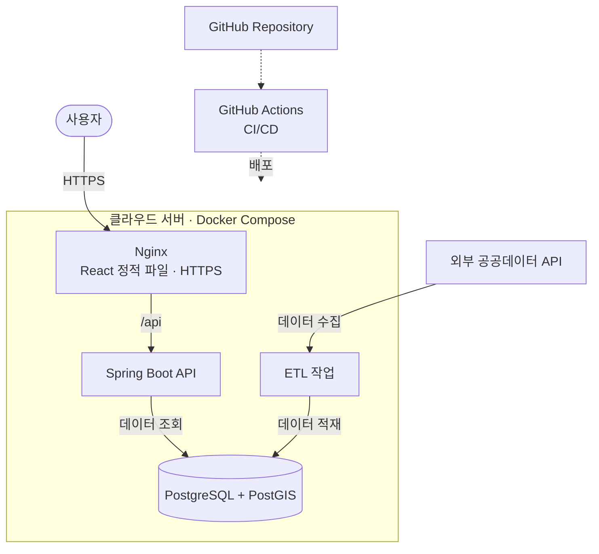

# 개발 가이드

- [README의 상세 기술 문서 안내](../README.md#상세-기술-문서)

이 문서는 로컬 개발 환경의 준비·실행·테스트 순서를 안내합니다. DB 없이 기본 탐색 화면과 웹 서버를 확인할 수 있으며, 지도에는 Kakao JavaScript 키가 필요합니다. 행정구역 API·ETL을 사용하려면 DB 연결을 준비해야 합니다. 명령은 안내한 디렉터리에서 실행합니다.

1. [개발 도구](#1-개발-도구)를 준비합니다.
2. DB가 필요하면 [환경변수 설정과 로컬 DB 준비](#로컬-db-준비)를 완료합니다.
3. 별도 터미널에서 [Frontend](#2-frontend)와 [Backend](#3-backend)를 실행합니다. Backend는 DB 사용 여부에 맞는 실행 방법을 선택합니다.
4. 각 프로젝트 디렉터리에서 [빌드·테스트·품질 검사](#빌드테스트품질-검사)를 실행합니다.

**현재는 로컬 개발 환경만 구성되어 있습니다.** 실제 운영 배포와 CI/CD는 미구성이며, [배포 검토 항목](#배포-검토-항목)은 향후 계획입니다.

## 목차

- [1. 개발 도구](#1-개발-도구)
  - [로컬 DB 준비](#로컬-db-준비)
- [2. Frontend](#2-frontend)
- [3. Backend](#3-backend)
  - [DB 없는 기본 실행](#db-없는-기본-실행)
  - [DB를 사용하는 `db` 프로필 실행](#db를-사용하는-db-프로필-실행)
  - [마이그레이션 적용 상태와 V5~V7 검증 기록](#마이그레이션-적용-상태-확인)
- [빌드·테스트·품질 검사](#빌드테스트품질-검사)
- [배포 검토 항목](#배포-검토-항목)

## 1. 개발 도구

현재 개발·검증 환경은 **macOS 및 Linux(Windows의 WSL 포함)**입니다. 아래 명령은 해당 환경의 셸을 기준으로 합니다.

네이티브 Windows(PowerShell·CMD)는 현재 지원하지 않습니다. **프로젝트의 전체 기능 구현이 완료된 이후 지원할 예정**이며, 구체적인 지원 시점은 확정하지 않았습니다.

- Node.js **24 LTS**, npm **11**: `frontend/`, `etl/`에서 각각 `nvm use`와 `npm ci`를 실행합니다. 두 프로젝트는 독립적인 잠금 파일을 사용합니다.
- Java **21**: 백엔드는 포함된 Gradle Wrapper(`./gradlew`)를 사용합니다.
- Docker와 Docker Compose: 로컬 PostgreSQL/PostGIS DB 및 백엔드 DB 통합 테스트에 사용합니다. Backend·ETL은 호스트에서 실행합니다.

| 확인할 대상               | 필요한 준비                                        | 다음 단계                               |
| ------------------------- | -------------------------------------------------- | --------------------------------------- |
| 기본 탐색·DB 없는 웹 서버 | Node.js·npm, Java                                  | Frontend와 Backend 기본 실행            |
| 행정구역 API·ETL          | 위 도구와 로컬 DB·환경변수, 해당 ETL의 기준 데이터 | DB 준비 후 Backend `db` 프로필·ETL 실행 |
| DB 통합 테스트            | 해당 프로젝트의 도구·의존성과 실행 중인 Docker     | 개발 DB와 분리된 일회용 DB에서 테스트   |

### 로컬 DB 준비

#### 환경변수 파일 준비

기본 로컬 개발 환경에서는 저장소 루트의 `.env.example`로 `.env`를 준비합니다. 루트 `.env`는 Docker Compose·Backend·ETL의 공통 DB 설정이며, 아래 DB 시작 절차의 `cp -n`은 기존 파일을 덮어쓰지 않습니다.

| 예시 파일               | 사용할 때                                                                                                                            |
| ----------------------- | ------------------------------------------------------------------------------------------------------------------------------------ |
| `backend/.env.example`  | Backend를 독립적인 DB 환경에서 실행할 때 참고합니다. 기본 환경에서는 복사할 필요가 없습니다.                                         |
| `etl/.env.example`      | ETL을 별도로 설정할 때만 사용합니다. `etl/.env`가 있으면 Node.js가 해당 파일도 읽으므로 공통 DB 설정과 불필요하게 중복하지 않습니다. |
| `frontend/.env.example` | Vite의 API 프록시 주소를 기본값인 `http://localhost:8080`과 다르게 설정할 때만 `frontend/.env`로 복사합니다.                         |

#### DB 시작

다음 블록은 **저장소 루트**에서 실행합니다. 기존 `.env`가 있으면 필요한 설정만 확인합니다.

```bash
cp -n .env.example .env
# .env의 로컬 DB 이름·사용자·비밀번호·포트를 설정합니다.
docker compose config --quiet
docker compose up -d --wait db
docker compose ps db
```

DB 이미지는 Testcontainers와 동일한 `postgis/postgis:17-3.5`입니다. `DB_PORT`의 기본값은 `5432`이며 `127.0.0.1`에만 공개합니다. 이미 사용 중인 포트이면 `.env`의 `DB_PORT`를 변경합니다.

실제 `.env`는 Git에서 제외되며, 예시 비밀번호는 로컬 개발용입니다.

#### 실행 터미널에 환경변수 적용

Docker Compose는 루트 `.env`를 자동으로 읽습니다. Spring Boot는 읽지 않고, ETL은 npm 실행 시 `etl/.env`만 읽습니다. 공통 루트 설정은 **Backend·ETL을 실행할 각 터미널에서**, 앱 디렉터리로 이동하기 전에 내보냅니다.

- 아래 명령은 저장소 루트에서 실행합니다. 이미 `backend/`나 `etl/`에 있다면 해당 디렉터리 기준으로 `source ../.env`를 사용합니다.
- 내보낸 값은 현재 셸과 그 셸에서 실행한 자식 프로세스에만 적용됩니다. 새 터미널에는 자동으로 전달되지 않습니다.
- 두 연결 URL은 같은 `DB_NAME`, `DB_USER`, `DB_PASSWORD`, `DB_PORT`에서 구성됩니다. 비밀번호에 URL 예약 문자가 있으면 `DATABASE_URL`의 비밀번호 부분을 URL 인코딩합니다.

```bash
set -a
source .env
set +a
```

#### 접속·공간 확장 확인

DB에 접속하거나 PostgreSQL·PostGIS 동작을 확인하려면 다음 명령을 사용합니다. `psql`은 컨테이너에 포함되어 있습니다. 호스트 DB 도구에서는 `127.0.0.1`, `DB_PORT`, `DB_NAME`, `DB_USER`, `DB_PASSWORD`를 사용합니다.

다음 셸 명령은 **저장소 루트**, 이어지는 SQL은 접속한 **`psql` 안**에서 실행합니다.

```bash
docker compose exec db sh -c 'psql -U "$POSTGRES_USER" -d "$POSTGRES_DB"'
```

```sql
SELECT version(), PostGIS_Version();
SELECT ST_SRID(ST_SetSRID(ST_MakePoint(127, 37), 4326));
```

`\q`로 접속을 종료합니다.

DB 데이터는 named volume `recycleyoungs_postgres_data`에 유지됩니다. **초기화된 볼륨에서는 `.env`의 DB 이름·사용자·비밀번호를 바꿔도 기존 DB 계정과 데이터가 자동 변경되지 않습니다.**

#### 종료·재시작과 데이터 보존

다음 명령은 **저장소 루트**에서 실행합니다.

```bash
docker compose stop db        # 종료, 컨테이너·볼륨 유지
docker compose up -d --wait db # 다시 실행
docker compose restart db     # 재시작, 데이터 유지
```

**일반적인 종료·재시작에는 볼륨을 삭제하는 옵션을 사용하지 않습니다.** 아래 Backend의 `db` 프로필은 미적용 Flyway 마이그레이션만 적용합니다. 2026-11-01 기준 V1~V7의 개발 DB 적용을 완료했으며, 재시작 전후 `flyway_schema_history`를 조회해 이력 유지를 확인할 수 있습니다.

기존 Testcontainers 통합 테스트는 Compose와 독립된 일회용 DB를 계속 사용합니다.

## 2. Frontend

### 실행 절차

**새 터미널의 저장소 루트**에서 실행합니다. 이미 `frontend/`라면 `cd frontend`를 반복하지 않습니다.

```bash
cd frontend
nvm use
npm ci
npm run dev
```

[http://localhost:5173](http://localhost:5173)에서 기본 탐색 화면을 확인합니다. `npm run build`는 타입 검사 후 정적 파일을 `dist/`에 생성하고, `npm run preview`로 빌드 결과를 확인할 수 있습니다.

### Kakao Maps 설정

1. `frontend/.env.example`을 참고해 `frontend/.env.local`에 `VITE_KAKAO_MAP_APP_KEY`를 설정합니다. 키가 없으면 지도 설정 안내를 표시하고 SDK를 요청하지 않습니다.
2. [Kakao 지도 공식 가이드](https://apis.map.kakao.com/web/guide/)에 따라 Kakao Developers에서 앱을 생성하고 카카오맵 사용 설정을 활성화합니다. [앱 설정] → [앱] → [플랫폼 키]에서 **JavaScript 키**를 확인합니다.
3. 해당 키의 JavaScript SDK 도메인에 `http://localhost:5173`을 등록합니다. `http://127.0.0.1:5173`, preview 주소(기본 `http://localhost:4173`), 배포 주소를 사용하면 각각의 origin도 등록합니다.
4. 환경변수 변경 후 개발 서버를 재시작합니다. 배포 빌드에는 빌드 시점의 값이 포함되므로 변경 후 다시 빌드합니다.

JavaScript 키는 브라우저 공개용이며 **REST API 키나 Admin 키를 사용하지 않습니다.** 실제 키와 환경변수 파일은 커밋하지 않습니다.

지도는 서울시청(위도 `37.5665`, 경도 `126.978`), 레벨 `5`로 시작합니다. SDK를 비동기 로딩하고 15초 안에 준비되지 않으면 오류와 재시도 버튼을 제공합니다. 연결·키·등록 도메인·카카오맵 사용 설정을 확인한 뒤 재시도합니다. 확대·축소 버튼은 SDK 준비 후 활성화됩니다.

초기 진입 시 상세 패널을 닫고 지도를 넓게 표시합니다. 데스크톱은 72px 아이콘 사이드바, 모바일은 하단 내비게이션을 제공합니다. 지역 탐색·주변 카페·상권 분석·후보지 비교 메뉴를 선택하면 패널이 열리고, 같은 메뉴·닫기 버튼·Escape로 접습니다. 다른 메뉴를 누르면 내용을 전환하며 닫기 버튼과 Escape는 선택 메뉴로 포커스를 돌립니다. 패널 크기가 바뀌면 기존 ResizeObserver로 지도를 재배치하고 중심을 유지합니다.

장소 검색은 지도·상세 패널 밖의 고정 레이어에 배치하며 준비 중 상태로 표시합니다. 검색창은 데스크톱 사이드바 바로 오른쪽 상단에 고정되고 상세 패널은 검색창 아래에서 열립니다. 모바일은 상단 검색창과 하단 확장형 패널을 유지합니다. 패널은 크기·투명도·위치를 부드럽게 전환하고, 모션 감소 설정에서는 전환을 생략합니다. 닫는 동안에도 마지막 내용을 유지하되 키보드·스크린리더 접근은 즉시 차단합니다.

자치구·행정동 선택은 기존 `/api` 프록시로 목록·경계 API를 조회합니다. Backend의 `db` 프로필과 정상 게시 경계 데이터가 필요합니다. 구 변경 시 동을 초기화하고, 동 `전체`는 선택 구 경계로, 구 `전체`는 서울시청 중심·레벨 5로 돌아갑니다. 코드는 문자열로 유지하며, Polygon·MultiPolygon의 경도·위도 범위로 지도 위치를 조정합니다. 경계선은 그리지 않습니다.

목록·경계의 로딩·빈 목록·오류·재시도를 구분합니다. 400·404·503과 네트워크 오류를 안내하며 이전 선택의 요청은 취소하고 늦은 응답도 무시합니다. 패널을 닫거나 다른 메뉴로 전환해도 선택은 유지됩니다. 지도 이동은 화면 크기가 안정된 뒤 적용하고, 지도 조작만으로 필터가 변경되지는 않습니다.

장소 검색·반경 설정·카페 마커·통계 API 연동은 후속 범위입니다. 행정구역 전체 통계는 상권 분석에, 선택 위치의 반경 정보는 주변 카페에 구분해 표시할 예정입니다. 점수 API 호출과 점수 표시는 없으며 공개 미승인 상태를 유지합니다.

`npm test`는 실제 키·외부 SDK 요청 없이 로더의 성공·실패·재시도·시간 초과와 StrictMode 초기화·이벤트 정리·주요 화면 상태를 검증합니다. 지역 조회의 문자열 코드·경계 범위·선택 초기화·비동기 요청 경합·API 오류·재시도도 검증합니다. 실제 지도 표시는 등록된 도메인과 유효한 JavaScript 키로 별도 확인해야 합니다.

### 프록시와 주의사항

- 프록시 대상을 바꾸려면 `frontend/`에서 `cp -n .env.example .env`로 파일을 준비하고 `API_PROXY_TARGET`을 설정합니다.
- 생략하면 `/api` 요청을 `http://localhost:8080`으로 전달합니다. 지역 선택은 이 프록시로 행정구역 목록·경계를 조회합니다.
- `API_PROXY_TARGET`은 Vite 개발 서버 전용입니다. `VITE_*` 변수는 브라우저에 공개되므로 비밀정보를 넣지 않습니다.

Tailwind CSS 4와 shadcn/ui 설정 및 기본 Button 컴포넌트가 포함되어 있습니다. 추가 UI는 `frontend/`에서 `npx shadcn@latest add <컴포넌트>`로 설치할 수 있습니다.

## 3. Backend

### DB 없는 기본 실행

**새 터미널의 저장소 루트**에서 실행합니다. 이미 `backend/`라면 `cd backend`를 반복하지 않습니다.

```bash
cd backend
./gradlew bootRun
```

기본 포트는 **8080**이며 루트 경로의 **404 응답은 정상**입니다. 기본 실행에는 DataSource·JdbcClient·Flyway가 필요 없습니다.

행정구역 API는 `db` 프로필에서만 활성화됩니다. DB 조회 기반은 Spring JDBC·JdbcClient로 구성했습니다.

### DB를 사용하는 `db` 프로필 실행

로컬 DB를 먼저 실행하고 **대상 DB·백업·마이그레이션 적용 권한을 확인합니다.** `db` 프로필을 시작하면 미적용 Flyway 마이그레이션이 자동 적용됩니다.

다음 블록은 **새 터미널의 저장소 루트**에서 환경변수를 내보내고 `backend/`로 이동합니다. Spring Boot는 `.env`를 자동으로 읽지 않습니다. 이미 `backend/`에 있다면 `set -a`, `source ../.env`, `set +a` 후 마지막 Gradle 명령만 실행합니다.

```bash
set -a
source .env
set +a
cd backend
./gradlew bootRun --args='--spring.profiles.active=db'
```

### 연결 설정과 주의사항

- `application-db.yaml`은 `DB_JDBC_URL`, `DB_USER`, `DB_PASSWORD`로 서비스용 Hikari DataSource(조회 연결 풀)와 JdbcClient를 구성합니다. Flyway는 같은 DB 설정을 별도의 전용 연결로 사용합니다.
- 운영에서 계정을 분리하려면 `spring.datasource.*`와 `spring.flyway.*`를 각각 외부 설정으로 지정합니다.
- Flyway는 DB 스키마 변경 이력을 관리합니다. `db` 프로필 시작 시 V1~V7 중 미적용 버전을 순서대로 적용하고 이미 적용된 마이그레이션은 다시 실행하지 않습니다. 현재 개발 DB는 V7까지 적용했습니다. 다른 DB에서도 미적용 버전이 자동 적용되므로 위 사전 확인이 필요합니다.
- Compose DB는 공간 연산용 PostGIS 확장을 포함합니다. 외부 로컬 DB는 `backend/.env.example`을 참고하고 PostGIS 설치 및 확장 생성 권한을 확인합니다.
- 스키마 적용만으로 조회 데이터가 생기지 않습니다. 행정구역 API는 [경계 ETL](etl-guide.md#행정동자치구-경계-적재)의 정상 게시본이 필요합니다.

### 마이그레이션 적용 상태 확인

Backend를 실행한 후 위의 `docker compose exec db …` 명령으로 DB에 접속합니다. 아래 읽기 전용 SQL의 기대 결과는 다음과 같습니다.

- V7까지 적용한 DB: 버전 `1`~`7`이 모두 `success = true`.
- 프로젝트 모델 테이블 조회: 11행(데이터 테이블 10개와 `etl_batch`).

SQL 사용 예시와 아래의 과거 V5·V6·V7 실제 개발 DB 검증 기록을 구분합니다.

```sql
SELECT version, description, success FROM flyway_schema_history ORDER BY installed_rank;
SELECT tablename FROM pg_tables
WHERE schemaname = 'public'
  AND tablename IN ('etl_batch', 'district', 'administrative_dong', 'service_industry',
                    'dong_store_stat', 'dong_sales_stat', 'dong_foot_traffic_stat', 'cafe_store',
                    'district_store_stat', 'district_sales_stat', 'district_foot_traffic_stat')
ORDER BY tablename;
```

기존 마이그레이션 파일의 수정이나 DB 초기화 없이 적용·검증합니다.

**V5 자치구 점포 — 2026-10-31 실제 개발 DB 검증**

Compose·ETL·Backend의 연결 대상이 같은 로컬 인스턴스임을 확인하고, 저장소 밖 `$HOME/Downloads/RecycleYoungs-backups/`에 적용 전 custom-format 백업을 생성했습니다. `pg_dump` 성공, `pg_restore --list`와 전체 아카이브 SQL 판독을 확인했으며 백업 권한은 `600`입니다.

백업을 실제 DB에 복원하는 작업은 수행하지 않았습니다. 원본 CSV와 백업은 Git에 포함하지 않습니다.

기존 V1~V4 이력은 그대로 유지되고 `db` 프로필이 V5 한 건만 신규 적용했습니다. 공식 자치구 점포 CSV 54,765행 적재·재실행과 실제 API 대조도 완료했습니다. 적용 전후 기존 7개 데이터 테이블 및 기존 배치 14건의 건수·전체 행 지문을 대조해 보존을 확인했습니다. [적재·API 검증 결과](etl-guide.md#실제-개발-db-적용적재-검증-2026-10-31)를 참고하세요.

이후 변경을 적용할 때도 대상 확인·백업·기존 데이터 보존 절차를 따르며 초기화·볼륨 삭제로 대체하지 않습니다.

**V6 자치구 추정매출 — 2026-10-31 실제 개발 DB 검증**

2026-10-31의 후속 자치구 추정매출 적용에서는 Compose·Backend·ETL이 같은 로컬 인스턴스임을 다시 확인하고 신규 백업을 생성했습니다.

- 백업: `$HOME/Downloads/RecycleYoungs-backups/recycleyoungs-before-v6-20261031T144432Z.dump`, 8,751,707바이트, 권한 `600`.
- SHA-256: `1fe19fb2b95a2cd926a234bef492dbded845bbd01d4ad35a3df2103b62976a14`.
- `pg_dump` 성공 및 `pg_restore --list`·전체 아카이브 SQL 판독을 확인했습니다. 목록 판독의 조기 종료로 발생한 입력 파이프 오류는 백업 파일을 직접 표준입력에 연결해 재검증했습니다. 실제 DB 복원 테스트는 수행하지 않았습니다.

**스키마 적용·적재·보존 결과**

- 기존 `db` 프로필이 V6 한 건만 신규 적용했고 V1~V6 모두 `success=true`입니다. V1~V5의 전체 이력·체크섬을 보존했으며 V6의 테이블·복합키·FK 3개·CHECK 7개와 측정값의 NULL 허용·기본값 없음도 확인했습니다.
- 실제 CP949 CSV 33,803행의 자치구 25개·업종 63개를 개발 DB 기준 코드와 전수 대조해 FK 불일치 0건을 확인한 뒤 적재했습니다. 135,212개 측정값 전수 대조·재실행 `SKIPPED`·기존 출처 보존·실제 API 대조를 완료했습니다.
- 적용 전후 기존 8개 데이터 테이블 및 배치 16건의 건수·전체 행 지문이 동일합니다. 자치구 매출의 `PUBLISHED`·`SKIPPED` 각 1건이 추가돼 전체 배치는 18건입니다. 초기화·볼륨 삭제·DROP/TRUNCATE나 기존 데이터셋 재적재는 하지 않았습니다.

배치 ID·게시 시각·실제 API 응답은 [자치구 추정매출 개발 DB 검증 기록](etl-guide.md#자치구-추정매출-개발-db-적용적재-검증-2026-10-31)에 있습니다. 코드·Flyway 파일·ETL·API 구현은 수정하지 않았습니다.

**V7 자치구 길단위인구 — 2026-11-01 실제 개발 DB 검증**

공식 자치구 길단위인구의 V7 적용·550행 적재·실제 API 검증도 완료했습니다.

- Compose·Backend·ETL의 DB 연결을 실제 인스턴스 식별자·DB·사용자로 대조해 같은 의도된 로컬 개발 DB임을 확인했습니다. 접속정보·식별자 원문은 공개하지 않습니다.
- 신규 백업: `$HOME/Downloads/RecycleYoungs-backups/recycleyoungs-before-v7-20261101T040416Z.dump`, 9,579,979바이트, 권한 `600`, custom-format.
- 백업 SHA-256: `b4cf4041275809ae1de61b58cdbe5261ab4a7f081984ec48dc6e6dbbee2437eb`. `pg_dump`·`pg_restore --list`·전체 아카이브 SQL 판독을 통과했으며 **실제 DB 복원 테스트는 미실시**입니다.

**스키마 적용·적재·보존 결과**

- 기존 `db` 프로필로 V7 한 건만 신규 적용했습니다. V1~V7 모두 `success=true`, V7 체크섬은 `194220786`이며 V1~V6 파일·전체 이력·체크섬은 보존했습니다. 신규 테이블 6개 컬럼·구/분기 PK·FK 2개·CHECK 5개, 세 NUMERIC의 NULL 허용·정밀도/scale 제한과 기본값 없음·유한 비음수 제약을 확인했습니다.
- 실제 CP949 CSV 550행·자치구 25개를 개발 DB 기준 코드와 전수 대조해 FK 불일치 0건을 확인한 뒤 적재했습니다. 세 측정값 1,650개 전수 문자열 대조·불일치 0건, 성별 합계 차이 269행 보존, 재실행 `SKIPPED`·수치·최초 게시 출처·전체 행 지문 보존과 실제 API 대조를 완료했습니다.
- 기존 데이터 테이블 9개와 배치 18건의 건수·전체 행 지문을 보존했습니다. 신규 인구의 `PUBLISHED`·`SKIPPED` 각 1건만 추가해 전체 배치는 20건이며 프로젝트 모델 테이블은 11개입니다. 검증용 Backend는 정상 종료했고 Compose DB·볼륨은 유지했습니다.

배치 ID·게시 시각·실제 API 및 예외 응답은 [자치구 길단위인구 개발 DB 검증 기록](etl-guide.md#자치구-길단위인구-개발-db-적용적재-검증-2026-11-01)에 있습니다. 기존 데이터 재적재·초기화·DROP/TRUNCATE나 코드·설정·Flyway·ETL 변경은 하지 않았습니다. 원본 CSV·백업·`.env`는 저장소에 포함하지 않습니다.

행정구역 API의 파라미터·DTO·오류·게시 배치 계약은 [데이터 설계](data-design.md#행정구역-rest-api-계약)를 참고하세요. ETL 설치·적재·재실행 명령은 [ETL 가이드](etl-guide.md#설치-및-공통-실행)에서 관리합니다.

## 빌드·테스트·품질 검사

Frontend 명령은 **`frontend/`**, Backend 명령은 **`backend/`**, ETL 명령은 **`etl/`**에서 실행합니다. 이 표의 명령에는 추가 `cd`가 필요하지 않습니다.

각 프로젝트의 도구·의존성을 준비한 뒤 필요한 검사를 선택합니다. Backend DB 통합 테스트는 일반 `build`와 분리되어 있으므로, 전체 검증 시에는 아래의 통합 실행 명령을 사용합니다.

| 프로젝트       | 명령                        | 검증 내용                                                                      |
| -------------- | --------------------------- | ------------------------------------------------------------------------------ |
| Frontend       | `npm run build`             | TypeScript 타입 검사 · Vite 빌드                                               |
| Frontend       | `npm test`                  | Vitest · React Testing Library 렌더링 테스트                                   |
| Frontend / ETL | `npm run lint`              | ESLint                                                                         |
| Frontend / ETL | `npm run format:check`      | Prettier 검사                                                                  |
| Backend        | `./gradlew build`           | Java 컴파일 · JUnit/Spring Boot Test · Spotless 검사 · 실행 JAR                |
| Backend        | `./gradlew integrationTest` | 별도 PostgreSQL/PostGIS 컨테이너에서 서비스·Flyway 연결, 스키마·공간 확장 검증 |
| ETL            | `npm run build`             | TypeScript 빌드                                                                |
| ETL            | `npm test`                  | Vitest 환경설정·CSV/ZIP·경계·업종·통계·카페 API 검증 테스트                    |

**실행 전제:** 백엔드 통합 테스트에는 실행 중인 Docker가 필요합니다. 로컬 Compose DB는 필요하지 않으며, 통합 테스트는 서비스 DataSource와 Flyway 설정을 모두 일회용 PostGIS 컨테이너로 덮어씁니다. 로컬 개발 DB나 실제 공공 API에 접근하지 않습니다.

백엔드 전체 검증은 `backend/`에서 `./gradlew build integrationTest`로 실행합니다.

- 단위·MVC 테스트: 기본 프로필의 DB 없는 기동, 코드 검증·응답 계약과 공통 오류를 검증합니다.
- 행정구역 통합 테스트: 최신 게시본·과거 출처 제외·GeoJSON·게시 중 조회 일관성과 주변 검색의 복수 구 교차·중심점 경계·반경 접촉·구 필터·빈 결과도 확인합니다.

**선택 실행:** `npm run test:watch`로 테스트 감시 모드를 사용합니다. 포맷 수정은 TypeScript 프로젝트의 `npm run format`, Java의 `./gradlew spotlessApply`로 수행합니다.

환경변수 예시에는 로컬 개발용 값만 포함합니다. 실제 비밀번호가 포함된 `.env` 파일은 Git에서 제외됩니다.

## 배포 검토 항목

### 배포 구성안 (계획)

로컬 개발용 PostgreSQL·PostGIS는 Docker Compose로 실행합니다. 서비스 전체의 컨테이너 배포는 후속 단계에서 검토할 예정입니다.

클라우드 환경은 AWS EC2 또는 다른 클라우드 서비스를 후보로 두고 있으며, Nginx와 CI/CD 도입도 고려 중입니다.

**아직 실제 배포 환경이나 배포 자동화는 구성되지 않았습니다.**



위 구성은 배포 방향을 설명하기 위한 예시입니다. 실제 환경에서는 프론트엔드 정적 파일 제공 방식, 데이터베이스 호스팅 위치, ETL 실행 방법 및 보안 구성을 별도로 결정할 예정입니다.

### 검토 항목

| 항목         | 검토 방향                                          |
| ------------ | -------------------------------------------------- |
| 컨테이너     | Docker 및 Docker Compose 활용                      |
| 클라우드     | AWS EC2 또는 대체 클라우드 서비스                  |
| 웹 서버      | Nginx를 통한 정적 파일 제공 및 API 요청 전달       |
| HTTPS        | 도메인과 TLS 인증서 적용                           |
| 데이터베이스 | PostgreSQL·PostGIS 운영 및 데이터 보존 정책        |
| ETL          | 데이터 갱신 주기에 맞춘 실행 및 실패 처리          |
| CI/CD        | GitHub Actions 등을 활용한 빌드·테스트·배포 자동화 |
| 환경변수     | 인증키, DB 접속 정보 등 비밀정보의 분리 관리       |
| 운영         | 로그, 오류 확인, 백업 및 장애 복구 방식 검토       |

실제 배포 방식과 구성 요소는 MVP 개발 및 테스트 결과를 바탕으로 확정할 계획입니다.
