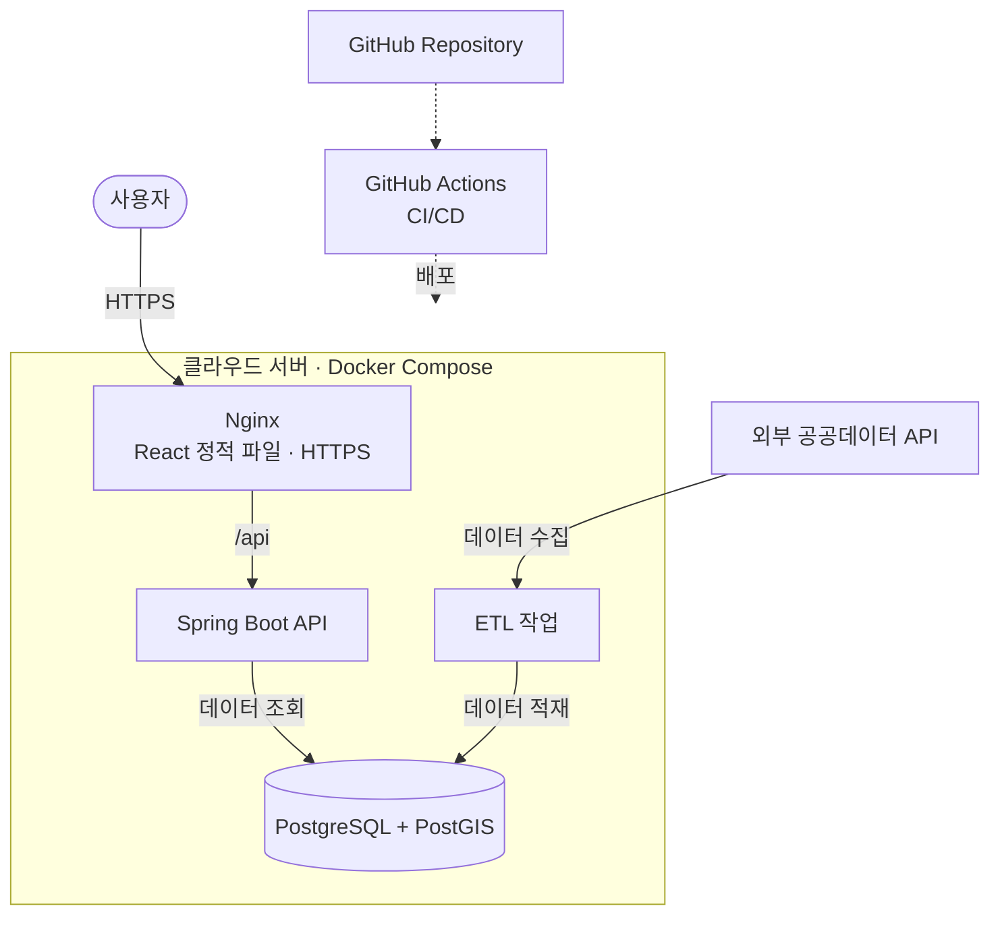

# 개발 가이드

- [README의 상세 기술 문서 안내](../README.md#상세-기술-문서)

현재 저장소의 개발 도구·Docker Compose·프로필·실행·검증 방법입니다. 명령은 안내한 디렉터리에서 실행합니다. 실제 운영 배포와 CI/CD는 미구성 상태입니다.

## 목차

- [1. 개발 도구](#1-개발-도구)
  - [로컬 DB 준비](#로컬-db-준비)
- [2. Frontend](#2-frontend)
- [3. Backend](#3-backend)
  - [DB 없는 기본 실행](#db-없는-기본-실행)
  - [DB를 사용하는 `db` 프로필 실행](#db를-사용하는-db-프로필-실행)
- [빌드·테스트·품질 검사](#빌드테스트품질-검사)
- [배포 검토 항목](#배포-검토-항목)

## 1. 개발 도구

현재 개발·검증 환경은 **macOS 및 Linux(Windows의 WSL 포함)**입니다. 아래 명령은 해당 환경의 셸을 기준으로 합니다.

네이티브 Windows(PowerShell·CMD)는 현재 지원하지 않습니다. **프로젝트의 전체 기능 구현이 완료된 이후 지원할 예정**이며, 구체적인 지원 시점은 확정하지 않았습니다.

DB 없이 준비 화면과 웹 서버만 확인하려면 개발 도구 설치 후 Frontend와 Backend의 기본 실행으로 진행합니다. 행정구역 API·ETL을 사용할 때는 로컬 DB와 환경변수 준비를 먼저 완료합니다.

- Node.js **24 LTS**, npm **11**: `frontend/`, `etl/`에서 각각 `nvm use`와 `npm ci`를 실행합니다. 두 프로젝트는 독립적인 잠금 파일을 사용합니다.
- Java **21**: 백엔드는 포함된 Gradle Wrapper(`./gradlew`)를 사용합니다.
- Docker와 Docker Compose: 로컬 PostgreSQL/PostGIS DB 및 백엔드 DB 통합 테스트에 사용합니다. Backend·ETL은 호스트에서 실행합니다.

### 로컬 DB 준비

#### 환경변수 파일 준비

기본 로컬 개발 환경에서는 저장소 루트의 `.env.example`로 `.env`를 준비합니다. `cp -n`은 기존 `.env`를 덮어쓰지 않습니다. 루트 `.env`는 Docker Compose·Backend·ETL의 공통 DB 설정에 사용합니다.

- `backend/.env.example`: Backend를 독립적인 DB 환경에서 실행할 때 참고합니다. 기본 환경에서는 복사할 필요가 없습니다.
- `etl/.env.example`: ETL을 별도로 설정할 때만 사용합니다. `etl/.env`가 별도로 있으면 Node.js가 해당 파일도 읽으므로, 공통 DB 설정을 사용할 때는 불필요한 중복 설정을 피합니다.
- `frontend/.env.example`: Vite의 API 프록시 주소를 기본값인 `http://localhost:8080`과 다르게 설정할 때만 `frontend/.env`로 복사합니다.

#### DB 시작

다음 블록은 **저장소 루트**에서 실행합니다. 기존 `.env`가 있으면 필요한 설정만 확인합니다.

```bash
cp -n .env.example .env
# .env의 로컬 DB 이름·사용자·비밀번호·포트를 설정합니다.
docker compose config --quiet
docker compose up -d --wait db
docker compose ps db
```

DB 이미지는 Testcontainers와 동일한 `postgis/postgis:17-3.5`입니다. `DB_PORT`의 기본값은 `5432`이며 `127.0.0.1`에만 공개합니다. 이미 사용 중인 포트이면 `.env`의 `DB_PORT`를 변경합니다. 실제 `.env`는 Git에서 제외되며, 예시 비밀번호는 로컬 개발용입니다.

#### 실행 터미널에 환경변수 적용

Docker Compose는 루트 `.env`를 자동으로 읽습니다. Spring Boot는 읽지 않고, ETL은 npm 실행 시 `etl/.env`만 읽습니다. 공통 루트 설정은 **Backend·ETL을 실행할 각 터미널에서**, 앱 디렉터리로 이동하기 전에 내보냅니다.

- 아래 명령은 저장소 루트에서 실행합니다. 이미 `backend/`나 `etl/`에 있다면 해당 디렉터리 기준으로 `source ../.env`를 사용합니다.
- 내보낸 값은 현재 셸과 그 셸에서 실행한 자식 프로세스에만 적용됩니다. 새 터미널에는 자동으로 전달되지 않습니다.
- 두 연결 URL은 같은 `DB_NAME`, `DB_USER`, `DB_PASSWORD`, `DB_PORT`에서 구성됩니다. 비밀번호에 URL 예약 문자가 있으면 `DATABASE_URL`의 비밀번호 부분을 URL 인코딩합니다.

```bash
set -a
source .env
set +a
```

#### 접속·공간 확장 확인

DB에 접속하거나 PostgreSQL·PostGIS 동작을 확인하려면 다음 명령을 사용합니다. `psql`은 컨테이너에 포함되어 있습니다. 호스트 DB 도구에서는 `127.0.0.1`, `DB_PORT`, `DB_NAME`, `DB_USER`, `DB_PASSWORD`를 사용합니다.

다음 셸 명령은 **저장소 루트**, 이어지는 SQL은 접속한 **`psql` 안**에서 실행합니다.

```bash
docker compose exec db sh -c 'psql -U "$POSTGRES_USER" -d "$POSTGRES_DB"'
```

```sql
SELECT version(), PostGIS_Version();
SELECT ST_SRID(ST_SetSRID(ST_MakePoint(127, 37), 4326));
```

`\q`로 접속을 종료합니다. DB 데이터는 named volume `recycleyoungs_postgres_data`에 유지됩니다. 초기화된 볼륨에서는 `.env`의 DB 이름·사용자·비밀번호를 바꿔도 기존 DB 계정과 데이터가 자동 변경되지 않습니다.

#### 종료·재시작과 데이터 보존

다음 명령은 **저장소 루트**에서 실행합니다.

```bash
docker compose stop db        # 종료, 컨테이너·볼륨 유지
docker compose up -d --wait db # 다시 실행
docker compose restart db     # 재시작, 데이터 유지
```

일반적인 종료·재시작에는 볼륨을 삭제하는 옵션을 사용하지 않습니다. 아래 Backend의 `db` 프로필을 실행하면 미적용 Flyway 마이그레이션만 적용됩니다. 2026-10-31 기준 V1~V5의 개발 DB 적용을 완료했습니다. 재시작 전후에 `flyway_schema_history`를 조회하면 마이그레이션 이력의 유지를 확인할 수 있습니다. 기존 Testcontainers 통합 테스트는 Compose와 독립된 일회용 DB를 계속 사용합니다.

## 2. Frontend

### 실행 절차

**새 터미널의 저장소 루트**에서 실행합니다. 이미 `frontend/`라면 `cd frontend`를 반복하지 않습니다.

```bash
cd frontend
nvm use
npm ci
npm run dev
```

[http://localhost:5173](http://localhost:5173)에서 준비 화면을 확인합니다. `npm run build`는 타입 검사 후 정적 파일을 `dist/`에 생성하고, `npm run preview`로 빌드 결과를 확인할 수 있습니다.

### 프록시와 주의사항

- 프록시 대상을 바꾸려면 `frontend/`에서 `cp -n .env.example .env`로 파일을 준비하고 `API_PROXY_TARGET`을 설정합니다.
- 생략하면 `/api` 요청을 `http://localhost:8080`으로 전달합니다. 프론트엔드의 실제 API 호출은 아직 구현하지 않았습니다.
- `API_PROXY_TARGET`은 Vite 개발 서버 전용입니다. `VITE_*` 변수는 브라우저에 공개되므로 비밀정보를 넣지 않습니다.

Tailwind CSS 4와 shadcn/ui 설정 및 기본 Button 컴포넌트가 포함되어 있습니다. 추가 UI는 `frontend/`에서 `npx shadcn@latest add <컴포넌트>`로 설치할 수 있습니다.

## 3. Backend

### DB 없는 기본 실행

**새 터미널의 저장소 루트**에서 실행합니다. 이미 `backend/`라면 `cd backend`를 반복하지 않습니다.

```bash
cd backend
./gradlew bootRun
```

기본 포트는 **8080**입니다. 기본 실행은 DataSource·JdbcClient·Flyway 없이 가능하며, 행정구역 API는 `db` 프로필에서만 활성화됩니다. 루트 경로의 **404 응답은 정상**입니다. DB 조회 기반은 Spring JDBC·JdbcClient로 구성했습니다.

### DB를 사용하는 `db` 프로필 실행

로컬 DB를 먼저 실행합니다. 다음 블록은 **새 터미널의 저장소 루트**에서 환경변수를 내보내고 `backend/`로 이동합니다. Spring Boot는 `.env`를 자동으로 읽지 않습니다. 이미 `backend/`에 있다면 `set -a`, `source ../.env`, `set +a` 후 마지막 Gradle 명령만 실행합니다.

```bash
set -a
source .env
set +a
cd backend
./gradlew bootRun --args='--spring.profiles.active=db'
```

### 연결 설정과 주의사항

- `application-db.yaml`은 `DB_JDBC_URL`, `DB_USER`, `DB_PASSWORD`로 서비스용 Hikari DataSource(조회 연결 풀)와 JdbcClient를 구성합니다. Flyway는 같은 DB 설정을 별도의 전용 연결로 사용합니다.
- 운영에서 계정을 분리하려면 `spring.datasource.*`와 `spring.flyway.*`를 각각 외부 설정으로 지정합니다.
- `db` 프로필 시작 시 Flyway가 V1~V6 중 미적용 버전을 순서대로 적용하고 이미 적용된 마이그레이션은 다시 실행하지 않습니다. 현재 개발 DB는 V5 상태이며 이번 작업에서 V6는 적용하지 않았습니다. 이 코드로 `db` 프로필을 기동하면 V6도 자동 적용되므로 대상 DB·백업·적용 권한을 먼저 확인합니다. Flyway는 DB 스키마 변경 이력을 관리하는 도구입니다.
- Compose DB는 공간 연산용 PostGIS 확장을 포함합니다. 외부 로컬 DB는 `backend/.env.example`을 참고하고 PostGIS 설치 및 확장 생성 권한을 확인합니다.
- 스키마 적용만으로 조회 데이터가 생기지 않습니다. 행정구역 API는 [경계 ETL](etl-guide.md#행정동자치구-경계-적재)의 정상 게시본이 필요합니다.

### 마이그레이션 적용 상태 확인

Backend를 실행한 후 위의 `docker compose exec db …` 명령으로 DB에 접속해 다음을 확인합니다. V6까지 적용한 DB의 이력은 버전 `1`~`6`이 모두 `success = true`여야 하며, 테이블 조회는 10행을 반환해야 합니다. 기존 개발 DB의 V5 적용 기록과 V6 미적용 상태는 아래에 별도로 구분합니다. 아래는 마이그레이션 적용 상태를 확인하는 읽기 전용 SQL입니다.

```sql
SELECT version, description, success FROM flyway_schema_history ORDER BY installed_rank;
SELECT tablename FROM pg_tables
WHERE schemaname = 'public'
  AND tablename IN ('etl_batch', 'district', 'administrative_dong', 'service_industry',
                    'dong_store_stat', 'dong_sales_stat', 'dong_foot_traffic_stat', 'cafe_store',
                    'district_store_stat', 'district_sales_stat')
ORDER BY tablename;
```

기존 마이그레이션 파일의 수정이나 DB 초기화 없이 적용·검증합니다.

2026-10-31 실제 개발 DB 검증에서는 Compose·ETL·Backend의 연결 대상이 같은 로컬 인스턴스임을 확인하고, 저장소 밖 `$HOME/Downloads/RecycleYoungs-backups/`에 적용 전 custom-format 백업을 생성했습니다. `pg_dump` 성공, `pg_restore --list`와 전체 아카이브 SQL 판독을 확인했으며 백업 권한은 `600`입니다. 백업을 실제 DB에 복원하는 작업은 수행하지 않았습니다. 원본 CSV와 백업은 Git에 포함하지 않습니다.

기존 V1~V4 이력은 그대로 유지되고 `db` 프로필이 V5 한 건만 신규 적용했습니다. 공식 자치구 점포 CSV 54,765행 적재·재실행과 실제 API 대조도 완료했습니다. 적용 전후 기존 7개 데이터 테이블 및 기존 배치 14건의 건수·전체 행 지문을 대조해 보존을 확인했습니다. [적재·API 검증 결과](etl-guide.md#실제-개발-db-적용적재-검증-2026-10-31)를 참고하세요. 이후 변경을 적용할 때도 대상 확인·백업·기존 데이터 보존 절차를 따르며 초기화·볼륨 삭제로 대체하지 않습니다.

행정구역 API의 파라미터·DTO·오류·게시 배치 계약은 [데이터 설계](data-design.md#행정구역-rest-api-계약)를 참고하세요. ETL 설치·적재·재실행 명령은 [ETL 가이드](etl-guide.md#설치-및-공통-실행)에서 관리합니다.

## 빌드·테스트·품질 검사

Frontend 명령은 **`frontend/`**, Backend 명령은 **`backend/`**, ETL 명령은 **`etl/`**에서 실행합니다. 이 표의 명령에는 추가 `cd`가 필요하지 않습니다.

| 프로젝트       | 명령                        | 검증 내용                                                                      |
| -------------- | --------------------------- | ------------------------------------------------------------------------------ |
| Frontend       | `npm run build`             | TypeScript 타입 검사 · Vite 빌드                                               |
| Frontend       | `npm test`                  | Vitest · React Testing Library 렌더링 테스트                                   |
| Frontend / ETL | `npm run lint`              | ESLint                                                                         |
| Frontend / ETL | `npm run format:check`      | Prettier 검사                                                                  |
| Backend        | `./gradlew build`           | Java 컴파일 · JUnit/Spring Boot Test · Spotless 검사 · 실행 JAR                |
| Backend        | `./gradlew integrationTest` | 별도 PostgreSQL/PostGIS 컨테이너에서 서비스·Flyway 연결, 스키마·공간 확장 검증 |
| ETL            | `npm run build`             | TypeScript 빌드                                                                |
| ETL            | `npm test`                  | Vitest 환경설정·CSV/ZIP·경계·업종·통계·카페 API 검증 테스트                    |

`npm run test:watch`로 테스트 감시 모드를 사용합니다. 포맷 수정은 TypeScript 프로젝트의 `npm run format`, Java의 `./gradlew spotlessApply`로 수행합니다. 백엔드 통합 테스트는 일반 `build`와 분리되어 있으며 Docker가 실행 중이어야 합니다.

백엔드 전체 검증은 `backend/`에서 `./gradlew build integrationTest`로 실행합니다. 단위·MVC 테스트는 기본 프로필의 DB 없는 기동, 코드 검증·응답 계약과 공통 오류를 검증합니다. 행정구역 통합 테스트는 최신 게시본·과거 출처 제외·GeoJSON·게시 중 조회 일관성과 주변 검색의 복수 구 교차·중심점 경계·반경 접촉·구 필터·빈 결과도 확인합니다. 통합 테스트는 서비스 DataSource와 Flyway 설정을 모두 일회용 PostGIS 컨테이너로 덮어쓰며, 로컬 개발 DB나 실제 공공 API에 접근하지 않습니다.

환경변수 예시에는 로컬 개발용 값만 포함합니다. 실제 비밀번호가 포함된 `.env` 파일은 Git에서 제외됩니다.

## 배포 검토 항목

### 배포 구성안 (계획)

로컬 개발용 PostgreSQL·PostGIS는 Docker Compose로 실행합니다. 서비스 전체의 컨테이너 배포는 후속 단계에서 검토할 예정입니다.

클라우드 환경은 AWS EC2 또는 다른 클라우드 서비스를 후보로 두고 있으며, Nginx와 CI/CD 도입도 고려 중입니다.

**아직 실제 배포 환경이나 배포 자동화는 구성되지 않았습니다.**



위 구성은 배포 방향을 설명하기 위한 예시입니다. 실제 환경에서는 프론트엔드 정적 파일 제공 방식, 데이터베이스 호스팅 위치, ETL 실행 방법 및 보안 구성을 별도로 결정할 예정입니다.

### 검토 항목

| 항목         | 검토 방향                                          |
| ------------ | -------------------------------------------------- |
| 컨테이너     | Docker 및 Docker Compose 활용                      |
| 클라우드     | AWS EC2 또는 대체 클라우드 서비스                  |
| 웹 서버      | Nginx를 통한 정적 파일 제공 및 API 요청 전달       |
| HTTPS        | 도메인과 TLS 인증서 적용                           |
| 데이터베이스 | PostgreSQL·PostGIS 운영 및 데이터 보존 정책        |
| ETL          | 데이터 갱신 주기에 맞춘 실행 및 실패 처리          |
| CI/CD        | GitHub Actions 등을 활용한 빌드·테스트·배포 자동화 |
| 환경변수     | 인증키, DB 접속 정보 등 비밀정보의 분리 관리       |
| 운영         | 로그, 오류 확인, 백업 및 장애 복구 방식 검토       |

실제 배포 방식과 구성 요소는 MVP 개발 및 테스트 결과를 바탕으로 확정할 계획입니다.
