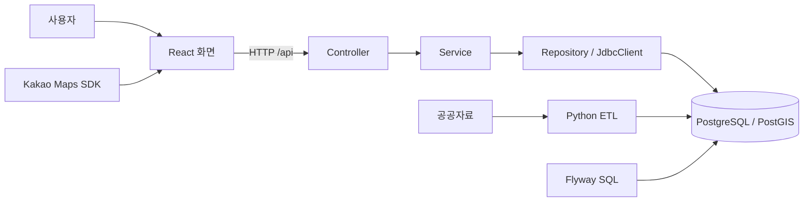
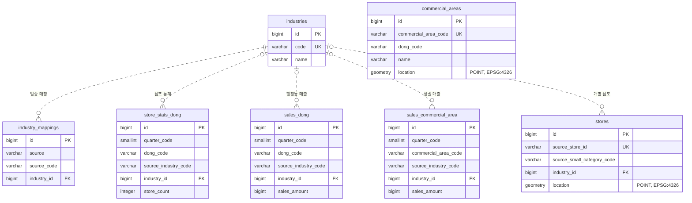
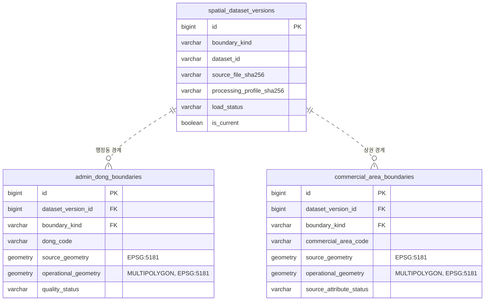

# 기술 명세와 개발 안내

처음 참여한 개발자가 서비스 흐름을 이해하고, 필요한 구현 계약을 찾기 위한 문서입니다. 현재 기능과 우선순위는 [프로젝트 현황](project.md), DB 변경·복구 조건은 [DB 안전 정책](db-safety.md)에 둡니다.

코드 확인 기준일은 **2026-10-16**입니다. 이 개편에서는 서비스를 시작하거나 DB·원본 자료에 접속하지 않았습니다. 실행 검증은 뒤의 [날짜별 기록](#검증-이력)과 구분합니다.

## 목차

- [시스템과 기술 선택](#시스템과-기술-선택)
- [통계 조회 한 번 따라가기](#통계-조회-한-번-따라가기)
- [읽기 지도와 용어](#읽기-지도와-용어)
- [코드 구조와 진입점](#코드-구조와-진입점)
- [기술 스택과 선택 이유](#기술-스택과-선택-이유)
- [개발 환경과 안전한 시작](#개발-환경과-안전한-시작)
- [팀 공통 실자료 개발 환경](#팀-공통-실자료-개발-환경)
- [데이터 출처와 의미](#데이터-출처와-의미)
- [DB schema와 Flyway](#db-schema와-flyway)
- [CSV ETL](#csv-etl)
- [Polygon ETL과 공간 한계](#polygon-etl과-공간-한계)
- [현재 GET API 계약](#현재-get-api-계약)
- [공간 조회 설계 — API·격리 검증](#공간-조회-설계--api격리-검증)
- [Frontend 화면과 요청 상태](#frontend-화면과-요청-상태)
- [테스트와 안전 모듈](#테스트와-안전-모듈)
- [검증 이력](#검증-이력)

## 시스템과 기술 선택

프로그램은 데이터를 준비하는 흐름과 사용자가 조회하는 흐름으로 나뉩니다. Python ETL은 파일을 검사·변환해 DB에 저장합니다. React는 사용자의 요청을 Spring API에 보내고 결과를 표시합니다.



- Controller는 요청 형식을 검사합니다.
- Service는 지원 조건과 데이터의 일관성을 확인하고 응답을 구성합니다.
- Repository는 매개변수를 바인딩한 SQL로 DB를 조회합니다.
- PostGIS는 좌표가 경계 안에 있는지, 점포가 반경 안에 있는지 계산합니다.

브라우저는 DB에 직접 연결하지 않습니다. 사용자 조회가 원본 수집이나 ETL을 다시 실행하지도 않습니다.

## 통계 조회 한 번 따라가기

청운효자동·카페·2025년 1분기를 선택했다고 가정합니다. 아래는 흐름 설명용 예시이며 현재 DB 조회 결과가 아닙니다.

| 선택 | 요청 값 |
| --- | --- |
| 청운효자동 | `dongCode=11110515` |
| 카페 | `industryCode=CAFE` |
| 2025년 1분기 | `quarterCode=20251` |

1. [SearchForm](../frontend/src/components/SearchForm.tsx)이 행정동·분기를 입력받고 업종은 CAFE로 고정합니다. 화면은 먼저 행정동·업종·분기의 지원 목록을 가져와 CAFE 제공 여부도 확인합니다.
2. 조회 버튼을 누르면 [API client](../frontend/src/api/adminDongApi.ts)가 단일 분기와 추세를 병렬 요청합니다.
3. [Service](../backend/src/main/java/com/example/backend/admindong/AdminDongService.java)가 형식·지원 조건을 확인합니다.
4. [Repository](../backend/src/main/java/com/example/backend/admindong/AdminDongRepository.java)가 점포 통계와 매출을 따로 조회합니다.
5. 화면은 두 결과의 로딩·오류를 각각 처리하고, 값과 단위를 표시합니다.

```text
GET /api/admin-dong-stats?dongCode=11110515&industryCode=CAFE&quarterCode=20251
GET /api/admin-dong-trends?dongCode=11110515&industryCode=CAFE
```

첫 요청은 선택 분기, 두 번째는 2025년 네 분기 표를 위한 것입니다. 한 요청의 실패가 다른 결과를 지우지 않습니다.

각 HTTP 요청 내부의 통계 조회는 읽기 전용 `REPEATABLE READ` 트랜잭션을 사용합니다. 별도 HTTP 요청들이 정확히 같은 DB 시점을 읽는다는 보장은 없습니다.

## 읽기 지도와 용어

실행이 목적이면 [개발 환경](#개발-환경과-안전한-시작), API를 수정한다면 [API 계약](#현재-get-api-계약)부터 확인합니다. 자료 해석은 [출처와 의미](#데이터-출처와-의미), DB 변경은 [안전 정책](db-safety.md)을 먼저 읽습니다.

| 용어 | 이 문서에서의 의미 |
| --- | --- |
| ETL | 파일을 읽어 검사·변환하고 DB에 저장하는 과정 |
| POINT / Polygon | 한 위치의 좌표 / 지역의 다각형 경계 |
| 좌표계·SRID | 좌표를 해석하는 기준과 그 식별자 |
| 원본 경계 | 수정하지 않고 보존하는 도형, 코드에서는 source geometry |
| 조회용 경계 | 서비스 판정에 쓰는 도형, 코드에서는 operational geometry |
| 업종 매핑 | 원천 업종 코드를 서비스 업종에 연결하는 규칙 |
| 데이터 계약 | 파일 구성·형식·해시 등 반드시 맞아야 하는 기준 |
| fingerprint | DB의 값·ID·sequence 등을 전체 비교하기 위한 해시 |
| publication | 검사한 경계 버전을 READY/current 상태로 공개하는 처리 |
| provenance | 사용한 입력·코드·검사 과정의 출처 기록 |
| mock / fixture | 가짜 응답·연결 / 테스트용 데이터 |
| opt-in 테스트 | 별도 설정으로 활성화해야 하는 검사 |
| backfill | 기존 행의 특정 빈 필드를 제한된 조건으로 채우는 작업 |

혼동하기 쉬운 버전과 시점은 구체적으로 구분합니다.

- `V1/V2/V3`는 **Flyway 스키마 버전**입니다.
- `real-data-v2`는 **배포 데이터 패키지 버전**입니다.
- 공간 응답의 `dataset.version`은 **DB에 저장된 경계 버전 ID**입니다.
- 점포 자료의 기준 시점과 DB 트랜잭션의 조회 시점은 서로 다릅니다.
- 이 문서의 “기존 개발 DB”는 과거 보호·퇴역 대상입니다. 원본 파일과 구분합니다.

## 코드 구조와 진입점

| 작업 | 시작할 위치 |
| --- | --- |
| 화면 입력·통계 | [SearchForm](../frontend/src/components/SearchForm.tsx), [통계 hook](../frontend/src/hooks/useAdminDongStats.ts) |
| 지도·위치 분석 | [KakaoMap](../frontend/src/components/KakaoMap.tsx), [분석 hook](../frontend/src/hooks/useLocationAnalysis.ts) |
| 후보 비교 | [비교 hook](../frontend/src/hooks/useCandidateComparison.ts), [컴포넌트](../frontend/src/components/) |
| 통계·추세 API | [admindong](../backend/src/main/java/com/example/backend/admindong/) |
| 위치·카페 API | [location](../backend/src/main/java/com/example/backend/location/), [nearby](../backend/src/main/java/com/example/backend/nearby/) |
| 스키마 | [Flyway migration](../backend/src/main/resources/db/migration/) |
| 파일 처리 | [etl/app](../etl/app/) |
| 개발 환경 | [Compose](../docker-compose.yml), [호스트 검사](../etl/team_dev.py), [DB 초기화](../etl/team_db.py) |
| 테스트 | [Backend](../backend/src/test/), [Frontend](../frontend/src/), [ETL](../etl/tests/) |

Frontend는 API client·types·hooks·components를 분리합니다. Backend는 Controller → Service → Repository 구조와 JdbcClient를 유지합니다.

## 기술 스택과 선택 이유

| 영역 | 저장소에서 확인한 기술 | 선택 이유 |
| --- | --- | --- |
| Backend | Java 21, Spring Boot 4.1.1, Spring MVC | 요청 검증과 계층별 책임 분리 |
| SQL | Spring JDBC / JdbcClient | 집계·공간 SQL을 명시적으로 관리 |
| DB | PostgreSQL 16 / PostGIS 3.4 계열 | 관계형 통계와 공간 연산을 함께 처리 |
| 스키마 | Flyway 12.4.0 | 버전별 SQL과 적용 이력 관리 |
| Frontend | React 19, TypeScript 6, Vite 8 | 타입이 있는 화면·요청 상태 관리 |
| UI | Tailwind CSS 4, shadcn Button/Card | 공통 스타일과 접근성 재사용 |
| ETL | Python 3.12, pandas, psycopg | CSV 처리와 트랜잭션 적재 |
| 경계 처리 | pyshp, Shapely, pyproj | 파일 구조·도형 품질·좌표 변환 |
| 명세·테스트 | Springdoc 3.1.1, JUnit, Vitest, unittest | API 명세와 계층별 회귀 검사 |

정확한 버전은 [Gradle](../backend/build.gradle), [npm 선언](../frontend/package.json)·[lockfile](../frontend/package-lock.json), [Python requirements](../etl/requirements.txt)를 기준으로 합니다. 선언 범위와 실제 설치 버전은 구분합니다.

JPA로 전환하거나 새로운 상태 관리 라이브러리를 도입한 구조가 아닙니다. SQL·화면 계약을 유지하며 필요한 범위만 변경합니다.

## 개발 환경과 안전한 시작

기본 실행 순서는 [루트 README](../README.md#실행-방법)에 있습니다. Compose는 DB·데이터를 준비하고, Backend와 Frontend는 호스트에서 실행합니다.

### 준비와 정상 실행

Java 21, Node.js 24/npm, Python 3.12, Docker와 Compose v2를 준비합니다. 데이터 처리 라이브러리는 컨테이너에 설치됩니다. 호스트의 `team_dev.py`는 Python 표준 라이브러리로 실행됩니다.

- 새 환경은 루트 `.env` 없이 기본 공개 데이터 패키지를 사용합니다.
- `data/raw/dataset/.gitkeep`는 Compose 입력 디렉터리를 유지합니다. 공개 데이터 실행에 수동 원본 준비는 필요하지 않습니다.
- 최초용 `preflight`는 DB에 접속하지 않고 이름·포트 충돌을 확인합니다.
- 기존 팀 자원이 있으면 `status`로 소유권과 실제 준비 상태를 확인합니다.
- `status`는 승인된 팀 DB를 읽기 전용으로 조회합니다. 문서 검사에 대신 사용하지 않습니다.
- `up -d` 반환과 ETL 완료는 다릅니다. `status=READY`를 확인합니다.

루트 `.env`는 Compose가 읽으며 Spring이나 호스트 Python이 자동으로 읽지 않습니다. 기존 설정을 덮어쓰거나 `.env` 전체를 셸에 불러오지 않습니다.

### 지도와 호스트 서버

Frontend의 `frontend/.env.local`에 `VITE_KAKAO_MAP_APP_KEY`를 설정합니다. Kakao Developers의 웹 도메인에 `http://localhost:5173`을 등록합니다. `127.0.0.1`은 별도 origin입니다.

Vite는 `/api`를 `http://localhost:8080`으로 전달합니다. 지도 키·비밀번호는 Git이나 이미지에 넣지 않습니다.

`bootRun`은 다음 조건으로 시작합니다.

1. `team_dev.py backend-proof`로 팀 DB의 준비 상태와 전체 fingerprint를 확인합니다.
2. 검사 결과와 reader 비밀번호를 Gradle이 메모리로 전달합니다. 출력물을 저장하거나 공개하지 않습니다.
3. `team-dev` profile과 읽기 전용 계정을 사용하고, Flyway 자동 실행은 끕니다.
4. 실제 JDBC 연결에서도 DB 식별자·소유권·버전·계약·경계 정보를 확인합니다.

셸에 남은 `DB_*`, `PG*`, `FLYWAY_*`, `SPRING_*` 설정과 CLI override는 거부합니다. 일반 `bootJar`·`application.yaml`의 동작과 팀 `bootRun`을 혼동하지 않습니다.

### 준비 실패 시

먼저 서비스 상태와 초기화 로그를 확인합니다.

```sh
docker compose ps -a
docker compose logs --tail=30 inspect-proxy preflight data-init db-identity db-migrate etl-init
```

오류 코드로 실패 단계를 확인합니다. DB·계약·버전 불일치를 해결하려고 볼륨을 삭제하거나 다시 적재하지 않습니다. 원인을 검토한 뒤 허용된 같은 환경의 준비·검증 경로를 사용합니다.

`COMPOSE_PROJECT_NAME`, `-p`, Compose override로 기존 자원을 우회하지 않습니다. 같은 daemon의 Docker context 두 개를 별도 격리 환경으로 보지도 않습니다.

개발 서버는 해당 터미널의 `Ctrl+C`로 종료합니다. DB를 멈출 필요가 있을 때만 대상·범위를 확인하고 `docker compose stop team-postgres`를 사용합니다. DB·cache·control 볼륨은 보존합니다.

### 명령별 영향

| 명령 | 실제 영향 |
| --- | --- |
| `docker compose up -d`, `make db`, `make etl` | 팀 환경 생성·시작, 필요한 초기화 또는 기존 상태 검증 |
| `make db-info`, `make check-db` | 팀 DB 소유권·READY·fingerprint의 읽기 전용 검사 |
| `make db-stop` | 팀 DB 서비스 중지 |
| `make db-migrate`, `make db-baseline` | 현재 Makefile에서 거부 |
| 독립 Flyway·전체 loader·`dbTest` | 별도 대상 검토 필요. 일반 사전 점검에 사용하지 않음 |

문서에 명령이 있다는 사실은 DB 실행·변경 승인을 뜻하지 않습니다. 접속·변경·정리 범위는 [안전 정책](db-safety.md)에 따릅니다.

## 팀 공통 실자료 개발 환경

현재 Compose의 기본값은 `TEAM_DATA_VERSION=real-data-v2`, `TEAM_DATA_MODE=release`입니다. 과거 데이터 선택 경로는 코드 호환성으로 남아 있지만, 현행 개발 절차에는 포함하지 않습니다.

### 자동 준비 단계

| 서비스 | 책임 |
| --- | --- |
| `inspect-proxy` | 다른 초기화 서비스에 필요한 Docker 조회 정보만 제공 |
| `preflight` | 전용 자원의 소유권·저장된 식별 정보 확인 |
| `data-init` | 공개 패키지 다운로드와 파일 검증 |
| `team-postgres` | 고정 PostgreSQL/PostGIS 이미지로 DB 제공 |
| `db-identity` | 실제 DB 연결 대상과 초기 상태 확인 |
| `db-migrate` | 연결 검사 후 원본 V1~V3 migration 적용 |
| `etl-init` | CSV·경계 적재와 전수 대조 후 READY 기록 |

`depends_on`은 DB의 healthy 상태와 초기화 서비스의 정상 종료를 구분합니다. 어느 단계든 실패하면 뒤의 성공을 가정하지 않습니다.

팀 DB는 `recycleyoungs_team_dev`, 호스트 주소는 `127.0.0.1:55432`입니다. `PGDATA`는 `/var/lib/postgresql/data/team`이며 별칭 `postgres`는 내부 네트워크에서 사용합니다.

### 패키지와 재실행

다운로드 설정의 기준은 [release.json](../data/release.json)입니다. 태그·asset·URL·크기·해시를 고정하며 임의 URL이나 `latest`를 받지 않습니다.

[team_dataset.py](../etl/team_dataset.py)는 HTTP 응답과 redirect host를 검사합니다. 안전한 ZIP 경로, 구성 파일 10개, 내부 해시, CSV·경계 리포트, 출처 고지도 확인합니다.

cache 작성자는 하나로 제한됩니다. 검증 후에만 최종 cache를 공개하며, 실패한 중간 파일과 손상 cache는 자동 삭제·교체하지 않습니다.

데이터 버전·계약·소유권은 cache, control 기록, DB 상태에 함께 저장됩니다. 값이 다르면 쓰기 전에 거부합니다. 버전 정보가 없는 과거 기록을 새 버전으로 자동 승격하지 않습니다.

같은 READY DB를 재실행하면 전체 데이터를 재검증하고 적재를 생략합니다. 값·ID·sequence·경계 버전과 `loaded_at`을 보존합니다.

- CSV 저장과 `CSV_DONE` 기록은 같은 트랜잭션입니다.
- CSV 전의 빈 DB만 허용된 초기 적재 대상으로 사용합니다.
- `CSV_DONE` 이후에는 원본과 저장값을 대조하고 기존 경계 공개 결과를 확인합니다.
- 알 수 없는 비어 있지 않은 DB를 자동 TRUNCATE하거나 갱신하지 않습니다.

### Docker와 연결 보호

Docker socket은 `inspect-proxy`만 받습니다. proxy는 고정된 GET inspect를 허용하고 변경 요청·타 프로젝트·임의 경로를 거부합니다.

socket의 `:ro`는 Docker API 권한을 제한하지 않습니다. proxy가 침해되면 daemon 권한에 접근할 수 있으므로 신뢰한 로컬 개발 환경에서만 사용합니다.

이미지의 manifest digest와 config digest는 다른 값입니다. guard는 고정 참조·실제 image ID·플랫폼을 함께 확인합니다. 데이터 버전과 `team-development-v1`이라는 인프라 label도 서로 다른 개념입니다.

초기화 서비스에는 전용 내부 네트워크를 사용합니다. DB의 호스트 포트는 loopback으로 제한하며, 호스트 연결용 네트워크에는 DB만 참여합니다.

출처·geometry·리포트·처리 도구의 해시까지 확인한 뒤 경계 정보를 Backend에 전달합니다. 로그는 고정 오류 코드·허용 예외 타입·형식이 확인된 SQLSTATE만 사용합니다. 비밀번호·DSN·원행은 출력하지 않습니다.

## 데이터 출처와 의미

### 원천·기간·집계 단위

| 자료 | 기간·집계 단위 | 현재 용도 |
| --- | --- | --- |
| 서울시 점포-행정동 | 2025년 1~4분기, 행정동·업종 | 점포 통계 API |
| 서울시 추정매출-행정동 | 같은 기간, 행정동·업종 | 매출 통계 API |
| 서울시 추정매출-상권 | 같은 기간, 상권·업종 | 별도 공간 집계. 현재 행정동 응답과 구분 |
| 서울시 영역-상권 CSV | 상권 코드·대표 X/Y·면적 | 대표점 목록. 경계 판정을 대신하지 않음 |
| SEMAS 서울 점포 | 파일명 기준 2026년 6월 | 개별 점포·주변 카페 조회 |
| 길단위인구-서울시 | 2021년 1분기~2026년 2분기, 서울 전체 22행 | 위치별 수요 분석에서 제외 |
| 행정동·상권 경계 ZIP | 확보일 2026-10-07, 실제 기준일 미확인 | 위치 판정용 경계 |

행정동 자료와 반경 점포는 서로 다른 공간 단위입니다. 2025년 통계와 2026년 6월 점포도 같은 기간의 관측으로 취급하지 않습니다.

파일에 점포가 없다는 이유만으로 폐업을 판정하지 않습니다. 행정동 매출·서울 전체 인구를 반경 면적 비율로 배분하지 않습니다.

공식 출처와 이용조건은 [README 고지](../README.md#원본-이용조건과-공개-고지)에 있습니다. 추가 자료는 [상권 매출 OA-15572](https://data.seoul.go.kr/dataList/OA-15572/S/1/datasetView.do), [SEMAS 분류표](https://bigdata.sbiz.or.kr/#/notice/267352041576902656)를 참고합니다.

### Manifest와 후속 검증의 범위

[manifest](../data/manifest.json)는 원본 파일 목록·형식·크기·해시·기간의 조사 기록입니다. 기록된 행 수는 현재 DB의 행 수가 아닙니다.

초기 조사에서 영역-상권 CSV 좌표계는 미확인이었습니다. 후속 공식 조사로 EPSG:5181 정책을 정했으므로 초기 metadata와 최종 정책을 구분합니다.

서울시 CSV는 CP949, SEMAS는 UTF-8-SIG로 읽습니다. UTF-8-SIG decoder를 쓴다는 사실만으로 실제 BOM이 있다고 단정하지 않습니다.

과거 원본 조사에서는 점포 통계와 매출 통계의 업종·조합별 행 존재가 달랐습니다. 행정동 lookup은 통계에서 만들며, 399개 동을 가진 영역 CSV로 대체하지 않습니다.

원본과 리포트를 같은 버전의 다른 파일로 덮어쓰지 않습니다. 공개 패키지 준비와 원본 직접 조사도 구분합니다.

### 업종 연결

| 내부 업종 | 서울시 코드 | SEMAS 코드 |
| --- | --- | --- |
| CAFE | CS100010 | I21201 |
| HAIR | CS200028 | 미확정 |
| KFOOD | CS100001 | 미확정 |
| PUB | CS100009 | 미확정 |
| GYM | 미매핑 | 미확정 |

원천 구분은 각각 `SEOUL`, `SEMAS`입니다. 점포의 소분류는 SEMAS 매핑만 사용하며, 빈 코드·미매핑 코드는 `industry_id=NULL`로 둡니다.

CAFE 경쟁군은 I21201의 통합 범주 전체입니다. 커피전문점 외 주스·다방·일부 테마 카페가 포함될 수 있습니다. 다른 소분류의 빵·빙수·편의점·스터디카페 등을 상호명이나 KSIC로 다시 분류하지 않습니다.

## DB schema와 Flyway

정확한 DDL은 [migration SQL](../backend/src/main/resources/db/migration/)이 기준입니다. 아래의 V1~V3는 데이터 패키지 버전과 다릅니다.

### ERD

Flyway V1·V2가 정의한 업무 테이블 10개를 두 영역으로 나눴습니다. 그림은 주요 컬럼만 표시하며, 운영용 상태·Flyway 이력 테이블은 생략합니다. V3는 기존 행을 보완하며 테이블을 추가하지 않습니다.

`PK`는 기본키, `FK`는 외래키, `UK`는 단일 컬럼의 고유 키입니다. `||`는 정확히 1개, `o|`는 0개 또는 1개, `o{`는 0개 이상을 뜻합니다.

모든 테이블은 자체 ID를 기본키로 사용합니다. 부모 키를 자식의 기본키에 포함하지 않는 관계이므로 FK 연결은 점선으로 표시합니다.

**통계·점포 — V1**

업종 매핑은 반드시 하나의 내부 업종을 참조합니다. 통계·점포의 업종은 아직 매핑되지 않은 경우 NULL일 수 있습니다.



`commercial_areas`에는 다른 테이블을 참조하는 FK가 없습니다. 통계·점포·대표점의 지역 코드는 조회에 사용하지만 FK 관계는 아니므로 선으로 연결하지 않았습니다. 복합 UNIQUE 조건은 아래 V1 설명을 참고합니다.

**공간 경계 — V2**

한 경계 버전은 행정동 또는 상권 중 한 종류를 관리합니다. 각 경계 행은 반드시 해당 종류의 버전을 참조합니다.



두 경계 테이블의 FK는 `(dataset_version_id, boundary_kind)`를 묶어 부모의 `(id, boundary_kind)`를 참조합니다. 컬럼별 독립 FK 두 개가 아닙니다. 같은 경계 코드는 다른 버전에 다시 존재할 수 있습니다.

현재 경계와 과거 통계 사이에는 FK가 없습니다. 도형의 소속 판정과 코드로 통계를 조회하는 과정은 별개이며, 같은 역사적 경계라는 뜻으로 해석하지 않습니다.

### V1 — 통계·점포·대표점

| 테이블 | 책임 |
| --- | --- |
| `industries` | 내부 업종 코드·이름 |
| `industry_mappings` | 원천별 업종 코드 연결 |
| `commercial_areas` | 상권 속성과 대표 POINT |
| `store_stats_dong` | 행정동 점포·개폐업·프랜차이즈 통계 |
| `sales_dong` | 행정동 추정매출·거래건수와 세부 원본 |
| `sales_commercial_area` | 상권 추정매출 |
| `stores` | SEMAS 점포 ID·분류·주소·좌표 |

모든 테이블은 `BIGSERIAL id`를 기본키로 사용합니다. 논리 식별자는 별도로 관리합니다.

- 업종은 `code`, 매핑은 `(source, source_code)`가 UNIQUE입니다.
- 통계는 `분기 + 동/상권 코드 + 원천 업종 코드`가 UNIQUE입니다.
- 점포는 `source_store_id`, 상권 목록은 상권 코드가 UNIQUE입니다.
- 매핑의 업종 FK는 필수이며, 통계·점포의 업종 FK는 nullable입니다.
- 점포·상권 대표점은 `POINT(4326)`이며 공간 GiST 인덱스를 사용합니다.

현재 경계를 역사적 통계의 FK로 연결하지 않습니다. 대표점 하나가 지역 전체 경계를 뜻하지도 않습니다.

V1은 분기 형식·지표 비음수·비율·좌표 범위를 모두 DB CHECK로 강제하지 않습니다. ETL·API 검사와 DB 제약을 구분합니다.

### V2 — 공간 version과 경계

| 테이블 | 책임 |
| --- | --- |
| `spatial_dataset_versions` | 출처·입력/처리 해시·품질·기준일·공개 상태 |
| `admin_dong_boundaries` | 버전별 행정동 원본·조회용 경계 |
| `commercial_area_boundaries` | 버전별 상권 경계와 원본 속성 충돌 |

허용 조합은 `ADMIN_DONG/OA-22160`, `COMMERCIAL_AREA/OA-15560`입니다. 원본·조회용 경계는 EPSG:5181을 사용합니다.

버전 ID와 경계 종류를 묶은 복합 FK로 종류를 검사합니다. 한 버전 안에서 코드와 원본 feature index는 각각 유일합니다. 서로 다른 버전에 같은 코드를 저장할 수 있습니다.

원본은 `GEOMETRY(GEOMETRY,5181)`, 조회용은 `GEOMETRY(MULTIPOLYGON,5181)`입니다. 조회용 도형은 비어 있지 않고 유효해야 하며, 도형과 해시의 NULL 여부도 일치해야 합니다.

조회용 경계의 non-NULL 행에는 partial GiST를 둡니다. 원본 GiST나 EPSG:4326 경계 복제는 없습니다. 작은 테이블의 순차 조회를 오류로 보거나 인덱스 사용을 강제하지 않습니다.

### 불변성과 publication

경계 공개는 **준비 → 전수 검사 → READY → 현재 버전 선택** 순서입니다.

1. 새 버전은 `PENDING`, `is_current=false`, `loaded_at=NULL`로 시작합니다.
2. PENDING인 부모를 잠근 뒤에만 경계를 추가할 수 있습니다.
3. 경계 UPDATE·DELETE와 READY 이후 추가 INSERT는 거부합니다.
4. 기대 행 수·사용 가능한 도형·검증 상태를 확인하고 한 번만 READY로 전환합니다.
5. 같은 종류의 이전 current를 해제하고 새 current를 활성화합니다.

종류별 advisory transaction lock을 사용합니다. 한 종류의 적재·READY·current 교체는 하나의 트랜잭션이며, 행정동과 상권 전체가 하나의 트랜잭션인 것은 아닙니다.

종류별 current는 최대 하나입니다. 가장 큰 ID나 최신 날짜로 임의 선택하지 않습니다. 실패한 종류는 rollback하며 이전 current를 보존합니다.

같은 READY 버전은 모든 행·도형·해시·metadata의 동등성을 확인한 뒤 재사용합니다. ID·`loaded_at`을 유지하고, 불완전 PENDING을 삭제·upsert로 숨기지 않습니다.

출처·검사·처리 정보나 적재 시점은 공개 후 임의 변경하지 않습니다. 새 보정이나 입력 변경은 새 처리 기준과 버전이 필요합니다.

### V3 — SEMAS CAFE 최소 backfill

새 테이블·컬럼·인덱스를 만들지 않습니다. `SEMAS/I21201 → CAFE` 매핑이 없을 때만 추가하고, 기존 I21201 중 `industry_id IS NULL`인 행만 채웁니다.

테이블 잠금과 CAFE 참조 잠금으로 분류 충돌을 검사합니다. 실제 대상 수와 변경 수가 같고, 잔존 NULL·충돌이 없는지 확인합니다.

다른 소분류, 이미 CAFE인 행, ID·원본 속성·POINT는 보존합니다. 빈 stores의 backfill은 0건입니다. 과거 점포 수를 실행 기대값으로 고정하지 않습니다.

매핑 INSERT는 해당 sequence를 사용하지만 stores sequence는 재시작하지 않습니다. sequence 값은 일반 행 rollback과 다르므로 별도 검사합니다.

## CSV ETL

### 입력과 검사 순서

독립 [CSV CLI](../etl/app/main.py)는 상권 목록·행정동 점포·행정동/상권 매출·개별 점포의 5개 작업을 지원합니다. 팀 Compose는 이 중 행정동 통계 2종과 개별 점포를 사용합니다.

`--only`로 선택한 입력을 모두 검사한 뒤 적재합니다. `--validate-only`는 DB 연결 없이 끝납니다.

[preflight](../etl/app/preflight.py)는 다음을 검사합니다.

- 파일 탐색·엄격한 문자 해석·CSV 구조
- 필수·중복 header, 열 수, 빈 키·필수 이름
- 복합 키 중복, 예상 밖 분기, 네 분기 누락, 빈 입력

일반 CSV 사전 검사는 manifest 해시를 자동 대조하지 않습니다. 입력 hash 검사는 [integration_check](../etl/tests/integration_check.py)와 팀 데이터 준비 경로에서 따로 수행합니다.

문자열 코드는 앞자리 0과 literal NA를 유지합니다. 정수는 int/Decimal로 처리해 큰 값의 정밀도를 보존합니다.

점포 경위도는 유한값·전 지구 범위를 검사합니다. 두 축이 있어야 POINT를 만들며, 한 축만 있으면 원본 scalar를 보존하고 POINT는 NULL입니다.

상권 대표 X/Y의 승인 좌표계는 `AREA_SOURCE_CRS=EPSG:5181`입니다. pyproj의 `always_xy`와 변환 오류 검사를 사용합니다. CSV 구현은 다른 유효 CRS도 해석할 수 있으나 승인 정책과 구분해야 합니다.

### 적재와 재실행의 의미

| 작업 | 쓰기 범위 |
| --- | --- |
| 상권 목록 | 원본 X/Y 보존 후 4326 변환, TRUNCATE·ID 재시작 |
| 통계·매출 | 해당 2025 분기 삭제 후 복합 키 기준 upsert |
| 개별 점포 | 매핑 검사 후 TRUNCATE·ID 재시작·청크 COPY |

선택한 모든 작업은 하나의 트랜잭션에 참여합니다. COPY 청크가 트랜잭션을 나누지는 않습니다. 점포 매핑 오류는 TRUNCATE 전에 거부합니다.

실패한 행 변경은 rollback 대상이지만 sequence 보존은 별도 검사합니다. 값이 같다는 사실과 ID·sequence가 같다는 사실도 구분합니다.

**전체 loader는 기존 DB backfill이나 일반 검증에 사용하지 않습니다.** V2/V3/경계만 적용하는 승인에 전체 CSV·점포 재적재를 포함하지 않습니다.

## Polygon ETL과 공간 한계

### 고정 입력과 처리 profile

[spatial_sources](../etl/app/spatial_sources.py)가 ZIP·구성 파일·리포트·예상 도형 수와 보정 대상을 고정합니다. 처리 profile은 입력과 도구 버전으로 계산한 재현 기준입니다.

검사 순서는 다음과 같습니다.

1. 실행 도구 버전과 리포트 해시·승인 상태를 확인합니다.
2. ZIP·구성 파일의 해시, 경로·이름·문자 해석을 확인합니다.
3. PRJ의 EPSG:5181, DBF 구조·삭제 표식, SHP 형식·좌표 차원을 검사합니다.
4. 도형과 속성 행의 대응, 코드·이름·중복을 확인합니다.
5. 전체 도형 수·종류·유효성 및 처리 profile을 대조합니다.

ZIP 이름은 CP949, DBF/CPG는 엄격한 UTF-8 정책을 적용합니다. DBF 우측 저장 padding 외에 코드·이름을 임의 정규화하지 않습니다.

고정 실행 조건은 pyshp 3.1.6·Shapely 2.1.2·GEOS 3.13.1입니다. Python·pyproj·PROJ·구현 해시도 profile에 포함합니다.

DB 공개 시 실제 PostgreSQL/PostGIS/GEOS/PROJ와 적재 코드 해시를 추가합니다. 실행 시각·물리 입력 경로·DB ID는 버전 식별에서 제외하지만 논리 리포트 경로와 내용은 포함합니다.

### Geometry 품질·repair·hash

| 상태 | 의미 |
| --- | --- |
| `VALID_SOURCE` | 유효한 원본. 조회용은 원본을 MultiPolygon으로 표현 |
| `REPAIRED_OPERATIONAL` | 잘못된 원본 보존, 승인된 조회용 도형만 보정 |
| `REVIEW_REQUIRED` | 의미·구성 검토 필요. 조회용 도형·보정값은 NULL, current 금지 |
| `UNSUPPORTED` | 비어 있거나 미지원 원본. 사유 보존, 조회용 도형은 NULL, current 금지 |

DB는 네 상태를 표현하지만 현재 준비 코드는 예상 밖·미지원 입력에서 중단합니다. 미지원 행을 자동 적재하지 않습니다.

유효한 원본에는 `make_valid`를 호출하지 않습니다. 승인 보정 대상은 상권 **3110137, 3110270, 3110234, 3110407, 3110515, 3110542**입니다.

`make_valid(method="linework", keep_collapsed=True)`를 사용합니다. 코드·feature index·원본 WKB 해시·ACCEPTABLE 리포트와 결과를 대조합니다. hole·bbox·경계·vertex 집합도 검사합니다.

원본은 수정하지 않습니다. `buffer(0)` 대체 처리나 line·point 자동 제거로 오류를 숨기지 않습니다.

도형 해시는 다음 표현을 사용합니다.

- 2D little-endian OGC WKB
- SRID 미포함
- ring·vertex 정규화 없음

파일 해시와 도형 해시는 다릅니다. 보정 직후 Polygon과 저장 MultiPolygon의 해시도 다를 수 있습니다. `ST_Equals`와 byte·해시 동일성은 별도로 검사합니다.

### 미해결 원본 한계

- 실제 경계 기준일과 2025년 통계 경계의 호환성은 미확인입니다. `B/UNRESOLVED` 상태를 유지합니다.
- 과거 검사에서 행정동의 양의 면적 겹침 13쌍이 확인됐습니다. snap·round·trim·`LIMIT 1`로 숨기지 않습니다.
- 상권 1,650개 중 원본 유효 1,644개·보정 대상 6개는 고정 입력의 검사 기록입니다.
- 홍지문 `3110531`은 `H5/CONFLICT_OBSERVED`입니다. `SIGNGU_CD=11110`, `ADSTRD_CD=11410660`과 CSV 귀속의 충돌을 보존합니다.
- 이름 차이·매출 행 부재는 도형 오류와 별개입니다. raw 속성을 fallback이나 canonical FK로 사용하지 않습니다.

다운로드일·수정일·검증일·적재일을 실제 경계 기준일로 바꾸지 않습니다. `referenceDate=null`은 미확인 상태이며 `loadedAt`으로 대체하지 않습니다.

### Standalone CLI와 guarded runner

[Polygon CLI](../etl/app/spatial_main.py)는 기본적으로 검사만 수행합니다. 적재하려면 `--load`, 명시적 `--dsn`, 선택한 경계의 모든 고정 입력이 필요합니다.

단독 CLI의 기본 `psycopg.connect(dsn, autocommit=True)`에는 실제 연결 대상 검사가 없습니다. DSN을 명시했다는 이유만으로 기존 DB에 안전하게 적용할 수는 없습니다.

격리 [control_worker](../etl/control_worker.py)는 연결 factory를 주입해 같은 반환 연결의 DB·사용자·시스템 식별자·timeout을 확인합니다. 팀 Compose의 publication 연결도 별도 검사를 거칩니다.

기존 DB를 위한 실행 경로와 승인은 [연결·권한 정책](db-safety.md#연결-identitywriter권한)을 따릅니다.

## 현재 GET API 계약

현재 비즈니스 API는 GET 7개입니다. 통계·위치·주변 카페를 제공하며 추천 점수 API는 없습니다.

| 경로 | 필수 query | 결과 |
| --- | --- | --- |
| `/api/admin-dongs` | 없음 | 행정동 code·name 배열 |
| `/api/industries` | 없음 | 통계 지원 업종 code·name 배열 |
| `/api/quarters` | 없음 | 지원 분기 code·label 배열 |
| `/api/admin-dong-stats` | dongCode, industryCode, quarterCode | 단일 분기 통계 |
| `/api/admin-dong-trends` | dongCode, industryCode | 2025년 네 분기 추세 |
| `/api/locations/resolve` | lat, lng | 행정동·상권과 경계 정보 |
| `/api/nearby-stores` | lat, lng, radius, industryCode | 반경 500m 카페 |

### 공통 규칙과 lookup

응답은 UTF-8 JSON·camelCase입니다. 목록은 배열, 통계는 객체를 직접 반환합니다. 별도 data wrapper나 pagination은 없습니다. 주변 카페 응답의 `data`는 자료 설명 필드입니다.

lookup은 선택 가능한 코드 목록을 뜻합니다. 서울시 업종 매핑이 있고 두 통계 테이블 중 하나 이상에 자료가 있는 조합에서 목록을 만듭니다.

모든 동·업종·분기 조합에 점포·매출 행이 모두 있다는 뜻은 아닙니다. GYM은 내부 등록만 돼 있고 통계 매핑이 없어 미지원입니다.

조회 가능한 목록이 비어 있으면 200·빈 배열입니다. 코드순으로 반환하며 이름은 표시용입니다. 내부 DB ID나 서울시 원천 업종 코드를 요청 식별자로 쓰지 않습니다.

### 요청과 검증 순서

허용된 query를 각각 정확히 한 번 전달해야 합니다. 목록 API에는 query를 허용하지 않습니다.

공백 제거·대소문자 보정·기본값·최신 분기 자동 선택은 없습니다. 같은 값을 두 번 보내도 중복입니다.

| 필드 | 전체 문자열 형식·범위 |
| --- | --- |
| `dongCode` | ASCII `[0-9]{8}`, 실제 지원 목록 포함 |
| 통계 `industryCode` | `[A-Z][A-Z0-9_]{0,29}`, 등록·매핑·자료 조건 충족 |
| `quarterCode` | `[1-9][0-9]{3}[1-4]`, 실제 지원 분기 |
| `lat`, `lng` | 최대 64자 유한 십진수, 지수 표기 허용 |
| 좌표 범위 | 위도 -90~90, 경도 -180~180 |
| 카페 `radius` | 문자열 `500`만 허용 |
| 카페 `industryCode` | `CAFE`만 허용 |

좌표는 원래 십진수로 범위를 확인합니다. double 변환의 반올림이나 0으로의 underflow로 잘못된 입력을 허용하지 않습니다.

통계 요청의 검증 순서는 다음과 같습니다.

1. 허용 필드의 중복을 dongCode → industryCode → quarterCode 순서로 확인합니다.
2. 미정의 key가 있으면 문자열순 첫 key를 거부합니다.
3. 같은 필드 순서로 누락·빈 값, 이후 형식을 검사합니다.
4. 읽기 전용 트랜잭션에서 전체 매핑·자료 무결성을 확인합니다.
5. 동 → 업종 → 분기의 지원 여부를 확인합니다.

추세에는 quarterCode와 분기 지원 검사가 없습니다. year·fromQuarter·toQuarter·limit도 미정의 query입니다. 미정의 필드 검사는 필수값 누락보다 먼저입니다.

### SQL·무결성과 transaction

통계 Service는 한 요청의 검사·조회에 읽기 전용 `REPEATABLE READ`를 적용합니다. 여러 HTTP 요청 간 동일한 조회 시점을 보장하지는 않습니다.

다음은 `DATA_INTEGRITY_ERROR`입니다.

- 내부 업종에 서울시 매핑이 여러 개 존재
- 매핑된 행의 industry_id가 NULL이거나 매핑과 불일치
- 논리 키 중복, 같은 테이블·분기·동의 이름 충돌
- 저장된 분기 형식 위반

요청하지 않은 조합의 오류도 전체 무결성 검사에서 발견될 수 있습니다. 지원 여부를 확인하기 전에 500이 발생할 수도 있습니다.

동 이름은 최신 분기를 우선하며, 같은 분기는 점포 통계 이름을 우선합니다. 분기별 이름 변경이나 두 통계 테이블 간 이름 차이만으로 오류로 보지는 않습니다.

추세는 테이블별 다중 분기 SQL을 사용합니다. 모호한 행을 임의 선택하거나 합산하지 않습니다.

### DTO와 숫자 계약

통계 최상위 필드는 `dong`, `industry`, `quarter`, `storeStats`, `salesStats`, `missingReasons`입니다. 동·업종은 code/name, 분기는 code/label을 제공합니다.

| 통계 필드 | JSON 타입 | 단위 |
| --- | --- | --- |
| storeCount | integer 또는 null | 개 |
| similarStoreCount | integer 또는 null | 개 |
| openingStoreCount | integer 또는 null | 개 |
| closingStoreCount | integer 또는 null | 개 |
| franchiseStoreCount | integer 또는 null | 개 |
| estimatedSalesAmount | 정수 문자열 또는 null | 원 |
| transactionCount | 정수 문자열 또는 null | 건 |
| weekdayEstimatedSalesAmount | 정수 문자열 또는 null | 원 |
| weekendEstimatedSalesAmount | 정수 문자열 또는 null | 원 |

점포 수는 DB INTEGER, 금액·거래건수는 signed BIGINT 범위입니다. BIGINT 범위는 -9223372036854775808~9223372036854775807입니다.

BIGINT는 부호가 있는 10진 정수 문자열입니다. 소수점·지수·구분자·JSON number로 반환하지 않습니다. `"9007199254740993"` 같은 값을 Number·parseInt·parseFloat로 바꾸지 않습니다.

공간 버전 ID, 카페 전체 수·품질 건수도 BIGINT 문자열입니다. Frontend는 문자열을 유지하고, 범위 검사·표시에 BigInt를 사용합니다.

점포 수는 개, 금액은 원, 거래건수는 건입니다. 원본의 `당월` 열 이름을 근거 없이 월평균·분기 총액·연간액으로 재해석하지 않습니다.

점포당 매출·증감률·성공률은 계산하지 않습니다. 개폐업률·연령대·시간대 상세는 현재 최소 응답에 없습니다.

### NULL·0·NO_ROW와 추세

| 자료 상태 | 응답 |
| --- | --- |
| 행 존재 | 통계 객체, 해당 missingReasons=null |
| 행 없음 | 통계 객체=null, 해당 missingReasons=NO_ROW |
| 행의 개별 값 없음 | 해당 필드=null, 객체와 행은 유지 |
| 실제 0 | 점포는 0, BIGINT는 `"0"` |

필드가 NULL이어도 생략하지 않습니다. 행 존재를 첫 지표의 NULL·0으로 판단하지 않습니다.

양쪽 행이 없어도 유효한 조회는 200입니다. 통신·DB 실패를 NO_ROW나 0으로 바꾸지 않습니다.

추세 응답의 최상위는 `dong`, `industry`, `quarters`입니다. quarters는 항상 `20251, 20252, 20253, 20254` 순서의 네 항목입니다.

각 항목은 `quarter`, `storeStats`, `salesStats`, `missingReasons`를 가집니다. 자료가 없는 분기도 제거하지 않습니다. 현재 목록에 다른 연도 자료가 추가돼도 이 네 분기 계약은 유지합니다.

분기별 역사 이름을 만들지 않고 최상위 동 이름 하나를 사용합니다. 무결성·DB 오류는 요청 전체 실패이며 오류 분기를 NO_ROW로 바꾸지 않습니다.

### 오류 계약과 적용 범위

애플리케이션 오류는 `{code, message, field}`입니다. 조건 분기는 code, 사용자 안내는 message를 사용합니다.

| HTTP | code | 의미 |
| --- | --- | --- |
| 400 | INVALID_PARAMETER | 미정의·중복·누락·빈 query |
| 400 | INVALID_DONG_CODE / UNKNOWN_DONG | 동 형식 오류 / 목록 부재 |
| 400 | INVALID_INDUSTRY_CODE / UNKNOWN_INDUSTRY | 업종 형식 오류 / 미등록 |
| 400 | UNSUPPORTED_INDUSTRY | 등록됐지만 통계 미지원, 또는 카페 외 반경 조회 |
| 400 | INVALID_QUARTER / UNSUPPORTED_QUARTER | 분기 형식 오류 / 미지원 분기 |
| 400 | INVALID_COORDINATE / UNSUPPORTED_RADIUS | 좌표 오류 / 500 외 반경 |
| 503 | BOUNDARY_DATA_UNAVAILABLE | 현재 경계 부재·미준비 |
| 503 | CAFE_MAPPING_UNAVAILABLE | 카페 매핑 부재·불일치 |
| 503 | STORES_DATA_UNAVAILABLE | 전체 점포 자료 없음 |
| 503 | CAFE_DATA_UNAVAILABLE | 조회 가능한 카페 자료 없음 |
| 500 | DATA_INTEGRITY_ERROR / INTERNAL_ERROR | 무결성 오류 / 예상 밖 내부 오류 |

400의 field는 해당 query 이름이며, 500·503은 null입니다. SQL·예외 세부·인증정보를 반환하지 않습니다.

미존재 URL·미지원 HTTP method처럼 프레임워크가 처리하는 모든 오류에 이 형식을 일반화하지 않습니다.

### 단위와 metadata

통계 기간은 quarter로 제공합니다. 통계·점포 원본의 기준일·완전성·적재 시점을 관리하는 catalog는 미구현입니다.

공간 dataset의 출처·품질·버전은 제공하지만 통계·점포의 원본 버전을 대신하지 않습니다. 요청 중 CSV·manifest를 읽어 누락된 metadata를 임의 생성하지 않습니다.

### Swagger와 OpenAPI

팀 Backend 실행 후 `http://localhost:8080/api/docs`에서 확인합니다. JSON은 `/api/v3/api-docs`이며 `/api` 자체가 Swagger 주소는 아닙니다.

`/api/docs`는 내부 `/api/swagger-ui/index.html`로 이동합니다. 설정은 `/api/v3/api-docs/swagger-config`를 사용합니다.

일반 application.yaml·bootJar는 `OPENAPI_ENABLED=false`가 기본입니다. 팀 bootRun과 DB 없는 문서 preview만 명시적으로 활성화합니다.

nullable 객체는 OpenAPI 3.1의 `anyOf(객체 schema, null)`로 표현합니다. 명세는 실제 Controller·DTO·validator·ExceptionHandler와 함께 변경해야 합니다.

Swagger 활성화는 인증·접근 제한이나 DB 변경 승인이 아닙니다. 운영 노출과 접근 통제는 별도 설계가 필요합니다.

## 공간 조회 설계 — API·격리 검증

### 후보 POINT와 행정동

위치 API는 업종과 무관한 읽기 전용 조회입니다. 경위도 POINT는 EPSG:4326, 경계는 EPSG:5181입니다.

조회 POINT만 변환하고 저장 경계는 변환하지 않습니다. `ST_Covers`는 내부·외곽·공유 경계·hole ring을 포함하고 hole 내부를 제외합니다.

투영 지원 범위는 위도 33.96~38.33, 경도 126~128입니다. 이 bbox 자체가 서울 경계는 아닙니다.

유효하지만 지원 범위 밖인 좌표는 도형 변환을 생략합니다. 경계가 준비돼 있으면 미지원·소속 없음 결과를 반환하며, 이를 서울 밖이라는 확정 사유로 해석하지 않습니다.

| 행정동 일치 수 | 상태 |
| --- | --- |
| 0 | OUTSIDE_OR_UNSUPPORTED, reason=NO_COVERING_OPERATIONAL_BOUNDARY |
| 1 | RESOLVED, 확정 동 제공 |
| 2개 이상 | AMBIGUOUS_BOUNDARY, 모든 후보 제공 |

0개·복수일 때 resolvedDong은 null입니다. 복수 후보는 코드순이며 한 곳을 임의 선택하지 않습니다. 단일 확정의 candidates는 빈 배열입니다.

상권은 0~N개입니다. 0개는 `NO_MEMBERSHIP`, 하나 이상은 `MEMBERSHIP`입니다. 복수를 오류로 보거나 자동 합산하지 않습니다.

두 종류의 current, 행 수·품질과 소속 결과는 한 SELECT의 같은 조회 시점에서 읽습니다. READY와 `PASSED/PASSED_WITH_LIMITATIONS`인 조회용 경계만 사용합니다.

current가 없는 경우와 준비된 경계에서 일치하지 않는 경우를 구분합니다. 기대 수·실제 수·가용 수 불일치나 중복 식별자는 무결성 오류입니다.

### 응답과 통계 연결

위치 응답은 coordinate, adminDong, commercialArea로 구성됩니다. 각 영역에는 상태·소속 결과·dataset 정보가 있습니다.

소속 항목은 code/name, datasetVersion, qualityStatus/qualityDetail, pointRelation을 제공합니다. pointRelation은 `INTERIOR` 또는 `BOUNDARY`입니다.

상권에는 sourceAttributeStatus/sourceAttributeDetail을 추가합니다. 내부 경계 ID·도형·raw 지역 코드는 노출하지 않습니다.

각 dataset은 다음 필드를 가집니다.

- version, datasetId, datasetName, sourceUrl, sourceCrs
- referenceDate, referenceDateVerified
- historicalCompatibilityStatus, validationStatus, loadedAt

version은 공간 테이블 ID의 BIGINT 문자열이며 sourceCrs는 5181입니다. 행정동과 상권 버전은 독립적입니다.

단일 확정 동이 통계 목록에 있을 때만 조회 조건에 연결합니다. 통계 목록 부재·NO_ROW를 지역 판정 실패로 바꾸지 않습니다. 대표점이나 통계가 없어도 소속 결과는 유지합니다.

경계 근처의 변환·측위 오차를 없앤다고 보장하지 않습니다. snap·반올림·epsilon buffer로 복수 일치를 제거하지 않습니다.

### 반경 500m 경쟁 카페 API

`radius=500`, `industryCode=CAFE`만 지원합니다. 카페는 SEMAS I21201 코드와 CAFE 매핑이 모두 일치해야 합니다.

상호명·KSIC·행정동 속성으로 카페를 다시 분류하지 않습니다. 원본 POINT와 분류도 수정하지 않습니다.

유효한 location POINT를 거리·응답 좌표의 기준으로 사용합니다. 분류 NULL이나 비어 있거나 범위 밖인 POINT는 제외하며, 원본 좌표의 불완전 건수도 별도 제공합니다.

거리는 WGS84 geography의 `ST_Distance(..., true)`로 계산합니다. **반환 거리 ≤ 500m**가 최종 포함 기준입니다.

`ST_DWithin(..., 501, true)`는 정밀도 차이로 후보를 놓치지 않기 위한 넓은 필터입니다. 분석 반경을 501m로 바꾼 것은 아닙니다.

기존 geometry 인덱스를 위한 bbox 후보 조건도 적용합니다. 고위도·날짜변경선 부근에는 누락을 피하도록 넓은 bbox를 사용합니다. 최종 판정은 항상 geography 거리입니다.

매핑·전체 품질·반경 count·최대 100개 목록은 한 SELECT에서 읽습니다. 거리순이며 동거리에서는 `source_store_id COLLATE "C"`로 정렬합니다.

응답 필드는 다음과 같습니다.

- coordinate, industryCode, radiusMeters
- totalCount, listedCount, listLimit, listComplete
- stores: sourceStoreId, name, coordinate, distanceMeters
- data: 출처·가용성·기준일·품질 정보

totalCount와 품질 건수는 BIGINT 문자열입니다. listedCount/listLimit은 정수이며, 좌표·거리는 숫자입니다. name=null은 상호명 미확인입니다.

전역 카페 자료가 준비돼 있고 반경에만 없으면 200·`totalCount="0"`입니다. 전체 점포·매핑·가용 카페가 없으면 각각 503으로 구분합니다. I21201의 non-CAFE 분류 충돌은 500 무결성 오류입니다.

data의 출처는 `SEMAS/I21201`, availability는 `AVAILABLE_RECORDS`입니다. snapshotStatus는 `UNVERIFIED`, referenceDate·loadedAt은 null입니다.

quality에는 다음 7개 건수가 있습니다.

- totalStoreCount, cafeSourceCount, usableCafeCount
- unclassifiedCafeCount, missingLocationCafeCount
- invalidLocationCafeCount, incompleteSourceCoordinateCafeCount

품질 사유는 중복될 수 있습니다. 0개 결과는 조회 가능한 자료의 결과이며 실제 경쟁 점포의 부재를 보장하지 않습니다.

## Frontend 화면과 요청 상태

### 화면 구조와 상태 소유

첫 화면은 상단 내비게이션 아래 전체 높이의 지도 작업 공간입니다. 데스크톱은 360px 왼쪽 패널과 남은 영역 전체 지도로 나누고, 모바일은 지도와 하단 분석 패널로 배치합니다. 패널 내부만 스크롤하며 낮은 모바일 높이(600px 이하)에서는 페이지 세로 스크롤로 조작 영역의 잘림을 방지합니다.

`App`이 위치 분석·후보 비교 hook을 한 번씩 소유하고 `ExploreWorkspace`가 지도와 패널 배치를, `AnalysisPanel`이 요약/주변/통계 탭을 조립합니다. 비교·데이터 안내는 native dialog를 사용하며 닫은 뒤 진입 버튼으로 초점을 복원합니다. 탭은 방향키·Home/End 이동을 지원합니다. 패널을 접은 뒤 직접 조회·지도 위치 선택으로 이동하면 패널도 다시 엽니다. 지도는 계속 mounted 상태이며 탭·대화상자 전환은 요청 취소가 아닙니다. 직접 조회는 지도 오류와 무관하게 사용할 수 있습니다.

카페 목록은 기본 가까운 5개를 표시합니다. 펼치기는 이미 받은 최대 100개 목록만 보여주며 API 추가 요청이나 pagination이 아닙니다. 전체 조회 수·수신 개수·현재 표시 개수를 구분하고 새 위치 결과가 오면 다시 접습니다. 원본 기준일·완전성 미검증 안내는 요약에 남기고 상세 출처·품질 근거는 펼쳐 읽습니다.

### 통계·지도

처음에는 lookup 세 개를 병렬 요청합니다. 목록 로딩·실패·빈 목록 상태에서는 조회 조건을 사용할 수 없으며 실패 시 재시도를 제공합니다.

업종은 CAFE로 고정하고 행정동·분기를 선택해 조회하면 통계·추세를 병렬 요청합니다. 다른 업종 UI를 제거하되 일반 API catalog·validator 계약은 유지합니다. CAFE가 catalog에 없으면 조회를 막습니다. 결과는 각각 로딩·성공·오류 상태를 가지며, 둘 다 끝날 때까지 중복 제출을 막습니다.

조건 변경과 앱 언마운트 시 요청을 취소합니다. 내비게이션으로 숨긴 화면은 종료가 아닙니다. AbortController와 요청 식별자를 확인해 늦은 성공·오류가 현재 화면을 덮지 못하게 합니다.

client는 숫자 범위, 응답의 요청 조건, NULL·missingReasons, 추세 순서·길이를 검사합니다. 클라이언트의 NETWORK_ERROR·HTTP_ERROR·INVALID_RESPONSE는 서버 오류 코드와 구분합니다.

Kakao SDK는 `autoload=false`로 읽고 `kakao.maps.load` 완료 후 지도를 만듭니다. 진행 중 Promise를 공유해 중복 script를 막습니다.

초기 지도 중심은 선택 위치가 아니며 좌표 state는 null로 시작합니다. 클릭 또는 ‘지도 중심 선택’으로만 위치를 정합니다. ‘지도 이동’ 버튼의 방향키는 중심만 이동하고 선택을 확정하지 않습니다. 선택 마커와 반경 500m Circle을 유지하며, 저장 후보와 표시 중인 점포는 번호 CustomOverlay로 연결합니다. 목록 선택은 지도 중심을 옮기고 지도 점포 선택은 주변 탭과 선택 상태를 연결합니다. 좌표는 내부 정밀도를 보존하고 화면에는 지역명·점포명·거리를 표시합니다.

키 누락·SDK 실패·초기화 실패를 지도 영역에서 안내합니다. 실패·언마운트 시 리스너·resize 처리·마커·Circle·오버레이 참조를 정리하며 공유 SDK는 임의 제거하지 않습니다. 번호 오버레이는 ID별 노드를 재사용하고 선택·응답 변경은 레이블/aria를 갱신해 키보드 초점을 유지합니다. 삭제된 오버레이의 이벤트와 map 연결만 해제합니다.

지도 재클릭은 이전 지역·카페·종속 통계를 무효화합니다. 사용자가 직접 동을 고르면 진행 중 위치 응답이 수동 선택을 덮지 않습니다.

지역과 카페는 독립 요청입니다. 한쪽 실패가 다른 성공을 지우지 않으며, 지역 실패가 수동 통계 검색을 막지도 않습니다.

### 최대 3곳 후보 비교 — Frontend orchestration

후보 비교는 단일 위치 분석과 별도의 hook으로 관리합니다. 선택한 원본 좌표를 복사해 최대 3곳을 저장하며, 가까운 좌표를 반올림해 합치지 않습니다.

새 지도 클릭은 저장 후보를 바꾸지 않습니다. 내부 ID는 삭제 후 재사용하지 않고 표시 번호의 빈자리만 재사용합니다. 새로고침 후 영속 저장은 지원하지 않습니다.

비교 조건은 CAFE·500m·SEMAS I21201·지원되는 2025년 분기 하나·행정동 통계입니다.

비교 표는 후보를 열로 두고 지역·반경 카페 수·점포와 매출의 9개 지표를 같은 행에 정렬합니다. 카드·표·담은 후보·지도는 공통 `candidatePresentation`으로 지역명과 판정 상태를 표시하며 늦게 도착한 지역명도 갱신합니다. 값 없음(NULL)·조회 행 없음(NO_ROW)·실제 0·미조회·실패를 구분합니다. 후보별 상세 근거와 개별 재조회는 접었다 펼칠 수 있습니다. 모호한 지역·판정 실패는 후보 보관 영역에서도 완료 상태와 구분해 표시합니다.

| 동작 | 요청 |
| --- | --- |
| 후보 추가 | 해당 위치 지역·카페 API 각 1개 |
| 같은 분기로 후보 분석 | 조회 가능한 후보당 통계 API 1개 |
| 개별 재조회 | 선택한 후보의 해당 결과만 요청 |
| 조건 목록 | 단일 화면의 lookup 공유 |

비교용 추세 요청은 없습니다. 같은 동·분기의 요청도 후보별로 처리하며 캐시로 묶지 않습니다.

지역이 단일 RESOLVED이고 동·CAFE·분기가 지원 목록에 있을 때만 통계를 요청합니다. 판정 중이거나 모호한 동을 다른 동으로 대체하지 않습니다.

- 분기를 바꾸면 이전 통계·오류·요청을 무효화하고 지역·카페 결과는 유지합니다.
- 새 분기는 버튼으로 조회합니다. 판정 중인 후보는 판정 완료 후 다시 조회해야 합니다.
- 삭제하면 해당 후보의 모든 요청을 취소하고 늦은 응답을 무시합니다.
- 지역 재조회는 종속 통계를 무효화합니다.
- 한 후보의 오류가 다른 후보의 결과를 지우지 않습니다.

지역·카페·통계마다 요청 세대와 controller, 후보 entry, mounted 상태를 확인합니다. 분기 A→B→A 변경과 삭제·재등록 뒤에도 오래된 응답을 적용하지 않습니다.

후보 간 경계 버전이 다르면 경고하고 지역 재조회를 안내합니다. 같은 버전이라도 여러 HTTP 요청이 정확히 같은 시점의 조회라는 뜻은 아닙니다.

점포 원본의 기준일·완전성은 UNVERIFIED입니다. 같은 분기 코드를 선택했다는 사실을 원본 snapshot 검증 완료로 표현하지 않습니다.

### 접근성과 스타일

화면은 한국어 lang, label과 입력 연결, 제목·section·table 의미 구조를 사용합니다. 상태는 status/alert와 polite 안내로 전달합니다.

Button은 최소 44px 조작 영역·focus·disabled 상태를 지원합니다. Card의 asChild를 사용할 때 section·aria-labelledby를 유지합니다.

Tailwind CSS 4의 의미 기반 토큰으로 딥 그린 `#245B4B`·아이보리 `#F7F7F2`·흰 카드 테마를 적용합니다. 기존 Button/Card에 Card 구성 요소·Badge·Alert·Table·NativeSelect·Field·Empty를 보완하며 런타임 의존성은 추가하지 않았습니다. `@shadcn/lint`는 raw color·inline style·동적 class·공통 컴포넌트 재스타일 규칙을 실제 활성화합니다. UI 원본에서의 variant 정의는 재스타일 규칙에서 제외합니다.

모바일은 지도와 하단 패널로 배치하고 넓은 표는 내부 스크롤을 사용합니다. Button의 nav 크기와 Card의 compact density를 공통 variant로 제공하며 Tailwind 공통 UI를 전역 CSS로 임의 덮어쓰지 않습니다.

### 카페 상권환경지수 — 초안과 미연동 계약

`lib/cafeScore.ts`는 수요 35(인구 노출 25·고객층 10), 경쟁 25(수요/운영 점포 15·동일 콘셉트 밀도 역방향 10), 소비 25(거래 밀도 15·전년 동기 거래 변화 10), 변동성 15(원천 분모를 확인한 폐업률 역방향)를 가중 합산하는 순수 초안입니다. `CAFE_ENV_V0_1_DRAFT`이며 검증된 성공/수익 모델이 아닙니다. 현재 UI는 계산값을 요청하거나 표시하지 않고 자료 미연동 상태와 기준을 안내합니다.

`CafeScoreEvidence` 입력은 검증된 동일 분기·행정동·CAFE·운영 시나리오의 기준 집단 ID와 각 지표의 백분위·기간·단위·검증 여부를 요구합니다. 선택한 후보 2~3곳을 기준 집단으로 쓰지 않습니다. 30개 미만 집단 차단은 실험적 최소 정책이며 통계적 타당성 보장이 아닙니다. 결측·비정상 점수·서로 다른 집단/단위/분기·미검증 입력·전년 동기 미확보는 `UNAVAILABLE`과 null total로 반환하고 나머지를 100점으로 확대하지 않습니다. 원본 BIGINT는 기존 API 경로에서 계속 문자열로 유지하며 지수 입력은 원본 값을 Number로 바꾼 값이 아닌 검증된 백분위입니다.

모의 산식 결과는 `DRAFT`, 영역별 점수, 모델 버전, 영역 가중치를 ±20% 조정·재정규화한 민감도 최소/최대를 반환합니다. 이 범위는 신뢰구간이 아닙니다. 실제 점수에는 인구·동일 유형 점포·전년 자료·면적/운영 점포 분모·서울 전체 기준 집단을 새로 확인해야 합니다. 같은 행정동의 지역 지수는 같으며 반경 500m 입지 점수로 환산하지 않습니다.

후속 API 제안(미구현)은 행정동·분기·운영 시나리오를 입력으로 받고, 산정 상태·결측 사유·각 항목 원본/단위·기준 집단·원천 기간/검증·모델 버전·가중치를 포함하는 읽기 전용 응답입니다. 기존 통계 응답을 이 입력으로 간주하지 않습니다. 실제 경로·schema·원천 수집/적재·API 구현은 별도 데이터 계약 검토 대상이며 이번 UI 작업에서 backend·DB·ETL을 변경하지 않았습니다.

이 구현과 대표 브라우저 검증은 포괄적인 WCAG·대비·screen reader 인증을 뜻하지 않습니다.

## 테스트와 안전 모듈

### DB 없는 일반 검증

준비된 환경에서 DB·원본 opt-in 변수를 설정하지 않고 실행합니다.

```sh
(cd backend && ./gradlew test)
(cd frontend && npm run test)
make check-frontend
(cd etl && python -m unittest discover -s tests -v)
```

ETL 테스트는 [requirements](../etl/requirements.txt)에 맞는 Python 환경이 필요합니다. 명시적 interpreter를 쓰려면 `make check-etl PYTHON=/path/to/prepared/python`을 사용합니다.

| 검사 | 확인하는 것 | 한계 |
| --- | --- | --- |
| Backend 일반 test | 요청·서비스·SQL 매핑·OpenAPI | DB/Flyway 자동 설정 제외, mock 사용 |
| Frontend test | 화면·응답 검사·취소·후보 상태 | mock fetch·SDK |
| ETL unittest | 파일·도형 처리·매핑·실행 guard | DB·실제 원본 필요 항목은 SKIP |
| lint·build | 정적 검사·타입·번들 | 실제 지도·DB 연결 성공을 뜻하지 않음 |

일반 테스트의 PASS·SKIP과 격리 DB 검증을 합쳐 보고하지 않습니다. 명령·환경·실패·미실행 범위를 기록합니다.

### DB·원본이 필요한 검증

`SPATIAL_TEST_DSN`, `STORES_TEST_DSN`, `STORES_REAL_DSN` 등은 별도 대상 승인 없이 설정하지 않습니다.

`dbTest`는 실제 DB와 Flyway를 사용할 수 있습니다. 과거 V1 전용 기대값도 있으므로 현재 팀 DB 사전 점검에 사용하지 않습니다.

[locationIntegration](../backend/src/locationIntegration/)과 [demo 도구](../etl/demo.py)는 새 격리 대상용입니다. 빌드 준비와 실제 runner 실행을 구분합니다. 실행·실패 주입·정리는 별도 범위로 검토합니다.

격리 fixture의 빠른 응답이나 인덱스 사용을 운영 부하 결과로 일반화하지 않습니다. 실제 4326 입력과 정확한 5181 경계 검사는 따로 확인해야 합니다.

### 실행 보호와 source 계약

[control 도구](../etl/control.py)는 승인된 격리 실행을 제어합니다. 기존 DB 실행 모드는 없습니다.

[source_validation](../etl/source_validation.py)은 전달받은 전후 자료를 비교합니다. [source_audit](../etl/source_audit.py)는 출처 기록 형식을 검사합니다. [source_control](../etl/source_control.py)은 실제 실행을 거부하는 모의 단계 모델입니다.

이 모듈들의 성공은 실제 DB 자료 수집·적용·복구의 증거가 아닙니다. 실제 수집기·실행기·재시작 후 중단 상태 처리 기능은 미구현입니다.

상세 계약은 [DB 정책](db-safety.md#실제-source-collector와-provenance-요구)에 둡니다.

## 검증 이력

### 2026-10-16 프론트엔드 화면 개편

딥 그린·아이보리 테마와 탐색/비교/직접 조회 화면을 반영한 작업 트리에서 Frontend 테스트 13개 파일·245개, lint, build, diff-check가 통과했습니다. 기존 KakaoMap 예외 mock의 Vitest 경고 1건은 테스트 PASS와 별개로 남았습니다.

같은 날 지도 작업 공간·지역명 후보 식별·카페 전용 조회·비교 대화상자·초안 지수 계약을 반영한 후 Frontend 15개 파일·269개 테스트와 `make check-frontend`(build/lint)가 통과했습니다. 이는 앞선 245개 실행과 별도 실행입니다. 지수 산식 검증은 합성 자료만 사용했으며 실제 지역 점수의 검증·산정 완료가 아닙니다.

localhost:5173의 실제 Kakao SDK와 기존 API를 통해 명동·소공동의 세 후보 저장, 2025년 4분기 공통 분석, 동일 행정동 안내, 관측 카페 수 차이, 지역명 표기, 카페 고정 직접 조회를 확인했습니다. 1440×900에서 지도 canvas 1080×779, 390×844에서 페이지 가로 넘침 없음·비교표 내부 가로 스크롤을 확인했고, 844×390에서는 페이지 세로 스크롤로 하단 조작에 접근합니다. Escape/진입 버튼 초점 복원, 지도 마커 키보드 초점 유지, 접힌 패널에서 직접 조회 이동, 화면 크기 변경 후 지도 중심 보존을 확인했습니다. 콘솔 error/warn 조회는 비어 있었습니다. 브라우저 확인은 새 DB 검증이나 원본 정확성 감사가 아닙니다. 200% 실제 확대·별도 모바일 기기·다른 브라우저는 이번 실행에서 검증하지 않았습니다.

IAB에서 1440×1000과 390×844로 실제 Kakao 지도·팀 backend를 사용해 위치 선택·후보 3곳·공통 분기 비교·비카페 업종 직접 조회·화면 왕복 후 결과 보존을 확인했습니다. 모바일 페이지 가로 넘침 없이 표 내부 스크롤과 키보드 목록 5→100→5 조작을 확인했습니다. 하단 보관 영역이 지도를 덮는 배치를 제거하고 본문 포커스·스크롤 이동을 검증했습니다.

실패 주입·경계 모호성·늦은 응답 차단은 일반 mock 회귀 결과이며, 이번 실브라우저에서의 실제 장애 복구 실측은 아닙니다. DB mutation·migration·ETL·원본 재검증·포괄적 접근성 인증을 수행한 기록도 아닙니다.

아래는 기존 실행 기록의 요약입니다. 이 문서 개편에서 재실행한 결과가 아니며 현재 DB의 행 수·READY·권한을 증명하지 않습니다.

### 2026-10-14 실자료 격리 시연

새 격리 DB에서 원본·SQL·API·실제 Kakao 지도와 최대 3후보를 대조했습니다.

- 대표 경계 2개와 지도 클릭 4곳을 검사했습니다.
- 최종 3후보의 Q3 통계 9개 지표를 SQL·API·UI로 대조했습니다.
- 후보 제한·삭제·교체·분기 변경·부분 실패·늦은 응답 차단을 검사했습니다.
- bridge의 TCP RST 뒤 정상 응답 복구를 3회 확인했습니다.
- 실행 전후 전수 무결성을 비교하고 생성한 격리 자원을 정리했습니다.

같은 시기의 팀 환경 구축 기록에는 최초 적재, 실제 지도, 재실행 보존과 실패 주입이 있습니다. 이후 보안 검토에서는 inspect proxy와 환경 주입 거부를 확인했습니다.

브라우저 요청 취소가 진행 중인 Java/JDBC SQL의 즉시 취소를 보장하지는 않습니다. 대표 경계 성공도 모든 좌표의 소속을 보장하지 않습니다.

### 공개 데이터와 독립 Ubuntu E2E

공개 패키지는 [고정 Release](https://github.com/jinwooorp/RecycleYoungs/releases/tag/real-data-v2)에 있습니다. 파일 크기·해시는 [release.json](../data/release.json), 자료 고지는 [공개 데이터 계약](../data/public-data-v2.json)이 기준입니다.

[run 4](https://github.com/jinwooorp/RecycleYoungs/actions/runs/38731532178)는 commit `794e78c7f60d41276018cca848ab66c78bee3cae`의 새 Ubuntu runner에서 실행됐습니다.

실제 공개 다운로드, Flyway V1~V3, CSV·경계 적재, READY, GET 7개·Swagger·Vite 프록시와 재실행 보존을 확인했습니다.

[run 5](https://github.com/jinwooorp/RecycleYoungs/actions/runs/38733807824)는 commit `2ae9964ec9bc278ccb639b5560315b2d21cd72c3`의 새 runner에서 같은 흐름을 확인했습니다.

실제 0·NO_ROW를 SQL·API로 비교했습니다. 지원 snapshot에서 NULL 지표 사례는 없어 `NOT_PRESENT_IN_SUPPORTED_SNAPSHOT`으로 남겼습니다. NULL 동작은 별도 fixture 검증이며 실제 HTTP 관측으로 보고하지 않습니다.

| 고정 입력 대조 | 당시 기록 |
| --- | --- |
| 행정동 점포 통계 | 141,218행 |
| 행정동 매출 | 67,113행 |
| SEMAS 점포 / I21201 카페 | 554,092행 / 22,739행 |
| 행정동 / 상권 경계 | 425개 / 1,650개 |
| 상권 보정 | 6개 |

서로 다른 DB의 fingerprint에는 생성 이력이 포함될 수 있습니다. 같은 DB 안의 재실행 보존과 원본 projection 대조를 기준으로 판단합니다.

독립 runner는 실제 Kakao SDK·타일·3후보 UI를 검증하지 않았습니다. 과거 실제 지도 시연과 합쳐 최신 v2의 전체 브라우저 검증 완료로 표현하지 않습니다.

### 과거 기록을 찾는 방법

개편 전 상세 수치·명령·검증 범위는 [기존 기술 문서](https://github.com/jinwooorp/RecycleYoungs/blob/e1668ca1100616b3f19d984fc6942ebc28b827b8/docs/technical.md)에 보존돼 있습니다.

과거 “main 반영 대기”, v1 수동 절차, 일회용 demo 재현 명령은 해당 시점의 기록입니다. 현재 실행은 README를 따릅니다. workflow 파일의 존재도 새 실행 승인을 뜻하지 않습니다.

추가 실행에서는 대상·입력·코드 버전·명령·PASS/FAIL/SKIP·정리 범위를 새로 기록합니다. 과거 백업·완료 건수·commit을 현재 상태로 고정하지 않습니다.
