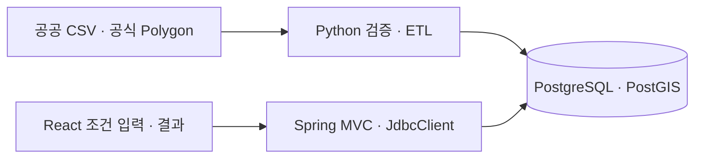
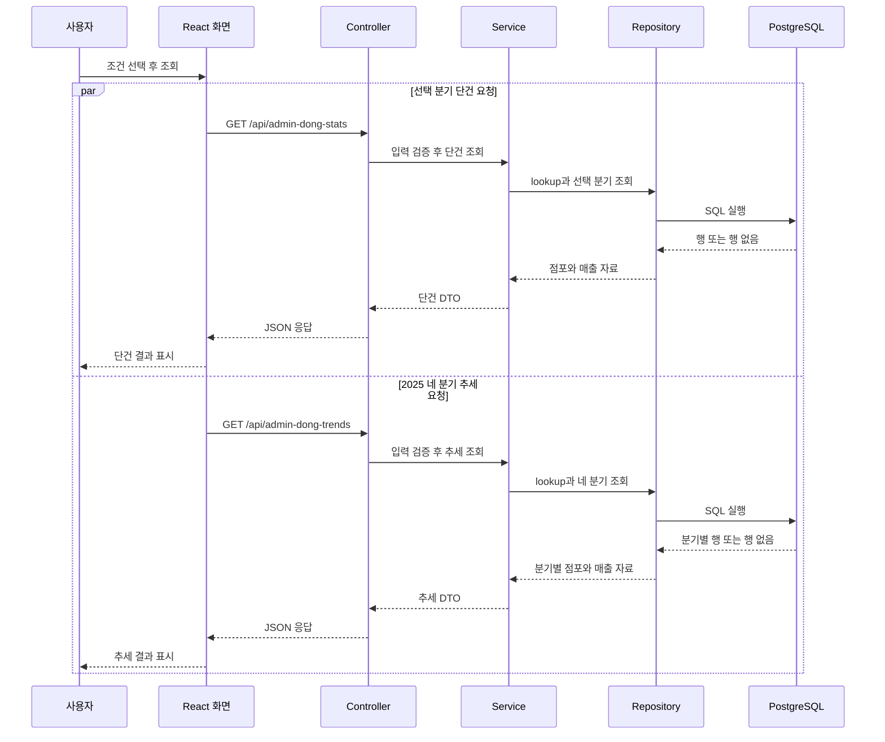
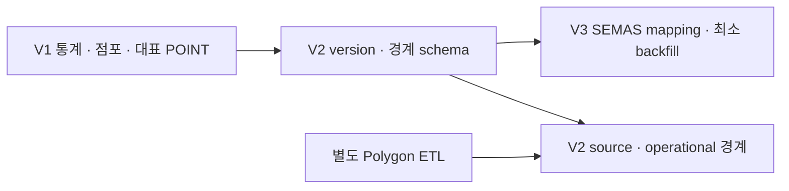

# 통합 기술 명세와 개발 안내

이 문서는 조회 버튼을 누른 뒤 화면과 서버, DB가 어떻게 함께 동작하는지 설명합니다. 처음에는 아래 시스템 그림과 조회 예시를 읽고, 맡을 작업에 필요한 상세 명세로 이동합니다. 현재 구현 상태와 다음 작업은 [project](project.md), 기존 DB 접속·적용·복구 승인은 [db-safety](db-safety.md), AI 작업 규칙은 [AGENTS](../AGENTS.md)에 있습니다.

기초 문서 개편의 정적 대조 기준은 2026-10-11의 [`d06f675`](https://github.com/jinwooorp/RecycleYoungs/commit/d06f675921b1edc34d38ef6646fdbb48bc66533e)입니다. 당시 무실행·합성/Mock·2026-10-13 v2 기록과 2026-10-14의 일회용 실자료 E2E는 [실자료 격리 시연](#실자료-격리-시연)에 보존합니다. **영구 팀 개발 환경**의 구현·실행 증거는 아래 절에서 별도로 관리합니다. 최초 팀 환경 구축은 기존 DB 미접속으로 진행했고, 후속 승인된 로컬 환경 통일의 읽기 전용 감사·백업·복원·퇴역 결과는 [DB 안전 정책](db-safety.md#2026-10-14-로컬-환경-통일)에 구분합니다.

## 목차

- [팀 공통 실자료 개발 환경](#팀-공통-실자료-개발-환경)

- [시스템과 기술 선택](#시스템과-기술-선택)
- [통계 조회 한 번 따라가기](#통계-조회-한-번-따라가기)
- [읽기 지도와 용어](#읽기-지도와-용어)
- [기술 스택과 선택 이유](#기술-스택과-선택-이유)
- [코드 구조와 진입점](#코드-구조와-진입점)
- [데이터 출처와 의미](#데이터-출처와-의미)
- [DB schema와 Flyway](#db-schema와-flyway)
- [CSV ETL](#csv-etl)
- [Polygon ETL과 공간 한계](#polygon-etl과-공간-한계)
- [현재 GET API 계약](#현재-get-api-계약)
- [Frontend 화면과 요청 상태](#frontend-화면과-요청-상태)
- [공간 조회 설계 — API·격리 검증](#공간-조회-설계--api격리-검증)
- [테스트와 안전 모듈](#테스트와-안전-모듈)
- [개발 환경과 안전한 시작](#개발-환경과-안전한-시작)
- [승인된 격리 재현 안내](#승인된-격리-재현-안내)
- [기술 결정과 Git 근거](#기술-결정과-git-근거)

## 팀 공통 실자료 개발 환경

이번 환경은 일회용 demo와 별개인 영구 **team-dev** 환경이다. legacy DB는 V1 BASELINE 상태를 변경하지 않고 2026-10-14 별도 승인된 백업·독립 복원·전수 대조 후 퇴역했다. 루트 Compose는 기존 `DB_*` 값을 참조하지 않는다. 신규 환경은 공개된 `real-data-v2`/release를 기본 사용하고 DB 이름·포트·V1~V3·고정 데이터 계약을 공유한다. 기존 v1은 명시적 v1/local로 보존한다. Kakao JavaScript 키는 개발자별 로컬 설정이다.

초기 구축 순서는 입력 계약/공격 입력 테스트 → Docker metadata guard/전용 자원 → Flyway → 상태 기반 ETL/전수 대조 → guarded bootRun → API/UI·재실행 검증이었다. 현재 활성화는 기존 main과 v1 자원을 보존하는 별도 worktree에서 준비한다. 원본·migration·비즈니스 API·불변 v1/v2 데이터 계약은 보존하며 실제 DB E2E를 단위/다운로드 검사와 구분한다.

| 단계 | 책임과 실패 경계 |
| --- | --- |
| `inspect-proxy` | socket 접근을 전담하는 stdlib 전용 이미지. internal network·host port 없음. 고정 GET inspect만 허용하고 실제 project/owner/name/ID를 검증해 필요한 metadata만 반환 |
| `preflight` | Docker **GET metadata만** 사용. 전용 network/volume label·생성시점·저장 identity 검증, 임의 owner/password 생성. 외부 자원 입양 거부 |
| `data-init` | 기본 v2 Release 고정 URL/tag/SHA 다운로드 → 10개 member·CSV·Polygon/report/ATTRIBUTION 검증 → cache 원자적 공개. 명시적 local은 원본 8개를 read-only 입력으로 사용 |
| `team-postgres` | digest 고정 PostgreSQL 16/PostGIS 3.4, DB `recycleyoungs_team_dev`, PGDATA `/var/lib/postgresql/data/team`, host `127.0.0.1:55432`. ETL internal network와 DB만 참여하는 host 접속 network. 기존 service `postgres`와 이름 분리 |
| `db-identity` | 실제 연결의 DB/role/SID/PGDATA/owner 확인. 알 수 없는 기존 데이터가 있으면 migration 거부 |
| `db-migrate` | 원본 V1~V3. 실제 Flyway 연결마다 initSql identity 검증. baseline/clean 비활성 |
| `etl-init` | CSV 3개를 기존 loader의 단일 transaction으로 적재. 각 Polygon publication도 실제 연결을 검증. source projection·SRID·geometry/attribute/profile·Flyway checksum·전체 row/ID/sequence fingerprint 확인 후 DB state READY |

`depends_on`은 healthy/completed-successfully를 구분한다. `up -d` 반환은 ETL 성공이 아니다. `python3 etl/team_dev.py status`는 Docker metadata와 DB READ ONLY snapshot에서 READY/version/contract 및 전수 fingerprint를 다시 비교한다. Backend `bootRun`은 이 검사를 통과해야 시작하며 실패 시 즉시 종료하고 상태/로그 확인 명령을 안내한다.

재실행은 동일 contract의 READY DB를 전수 재검증하고 ETL을 생략한다. CSV transaction과 `CSV_DONE` checkpoint는 원자적이다. 실패·프로세스 중단 후에는 CSV 이전의 빈 DB만 다시 적재하고, CSV_DONE 이후에는 source projection을 확인한 뒤 immutable Polygon publication을 재사용한다. 알 수 없는 비어 있지 않은 DB·다른 데이터 버전·다른 처리 계약은 자동 TRUNCATE/refresh하지 않는다. READY와 실측이 다르면 정상 상태를 반환하지 않는다. 기본 보존 대상은 새 DB/cache/control volume 모두다.

host preflight는 최초 `python3 etl/team_dev.py preflight`로 포트·기존 동일 이름 충돌을 검사한다. Compose 내 guard는 다시 실제 metadata를 검사한다. preflight/db-identity/etl-init은 직접 socket을 받지 않고 전용 internal inspect network의 proxy를 사용한다. proxy는 정확한 container/network/volume inspect와 고정 PostGIS ref 한 개의 image inspect만 허용하며 mutation·exec·list·archive·query/encoded/경로 탈출·타 프로젝트를 거부한다. 응답에서 임의 Env·명령·host mount 경로를 제거하되 실제 image/mount/network/port/생성시각 검증 필드는 유지한다. host status/bootRun의 Docker CLI와 실제 DB SID/owner/PGDATA 검사는 별개로 유지한다.

이미지 manifest digest와 config digest는 서로 다른 식별자다. [Docker Registry manifest](https://docs.docker.com/reference/api/registry/latest/operations/GetImageManifest/)의 bytes/SHA를 대조해 고정 manifest에 포함된 config digest·linux/amd64를 확인했다. guard는 두 저장 방식의 알려진 ID만 허용하고, 컨테이너의 요청 ref·실제 image ID·고정 ref의 image inspect ID/RepoDigest·플랫폼을 함께 검증한다. v1의 저장된 actual image proof 형식과 비교는 유지한다. 초기화 실패는 고정 오류 코드·허용된 예외 타입·형식 검증한 SQLSTATE만 출력하며 원문 예외·Env·DSN·원행은 전달하지 않는다.

socket의 `:ro`는 Docker API 권한을 제한하지 않는다. socket을 가진 proxy 자체의 침해는 여전히 daemon 전체 권한으로 이어질 수 있다. 별도 stdlib 전용 build stage·고정 base digest·읽기 전용 filesystem·cap_drop ALL·no-new-privileges·외부 port 없는 internal network로 노출을 줄인다. 신뢰한 로컬 개발 환경 전용이며 daemon을 외부 TCP에 공개하지 않는다. DB·입력 mount·volume 소유권을 검증하지 않은 cleanup은 금지한다.

`./gradlew bootRun`은 팀 전용 profile과 고정 loopback reader를 사용한다. 루트 `.env`를 Spring에 읽히지 않으며 process `DB_*`/`PG*`/`FLYWAY_*`/`SPRING_*` 주입과 CLI override를 거부한다. reader는 기본 READ ONLY이며 매 실제 JDBC 연결에서 SID/owner/DB/role/READY/버전/row count/Flyway history를 확인한다. 시작 전에는 전체 fingerprint도 검사한다. 일반 application.yaml/bootJar의 기본 OpenAPI 비활성 정책은 유지한다.

기존 v1 후보는 원본 report의 개인 임시 경로 때문에 공개하지 않는다. 공개용 파생 v2는 별도 사용자 승인으로 [real-data-v2 Release](https://github.com/jinwooorp/RecycleYoungs/releases/tag/real-data-v2)에 배포했다. 활성화 worktree의 `data/release.json`은 실제 tag·asset URL·archive SHA를 PUBLISHED로 고정한다. 임의 URL/latest를 받지 않고 redirect host/상태/크기/전체 hash/ZIP 경로/내부 hash/report를 검사한다. cache 손상은 자동 대체하지 않는다. 기존 tag/asset을 덮어쓰지 않으며 다음 데이터 갱신은 새 버전과 별도 승인이 필요하다.

### 2026-10-14 팀 개발 환경 실측

당시 상태는 **LOCAL_READY_RELEASE_PENDING**이었다. 아래 수치는 해당 전용 v1 volume에서 측정한 과거 기록이며 현재 v2 DB 측정으로 사용하지 않는다.

| 검증 | 이번 결과 |
| --- | --- |
| 입력 | 원본 8개 bytes/SHA 일치, 고정 report·ZIP member·6개 repair 계약 통과, 원본 불변 |
| Flyway | V1/V2/V3 success, checksum -2055107083 / 237765795 / 617267104 |
| CSV | store_stats_dong 141,218 / sales_dong 67,113 / stores 554,092. 원본 전체 projection SHA 대조 통과 |
| 점포 | source ID 554,092 unique / CAFE 22,739 / mapping 충돌·NULL/비정상 POINT 0 |
| Polygon | admin 425(version 1) / commercial 1,650(version 2), source/operational 전체 geometry·속성·SRID 5181 일치. 기존 한계 UNRESOLVED 유지 |
| API | GET 7개 200. 선택 위치 3개 카페 179 / 116 / 267과 Q3 행정동 9개 지표·4개 분기 추세를 READ ONLY SQL과 대조 |
| 브라우저 | localhost:5173 실제 Kakao SDK/타일·지도 클릭·행정동/상권·3후보 제한/비교·수동 통계/추세. 실제 Swagger `/api/docs`와 OpenAPI JSON, console error/warn 없음 |
| 재실행 | data-init VERIFIED_CACHE, Flyway 추가 적용 없음, etl-init PRESERVED. 최초와 모든 data row/ID/sequence·source version fingerprint 동일 |
| 실패 주입 | 새 team DB에서 실제 SID 오류 거부, version/contract/status·값 변조 감지, 실제 CSV 중간 실패 rollback·미준비 상태 확인. fixture 변경 전부 rollback, 기존 데이터·ID·sequence 보존: 7 PASS |
| 일반 회귀 | Backend 247 PASS / Frontend 235 PASS + build/lint / ETL 295 PASS·15 SKIP(총 310). 기존 DB/raw opt-in은 미활성 |
| Release | 후보 87,885,265 bytes, SHA-256 `58f83f3edc981b950288b990cd667ca17e0a1b30c6028b84035a88bf3407490d`, 원본 8개+dataset.json 9 members. HTTP fixture 다운로드→hash→안전 해제→cache 재사용/손상 거부 통과. 실제 GitHub 다운로드·업로드 미실행 |

초기 bind 셸 스크립트 실행 오류는 SQL init + 빈 스키마의 owner bootstrap으로 고쳤다. internal network 단독으로 host port가 실제 publish되지 않은 문제는 DB 전용 host network와 실제 `NetworkSettings.Ports` 검사로 고쳤다. reviewer의 사전 migration 버전 gate·고유 service key·이미지 재빌드·원자적 최초 checkpoint/credential claim 지적을 반영했고 남은 actionable finding은 없었다.

위 표는 최초 구축·퇴역 시점의 기록이다. 최종 보안 검토에서는 `source-map-js`의 PostCSS/Tailwind/jsdom 전이 의존성을 1.2.1에서 공식 수정 버전 1.2.2로 lockfile만 갱신했다. [GHSA-68fv-2mgg-jv7q](https://github.com/advisories/GHSA-68fv-2mgg-jv7q)는 신뢰하지 않는 indexed source map의 큰 offset을 처리할 때 event loop를 막는 취약점이다. 현재는 개발·빌드·테스트 의존성이지만 외부 source map을 처리할 때 위험하므로 수정했다. `npm ci`와 audit에서 취약점 0건을 확인했다.

서울시·SEMAS 공식 이용조건과 로컬 출처 연결·리포트 권리 범위는 [README](../README.md#원본-이용조건과-공개-고지)에 있다. 당시 Release는 UNPUBLISHED였으며, 후속 Public 공개·다운로드 및 활성화/clean clone의 현재 범위는 아래 v2 절에 구분한다.

### 2026-10-14 최종 보안 검토·회귀

최초 구축 후 별도 실행한 검증이다. 직접 socket 접근을 worker 3개에서 제거하고 전용 inspect proxy로 제한했다. 실제 macOS Docker Desktop에서 허용된 GET은 200, 변경 요청은 405, legacy 이름·임의 API 경로는 403이었다. `make check-db`도 과거 V1 기대값의 opt-in dbTest 대신 읽기 전용 팀 status로 연결한다. 기존 API·migration·원본·승인 repair 계약은 변경하지 않았다.

| 검증 | 최종 보안 검토 실행 결과 |
| --- | --- |
| Backend | Java 21, `./gradlew test build --no-daemon --rerun-tasks`: 247 PASS. 일반 bootRun의 legacy DB 환경 주입은 proof/접속 전에 거부 |
| Frontend | Node 24.20.0, `npm ci`, 235 PASS, lint/build PASS, audit 0건. source-map-js 1.2.2 설치 확인 |
| ETL | Python 3.12.14, 316개 중 301 PASS / 15 SKIP. 일반 회귀이며 DB/raw opt-in 미활성. Release 다운로드는 합성 HTTP/cache fixture |
| Compose 재실행 | 보안 변경 적용 후 일반 `up -d` 두 번, VERIFIED_CACHE·migration 추가 없음·PRESERVED. 동일 DB full ID/SID와 전체 데이터·ID·sequence fingerprint 보존 |
| 실자료 SQL/API/UI | 실제 지도 3곳의 카페 176 / 117 / 254, 명동·소공동 Q3 9개 지표 및 네 분기 추세 대조. 후보 3곳 제한·비교·Swagger 7 GET 렌더링, 양쪽 console error/warn 0 |
| 패키지 | 기존 후보 87,885,265 bytes와 위 archive SHA 유지. 8개 개별 bytes/SHA와 dataset.json 계약·9 members·byte 동일성 재확인. 원본/후보 덮어쓰기 없음 |

이 보안 검토에서는 기존 READY DB를 초기화하거나 실패 주입으로 변조하지 않았다. 최초 적재·실제 실패 rollback은 앞 절의 구축 증거와 구분한다. 당시 남았던 Release 공개·다운로드와 현재 독립 clean clone 검증 범위는 아래 v2 절에 이어 기록한다.

### 공개용 파생 리포트와 v2 계약

2026-10-15 최초 파생 작업의 승인 범위는 원본 보존·공개용 파생본 생성·안전한 로컬 검증까지였다. 이후 별도 승인된 Public 공개와 코드 반영은 다음 절에 구분한다. 원본 report 3개·기존 v1 ZIP·READY DB는 변경하지 않는다.

기존 `real-data-v1` 계약 SHA는 `57594dc6f49495bcc5644f753b07b0bedff07934ac48aecd428215c2329937c3`이다. manifest·원본 `spatial_sources.py`·geometry/loader·migration을 바꾸면 기존 READY 검증도 실패하므로 이 파일들은 유지한다. [team_public_data.py](../etl/team_public_data.py)는 DB나 Docker에 접근하지 않는 별도 도구다. [public-data-v2.json](../data/public-data-v2.json)이 `real-data-v2`와 새 report bytes/SHA를 고정한다. 이 데이터 계약과 실제 공개 상태(`release.json`)는 분리한다.

- CSV 3개와 원본 Polygon ZIP 2개는 byte-identical이다. 리포트 3개는 지정한 환경 metadata만 제거한 파생본이다. 원본 report SHA·제거한 필드명·파생 정책을 기록하고 나머지 JSON 값은 전부 보존한다.
- 행정동 report의 script 경로·명령·임시 환경, 상권 quality report의 로컬 재사용 경로, repair report의 container/network/storage/cleanup·전체 빌드 문자열을 제거한다. PostgreSQL 16.4/PostGIS 3.4.3/GEOS 3.9.0/PROJ 7.2.1 검증 엔진 버전은 정규화해 남긴다. feature별 수치·linework/structure/buffer0 결과·원본/repair WKB hash·replay·6개 승인 판정은 제거하지 않는다.
- 기존 `prepare_dataset`에 새 고정 report hash를 갖는 불변 spec을 명시적으로 전달한다. 원본 전역 SPECS는 변경하지 않는다. 같은 source/operational geometry 결과여도 profile의 report hash/상대 artifact 이름이 다르므로 기존 DB version에 자동으로 채택할 수 없다.
- 새 ZIP은 입력 8개와 `ATTRIBUTION.json`, `dataset.json`의 10개 member다. 전체/내부 hash·정확한 member·경로·symlink·ZIP metadata·canonical dataset 계약을 검증한 후에만 새 디렉터리로 해제한다. 개인 Unix/Windows 경로·인증 문자열·URL 내 credential/query와 허용하지 않은 환경 필드는 거부한다. scanner는 모든 개인정보 부재를 보증하는 수단이 아니며 hash-pinned 입력과 내용 검토를 함께 적용한다.

최초 파생 후보 검증 당시 runtime은 v1만 지원했고 기본값도 v1/local이었다. 후속 runtime·Public 다운로드·활성화 준비는 다음 절에 구분한다. 기존 READY DB의 report hash를 덮어쓰거나 v2로 선언하는 전환은 금지한다.

자료별 공식 출처·고지와 남은 한계는 [README](../README.md#원본-이용조건과-공개-고지)에 있다. 공식 CSV/ZIP 5개 byte 일치와 프로젝트 report 생성 기록은 확인했지만 최초 CSV 취득 시점·실제 경계 기준일은 미확인이다. 사용자는 보유·관리 권리 범위의 report 3개 CC BY 4.0·출처표시명 RecycleYoungs 프로젝트를 선택하고 공개 권한·필요 동의를 확인한 뒤 정확한 최종 ZIP의 Public 업로드를 승인했다. 기록에 없는 제3자 권리까지 일괄 허락한 것으로 처리하지 않는다.

이번 로컬 검증은 Python 3.12.14의 일반 회귀 327개 중 **312 PASS / 15 SKIP**이며, 그중 공개 파생 도구 테스트는 11개다. Unix/macOS/Windows 경로·URL credential·원본 hash 불일치·계약/내부 bytes 변경·JSON 중복 키·ZIP comment/path·검증 후 archive 교체·기존 출력 덮어쓰기 거부와 결정적 패키징을 검사했다. 실제 후보 해제 후 통계 141,218행·매출 67,113행·점포 554,092행·CAFE 22,739행을 다시 검증했다. 원본/파생 report로 준비한 행정동 425개·상권 1,650개 feature의 모든 필드와 승인 6개 repair 결과가 동일했고 profile 차이는 `reports`뿐이었다. 원본 8개·v1 ZIP·v1 계약 hash도 유지됐다. DB 접속·migration·적재와 Backend/Frontend 재실행은 이번 범위에서 수행하지 않았다.

### v2 runtime 통합과 독립 E2E

현재는 **Public Release·테스트 브랜치의 독립 DB E2E 검증 완료 / main 반영 승인 대기**다. [team_dataset.py](../etl/team_dataset.py)는 v1/v2 contract와 prepare를 위임한다. `team_data.py`·`team_public_data.py`·원본 ETL·migration·데이터 계약은 유지한다. 공개된 최종 asset은 **87,870,777 bytes**, SHA `6b11901f46d1a207c5b36353483e209f00a10fb401edcc5fd036a3025238ff0b`, dataset contract SHA `0d27a0e526cd249d7adebf374b7be646fd5122ba5cede8b558117dd11d761994`, ATTRIBUTION SHA `4701182c7479caed7b480a97e3a792907e79feebe884897c2ecad511f8af0f67`다. tag `real-data-v2`는 검증된 runtime 코드 commit을 가리키며 서버 digest·Draft byte 비교·실제 공개 HTTPS→새 빈 cache→두 번째 cache 재사용을 검증했다. 이전 미공개 후보와 기존 v1 계약·ZIP·DB는 그대로 보존하며 새 계약에 자동 채택하지 않는다.

| 경계 | 구현·검증 |
| --- | --- |
| 선택·cache | `TEAM_DATA_VERSION` allowlist, 신규 기본 v2/release. 명시적 v1/local 보존. version별 cache·계약·정확한 member/hash 검사. v2 Local은 원본 8개에서 고정 파생본 생성. 임의 URL override 없음 |
| 동시/실패 | container의 `flock`으로 writer 한 개, 충돌 즉시 오류·프로세스 종료 시 해제. 실패 staging은 보존, 최종 cache는 검증 후 rename. 손상 cache 자동 삭제·교체 없음 |
| control/DB | 신규 ownership ledger에 version/contract 저장. 기존 미기록 ledger는 v1로만 해석. 불일치는 control 변경/SQL 쓰기 전 거부. 실제 연결 DB/actor/SID/owner/PGDATA와 Flyway history·fingerprint 유지 |
| Flyway | identity 단계가 검증한 version/contract를 control에 전달. migrate.sh는 매 실제 Flyway 연결에서 SID/owner와 기존 state의 version/contract를 검사. 원본 V1~V3·baseline/clean 정책 불변 |
| ETL/state | 선택 cache·report spec으로 기존 loader/publication 재사용. 실제 profile/source/geometry/ID/sequence/fingerprint 검증 후 READY. checkpoint conflict는 동일 version/contract/owner만 status 갱신. READY 경로는 setup DDL·checkpoint·loader 생략 |
| Backend | 호스트 proof가 선택 version·기대 migration·실제 공간 metadata/report/source/profile hash를 검사. 단일 READ ONLY SQL snapshot의 공간 proof를 Gradle이 메모리로 전달. JDBC 매 연결에서 version/contract·기존 identity/count/history·동일 공간 proof 확인, reader/Flyway-disabled/OpenAPI 계약 유지 |
| Compose | 초기화 서비스 5개에 version 전달, Dockerfile에 새 runtime/고정 공개 계약 포함. 프로젝트·image/SID·volume/network/port·inspect proxy 권한 검사는 유지. dataset과 infrastructure label `team-development-v1`은 다른 개념 |

라이선스 후보 갱신 후 이번 회귀는 Backend **249 PASS**(`test build --no-daemon --rerun-tasks`), Frontend **235 PASS** + `npm ci`/lint/build/audit **0건**, ETL **334 PASS / 15 SKIP**(349개)다. 파생 도구 14개·runtime fixture 16개에 리포트 한정 라이선스/출처·한계 고지/계약 결속과 이전 후보 pin 거부를 포함했다. Compose propagation/build-context/Flyway shell gate 3개와 기존 v1/inspect proxy/공통 회귀도 유지했다. DB/raw opt-in은 활성화하지 않았다. 이전 runtime 준비 회귀의 330 PASS / 15 SKIP 및 최초 파생 회귀의 312 PASS / 15 SKIP은 당시 결과다.

실제 최종 ZIP을 loopback HTTP로 **빈 별도 로컬 cache**에 다운로드·SHA/10-member/CSV/geometry 검증했다. 두 번째 release 실행과 같은 cache의 local 실행은 VERIFIED_CACHE였고 HTTP 요청 1회, 10개 파일 bytes/hash/mtime 불변이었다. 입력 행 수 141,218 / 67,113 / 554,092·CAFE 22,739 및 geometry 425 / 1,650·6개 repair가 확인됐다. 이는 **DB 적재 건수나 실제 GitHub 성공이 아니다**. 실제 prepared geometry로 `dataset_metadata`와 버전 검증도 조합했지만 DB engine version 응답은 fixture이며 실측 profile로 주장하지 않는다.

로컬 `default`/`desktop-linux`는 같은 daemon이므로 v2 DB 실험에 사용하지 않았다. 후속 승인된 [GitHub-hosted Ubuntu 24.04 run 4](https://github.com/jinwooorp/RecycleYoungs/actions/runs/38731532178)는 테스트 브랜치 commit `794e78c7f60d41276018cca848ab66c78bee3cae`의 새 checkout·빈 cache/volume에서 실제 공개 다운로드→Flyway V1~V3→CSV/Polygon ETL→READY→Backend GET 7개/Swagger→Vite 프록시→Compose 재실행 보존을 통과했다. SID는 `7696864147976323112`, 통계 141,218·매출 67,113·점포 554,092·CAFE 22,739·행정동 425·상권 1,650행이며 전수 source projection·WKB/repair/profile·checksum·ID/sequence fingerprint를 검사했다. reader READ ONLY와 Q3 SQL/API 9개 지표도 일치했다. 일반 회귀는 Backend 249·Frontend 235·ETL 350 PASS / 15 SKIP, audit 0건이다. 실제 Kakao SDK·타일·3후보 UI와 main 반영 후 새 clone은 미검증이며, NULL/0/NO_ROW별 HTTP 관측은 별도로 보강 중이다. 기존 로컬 v1 SQL/Compose/Docker mutation은 수행하지 않았다.

별도 활성화 worktree에서는 실제 `data/release.json` pin을 PUBLISHED/v2로 바꾸고 Compose·예시·공통 runtime을 v2/release로 맞춘다. 호스트 status/Gradle proof가 같은 `version()`을 사용하므로 Makefile·Backend에 기본값을 중복 추가하지 않는다. 기존 v1 사용자는 개인 `.env`에 v1/local, **각 Backend/status 셸**에는 `export TEAM_DATA_VERSION=real-data-v1`을 명시해야 한다. `.env`를 자동 변경하거나 전체 source하지 않는다. mismatch는 자동 이관 대신 기동을 거부한다.

현재 main·기존 v1 DB와 control/cache/DB volume은 보존하며 main 반영은 승인 대기다. 테스트 브랜치의 commit/push와 최대 4회의 추가 독립 Actions 실행은 후속 사용자 승인 범위에서만 수행한다. 같은 daemon에서 `-p` override로 병행 실행하지 않는다. 위 독립 runner의 최초 DB·Flyway·ETL·reader/API/Swagger·재실행 fingerprint 검증과 실제 브라우저·main 반영 후 새 clone 검증을 구분한다. 공개된 ZIP·tag·asset·리포트/ATTRIBUTION/dataset hash는 이번 활성화에서 변경하지 않는다.

활성화 초기 worktree 준비 단계의 일반 회귀는 Backend **249 PASS**·build, Frontend **235 PASS**·lint/build/audit **0건**, ETL **338 PASS / 15 SKIP**(353개)였다. 새 기본 선택·실제 고정 Release pin·CLI 모드·Compose 전체 gate의 v2 기본/v1 명시 선택과 기본 host proof의 v1 ledger 사전 거부를 확인했다. 실제 추적된 PUBLISHED 설정을 그대로 사용한 HTTPS→새 빈 cache→재사용도 통과했으며, URL/config override 없이 다운로드 1회·10개 member bytes/hash/mtime 보존을 확인했다. 이 초기 결과와 후속 독립 runner의 DB·서비스 E2E는 별개 증거다.

## 시스템과 기술 선택

프로그램은 자료를 준비하는 과정과 사용자가 조회하는 과정으로 나뉩니다. Python ETL은 공공 CSV를 읽고 코드·숫자·좌표를 검증해 DB에 미리 넣습니다. React 화면은 사용자의 조건을 Spring API에 보내고, Spring은 DB에 저장된 자료를 조회해 응답합니다.



각 부분이 맡는 일은 분명합니다. React는 조건 입력과 로딩·오류·결과 표시, Spring은 조건/자료의 일관성 확인과 응답 조립, PostgreSQL은 자료 저장과 조건별 SQL 조회를 담당합니다. PostGIS는 점포의 좌표와 지역 경계를 다루는 DB 확장입니다. 통계 API는 행정동 code를 사용하고 공간 포함 판정은 별도 `/api/locations/resolve`에서 담당합니다.

서로 다른 원천의 통계를 DB table로 나눠 저장하면 동·업종·분기라는 key로 필요한 자료를 읽고 중복/연결 조건을 검사할 수 있습니다. CSV 검증과 변환은 별도 Python ETL이 맡으므로 요청마다 원본을 읽거나 다시 적재할 필요가 없습니다. 공식 원본의 자동 수집·정기 갱신 스케줄링은 미구현입니다. 고정 v2 Release의 실제 공개 다운로드와 테스트 브랜치의 독립 runner E2E를 확인했으며, main 반영 후 새 clone·실제 지도 UI 검증은 구분해 남겨 둡니다.

실제 코드는 Backend의 Controller→Service→JdbcClient Repository, Frontend의 API client→types→hooks→components로 나눠 책임을 관리합니다. Frontend는 DB에 직접 접속하거나 Backend 계산을 별도로 구현하지 않습니다. Compose·Makefile은 실행 진입점일 뿐 승인이나 대상 확인을 대신하지 않습니다.

## 통계 조회 한 번 따라가기

### 예시 입력

청운효자동에서 카페 업종의 2025년 1분기 통계를 조회한다고 가정합니다. 아래는 요청 흐름을 설명하는 예시이며 현재 DB에서 다시 조회한 결과가 아닙니다.

| 화면 선택 | API에 전달하는 값 |
| --- | --- |
| 청운효자동 | dongCode=`11110515` |
| 카페 | industryCode=`CAFE` |
| 2025년 1분기 | quarterCode=`20251` |

이 값은 [Frontend 테스트](../frontend/src/App.test.tsx)·[Backend API 테스트](../backend/src/dbTest/java/com/example/backend/AdminDongApiTests.java)와 기존 원본/DB 대조 기록의 계약에 있습니다. 실제 화면의 선택 목록은 그 환경의 API 응답으로 정해집니다. 다음 설명은 목록을 받았고 유효한 조건을 선택한 정상 요청 경로를 따라갑니다.

### 1. 화면에서 조건을 선택한다

[SearchForm](../frontend/src/components/SearchForm.tsx)의 행정동·업종·분기 선택 상자가 입력을 받습니다. 선택한 문자열은 [useAdminDongStats](../frontend/src/hooks/useAdminDongStats.ts)의 `selection` 상태에 저장됩니다. [App](../frontend/src/App.tsx)은 폼의 변경 이벤트를 `changeSelection`, 조회 버튼을 `search`에 연결합니다.

세 값이 선택돼야 조회 버튼을 사용할 수 있습니다. 버튼을 누르면 이전 결과를 비우고 단건 통계와 추세의 로딩 상태를 각각 시작합니다. 화면이 열릴 때는 선택 가능한 동·업종·분기 목록을 API 세 개로 먼저 가져오며, 기본 선택이나 자동 통계 조회는 하지 않습니다.

### 2. 서로 다른 두 API를 호출한다

[API client](../frontend/src/api/adminDongApi.ts)가 다음 GET 요청을 병렬로 보냅니다. 단건은 고른 분기의 수치, 추세는 같은 동·업종의 네 분기 표를 위한 요청입니다.

```text
GET /api/admin-dong-stats?dongCode=11110515&industryCode=CAFE&quarterCode=20251
GET /api/admin-dong-trends?dongCode=11110515&industryCode=CAFE
```

추세에는 quarterCode를 보내지 않습니다. 두 요청은 각각 결과·로딩·오류 상태를 가져, 단건만 성공하거나 추세만 성공해도 성공한 쪽을 표시할 수 있습니다. 두 요청이 모두 끝날 때까지 다시 제출하는 것은 막습니다.

조건을 바꾸거나 화면을 떠나면 AbortController로 진행 중 요청을 취소합니다. 취소한 요청의 응답이 늦게 와도 현재 요청의 controller인지 확인해 새 선택의 결과를 덮어쓰지 못하게 합니다. 취소를 자료 없음이나 연결 오류로 바꾸지 않습니다.

### 3. Spring이 조건을 확인하고 조회를 조립한다

[Controller](../backend/src/main/java/com/example/backend/admindong/AdminDongController.java)는 HTTP query를 받고 [QueryValidator](../backend/src/main/java/com/example/backend/admindong/QueryValidator.java)로 허용 필드·중복·누락·형식을 확인합니다. [Service](../backend/src/main/java/com/example/backend/admindong/AdminDongService.java)는 지원되는 동·업종·분기인지 확인하고 두 통계 자료를 응답으로 조립합니다. [Repository](../backend/src/main/java/com/example/backend/admindong/AdminDongRepository.java)는 JdbcClient로 SQL을 실행해 DB의 행을 읽습니다.

업종 연결(mapping)이 필요한 이유는 화면의 `CAFE`와 서울시 통계의 `CS100010`이 서로 다른 코드이기 때문입니다. Service가 Repository의 lookup 결과에서 올바른 SEOUL 연결을 확인하고 통계의 원천 업종 코드로 조회합니다. 다른 자료인 SEMAS의 I21201은 이 통계 요청에 대신 쓰지 않습니다. 중복 연결이나 불일치가 있으면 임의로 하나를 고르지 않고 오류로 처리합니다.

이 한 요청의 지원 범위 확인과 통계 조회는 같은 읽기 전용 REPEATABLE READ transaction으로 묶습니다. 여러 SQL이 같은 관찰 상태를 읽도록 하는 것이며, 동시에 보낸 두 HTTP 요청까지 같은 snapshot이라는 뜻은 아닙니다. [정확한 검증 순서](#요청과-검증-순서)와 [SQL 계약](#sql무결성과-transaction)은 상세 명세에 있습니다.

### 4. DB에서 점포와 매출 자료를 따로 읽는다

이 예시의 조회 key는 동 `11110515`·서울시 업종 `CS100010`·분기 `20251`입니다. `store_stats_dong`에는 점포 수 자료, `sales_dong`에는 추정매출과 거래 건수 자료가 있습니다. 두 자료는 서로 다른 원천이고 같은 조건에도 한쪽만 있을 수 있어 table을 나누고 결과도 따로 유지합니다.

단건 조회는 두 table에서 선택 분기를 읽습니다. 추세 조회는 각 table에서 20251~20254를 한 번에 읽고, Service가 항상 네 분기 순서로 조립합니다. 일부 또는 전체 분기의 자료가 없어도 분기 칸을 없애지 않습니다.

행이 없으면 해당 응답 section은 null이고 이유는 NO_ROW입니다. 행이 있는데 특정 수치만 NULL이면 그 수치만 null로 남깁니다. DB 연결 실패나 무결성 오류를 빈 자료로 바꾸지는 않습니다. 전체 SQL은 [Repository](../backend/src/main/java/com/example/backend/admindong/AdminDongRepository.java), table 관계는 [DB 명세](#db-schema와-flyway)에서 확인합니다.

### 5. 응답을 확인하고 두 결과를 표시한다

Service가 만든 [DTO](../backend/src/main/java/com/example/backend/admindong/ApiResponses.java)를 JSON으로 응답하면 client가 필드·숫자 범위·결측 이유·추세 순서를 확인합니다. 정상 응답은 [StatsResult](../frontend/src/components/StatsResult.tsx)에 선택 분기의 점포·매출로, [TrendResult](../frontend/src/components/TrendResult.tsx)에 네 분기 표로 전달합니다. 각 결과는 도착하는 대로 표시됩니다.

값이 0이면 실제 0을 표시합니다. 지표 NULL과 행 부재 NO_ROW는 모두 화면에서 자료 없음으로 안내하지만 API에서는 서로 구분합니다. 요청 실패는 오류 안내입니다. 이 구분이 있어야 '자료가 없어 알 수 없음'을 '점포나 매출이 0임'으로 오해하지 않습니다.

금액과 거래 건수의 DB BIGINT는 JavaScript Number가 정확히 표현할 수 있는 범위를 넘을 수 있습니다. 그래서 API는 10진 정수 문자열로 보내고, [formatter](../frontend/src/lib/formatStats.ts)는 BigInt로 정확하게 표시합니다. 이번 예시에 새 통계값을 만들어 넣지 않았습니다. 정확한 [응답 필드](#dto와-숫자-계약), [결측 계약](#null0no_row와-추세), [오류 계약](#오류-계약과-적용-범위)을 확인할 수 있습니다.

### 요청 흐름 그림

아래는 정상 요청의 흐름입니다. 각 분기는 독립적으로 결과를 표시하며, 오류·취소의 상세 처리는 앞 설명과 [Frontend 상태 계약](#frontend-화면과-요청-상태)을 따릅니다. Python ETL은 이 요청 경로에 없습니다.



## 읽기 지도와 용어

조회 예시로 흐름을 이해했다면, 맡을 작업에 필요한 명세만 찾아 읽습니다. 아래 표는 코드의 전체 계약을 대체하는 요약이 아니라 상세 설명의 위치 안내입니다.

| 알아볼 내용 | 상세 섹션 |
| --- | --- |
| 응답 필드·입력·오류·결측 | [현재 GET API 계약](#현재-get-api-계약) |
| 자료의 출처·기간·집계 단위와 업종 연결 | [데이터 출처와 의미](#데이터-출처와-의미) |
| table·제약·V1/V2/V3 변경 | [DB schema와 Flyway](#db-schema와-flyway) |
| CSV 검증·적재·재실행 | [CSV ETL](#csv-etl) |
| 경계 원본·좌표계·repair·hash·한계 | [Polygon ETL](#polygon-etl과-공간-한계) |
| 위치·반경·후보 비교 계약과 검증 한계 | [공간 조회 설계](#공간-조회-설계--api격리-검증) |
| 테스트·격리 runner·source 계약의 차이 | [테스트와 안전 모듈](#테스트와-안전-모듈) |
| 설치·설정·DB 없는 검증·위험 명령 | [개발 환경](#개발-환경과-안전한-시작) |

### 자주 등장하는 용어

모르는 용어가 나올 때 아래로 돌아오면 됩니다. 실제 승인 조건은 [db-safety](db-safety.md)의 정책을 따릅니다.

| 용어 | 이 프로젝트의 예시와 의미 |
| --- | --- |
| ETL | CSV를 읽고 검증·변환해 DB에 적재하는 별도 과정. 조회 버튼이 실행하지 않음 |
| PostGIS | PostgreSQL에서 좌표·지역 경계와 공간 조건을 저장/조회하는 확장 기능 |
| POINT / Polygon | 한 위치의 좌표 / 지역의 다각형 경계. 대표 POINT 하나로 지역 전체를 판정할 수 없음 |
| CRS / SRID·EPSG | 좌표계 / DB의 좌표계 식별자. EPSG:4326은 경위도 POINT, EPSG:5181은 이 프로젝트의 경계 평면 좌표 |
| source / Source DB | 공공자료 원천 / 보호하는 기존 개발 DB. source geometry는 수정하지 않은 원본 도형 |
| operational geometry | 승인된 처리 후 조회에 쓸 도형. 원본과 함께 보존 |
| 분기 | 통계의 YYYYQ 문자열. 20251은 2025년 1분기 |
| mapping | 원천 업종과 내부 업종의 연결. SEOUL/CS100010→CAFE |
| snapshot | 특정 시점의 점포 자료 또는 DB 관찰 상태. 통계 분기와 별개 |
| provenance | 어떤 입력·코드·관찰 과정에서 나온 자료인지 기록하는 출처 근거. 형식 검사와 실제 관찰 증명은 다름 |
| migration / Flyway | table·제약·reference 등을 버전별 SQL로 바꾸는 작업 / 그 이력을 관리하는 도구 |
| baseline | 이미 존재하는 DB 구조를 관리 시작점으로 표시한 Flyway 이력. 구조 검증·실행 승인을 대신하지 않음 |
| backfill | 기존 빈 필드를 제한된 조건으로 채움. V3는 I21201·industry_id NULL만 CAFE로 변경 |
| surrogate ID | DB 내부 숫자 ID. API 식별자나 재적재 안정성을 뜻하지 않음 |
| version / current | 입력·처리 profile로 식별한 공간 dataset / 종류별 현재 공개 version |
| publication | 전수 경계 검증 후 READY/current로 공개하는 종류별 transaction |
| full loader | 기존 행을 지우고 전체 입력을 다시 채우는 적재 경로. table별 범위가 다르고 ID 재시작 가능 |
| rollback | 실패한 transaction의 행 변경 취소. sequence처럼 별도로 움직이는 값까지 복원된다고 보장하지 않음 |
| NULL / NO_ROW | 행 안의 지표값 부재 / 해당 조건의 행 자체 부재. 둘 다 실제 0과 다름 |
| mock / fixture·opt-in | 가짜 응답으로 확인 / 검증용 입력·DB / 별도로 활성화해야 하는 검사 |
| isolated environment | 보호 DB/container/volume과 분리한 검증 환경. 이름 prefix만으로 격리가 증명되지 않음 |
| writer control | 값을 쓸 수 있는 프로그램·계정·예약 작업 등을 확인하고 검증 창의 변경을 통제하는 일 |
| NOT_READY | 실제 source 적용 경로·최신 증거·승인 등 조건이 미충족인 상태. 코드 존재/격리 PASS로 해제되지 않음 |

현재 통계·지역 판정·반경 경쟁 카페 API와 화면, 최대 3후보 비교를 구현했습니다. [공간 API와 격리 검증](#공간-조회-설계--api격리-검증) 및 [후보 비교](#최대-3곳-후보-비교--frontend-orchestration)의 과거 합성/Mock·v2와 2026-10-14 최종 실자료 검증을 구분합니다. README 7~10단계 완료는 MVP·격리 시연 범위이며 migration SQL·코드·격리 PASS가 기존 DB 적용 완료를 뜻하지 않습니다.

## 기술 스택과 선택 이유

정확한 버전과 선택 근거가 필요할 때 아래를 확인합니다. 이 표는 설치된 현재 runtime을 새로 측정한 결과가 아니라 저장소의 선언/lockfile 기준입니다.

### 저장소에서 확인한 스택

| 영역 | 선언 또는 lockfile 기준 | 사용 범위 |
| --- | --- | --- |
| Backend | Java 21, Spring Boot 4.1.1, Gradle Wrapper 9.7.1 | MVC, JDBC/JdbcClient, Flyway, PostgreSQL driver |
| Frontend | lockfile React/React DOM 19.3.0, TypeScript 6.0.3, Vite 8.3.0 | React core, fetch, AbortController, Kakao Maps JavaScript SDK |
| UI | Tailwind 4.3.3, 수동 도입한 shadcn Button/Card | Radix Slot, cva, clsx, tailwind-merge |
| Frontend test | Vitest 5.0.3, jsdom, Testing Library | mocked fetch·지도 SDK mock으로 client/hook/component 검증 |
| ETL | Python image 3.12-slim | pandas 2.2.3, psycopg 3.2.3, pyproj 3.7.0, pyshp 3.1.6, Shapely 2.1.2 |
| DB/migration | Compose postgis/postgis:16-3.4, flyway/flyway:12.4.0 | 현재 실행 image/minor version은 이번에 확인하지 않음 |

근거는 [package](../frontend/package.json)·[lockfile](../frontend/package-lock.json), [build.gradle](../backend/build.gradle)·[wrapper](../backend/gradle/wrapper/gradle-wrapper.properties), [requirements](../etl/requirements.txt)·[Dockerfile](../etl/Dockerfile), [Compose](../docker-compose.yml)입니다. package의 React `^19.2.8`·TypeScript `~6.0.2`는 허용 범위이고 위 값은 lockfile resolution입니다. Node.js 24 계열은 개발 환경 안내이며 engines/.nvmrc로 고정돼 있지 않습니다.

Spring JDBC starter의 HikariCP 기반 연결 구성을 사용하며 직접 pool 설정은 없습니다. Lombok은 선언됐지만 현재 main Java에서 사용하지 않습니다. JPA/Spring Data JDBC/jOOQ, Frontend Router/Axios/상태·폼 라이브러리/Chart/theme provider는 사용 코드가 없습니다. 지도는 별도 npm 패키지 없이 공식 Kakao Maps JavaScript SDK를 사용합니다. shadcn lint plugin 등록은 전용 rule 활성화를 뜻하지 않습니다.

### 주요 선택 이유

Python ETL 중심의 통계 조회에 ORM aggregate/영속성 계층이 필요하지 않아 JdbcClient와 명시적 SQL을 유지했습니다. schema의 단일 기준은 Flyway SQL이며 ORM schema 생성·Compose 초기 SQL을 병행하지 않습니다. 기존 SQL은 내용 유지 후 V1로 이전했습니다.

Frontend는 작은 조회 흐름에 React core/fetch를 사용하고 native select/table의 접근성을 유지했습니다. shadcn은 실제 필요한 Button/Card만 도입했습니다. 통계 화면에 카카오맵 단일 위치 선택을 추가했으며 두 기능은 독립적으로 동작합니다. 선택 좌표의 실제 지역 분석·통계 API 연결과 점수·차트는 후속 자료/계약 검증 범위입니다.

## 코드 구조와 진입점

표에서 파일명을 모두 외우기보다 맡은 기능의 출발점을 찾습니다. 화면 입력은 SearchForm/조회 hook, API 요청은 admindong, 자료 적재는 CSV/Polygon CLI에서 시작하고 테스트 위치를 함께 확인합니다.

| 위치 | 책임 |
| --- | --- |
| [Backend admindong](../backend/src/main/java/com/example/backend/admindong/) | Controller, Service, JdbcClient Repository, DTO, 입력·예외 계약 |
| [application.yaml](../backend/src/main/resources/application.yaml)·[WebConfig](../backend/src/main/java/com/example/backend/WebConfig.java) | DB/Flyway/CORS 설정 |
| [migration](../backend/src/main/resources/db/migration/) | V1/V2/V3 SQL source of truth |
| [일반 Backend test](../backend/src/test/)·[dbTest](../backend/src/dbTest/) | DB 없는 회귀 / 실제 DB·격리 fixture opt-in |
| [Frontend App](../frontend/src/App.tsx) | 통계·추세 화면과 선택 좌표의 React 상태 |
| [KakaoMap](../frontend/src/components/KakaoMap.tsx)·[SDK 로더](../frontend/src/lib/loadKakaoMaps.ts)·[SDK 타입](../frontend/src/types/kakao-maps.d.ts) | 공유 SDK 로딩, 지도·단일 마커, 클릭·resize 자원 정리 |
| [API client](../frontend/src/api/adminDongApi.ts)·[types](../frontend/src/types/api.ts) | HTTP·응답 검사 / 타입 |
| [조회 hook](../frontend/src/hooks/useAdminDongStats.ts)·[components](../frontend/src/components/) | 조건·취소·상태 / 입력·통계·추세·공통 UI |
| [CSV main](../etl/app/main.py)·[preflight](../etl/app/preflight.py) | 입력 선택·검증·caller transaction |
| [Polygon CLI](../etl/app/spatial_main.py)·[geometry](../etl/app/spatial_geometry.py)·[load](../etl/app/spatial_load.py) | 별도 준비·publication |
| [ETL tests](../etl/tests/)·[control](../etl/control.py) | 회귀·격리 검사·실제 격리 실행 보호 |
| [source_validation](../etl/source_validation.py)·[source_control](../etl/source_control.py)·[source_audit](../etl/source_audit.py) | 순수 보존 비교·비활성 모델·UNVERIFIED 계약 |
| [manifest](../data/manifest.json) | 입력 파일명·bytes·SHA·header·기간의 초기 조사 metadata |
| [Makefile](../Makefile)·[Compose](../docker-compose.yml) | 실행 명령. 아래 부작용·승인 조건을 먼저 확인 |
| [legacy](../legacy/README.md) | TypeScript CSV·Prisma·Next.js/Vite 과거 실험 보존. 현재 실행 흐름에 의존하지 않음 |

## 데이터 출처와 의미

### 원천·기간·집계 단위

| 자료 | 기록된 시점·단위 | 현재 사용·한계 |
| --- | --- | --- |
| 서울시 점포-행정동 | 2025 Q1~Q4, 행정동+서비스 업종+분기 | 현재 통계 API |
| 서울시 추정매출-행정동 | 2025 Q1~Q4, 행정동+서비스 업종+분기 | 현재 통계 API의 원본 보고값 |
| 서울시 추정매출-상권 | 2025 Q1~Q4, 상권+서비스 업종+분기 | 행정동 통계와 다른 공간 집계 |
| 서울시 영역-상권 CSV | 상권 code·대표 X/Y·면적, 기준 기간 열 없음 | 대표 POINT catalog. Polygon 판정 대체 불가 |
| SEMAS 서울 점포 | 파일명 기준 2026-06 snapshot, CSV 기준 날짜 열 없음 | source 점포 ID·소분류·경위도, 향후 경쟁군 |
| 길단위인구-서울시 | 2021 Q1~2026 Q2, 서울 전체 22행 | 위치별 수요 ETL에서 제외 |
| OA-22160/OA-15560 Polygon ZIP | 확보일 2026-10-07, 실제 역사적 경계 기준일 미확인 | operational 경계. 2025 당시 경계 동일성 보증 없음 |

공식 안내: [점포 OA-22172](https://data.seoul.go.kr/dataList/OA-22172/S/1/datasetView.do), [행정동 매출 OA-22175](https://data.seoul.go.kr/dataList/OA-22175/S/1/datasetView.do), [상권 매출 OA-15572](https://data.seoul.go.kr/dataList/OA-15572/S/1/datasetView.do), [행정동 경계 OA-22160](https://data.seoul.go.kr/dataList/OA-22160/S/1/datasetView.do), [상권 영역 OA-15560](https://data.seoul.go.kr/dataList/OA-15560/S/1/datasetView.do), [SEMAS 상가정보](https://www.data.go.kr/data/15012005/openapi.do)·[분류표](https://bigdata.sbiz.or.kr/#/notice/267352041576902656). 이번 개편에서 외부 페이지나 원본을 새로 확인하지 않았습니다. 과거 제공 파일과 보관 CSV의 byte/SHA 일치도 최초 다운로드·배포 이력·정확한 이용 조건의 증명은 아닙니다.

서울시 CSV decoder는 CP949, SEMAS는 UTF-8-SIG입니다. UTF-8-SIG 사용은 실제 BOM 존재의 증명이 아닙니다. manifest의 BOM=false와 과거 기록의 BOM 표현은 원본 미열람으로 판정 유보입니다.

원본 위치는 `data/raw/dataset/`이며 ZIP의 dataset 폴더를 유지합니다. 새 clone에는 원본이 없어 별도 확보가 필요합니다. 원본·report를 변경하거나 다른 hash/기간/지역/header를 같은 version으로 덮어쓰지 않습니다.

2025 통계와 2026-06 점포를 같은 기간 관측으로 취급하지 않습니다. snapshot 누락만으로 폐업을 판정하지 않고 지역 집계 매출/인구를 반경 면적 비율로 배분하지 않습니다. 추정매출은 창업 수익·성공 확률이 아닙니다.

### Manifest와 후속 검증의 범위

manifest는 2026-09-30의 파일 구조·행 수·크기·SHA·header·기간 조사입니다. row_count는 입력 기록 수이며 현재 DB 건수가 아닙니다. 초기 영역-상권 CRS는 5181/5186 충돌로 unverified였고 이후 10월 7일 공식 조사에서 5181 정책을 확정했습니다. 초기 감사 metadata와 후속 공식 결론을 구분합니다. 이번 개편은 manifest를 수정하지 않았습니다.

과거 입력 조사에서 두 행정동 통계는 같은 425개 code/name을 공유하지만 업종 범위·조합별 행 존재는 다릅니다. 점포 원천 업종 100개와 매출 63개를 전체 지원 업종으로 해석하지 않습니다. 상권 매출 1,577개는 catalog 1,650개 안에 있고 나머지 73개에는 매출이 없습니다. 영역 CSV의 동은 399개이므로 행정동 lookup 기준으로 쓰지 않습니다.

### 업종 연결

| 내부 업종 | SEOUL code | SEMAS code |
| --- | --- | --- |
| CAFE | CS100010 | I21201 |
| HAIR | CS200028 | 미확정 |
| KFOOD | CS100001 | 미확정 |
| PUB | CS100009 | 미확정 |
| GYM | 미매핑 | 미확정 |

V1은 SEOUL 4mapping, V3는 SEMAS/I21201→CAFE reference를 추가합니다. stores는 `(source, source_code)` mapping으로 industry_id를 채우고 미매핑/빈 code는 NULL입니다. SEOUL code를 SEMAS에 혼용하지 않습니다.

MVP CAFE 경쟁군은 I21201 공식 통합 범주 전체입니다. 커피전문점·다방 외 주스·보드게임/사주/전통찻집/애견카페 등을 포함합니다. 빵/떡/빙수·버거·편의점·음료 소매·독서실/스터디카페의 다른 소분류는 제외합니다. KSIC/상호명으로 재분류하지 않습니다. 과거 전체 CSV 검사에서 I21201 22,739개 고유 점포의 ID·좌표 품질을 확인했지만 현재 개발 DB 적재 건수는 아닙니다.

## DB schema와 Flyway

### V1 — 통계·점포·대표점

정확한 정의는 [V1 SQL](../backend/src/main/resources/db/migration/V1__initial_schema.sql)입니다. 애플리케이션 table 7개이며 Flyway history는 별도입니다.

| table | 책임 | PK·FK·unique·index |
| --- | --- | --- |
| industries | 내부 업종 5개 | BIGSERIAL id PK, code UNIQUE |
| industry_mappings | 원천별 업종 연결 | id PK, source/source_code UNIQUE, industry_id NOT NULL FK |
| commercial_areas | 상권 catalog·원본 X/Y·대표 POINT | id PK, 상권 code UNIQUE, nullable POINT(4326), GiST·dong B-tree |
| store_stats_dong | 점포·유사점포·개폐업률/건수·프랜차이즈 통계 | id PK, 분기/동/source 업종 UNIQUE, nullable industry FK, 동/업종/분기 lookup index |
| sales_dong | 행정동 매출, 금액·건수와 요일/시간/성별/연령 세부 원본 | id PK, 같은 논리 key UNIQUE/FK/lookup, BIGINT |
| sales_commercial_area | 상권 매출 | id PK, 분기/상권/source 업종 UNIQUE, nullable industry FK, 상권/업종/분기 lookup |
| stores | SEMAS source ID·상호/지점·분류·주소·행정/법정동·좌표 | id PK, source_store_id UNIQUE, nullable industry FK, nullable POINT(4326), GiST·소분류/dong B-tree |

V1 정의는 169column·19constraint·22index·7BIGSERIAL sequence입니다. quarter 형식·metric 비음수·비율·좌표 범위를 DB CHECK로 강제하지 않습니다. 입력/조회 검사와 DB 제약을 구분합니다.

통계의 논리 key는 동/상권 code+source 업종+분기입니다. 내부 ID를 외부 식별자로 쓰지 않습니다. 통계·점포·대표점에 current boundary FK를 추가하지 않아 현재 geometry와 역사적 통계의 동일성을 가정하지 않습니다.

### V2 — 공간 version과 경계

[V2 SQL](../backend/src/main/resources/db/migration/V2__spatial_schema.sql)은 공간 3table, guard 2function/3trigger, 3sequence를 추가합니다. V1 데이터·구조를 보존하는 추가 migration입니다.

| table | 주요 계약 |
| --- | --- |
| spatial_dataset_versions | dataset/kind·ZIP SHA·profile SHA·출처/검증/처리 version·날짜·역사적 호환·PENDING/READY·current |
| admin_dong_boundaries | version/kind+동 code, source feature index, source/operational geometry·품질/repair/hash |
| commercial_area_boundaries | version/kind+상권 code, 같은 geometry 계약, raw 지역 code·검증/충돌 상태 |

세 table은 모두 BIGSERIAL id PK입니다. version parent의 `(id, boundary_kind)` UNIQUE가 boundary composite FK의 대상이며, version identity `(dataset_id, source_file_sha256, processing_profile_sha256)`도 UNIQUE입니다. version 안에서 code와 SHP의 0-based feature index는 각각 UNIQUE입니다. `(dataset_version_id, boundary_kind)` FK로 종류를 검증합니다. 행정동 code는 8자리, 상권 code는 1~20자리 숫자입니다. 다른 version에는 같은 code를 저장할 수 있습니다.

dataset/kind는 OA-22160/ADMIN_DONG, OA-15560/COMMERCIAL_AREA로 제한합니다. source CRS=5181, SHA=lowercase 64hex, metadata=JSON object, provenance/report/notes=비공백, 기대 feature_count>0을 검사합니다. reference_date_verified는 실제 reference_date 존재와 일치해야 합니다.

source는 GEOMETRY(5181), operational은 MULTIPOLYGON(5181)입니다. operational은 nonempty/valid이며 geometry와 hash의 NULL/존재가 맞아야 합니다. DB도 NDR WKB SHA를 검사합니다. operational non-NULL에 partial GiST를 둡니다. source GiST·4326 Polygon 복제·quality B-tree·반경 index는 없습니다. 작은 table의 Seq Scan은 정상이며 강제 Index Scan은 운영 정책이 아닙니다.

다운로드일·파일 수정일·페이지 갱신일·실제 경계 기준일·검증일·적재일을 하나로 합치지 않습니다. 미확인 reference date는 NULL/미검증입니다. 공간 provenance는 통계/점포 metadata catalog를 대신하지 않습니다.

### 불변성과 publication

- 새 version은 PENDING/non-current/loaded_at NULL입니다. 종류별 current는 partial UNIQUE로 최대 1개이며 미적재는 0개입니다. 최신 ID/날짜로 임의 선택하지 않습니다.
- boundary INSERT는 parent를 FOR UPDATE로 읽고 PENDING만 허용합니다. UPDATE/DELETE·READY 뒤 추가 INSERT는 거부합니다.
- version DELETE·provenance/검증/처리 metadata 변경·READY→PENDING·loaded_at 변경은 거부합니다. 재repair는 새 profile/version입니다.
- PENDING→READY는 한 번만 허용하며 기대 수·전수 usable 품질·허용 validation 상태를 검사하고 DB의 clock_timestamp()로 loaded_at을 생성합니다. READY만 current가 될 수 있습니다.
- 종류별 advisory transaction lock 아래 전수 INSERT/검증→READY→이전 current 해제→새 current 활성화를 한 transaction으로 수행합니다.
- 실패한 kind는 rollback하여 이전 current를 보존합니다. 두 kind 전체는 단일 transaction이 아닙니다.
- 같은 READY identity는 전수 row/WKB/hash/metadata 동등성을 확인하고 ID/loaded_at/hash를 유지해 재사용합니다. 불완전 PENDING·불일치를 upsert/삭제로 숨기지 않습니다.

### V3 — SEMAS CAFE 최소 backfill

[V3 SQL](../backend/src/main/resources/db/migration/V3__semas_cafe_mapping_and_store_backfill.sql)은 새 table/column/index를 만들지 않습니다. mapping/stores SHARE ROW EXCLUSIVE lock, 실제 CAFE ID의 FOR KEY SHARE, CAFE/mapping/non-CAFE 충돌 검사를 수행합니다.

SEMAS/I21201 mapping이 없을 때만 한 행을 넣고 기존 I21201·industry_id NULL만 UPDATE합니다. 대상 count=affected count, 잔존 NULL/충돌 0을 검사합니다. 다른 소분류·이미 CAFE인 row·ID·원본 속성·POINT는 변경하지 않습니다. fresh/부분/전체 stores에서 실제 대상 수를 사용하며 과거 22,739를 고정하지 않습니다. 빈 stores의 backfill은 0입니다.

mapping insert 때 mapping sequence를 사용하고 stores sequence를 재시작하지 않습니다. sequence nextval은 MVCC rollback과 별개이므로 실패 시 sequence까지 원상복구된다고 일반화하지 않습니다. source BASELINE/history·허용 sequence 변화는 [보존 정책](db-safety.md#v1-보존과-허용-변경)을 따릅니다.



이 그림은 SQL/ETL의 책임 관계이며 기존 DB 적용 완료 표시가 아닙니다.

## CSV ETL

### 입력과 검사 순서

기본 5job은 commercial_areas/store_stats_dong/sales_dong/sales_commercial_area/stores입니다. [main](../etl/app/main.py)은 `--only`의 선택 입력 전체를 먼저 검사하고 `--validate-only`이면 DB 연결 없이 종료합니다.

[preflight](../etl/app/preflight.py)는 정확한 파일명 discovery, strict decoding/CSV, 필수·중복 header, field count, blank key/필수 이름, strip된 복합 key 중복, 예상 밖 분기·네 분기 누락·empty input을 거부합니다. manifest SHA/bytes 전수 대조는 별도 [integration_check](../etl/tests/integration_check.py)의 verify_inputs 기능입니다. 일반 validate-only가 metric 의미/범위·bbox·행정동 membership까지 증명하지 않습니다.

CSV reader는 문자열 dtype·literal NA·leading zero를 유지하고 기존 clean_text의 whitespace 정책을 적용합니다. [utils](../etl/app/utils.py)는 int/Decimal로 정수를 처리해 2^53 초과도 정확히 유지합니다. stores 경위도는 finite/world 범위를 검사하고 두 축 모두 있을 때 POINT를 만듭니다. 한 축만 NULL이면 scalar를 보존하고 POINT는 NULL입니다. 대표 상권 X/Y는 finite 변환과 transform errcheck를 사용하며 같은 world 범위 검사로 설명하지 않습니다.

### 적재와 재실행의 의미

CRS parsing·chunk size 검사 후 연결을 열고 선택된 job 전체가 caller transaction 하나에 참여합니다.

| job | 실제 write 범위 |
| --- | --- |
| commercial_areas | 원본 X/Y 보존, always_xy로 4326 변환, TRUNCATE RESTART IDENTITY·대표 POINT insert |
| 행정동 점포·행정동/상권 매출 | metric 변환, 해당 2025 분기 DELETE 후 복합 key upsert |
| stores | transaction에서 mapping 한 번 조회, CAFE/SEMAS mapping 검사 후 TRUNCATE RESTART IDENTITY·청크 COPY |

stores의 소분류는 SEMAS mapping만 사용합니다. 미매핑/빈 code는 NULL이고 KSIC/상호 재분류는 없습니다. mapping 실패는 TRUNCATE 전에 거부합니다. chunk는 전체 transaction 경계와 별개입니다.

실패 시 저장 행은 transaction rollback 대상이지만 sequence는 별도 검사해야 합니다. 값의 논리 재실행 동등성과 ID/sequence 보존은 다릅니다. **full loader는 snapshot 교체 도구이며 기존 개발 DB 업데이트·보존/backfill 명령으로 사용하지 않습니다.** V2/V3/Polygon-only 승인에 전체 CSV/stores 적재는 포함되지 않습니다.

영역-상권의 승인 source 정책은 `AREA_SOURCE_CRS=EPSG:5181`입니다. CSV 구현 자체는 명시된 유효 CRS를 parsing/transform할 수 있어 5181만 강제하지는 않습니다. Polygon PRJ 검사는 5181을 강제합니다. 축 선언·X/Y·always_xy·longitude/latitude를 구분하고 임의 SRID 부여·Force2D는 금지합니다.

## Polygon ETL과 공간 한계

### 고정 입력과 처리 profile

[spatial_sources](../etl/app/spatial_sources.py)는 승인된 ZIP/member/report SHA·schema·기대 feature 수·invalid 목록·provenance를 고정합니다. 값과 전체 report를 문서에 복제하지 않습니다.

준비는 runtime→report bytes/hash/acceptance→ZIP/member bytes/hash→CP949 ZIP 이름→UTF-8 strict DBF/CPG→PRJ 5181→DBF header/count/deleted record→SHP header/type/Z/M→paired shape/record→code/name/중복→geometry→전수 count/type/invalid 집합→profile 순입니다. DBF 우측 저장 padding 외 code/name normalization은 하지 않습니다. ZIP/SHP를 재저장/재압축하거나 실행 중 report를 만들어 acceptance를 승인하지 않습니다.

runtime hard gate는 pyshp 3.1.6·Shapely 2.1.2·GEOS 3.13.1입니다. Python/pyproj/PROJ와 구현 SHA도 profile에 포함합니다. offline_base_profile에는 DB 정보가 없고 publication 때 실제 PostgreSQL/PostGIS/GEOS/PROJ와 load 코드 SHA를 더한 전체 profile을 계산합니다. 실행 시각·DB ID·물리 입력 경로는 identity에서 제외하지만 논리 report 경로·bytes/profile은 결속합니다. 입력·도구·profile 변경은 새 version과 재검증이 필요합니다.

### Geometry 품질·repair·hash

| quality | 계약 |
| --- | --- |
| VALID_SOURCE | valid nonempty Polygon/MultiPolygon, operational=ST_Multi(source), repair metadata NULL |
| REPAIRED_OPERATIONAL | invalid source 보존, 승인 operational·정확한 method/인자·invalid reason 필수 |
| REVIEW_REQUIRED | 예상 밖 type/성분·의미 변화, source/비공백 이유 보존, operational/hash·repair NULL, current 금지 |
| UNSUPPORTED | NULL/empty/미지원 원본 이유 보존, operational/hash·repair NULL, current 금지 |

DB는 네 상태를 표현할 수 있지만 현재 prepare_dataset은 예상 밖/미지원 입력을 예외로 중단합니다. CLI가 REVIEW_REQUIRED/UNSUPPORTED row를 자동 적재한다는 뜻은 아닙니다.

valid 원본에는 make_valid를 호출하지 않습니다. 승인 repair는 상권 3110137, 3110270, 3110234, 3110407, 3110515, 3110542 여섯 개뿐입니다. 고정 code·feature index·source WKB SHA·report ACCEPTABLE과 `make_valid(method="linework", keep_collapsed=True)`의 결과 hash/hole/bbox/boundary/vertex set을 검사합니다. 원본은 invalid로 보존하고 operational만 valid nonempty 2D MultiPolygon으로 저장합니다. buffer(0) fallback·GeometryCollection/line/point 자동 discard는 금지합니다.

hash는 2D little-endian OGC WKB, SRID 미포함, ring/vertex normalize 없음입니다. source geometry SHA≠SHP 파일 SHA, repair 직후 Polygon SHA≠저장 MultiPolygon SHA일 수 있습니다. ST_Equals와 byte/hash 동등성은 별도 검사합니다.

### 미해결 원본 한계

- 행정동 원본 425개 valid·2025 code/name 일치는 역사적 경계 동일성의 증명이 아닙니다. 실제 경계 기준일·표준단위구역 환산/재집계 정책 미확보로 B/UNRESOLVED, 공간 조사 4단계 미완료입니다.
- 현재 공식 operational 경계로 MVP를 진행하지만 2025 집계 당시 정확한 경계라고 주장하지 않습니다. 원본 배포/변경 이력·참조 정책도 미확인입니다.
- 행정동 양의 면적 overlap 13쌍, 최대 약 0.024527336747m²는 과거 원본 검사 결과입니다. 접촉 경계와 내부 overlap을 구분하고 snap/round/trim·LIMIT 1로 숨기지 않습니다.
- 상권 원본 1,650개는 valid 1,644·invalid 6개입니다. geometry 품질과 raw 속성·이름·통계 부재를 혼동하지 않습니다.
- 홍지문 3110531은 H5/CONFLICT_OBSERVED입니다. SIGNGU_CD=11110, ADSTRD_CD=11410660과 CSV 귀속의 충돌을 보존하며 canonical FK/fallback/자동 교정에 쓰지 않습니다. 다른 feature의 UNVERIFIED는 모순 없음 보증이 아닙니다.
- SHP/CSV 이름 차이 3건·매출 없는 73상권은 geometry invalidity와 별개입니다. raw 이름을 자동 치환하지 않습니다. bbox sanity는 정확한 행정동 membership 증명이 아닙니다.

B/H5의 공식 해결은 미완료지만 한계를 표시하고 확정 predicate/cardinality를 지키는 operational MVP는 별도로 개발할 수 있습니다. 이 판단이 source DB 적용 안전 gate를 면제하지 않습니다.

### Standalone CLI와 guarded runner

Polygon CLI는 CSV DB 환경 기본값과 독립적입니다. 기본은 prepare/검증만 하며 접속하지 않습니다. load는 `--load`와 `--dsn`을 함께, 선택 kind의 ZIP와 모든 고정 report를 명시해야 합니다. 모든 입력 준비 후 종류별 publication을 수행합니다.

**standalone 기본 연결은 psycopg.connect(dsn, autocommit=True)이며 actual identity guard가 없습니다.** 격리 [control_worker](../etl/control_worker.py)는 connection_factory를 주입해 explicit DSN·connect_isolated·timeout·동일 반환 연결의 identity/session을 검사합니다. CLI는 그 연결을 publish에 전달합니다. explicit DSN만으로 guarded source 경로가 되지 않습니다. 기존 DB의 actual publication 연결 검증·승인은 [db-safety](db-safety.md#연결-identitywriter권한)를 따릅니다.

## 현재 GET API 계약

근거: [Controller](../backend/src/main/java/com/example/backend/admindong/AdminDongController.java), [DTO](../backend/src/main/java/com/example/backend/admindong/ApiResponses.java), [Validator](../backend/src/main/java/com/example/backend/admindong/QueryValidator.java), [Service](../backend/src/main/java/com/example/backend/admindong/AdminDongService.java), [Repository](../backend/src/main/java/com/example/backend/admindong/AdminDongRepository.java), [Advice](../backend/src/main/java/com/example/backend/admindong/ApiExceptionHandler.java). 아래는 구현 계약이며 공간·반경·추천 API는 없습니다.

### 공통 규칙과 lookup

UTF-8 application/json·camelCase입니다. 목록은 배열, 통계는 객체를 직접 반환하고 data wrapper·pagination·surrogate ID·source 업종 code는 없습니다. 외부 식별자는 동 code·내부 업종 code·분기 YYYYQ 문자열이며 이름은 표시용입니다.

lookup은 유효한 단일 SEOUL mapping과 두 통계 table 중 하나 이상에 행이 있는 합집합입니다. 전체 lookup 조합에 양쪽 통계가 존재한다는 뜻은 아닙니다. 고정 원본 범위는 동 425개·CAFE/HAIR/KFOOD/PUB·20251~20254이고 현재 DB 재조회 건수가 아닙니다. GYM은 등록됐지만 mapping이 없어 미지원입니다. 빈 DB lookup은 200/[]입니다.

| GET 경로 | 허용 query | 200 응답 |
| --- | --- | --- |
| /api/admin-dongs | 없음 | code 오름차순 `[{code,name}]` |
| /api/industries | 없음 | code 오름차순 `[{code,name}]` |
| /api/quarters | 없음 | code 오름차순 `[{code,label}]`, label=`2025년 1분기` 형식 |
| /api/admin-dong-stats | dongCode, industryCode, quarterCode 필수 | `{dong,industry,quarter,storeStats,salesStats,missingReasons}` |
| /api/admin-dong-trends | dongCode, industryCode 필수 | `{dong,industry,quarters}`, 정확히 4item |

목록 API의 query도 INVALID_PARAMETER입니다. 미존재 URL의 404와 유효 조건의 NO_ROW는 별개입니다. CORS의 POST 허용 설정도 POST endpoint가 있다는 뜻이 아닙니다.

### 요청과 검증 순서

| 필드 | 전체 문자열 형식 | 지원 조건 |
| --- | --- | --- |
| dongCode | `[0-9]{8}` | 동 lookup code |
| industryCode | `[A-Z][A-Z0-9_]{0,29}` | 내부 등록·유효 SEOUL mapping/통계 |
| quarterCode | `[1-9][0-9]{3}[1-4]` | 단건만 허용, quarter lookup 포함 |

필수값은 정확히 한 번 전달합니다. 같은 값 반복도 중복입니다. trim·대소문자 보정·기본값·최신 분기 자동 선택은 없고 공백 문자열은 형식 오류입니다. source code는 요청 식별자가 아닙니다.

1. 허용 필드 중복: dongCode→industryCode→quarterCode. 추세는 앞 두 개만.
2. 미정의 key: 문자열 오름차순의 첫 key.
3. 누락/빈 값 검사 후 형식 검사: 각각 위 필드 순서.
4. 같은 요청의 READ ONLY transaction에서 전역 SEOUL mapping·lookup/통계 무결성 검사. 지원 확인 전에 500이 발생할 수 있음.
5. dong→industry→quarter 지원 확인. 추세에는 quarter 지원 검사가 없음.

추세의 quarterCode/year/fromQuarter/toQuarter/limit는 값과 무관하게 미정의 query입니다. dongCode 누락+quarterCode 전달이면 field=quarterCode 구조 오류가 먼저이고, dongCode 중복까지 있으면 field=dongCode가 먼저입니다.

### SQL·무결성과 transaction

lookup은 두 통계 table을 SEOUL mapping에 INNER JOIN한 합집합입니다. 미매핑 row는 lookup scope에서 제외합니다. 내부 업종의 복수 SEOUL mapping·mapped row industry_id NULL/불일치·논리 key 중복·같은 table/quarter/dong 이름 충돌·저장 분기 형식 위반은 DATA_INTEGRITY_ERROR입니다. 요청하지 않은 조합이나 2025 밖 오류도 전역 검사로 500이 될 수 있습니다.

동 이름은 최신 분기, 같은 분기는 점포 통계 우선입니다. 분기 간 이름 변경·점포/매출 table 간 이름 차이 자체는 오류가 아닙니다. 모호한 row를 임의 선택·합산하지 않습니다.

Service의 class-level READ ONLY/REPEATABLE READ는 한 HTTP 요청 내부 lookup/검증/통계에 적용됩니다. lookup 4SQL, 단건/추세 각각 lookup 4+통계 2SQL입니다. 추세는 각 table의 IN 다중 분기 SQL 한 번씩이며 기존 복합 lookup index를 재사용합니다. parameter binding을 사용합니다. UI의 lookup 3요청과 단건/추세 두 요청 사이 동일 snapshot은 보장하지 않습니다. query 횟수는 코드 흐름이며 현재 성능 측정 결과는 아닙니다.

### DTO와 숫자 계약

dong/industry는 null 불가 `{code,name}`, quarter는 null 불가 `{code,label}`입니다. section이 존재하면 모든 metric을 포함하며 NULL 필드도 생략하지 않습니다.

| section/필드 | JSON 타입 | DB/단위 |
| --- | --- | --- |
| storeStats | object 또는 null | 점포 row |
| storeCount | integer number 또는 null | store_count, 개 |
| similarStoreCount | integer number 또는 null | similar_store_count, 개 |
| openingStoreCount | integer number 또는 null | opening_store_count, 개 |
| closingStoreCount | integer number 또는 null | closing_store_count, 개 |
| franchiseStoreCount | integer number 또는 null | franchise_store_count, 개 |
| salesStats | object 또는 null | 매출 row |
| estimatedSalesAmount | decimal integer string 또는 null | sales_amount ← 당월_매출_금액, 원 |
| transactionCount | decimal integer string 또는 null | transaction_count ← 당월_매출_건수, 건 |
| weekdayEstimatedSalesAmount | decimal integer string 또는 null | weekday_sales_amount, 원 |
| weekendEstimatedSalesAmount | decimal integer string 또는 null | weekend_sales_amount, 원 |
| missingReasons | null 불가 object | storeStats/salesStats 두 키, 각각 null 또는 NO_ROW |

점포 수는 signed DB INTEGER, 매출 금액·건수는 signed BIGINT 범위 -9223372036854775808~9223372036854775807입니다. BIGINT는 부호 포함 10진 정수 문자열이며 지수·소수점·자리 구분·JSON number는 쓰지 않습니다. `"9007199254740993"`을 JS Number/parseInt/parseFloat로 바꾸지 않습니다. Frontend는 string을 유지하고 범위 검사·정확한 표시에 BigInt를 사용합니다.

아래는 과거 원본/DB 대조를 바탕으로 한 예시이며 현재 조회값이 아닙니다.

```json
{
  "dong": {"code": "11110515", "name": "청운효자동"},
  "industry": {"code": "CAFE", "name": "카페"},
  "quarter": {"code": "20251", "label": "2025년 1분기"},
  "storeStats": {
    "storeCount": 114, "similarStoreCount": 115,
    "openingStoreCount": 2, "closingStoreCount": 4, "franchiseStoreCount": 1
  },
  "salesStats": {
    "estimatedSalesAmount": "4535266422", "transactionCount": "302642",
    "weekdayEstimatedSalesAmount": "2853077729",
    "weekendEstimatedSalesAmount": "1682188693"
  },
  "missingReasons": {"storeStats": null, "salesStats": null}
}
```

### NULL·0·NO_ROW와 추세

| DB 상태 | section/이유 | 의미 |
| --- | --- | --- |
| 행 존재 | object, 이유 null | HTTP 200, 자료 제공 |
| 한쪽 행 없음 | 그 section=null, 그 이유=NO_ROW | 200, 다른 자료 유지 |
| 양쪽 행 없음 | 둘 다 null/NO_ROW | 200, 유효 조건 자료 없음. 404/오류 아님 |
| 행 존재·metric NULL | metric만 null, section 이유 null | 원인을 임의 생성하지 않음 |
| 행 존재·실제 0 | number 0 / BIGINT string "0" | 실제 0, 결측 대체값 아님 |

행 존재는 row 자체로 판단하고 첫 metric의 NULL/0으로 판단하지 않습니다. HTTP/network 실패는 NO_ROW로 바꾸지 않습니다.

추세 quarters는 항상 20251,20252,20253,20254 순서의 정확히 4item입니다. 각 item은 `{quarter,storeStats,salesStats,missingReasons}`이며 단건과 같은 계약입니다. 최상위는 dong/industry/quarters만 있고 top-level quarter·요약 상태는 없습니다.

- 전체 NO_ROW여도 item을 생략하거나 quarters=[]로 만들지 않습니다. label은 2025년 1~4분기입니다.
- 축은 DB quarter lookup과 독립적입니다. 한 분기 부재나 다른 연도 추가에도 2025 네 분기를 유지합니다.
- 다른 연도 자료로 lookup에 들어온 동/업종은 2025 전체 NO_ROW일 수 있습니다. 빈 DB는 UNKNOWN_DONG입니다.
- dong.name은 기간 밖을 포함한 최신 lookup 이름 하나이며 분기별 역사 이름을 만들지 않습니다.
- 중복·무결성·DB 오류는 요청 전체 실패입니다. 부분 정상과 오류를 섞거나 오류 분기를 NO_ROW로 바꾸지 않습니다.
- 같은 DB snapshot의 단건/item 값은 같아야 하지만 별도 HTTP 사이 동일 snapshot은 보장하지 않습니다.

### 오류 계약과 적용 범위

AdminDongController의 Advice가 처리하는 오류는 wrapper 없이 `{code,message,field}` 세 필드를 항상 반환합니다. message는 한국어 표시용이고 분기는 code로 합니다. field는 query 이름 또는 null입니다. SQL·stack trace·접속 정보는 응답에 노출하지 않습니다. 미존재 URL·미지원 method 등 framework 모든 오류에 이 계약을 일반화하지 않습니다.

| HTTP | code | 조건 / field |
| --- | --- | --- |
| 400 | INVALID_PARAMETER | 누락·빈 값·중복·미정의 query / 해당 이름 |
| 400 | INVALID_DONG_CODE | 형식 / dongCode |
| 400 | UNKNOWN_DONG | lookup 부재 / dongCode |
| 400 | INVALID_INDUSTRY_CODE | 형식 / industryCode |
| 400 | UNKNOWN_INDUSTRY | 내부 업종 부재, CS100010 직접 요청 포함 / industryCode |
| 400 | UNSUPPORTED_INDUSTRY | 등록됐지만 미지원, GYM 포함 / industryCode |
| 400 | INVALID_QUARTER | 형식 / quarterCode |
| 400 | UNSUPPORTED_QUARTER | 형식은 맞지만 미지원 / quarterCode |
| 500 | DATA_INTEGRITY_ERROR | mapping·mapped industry·중복·명칭/분기 무결성 / null |
| 500 | INTERNAL_ERROR | DB 연결 등 예상 밖 실패 / null |

### 단위와 metadata

점포 수=개, 추정매출=원, 거래 건수=건입니다. 분기에 귀속된 원본 보고값이며 원본의 `당월` 열 이름을 월평균·분기 총액·연간액으로 재해석하지 않습니다. 합·평균·점포당 매출·증감률·성공률은 계산하지 않습니다. openingRate/closingRate·시간대/연령대 상세는 현재 최소 응답에 없습니다.

통계 기간 metadata는 quarter만 제공하며 통계/점포 원본 snapshot·loadedAt catalog는 미구현입니다. 공간 dataset version·품질과 점포 출처/UNVERIFIED 한계 UI는 [상세 계약](#공간-조회-설계--api격리-검증)에 따라 이미 제공하지만 원본 snapshot 검증을 대신하지 않습니다. 미제공 통계/점포 metadata를 Flyway version·공간 provenance로 대체하거나 만들지 않으며 실제 catalog 확장은 별도 설계/승인이 필요합니다. 요청 중 CSV/manifest/원천을 읽는 우회는 금지합니다.

## Frontend 화면과 요청 상태

기존 수동 통계·추세의 요청 흐름은 아래와 같습니다. 지도에서 단일 행정동을 확정하면 동 조건을 반영하지만 통계는 조회 버튼으로 요청하며, 후보 비교는 별도 공통 조건을 사용합니다.

1. mount 때 lookup 세 개를 Promise.all로 병렬 요청합니다. loading/error/목록 하나라도 빈 상태에서는 선택을 막고 오류에는 다시 시도를 제공합니다. 기본 선택·자동 조회는 없습니다.
2. 세 조건 선택 후 버튼으로 단건·추세를 병렬 요청합니다. 선택 분기는 단건에만 전달합니다.
3. 두 결과는 독립 loading/error/success입니다. 한쪽 실패에도 다른 결과를 유지하고 둘 다 끝날 때까지 재제출을 막습니다.
4. 조건 변경은 공유 AbortController로 취소하고 결과/오류/loading을 초기화합니다. controller identity/aborted 검사로 늦은 응답을 차단하고 unmount에도 취소합니다.
5. 완료 후 새 조회는 이전 결과를 초기화합니다. 단건 양쪽 NO_ROW는 정상 empty 안내, 추세 전체 NO_ROW는 네 분기 표를 유지합니다.

client는 INTEGER/BIGINT 범위·section/missingReasons 일치·추세 길이/순서/label을 검증합니다. formatter는 string→BigInt→Intl로 표시합니다. NULL/NO_ROW는 자료 없음, 실제 0은 0개/0원/0건입니다. 오류 재조회는 버튼을 사용합니다. client의 NETWORK_ERROR/HTTP_ERROR/INVALID_RESPONSE는 서버 오류 code와 별개이고 요청 취소를 network failure로 재분류하지 않습니다.

### 카카오맵 단일 위치 선택

- 공식 SDK를 `autoload=false`로 불러오고 `kakao.maps.load(callback)` 완료 후 지도를 생성합니다. 로더는 진행 중 Promise를 공유해 중복 script를 막고 로딩 실패·timeout·재시도를 처리합니다. 실패 시 로더가 소유한 script만 제거하고 외부 script와 다른 Kakao 기능은 보존합니다.
- 지도 표시·확대·축소·드래그 이동을 지원합니다. 지도 초기 중심은 선택 위치로 처리하지 않으며, 최초 선택 좌표는 `null`입니다.
- 클릭 이벤트의 위도·경도를 검증해 일반 좌표 객체로 [App](../frontend/src/App.tsx)의 React state에 저장하고 화면에 표시합니다. 마커는 처음 선택할 때 생성하고 이후 같은 객체를 이동하며, 상위 좌표 변경도 반영합니다.
- 키 누락·SDK 로딩 실패·지도 초기화 실패를 지도 영역에서 안내합니다. StrictMode와 늦은 로딩 완료에 대응하고, 실패·언마운트 시 클릭 리스너·ResizeObserver/window resize 이벤트·마커·지도 참조를 정리합니다. 공유 SDK script는 컴포넌트 언마운트만으로 제거하지 않습니다.
- 지도 클릭은 지역 판정과 지원 조건의 500m 경쟁 카페 조회를 요청합니다. 단일 확정 동이 통계 lookup에 있으면 동 조건에 반영하며, 통계·추세는 기존 조회 버튼을 유지합니다. 저장한 최대 3후보는 새 지도 탐색과 독립적이고 별도 공통 분기로 비교합니다. [지역 판정·통계 연결](#공간-조회-설계--api격리-검증), [경쟁 카페](#반경-500m-경쟁-카페-api), [후보 비교](#최대-3곳-후보-비교--frontend-orchestration)에 상세 계약을 둡니다.

SDK 1차 연동 당시 2026-10-12의 프론트엔드 116개 테스트·lint·build 및 Chrome 지도 기록은 과거 검증입니다. 이후 합성/Mock·v1 SDK BLOCKED·2026-10-13 v2와 [2026-10-14 최종 실자료 격리 시연](#실자료-격리-시연)을 구분합니다. 최신 실제 SDK·tile/click·3후보 연결과 Frontend 235 PASS·lint/TypeScript/build를 확인했습니다. 기존 DB는 NOT_READY입니다.

### 접근성과 스타일

한국어 document lang/viewport, label/htmlFor+native select, semantic section/heading/table/caption/th scope, status/alert·polite 완료 안내, 키보드 스크롤 영역을 사용합니다. Button의 최소 44px target·disabled/focus와 Card의 Radix Slot asChild로 section/aria-labelledby를 유지합니다.

Tailwind는 @tailwindcss/vite·@import입니다. index.css는 light theme/base/접근성 utility, App.css는 components layer의 native 입력·통계·상태를 담당합니다. layer 밖 전역 CSS로 공통 UI를 덮어쓰지 않습니다. 760/761px 전환·모바일 한 열·표 내부 overflow, TypeScript/Vite의 @/*→src/* alias를 유지합니다. 미사용 Select/Combobox/Chart·불필요한 wrapper는 없습니다.

이 구조와 과거 browser 기록은 포괄적 WCAG/contrast/screen reader 최신 PASS를 뜻하지 않습니다. 지역 결과와 후보 비교는 공간 dataset version·품질·기준일/loadedAt·역사 호환성 한계를, 카페 결과는 SEMAS/I21201 출처·기준일/적재 시점 미확인·snapshot UNVERIFIED를 표시합니다. 통계 원본 snapshot/version은 API에 없어 만들지 않습니다. [공간 자료 한계](#공간-조회-설계--api격리-검증)와 [후보 비교의 자료 기준](#최대-3곳-후보-비교--frontend-orchestration)을 따르며 실제 원본 검증 완료를 뜻하지 않습니다.

<a id="공간-조회-설계--구현-전"></a>

## 공간 조회 설계 — API·격리 검증

2026-10-12에 Backend 좌표 API·Frontend 지도 연결을 구현하고, DB 없는 단위/Mock 테스트와 **새 일회용 격리 DB의 합성 fixture**를 검증했습니다. PostgreSQL 16.4/PostGIS 3.4.3/PROJ 7.2.1에서 실제 V1/V2/V3(Flyway 12.4.0)·공간 SQL·JdbcClient·HTTP 200/400/503/500·current 교체/동일 snapshot·날짜/BIGINT 및 EXPLAIN을 확인했습니다. 기존 개발 DB·실제 서울 Polygon·실제 서울 통계·운영 성능은 미검증이며 기존 DB는 **NOT_READY**입니다. 격리 실행은 이번 세션의 명시적 승인 아래 새 internal network·host port 없음·data/init tmpfs·소유권/연결 identity 검사로만 수행했습니다. 기존 Docker 자원·원본·백업·ETL에 접근하지 않았으며 README 7단계의 ✅ 전환은 사용자 리뷰 후 결정합니다.

### 후보 POINT와 행정동

longitude/latitude 순서의 EPSG:4326 POINT를 받고 query POINT 하나만 5181로 변환합니다. 저장 boundary를 transform하지 않아 operational GiST를 사용할 수 있습니다. ST_Covers는 내부·외곽/공유 경계·hole ring을 포함하고 hole 내부는 제외합니다.

`GET /api/locations/resolve?lat=37.5665&lng=126.9780`은 업종과 무관한 읽기 전용 API입니다. `lat`/`lng`는 각각 한 번 필수이며 다른 query는 거부합니다. 최대 64자의 십진수(지수 표기 포함), 유한값, 위도 -90..90·경도 -180..180을 검사합니다. 원래 십진수로 범위를 확인하여 double 반올림으로 범위 밖 값을 허용하지 않고, 0으로 underflow하는 비정상 입력도 거부합니다. 표시만 소수점 6자리이며 요청 좌표를 반올림하지 않습니다.

서비스의 투영 지원 범위는 서울 자료를 포함하는 EPSG:5181의 사용 영역 bbox(위도 33.96..38.33, 경도 126..128)입니다. [PROJ의 EPSG:5181 usage](https://github.com/OSGeo/PROJ/blob/master/data/sql/projected_crs.sql)와 [extent 3730](https://github.com/OSGeo/PROJ/blob/master/data/sql/extent.sql)을 기준으로 합니다. 범위 밖의 유효 좌표는 CASE로 POINT 변환을 생략하고 NULL query geometry를 사용합니다. 필요한 current 데이터가 준비돼 있으면 OUTSIDE_OR_UNSUPPORTED/NO_MEMBERSHIP을 반환하며 서울 밖이라는 확정 원인으로 해석하지 않습니다. 이 bbox는 소속을 결정하는 행정 경계가 아니며, 범위 안의 판정은 항상 ST_Covers로 수행합니다.

두 종류의 current version·행 수/usable 품질·모든 membership을 한 SELECT의 MVCC snapshot에서 읽습니다. READY·검증 PASSED/PASSED_WITH_LIMITATIONS의 operational geometry만 조회하고 ST_Touches로 BOUNDARY/INTERIOR를 구분합니다. current 부재·미준비와 준비된 경계의 0개 match를 구분하며, READY의 feature_count/실제 행 수/usable 행 수 불일치·중복 식별자는 무결성 오류입니다. publication/version을 변경하지 않습니다.

| current 행정동 match | domain result |
| --- | --- |
| 0 | OUTSIDE_OR_UNSUPPORTED, reason=NO_COVERING_OPERATIONAL_BOUNDARY, resolved dong=NULL, candidates=[]; 영역 밖/gap으로 단정하지 않음 |
| 1 | RESOLVED, dong code·version·quality·point_relation. 단일 경계 위 match도 BOUNDARY 유지 |
| 2+ | AMBIGUOUS_BOUNDARY, 모든 후보, resolved dong=NULL. LIMIT 1·임의 통계 동 선택 금지 |

### 상권·통계 연결·오류

상권은 0..N memberships입니다. 0은 NO_MEMBERSHIP/빈 배열, 복수는 전체 membership이며 행정동 모호성 상태를 적용하지 않습니다. 배타적 소속·원본 overlap의 의도/오류를 가정하지 않습니다. 사용자가 상권을 선택하고 복수 통계를 자동 합산하지 않습니다.

유효 좌표 domain result=200, 필요한 current 부재·미준비=BOUNDARY_DATA_UNAVAILABLE/503, 무결성=DATA_INTEGRITY_ERROR/500, 예상치 못한 DB 실패=INTERNAL_ERROR/500입니다. 누락·중복·unknown query는 INVALID_PARAMETER/400, 숫자 형식·범위 오류는 INVALID_COORDINATE/400이며 모두 기존 `code/message/field` 형태입니다. 위치 Controller에 별도 advice를 적용하고 기존 통계 GET 5개·기존 advice 계약을 바꾸지 않습니다. SQL/원본 예외/인증정보는 응답에 노출하지 않습니다.

응답은 `coordinate:{lat,lng}`, `adminDong:{status,reason,resolvedDong,candidates,dataset}`, `commercialArea:{status,memberships,dataset}`입니다. RESOLVED의 candidates는 빈 배열, AMBIGUOUS_BOUNDARY의 resolvedDong은 null이며 모든 후보를 코드순으로 반환합니다. 상권 1개 이상은 MEMBERSHIP, 0개는 NO_MEMBERSHIP입니다. 각 match는 code/name/datasetVersion/qualityStatus/qualityDetail/pointRelation을 제공하고 상권은 sourceAttributeStatus/sourceAttributeDetail을 추가합니다. 내부 boundary ID·geometry·raw 동 코드/시군구 코드는 반환하지 않습니다.

각 dataset은 `version`(spatial_dataset_versions.id의 BIGINT 문자열 식별자), `datasetId`, `datasetName`, `sourceUrl`, `sourceCrs=5181`, `referenceDate`, `referenceDateVerified`, `historicalCompatibilityStatus`, `validationStatus`, `loadedAt`을 제공합니다. 행정동·상권 version은 독립적입니다. referenceDate=null/verified=false는 기준일 미확인이며 loadedAt을 기준일이나 통계 분기로 대체하지 않습니다. 원본 지역 속성 충돌·미검증 상태와 과거 통계 경계 호환성 미검증을 UI에 표시합니다.

resolved dong code로 통계 lookup을 연결하되 geometry match·lookup 부재·통계 NO_ROW는 별개입니다. 통계 부재를 OUTSIDE로 바꾸지 않고 대표점/통계가 없어도 membership을 제공합니다. 경계 이름·대표점 이름을 구분하고 raw 지역 속성 fallback은 금지합니다.

지도 재클릭은 이전 지역·통계·추세·관련 오류와 확정 동 조건을 즉시 정리합니다. AbortController와 요청 식별자로 늦은 성공/오류를 무시하고, 언마운트 시 취소합니다. lookup에 있는 단일 동만 조건에 반영하며 업종·분기는 자동 선택하지 않습니다. 통계는 기존 **조회하기** 버튼으로만 요청합니다. lookup에 없는 동은 지역 판정 성공을 유지하고 통계 연결 자료 부재로 표시합니다. 직접 동을 선택하면 수동 모드가 되어 진행 중 위치 응답이 선택을 덮지 않습니다. lookup 지연/실패 후 재시도도 처리하고 통계/추세 병렬 요청·부분 성공·NULL/0/NO_ROW·BIGINT 문자열 동작을 유지합니다. 위치 실패는 독립적인 재시도 버튼을 제공하며 수동 통계 검색을 막지 않습니다.

격리 합성 fixture는 exact 5181 및 4326 JDBC/HTTP에서 내부·외부·외곽·공유 경계·양의 면적 overlap·hole ring/내부·상권 0/1/복수·투영 지원 밖/극단 좌표를 검증했습니다. 경계 API fixture는 왕복 오차로 epsilon/snap을 도입하지 않고 중앙경도 축의 정확한 경계 좌표를 사용했습니다. 실제 데이터의 임의 경계 근처 소속 보장은 여전히 없습니다. 두 operational GiST index가 작은 fixture의 실행 계획에 사용됐지만, 작은 합성 자료의 시간·계획을 운영 성능으로 일반화하지 않습니다.

전용 opt-in harness는 [locationIntegration](../backend/src/locationIntegration/)입니다. `./gradlew prepareLocationIntegration --offline`은 별도 runner용 classpath를 준비하며 DB에 연결하지 않습니다. 일반 test/check/bootRun/dbTest가 이 harness를 자동 실행하지 않습니다. Python controller는 새 자원만 만들고 비밀번호를 메모리에 유지하며, Java DataSource는 Flyway와 API의 모든 새 연결에서 database/user/system identifier/PGDATA/port/timeout을 검사합니다. 원본 migration·V2 제약/trigger는 변경하거나 해제하지 않습니다. 격리 환경의 재실행·정리는 세션별 명시적 승인과 소유권 검사 아래 수행해야 합니다.

Chrome은 Mock 지도 SDK와 실제 격리 HTTP/DB 합성 응답을 연결하여 지도 클릭→동 조건→수동 통계·추세·재클릭·실제 503/재시도·lookup 부재를 확인했습니다. HTTP는 같은 internal network의 runner에서 호출해 전달했으며 DB/API host port를 열지 않았습니다. 이 검증은 live Kakao SDK/타일 및 실제 서울 자료 전체 흐름과 구분합니다. v1/v2 diff·검증 기록·스크린샷은 Git 제외 작업별 리뷰 폴더에 보존합니다.

snap/round/epsilon buffer로 복수 match를 없애지 않습니다. 좌표 변환 왕복·측위 오차로 경계 근처 확정 소속을 보장하지 않습니다. exact 5181 fixture와 4326 API 입력 fixture를 따로 검증해야 합니다.

### 반경 500m 경쟁 카페 API

`GET /api/nearby-stores?lat=37.5665&lng=126.9780&radius=500&industryCode=CAFE`를 구현했습니다. 네 query는 각각 한 번 필수이고 unknown query를 거부합니다. 좌표 검증은 위치 API와 같은 유한 십진수/원래 값 범위/underflow 정책이며, radius는 문자열 `500`, industryCode는 `CAFE`만 허용합니다. 누락·중복·unknown=INVALID_PARAMETER/400, 좌표=INVALID_COORDINATE/400, 다른 반경=UNSUPPORTED_RADIUS/400, 다른 업종=UNSUPPORTED_INDUSTRY/400입니다.

카페 범위는 `SEMAS/I21201 → industries.CAFE` 매핑과 stores의 `source_small_category_code=I21201 AND industry_id=CAFE.id`가 모두 일치한 행입니다. 서울 통계 CS100010·상호·KSIC·행정동·상권 속성을 분류/거리 대체 조건으로 사용하지 않습니다. I21201 전체 통합 범주이므로 커피전문점 외 일부 음료 업태도 포함될 수 있습니다. 분류 NULL과 NULL/EMPTY/범위 밖 POINT는 제외하고 전역 품질 건수를 제공합니다. 원본 longitude/latitude 불완전 건수도 별도 표시하며, 유효한 location이 있으면 그 POINT가 거리와 응답 좌표의 기준입니다. 원본 POINT/분류/좌표는 수정하지 않습니다.

거리·목록 정렬은 WGS84 geography `ST_Distance(..., true)`의 미터 값을 사용하며 **반환 거리 ≤ 500m**를 경계 포함의 최종 기준으로 합니다. 실제 PostGIS 3.4.3에서 ST_Project로 생성한 500m 점은 ST_Distance=500인데 ST_DWithin(...,500)=false인 정밀도 차이를 재현했습니다. 따라서 ST_DWithin(...,501,true)는 넓은 후보 필터로만 사용하고 materialized 후보의 ST_Distance≤500으로 최종 필터링합니다. 분석 반경을 501m로 넓히거나 좌표를 snap/반올림하지 않습니다. 499.999m/500m 포함과 500.001m 제외를 실제 JDBC/HTTP로 검증했습니다. 이 기준도 [PostGIS 거리 함수의 수치 정밀도](https://github.com/postgis/postgis/blob/3.4.3/postgis/geography_measurement.c)에 의존하며 실측 위치 오차를 없애지 않습니다.

`location::geography`에 기존 geometry GiST가 자동 적용된다고 가정하지 않습니다. `location && queryEnvelope`를 별도로 적용합니다. WGS84의 위도 1도 거리 하한보다 작은 100,000m를 사용해 위도 범위를 넓게 잡고, 경도는 경로의 최대 절대 위도 cos로 보수적으로 계산합니다. 위도 ±80° 이상/날짜변경선 부근은 전 지구 bbox로 바꿔 후보 누락을 방지합니다. 최종 거리 판정은 항상 geography입니다. 서울·적도·고위도·극지·날짜변경선의 360 방위 geodesic fixture와 극단 유효 입력을 검증했습니다. 작은 fixture 및 20,000개 추가 합성 점포의 EXPLAIN/ANALYZE에서 기존 idx_stores_location의 사용을 확인했으며 새 schema/index/migration은 추가하지 않았습니다.

매핑·전역 inventory·반경 내 전체 count·거리순 최대 100개 목록은 한 SELECT/MVCC snapshot입니다. 동거리에서는 source_store_id COLLATE "C"로 안정적으로 정렬합니다. 기존 UNIQUE(source_store_id)를 유지하고 서비스도 중복 결과를 거부합니다. 전체 count와 품질 건수는 BIGINT 문자열, listedCount/listLimit은 정수, 거리/좌표는 숫자입니다. 응답은 `coordinate`, `industryCode`, `radiusMeters`, `totalCount`, `listedCount`, `listLimit=100`, `listComplete`, `stores:[{sourceStoreId,name,coordinate,distanceMeters}]`, `data`이며 내부 점포 ID·주소·원본 분류 전체를 노출하지 않습니다. name=null은 상호명 미확인입니다.

| 준비 상태 | HTTP·계약 |
| --- | --- |
| CAFE 또는 SEMAS/I21201 매핑 누락/불일치 | 503 CAFE_MAPPING_UNAVAILABLE |
| 전역 stores가 비어 있음 | 503 STORES_DATA_UNAVAILABLE |
| 분류·위치가 유효한 I21201 카페가 전역에 없음 | 503 CAFE_DATA_UNAVAILABLE (카페 외 행만 있어도 동일) |
| I21201의 non-CAFE 분류 충돌 | 500 DATA_INTEGRITY_ERROR |
| 조회 가능한 카페 자료는 있으나 반경 내 0개 | 200 totalCount="0", stores=[], listComplete=true |
| SQL/예상치 못한 서버 오류 | 500 INTERNAL_ERROR; code/message/field만 반환 |

정상 응답의 data는 `source=SEMAS`, `sourceCategoryCode=I21201`, `availability=AVAILABLE_RECORDS`, **snapshotStatus=UNVERIFIED**, referenceDate=null, loadedAt=null입니다. quality는 totalStoreCount/cafeSourceCount/usableCafeCount/unclassifiedCafeCount/missingLocationCafeCount/invalidLocationCafeCount/incompleteSourceCoordinateCafeCount입니다. 제외/품질 사유는 중복될 수 있습니다. 행 존재·유효 POINT·V3 매핑은 전체 snapshot 완전성/기준일/적재 시점을 증명하지 않으며 공간 경계 version을 점포 version으로 재사용하지 않습니다. 0개도 현재 조회 가능한 자료의 결과이지 실제 경쟁 카페 부재를 보장하지 않습니다.

지도 클릭은 지역 판정과 경쟁 카페를 독립 요청하고 각각 AbortController/요청 식별자로 취소·늦은 응답·언마운트를 처리합니다. 재클릭은 이전 카페 목록을 즉시 지우며 재시도는 최신 좌표만 사용합니다. 통계 업종이 CAFE 외이면 카페 결과를 지우고 미지원 안내를 표시합니다. 업종 미선택 시에는 명시적으로 이름 붙인 카페 분석을 제공하고 CAFE 선택 시 최신 위치를 조회합니다. 통계/추세는 기존 수동 조회와 부분 성공을 유지합니다. 지역 모호성/실패는 카페 거리 조회를 막지 않으며 반경 결과가 지역 판정을 바꾸지 않습니다. 카페 다중 마커·원 오버레이·최대 3곳 비교는 포함하지 않습니다.

새 opt-in NearbyIntegrationRunner는 기존 locationIntegration controller의 allowlist action `start-nearby-runner`로만 실행합니다. 두 runner는 명시적인 테스트 profile로 DataSource 설정을 분리하며 모든 JDBC/Flyway 연결의 기존 identity guard를 유지합니다. 원본 V1/V2/V3와 합성 점포로 SQL/JdbcClient/HTTP 200/400/503/500·count/list·NULL/분류·경계·정렬·EXPLAIN 및 기존 Location/통계 API 회귀를 검증했습니다. inventory를 매 요청 전역 집계하는 비용은 남아 있으며 합성 2만 행의 성능을 실자료/운영 성능으로 일반화하지 않습니다.

Chrome 20개 체크는 실제 격리 API·합성 점포/통계·Mock 지도 SDK로 클릭→카페/지역 결과→수동 통계·재클릭·0개·실제 매핑503/재시도·다른 업종 안내를 확인했습니다. 네트워크 실패·통계 실패·실제 응답 지연은 QA 주입이며 live SDK/타일 검증이 아닙니다. 데스크톱/390px 가로 넘침과 페이지 JavaScript 오류가 없었고, 스크린샷·전체 diff·보고서는 Git 제외 `.codex-local/reviews/2026-10-12-nearby-cafes/`에 보존합니다. Backend 일반 230개, Frontend 185개, Python 안전성 6개, 실제 nearby JDBC/HTTP 체크 65개와 Location 회귀 64개를 검증했습니다.

8단계 구현 당시에는 실제 SEMAS 적재와 TRUNCATE full loader를 실행하지 않았습니다. 이후 [실자료 격리 시연](#실자료-격리-시연)은 새 DB의 빈 stores·실제 연결 identity를 확인한 뒤 전수 적재했습니다. EXPLAIN은 과거 v1 실측이고, 2026-10-13 v2의 클릭 대조와 2026-10-14 최종 4개 클릭 SQL/API·최종 UI 대조를 구분합니다. README 8단계는 MVP·격리 시연 완료입니다. 원천 기준일·원자적 snapshot publication·운영 부하는 미검증이고 파일명 202606과 2025 통계의 시점·집계 단위를 구분합니다. 기존 DB는 **NOT_READY**입니다.

### 최대 3곳 후보 비교 — Frontend orchestration

2026-10-13에 기존 API를 재사용하는 후보 비교를 구현했습니다. 지도 탐색/단일 분석 hook과 별도의 useCandidateComparison·CandidateComparison·CandidateCard로 구성하며 Backend/API/schema/SDK loader 변경과 새 전역 상태 라이브러리는 없습니다. 선택한 원본 좌표를 **후보지에 추가**로 복사해 최대 3곳 저장하고, 정확한 숫자 좌표만 중복으로 처리합니다. 가까운 좌표를 반올림/snap으로 합치지 않습니다. 새 지도 클릭은 저장 후보를 바꾸지 않습니다. 내부 ID/등록 순서는 단조 증가해 삭제 후 재사용하지 않고, 표시 번호 1~3의 빈 번호만 다시 사용할 수 있습니다. 현재 단일 선택 마커를 유지하고 저장 위치는 후보 카드로 구분합니다. 페이지 새로고침/언마운트 후 후보 영속 저장은 범위 밖입니다.

공통 비교 조건은 **CAFE / 500m / SEMAS I21201 / 사용자가 선택한 조회 가능한 2025년 분기 하나 / 행정동 통계**입니다. 비교 분기는 기존 수동 조회 조건과 독립적입니다. 분기를 변경하면 모든 후보의 이전 통계/오류/진행 요청을 즉시 무효화하며 지역·카페 결과는 유지합니다. **비교 통계 조회** 버튼으로 새 분기를 명시 조회합니다. 지역 판정이 끝난 후보 중 단일 RESOLVED 동이 lookup에 있고 CAFE/분기가 실제 lookup에서 지원될 때만 통계를 요청합니다. 판정 중인 후보는 완료 후 다시 조회해야 하며 모호성/미지원/lookup 부재는 다른 동으로 대체하지 않습니다.

| 사용자 동작 | 기존 API 재사용·요청 수 |
| --- | --- |
| 후보 추가 | 해당 좌표 location resolve + nearby stores를 독립 병렬 요청, 후보당 2개 |
| 비교 통계 조회 | 조회 가능한 후보당 admin-dong-stats 1개, 최대 3개. 비교용 trend 요청 없음 |
| 개별 재조회 | 선택한 후보의 지역/카페/통계 중 해당 종류만 요청. 지역 재조회는 종속 통계를 무효화 |
| 조회 조건 | 기존 단일 hook의 admin-dongs/industries/quarters lookup 결과 공유, 후보별 추가 lookup 없음 |

기존 지도 탐색의 단일 위치 요청·수동 stats/trend는 그대로 유지합니다. 매 render/마우스 이동에 비교 요청을 반복하지 않고 pending 재조회/통계 조회 중복을 막습니다. 동일 동/분기의 통계 요청을 캐싱하지 않아 후보별 취소 상태를 단순하게 유지하며, 같은 행정동의 값은 좌표별 독립 통계가 아니고 합산하지 않는다고 안내합니다.

후보별 지역·카페·통계에 개별 결과/loading/error와 AbortController·요청 세대·registry entry identity·mounted guard를 둡니다. 삭제는 모든 pending 요청을 취소하고 늦은 성공/오류가 후보를 다시 만들지 못하게 합니다. 분기 A→B→A, 같은 이벤트의 분기 변경+조회, 지역 재조회 중 이전 통계 응답도 차단합니다. 지역 실패/모호성은 성공한 카페 결과를 삭제하지 않으며 한 후보의 오류가 다른 후보를 지우지 않습니다. API의 좌표 검증과 통계 응답의 요청 dong/industry/quarter 대조를 유지합니다. 각 후보에 이름 붙인 지역·카페·통계 재조회 버튼을 제공합니다.

행정동·상권·경계 내부/위·품질·행정동/상권 version·기준일·적재 시점·역사 호환성 한계를 표시합니다. 후보별 공간 version이 다르면 동일 경계 자료 기준 비교가 아님을 경고하고 개별 지역 재조회를 안내합니다. 같은 version이라도 별도 요청을 원자적 동일 시점 조회로 주장하지 않습니다. Nearby totalCount의 BIGINT 문자열을 그대로 보존하고 listLimit100/listedCount와 구분합니다. 점포 snapshot은 UNVERIFIED이며 모든 후보 요청의 동일 원본/기준일/완전성을 보장하지 않습니다. 통계 snapshot/version을 만들지 않으며 같은 분기 코드와 동일 원본 snapshot 검증을 구분합니다.

통계 9항목(점포/유사/개업/폐업/프랜차이즈·추정매출/매출 건수/평일/주말 추정매출)을 기존 값만으로 표시합니다. NULL은 값 없음, NO_ROW는 조회 행 없음, 실제 0은 단위 있는 0입니다. BIGINT를 Number로 바꾸지 않습니다. 경쟁 카페는 좌표 반경, 추정매출은 2025년 행정동 집계이며 반경 매출로 배분하거나 창업 점수/성공률/추천 순위를 만들지 않습니다. SEMAS 자료와 통계의 시점·공간 단위 차이를 명시합니다.

2026-10-13의 9단계 구현 당시 Frontend Vitest/RTL 233개(기존185+신규48)·lint/build, Chrome Mock 사용자 흐름 30개 체크가 PASS했습니다. Chrome은 SDK와 모든 API를 합성 Mock으로 대체했고 QA 서버의 API proxy를 비활성화했습니다. 1440px/390px에서 등록·분기·삭제/교체·늦은 응답·부분 오류·키보드·수동 통계/추세·가로 넘침을 확인했습니다. Backend/실제 PostGIS는 당시 실행하지 않았습니다. 이 과거 기록은 Git 제외 로컬 리뷰 폴더에 보존하며 최신 Frontend 235 PASS·실자료 검증과 구분합니다.

9단계 구현 당시 Frontend/Mock 검증, 2026-10-13 v2 시연, 2026-10-14 [최종 실자료 검증](#실자료-격리-시연)을 구분합니다. 최신 검증은 실제 지도 최대 3후보·4번째 제한·삭제/교체·분기 변경·단일 실패 복구·다른 후보 유지·늦은 응답 차단 및 최종 Q3 통계 9개 지표 SQL/API/UI 일치입니다. README 9단계는 MVP·격리 시연 완료입니다. 원자적 snapshot publication·운영 부하는 미검증이며 기존 DB는 **NOT_READY**입니다.

## 테스트와 안전 모듈

### 검사별 책임

| 검사 | 검증 범위·한계 |
| --- | --- |
| Backend 일반 test | DB/Flyway auto config 제외, mock/standalone MockMvc. 실제 transaction isolation 증명이 아님 |
| Frontend App/API test | jsdom·mocked fetch, 실제 client/hook/component의 조건·취소·결측·오류·BIGINT. CSS layout/DB/browser E2E 아님 |
| test_etl / test_stores_mapping | CSV/key/기간/precision·mapping·transaction 경계. fake/mock rollback을 실제 DB 성공으로 해석하지 않음 |
| test_spatial / test_spatial_cli | 합성 ZIP/DBF/report·CRS/hash/repair/profile·기본 무접속·explicit 입력 |
| spatial/stores DB test | opt-in publication/retry/rollback/current/불변성/동시성·COPY/POINT/FK fixture |
| spatial/stores real test | opt-in 고정 실제 ZIP/report/CSV의 품질·전수 logical replay |
| integration_check | inputs/compare는 무접속. DB mode는 TEMP/COPY/write fixture를 포함할 수 있음 |
| integration_spatial | Covers·hole/overlap/H5/hash·ANALYZE/EXPLAIN. 순수 readonly 도구 아님 |

개별 DB test의 이름 prefix·history/빈 table 검사는 isolation proof 전체가 아닙니다. [integration_support](../etl/tests/integration_support.py)의 explicit route/internal network/tmpfs/no-volume proof와 실제 SID guard를 구분합니다. v1-stores는 V1-only/empty 격리 fixture이며 production backfill 경로가 아닙니다.

API 값·NULL/0/NO_ROW·오류·BIGINT·부분 성공·390px/1280px·keyboard focus를 함께 검증합니다. 과거 원본→DB→API→React 기록은 아래 Git 근거에 있고 현재 HEAD 실행 결과가 아닙니다. 테스트 코드 존재, 과거 실행, 이전 세션 보고, 이번 실행을 구분하며 SKIP/mock/offline을 DB PASS에 합산하지 않습니다.

### 실행 보호와 source 계약

| 모듈 | 현재 역할·상태 |
| --- | --- |
| control.py / control_backend.py / control_worker.py | 실제 격리 11단계 실행·validator·identity/hash·STOP. 개발 DB 실행 모드 없음 |
| source_validation.py | supplied before/after의 V1/V2/V3 순수 보존 비교. PASS/UNEXPECTED_CHANGE/INSUFFICIENT_EVIDENCE/INDETERMINATE |
| source_control.py | 기본 inspect=NOT_READY/UNMEASURED. 메모리 SourceSimulation의 합성 전이는 SIMULATED_ONLY, 실행 항상 거부 |
| source_audit.py | serialization·UNVERIFIED_CLAIMS 결속. 성공도 CONTRACT_VALID_UNVERIFIED·boolean false·DB/승인 false |
| 실제 source collector/executor | 미구현. fake connection collector·실측 provenance·durable STOP도 후속 작업 |

source 세 모듈의 과거 커밋 실행 결과는 확인하지 못했지만 2026-10-14 일반 ETL 회귀는 PASS였습니다. 이 단위 결과는 실제 source 수집·적용 증거가 아닙니다. Audit는 preservation comparator나 SourceSimulation을 호출하지 않으며 source_control도 실제 validator 수집 경로에 연결돼 있지 않습니다.

source_validation은 Polygon stage를 지원하지 않고 old integration snapshot만으로 신규 full catalog/ACL/history/sequence 요구를 만족하지 못합니다. source control의 HMAC·합성 승인값도 사람 승인/실측 근거가 아닙니다. 상세 판정·collector 요구·FINAL 구분은 [안전 계층](db-safety.md#실행검증-계층과-결과-상태)에 둡니다.

## 개발 환경과 안전한 시작

현재 팀원의 정상 실행은 [팀 공통 실자료 개발 환경](#팀-공통-실자료-개발-환경)과 README 빠른 시작을 따른다. 아래의 일반/과거 DB 설명은 보호 대상에 대한 실행 승인이 아니다. 루트 Compose와 `make db`는 이제 새 team-dev pipeline이며 baseline·단독 migration 진입점은 거부한다.

### 설정과 설치

먼저 [README](../README.md)→[project](project.md)를 읽고 작업 범위를 정합니다. Git 상태를 확인하고 기존 변경을 보존합니다. DB 접속 없이 소스·mock UI·일반 test부터 시작합니다. 아래 명령은 안내이며 이번 개편에서 실행하지 않았습니다.

새 로컬 설정이 없을 때만 `.env.example`을 `.env`로 복사합니다. 기존 .env를 덮어쓰지 않습니다. Compose는 루트 .env를 읽지만 Spring/로컬 Python은 process 환경을 사용하고 .env를 자동 import하지 않습니다. Spring DB_PASSWORD에는 기본값이 없습니다. Java properties에 dotenv import를 추가하지 않습니다. secret을 문서·로그·Git에 넣지 않습니다.

| 설정 | 의미 |
| --- | --- |
| DB_HOST/DB_PORT/DB_NAME/DB_USER/DB_PASSWORD | 승인된 explicit route·database·계정. 값 설정만으로 접속 승인 아님 |
| AREA_SOURCE_CRS | 영역 X/Y의 승인 source는 EPSG:5181, 미설정 거부. 일반 CSV 지원 범위와 구분 |
| DATA_DIR / CSV --data-dir | 기본 data/raw/dataset 대신 사용할 입력 |
| STORE_CHUNK_SIZE | COPY 청크, 전체 transaction과 별개 |
| FRONTEND_ORIGINS | CORS, 기본 localhost/127.0.0.1:5173 |
| EXPECTED_STORE_STATS_ROWS/EXPECTED_SALES_ROWS | DB test 기대값, 실제 상태 확인을 대신하지 않음 |

Docker 밖의 localhost:5432와 Compose ETL의 postgres:5432를 혼동하지 않습니다. 기본값이 보호 DB를 가리키면 중단합니다. 기존 volume의 env 이름/계정을 바꿔도 실제 database/role이 바뀌지 않습니다. Spring 기본 8080·Vite 5173과 /api proxy를 사용합니다. 기존 process를 임의 종료하지 않습니다.

원본은 별도 확보 후 dataset 폴더·manifest 파일명/bytes/SHA를 대조합니다. 원본 열람/검증도 승인 범위를 따릅니다. 의존성 설치는 lockfile을 사용하며 네트워크/설치가 필요한 작업입니다.

```sh
(cd frontend && npm ci)
python3.12 -m venv etl/.venv
etl/.venv/bin/python -m pip install -r etl/requirements.txt
```

기존 .venv가 있으면 재생성하지 않고 준비된 환경을 확인합니다. Node24 안내와 Python3.12 image를 현재 runtime 실측값으로 쓰지 않습니다.

### DB 없는 검증

준비된 환경에서 DB/raw opt-in이 없는 것을 확인하고 변경 범위에 필요한 명령만 실행합니다.

```sh
(cd backend && ./gradlew test)
(cd frontend && npm run test)
make check-frontend
make check-etl PYTHON="$(pwd)/etl/.venv/bin/python"
```

Backend 일반 test는 DB/Flyway auto config를 제외합니다. check-frontend는 build/lint이며 test는 별도입니다. ETL discover의 opt-in SKIP는 DB/raw 검증 완료가 아닙니다.

기본 control inspect는 Git·비활성 정책을 확인하고 무접속입니다. source_control inspect는 파일·DB·실행 identity도 관찰하지 않습니다. bytecode 생성을 피할 필요가 있으면 `python -B etl/control.py`, `python -B etl/source_control.py --inspect`를 사용합니다. 실행 코드를 임의 import하거나 --isolated-run을 일반 점검에 붙이지 않습니다.

### Raw 검증과 opt-in

CSV validate-only는 DB 무접속이지만 실제 raw 입력을 읽습니다. 별도 raw 사용 범위가 승인된 경우 ETL 디렉터리에서 `python -m app.main --validate-only`로 구조/key/기간을 검사합니다. `make etl-validate`도 --no-deps/--validate-only이나 Docker build/download를 수행할 수 있으므로 Docker 없는 일반 검사로 안내하지 않습니다.

Polygon offline 예시는 **승인된 raw ZIP/report에 한해** 사용합니다. load는 포함하지 않습니다.

```sh
python -m app.spatial_main --only admin --validate-only \
  --admin-zip "$APPROVED_ADMIN_ZIP" --admin-report "$APPROVED_ADMIN_REPORT"
python -m app.spatial_main --only commercial --validate-only \
  --commercial-zip "$APPROVED_COMMERCIAL_ZIP" \
  --commercial-report "$APPROVED_COMMERCIAL_REPORT" \
  --commercial-repair-report "$APPROVED_REPAIR_REPORT"
```

API_FIXTURE_TEST=true·DB_NAME recycleyoungs_api_fixture_ prefix·실제 V1/빈 통계 table·Flyway disabled 조건은 쓰기/rollback fixture용입니다. 별도 격리 승인 없이 활성화하지 않습니다. SPATIAL_TEST_DSN/SPATIAL_REAL_SOURCE_ROOT/STORES_TEST_DSN/STORES_REAL_DSN/STORES_REAL_CSV도 opt-in이며 prefix만으로 격리를 보장하지 않습니다.

### 위험 명령과 알려진 blocker

**일반 application.yaml/opt-in dbTest는 pending migration을 자동 실행할 수 있으므로 사전 점검에 사용하지 않습니다.** 팀 전용 `bootRun`은 READY·소유권 확인 후 reader로 연결하며 Flyway를 비활성화합니다. `make check-db`는 읽기 전용 팀 status로 연결합니다. 기존 [PostgresConnectionTests](../backend/src/dbTest/java/com/example/backend/PostgresConnectionTests.java)는 Flyway current version=1을 고정 기대해 V1~V3 fresh DB와 맞지 않으므로 팀 DB 검사로 실행하지 않습니다.

| 경로 | 부작용·승인 조건 |
| --- | --- |
| make db / make etl / docker compose up | guarded team-dev pipeline 준비·재검증. 기존 legacy 자원 참조 없음. 최초 동일 이름 충돌 확인 필수 |
| make db-info / make check-db | 팀 metadata·READY/version·전수 fingerprint를 READ ONLY로 확인 |
| make db-migrate / make db-baseline | 거부. identity→Flyway→ETL 순서를 우회하지 않음 |
| 독립 Flyway migrate / CSV full loader | schema/history·DELETE/TRUNCATE·ID 변경 가능. 별도 대상/gate/명시 승인 필요. 기존 DB backfill 금지 |
| Polygon --load | explicit DSN만으로 충분하지 않음. 실제 publication 연결 guard·종류별 transaction·승인 |
| bootRun / make backend | 고정 loopback 팀 reader·READY 검사, Flyway 비활성. 임의 process/CLI DB 설정 거부 |
| 일반 application.yaml / opt-in dbTest | 자동 migration 가능. 기존/팀 DB 사전 점검 금지 |
| db-stop / stop/restart/recreate / down / restore | 보호 자원에 자동 실행 금지. 만든 격리 자원과 구분 |
| Flyway repair/clean·DDL/DML·role/ACL/sequence 변경 | 별도 명시 승인. 실패를 숨기는 복구 경로로 사용 금지 |

현재 team-dev는 READY이며, 과거 NOT_READY였던 legacy 환경은 백업·독립 복원·전수 대조 후 퇴역했습니다. 과거 source 적용 정책은 [DB 안전 기준](db-safety.md)에 보존하며 이름이 같은 자원을 재생성·재사용하는 승인으로 해석하지 않습니다.

## 승인된 격리 재현 안내

다음은 과거 8-C1/새 환경 흐름을 설명하는 재현 순서입니다. 현재 HEAD 전체 실행 PASS가 아니며 생성·접속·mutation·raw·정리 범위를 각각 승인받아야 합니다. root Compose는 보호 container 이름이 고정돼 있어 project 이름 변경만으로 격리를 만들 수 없습니다.

1. 기존 DB/container/volume을 재사용하지 않는 대상: 전용 internal network·host port 없음·data/init tmpfs·기존 mount/volume 없음·고정 image.
2. 실제 Docker/server identity·isolation proof와 explicit route/계정 고정. 원본/source/migration read-only, evidence는 project 밖 private lifecycle.
3. manifest·Polygon ZIP/member/report/profile offline 검사. 불일치면 DB 단계 중단.
4. Fresh 빈 DB: SQL V1→V2→V3와 validate, BASELINE 아닌 SQL history1/2/3·V1 7+V2 3table·SEOUL4+SEMAS CAFE·빈 stores backfill0. actual JDBC identity와 gate 유지.
5. 같은 network의 승인 runner에서 행정동 두 job 먼저 검증. 전체 5job은 별도 범위이며 CRS 필요. 값/key/NULL/ID/sequence·rollback 대조.
6. guarded Polygon admin→전수 검증→commercial→전수 검증→격리 동등 retry. 이 retry를 실제 source FINAL에 복사하지 않음.
7. 승인된 격리 Backend와 Frontend proxy로 HTTP·원본 값·화면을 대조. 별도 port 필요 시 기존 process 종료 금지.
8. 전후 raw hash·보호 자원 불변·최종 snapshot 확인. 승인받아 만든 자원만 정리; 기존 container/volume/restore 제외.

CSV 선택 예시는 **승인된 격리 runner에서만**, ETL 디렉터리 기준입니다.

```sh
python -m app.main --data-dir "$APPROVED_DATA_DIR" --only store_stats_dong sales_dong
```

integration_check의 inputs/snapshot/source/compare-preserved/compare-logical과 integration_spatial의 책임은 앞 테스트 표를 확인합니다. 전체 orchestration driver·private config/evidence는 저장소의 일반 자동 실행 명령이 아닙니다. 실패·권한/캐시/네트워크 blocker와 PASS/FAIL/SKIP를 실제 환경별로 기록합니다.

## 실자료 격리 시연

### 2026-10-14 최종 검증 결과

별도 승인된 새 일회용 격리 DB에서 수행한 최종 실행 기록입니다. 이 문서 갱신에서 재실행한 결과가 아닙니다.
7~10단계 완료 범위는 캡스톤 MVP·격리 실자료 시연이며 기존 개발 DB 적용이나 운영 준비 완료를 뜻하지 않습니다.

| 일반 회귀 | 최종 기록 |
| --- | --- |
| Python | 3.12.14 전용 venv, 기존 requirements의 고정 버전만 설치·import·pip check PASS |
| ETL 전체 unittest | 277 PASS / 15 SKIP / 0 FAIL / 0 ERROR |
| Bridge 순수 안전 테스트 | 33 PASS, ETL 277에 포함 |
| Backend 일반 test | 230 PASS, compileJava/compileDemoJava/prepareDemo PASS |
| Frontend 전체 Vitest | 235 PASS, ESLint/TypeScript/Vite production build PASS |

의존성은 pandas 2.2.3, psycopg/psycopg-binary 3.2.3, pyproj 3.7.0, pyshp 3.1.6, Shapely 2.1.2입니다.
일반 ETL의 SKIP는 spatial DB 8개, stores DB 4개, 실제 ZIP/report 2개, 실제 CSV+DB 1개로 opt-in 미설정 때문입니다.
일반 회귀는 DB/Docker/raw를 사용하지 않았고 별도 아래 격리 live 실행과 구분합니다.

입력 8개(CSV 3개·ZIP 2개·source/repair report 3개)의 명시 경로·bytes·SHA-256과 ZIP member/report/profile identity를 확인했습니다.
기대값은 [manifest](../data/manifest.json)와 [spatial_sources](../etl/app/spatial_sources.py)의 고정 정의를 따르며 다른 원본으로 대체하지 않았습니다.
prepare/verify/final과 cleanup 전후 source hash가 일치했습니다.

| 실제 적재 | 전수 검증 결과 |
| --- | --- |
| 행정동 Polygon | 425개 valid |
| 상권 Polygon | 1,650개: valid source 1,644개 + 승인 repair 6개 |
| 행정동 점포 통계 | 141,218행 |
| 행정동 추정매출 | 67,113행 |
| SEMAS 점포 | 554,092행, unique ID 동일, NULL/bad POINT·CAFE 분류 충돌 0 |
| I21201 → CAFE | 22,739행 |

V1/V2/V3 migration, 실제 publication/JDBC identity guard와 reader SELECT-only(writable table 0)·owner NOLOGIN을 통과했습니다.
E2E 전후 final에서 source/DB 전수 projection·geometry·점포 무결성 값이 동일했습니다.

| 실제 클릭 | 좌표 (lat, lng) | 카페 SQL/API count | list 길이 |
| --- | --- | ---: | ---: |
| 후보1 | (37.567733362099176, 126.97439598233436) | 138 | 100 |
| 후보2, 이후 삭제 | (37.5666530622714, 126.97892396440197) | 202 | 100 |
| 후보3 | (37.5650319908887, 126.9834519353379) | 221 | 100 |
| 빈 표시번호2에 교체 | (37.565933282564906, 126.9857155203619) | 266 | 100 |

네 클릭의 geography 거리/count/list 전체 계약 필드는 독립 SQL/API와 일치했습니다.
최종 후보1/2/3(클릭1/4/3)의 UI count는 138/266/221, Q3 통계 9개 지표도 SQL/API/UI와 일치했습니다.
최종 nearby UI 목록의 100개 항목을 API/SQL 근거와 대조했으며 목록 길이와 전체 count를 구분합니다.
Q4/Q3 SQL/API 대조와 Q4 초기 UI·Q3 전환/재조회도 확인했지만 Q4 모든 지표의 별도 DOM 대조 기록으로 확대하지 않습니다.
실제 SDK/tile/click·최대3후보·4번째 제한·삭제/새 identity 교체·늦은 응답 차단·단일 실패 복구·다른 후보 유지·desktop1440/mobile390px가 PASS였습니다.
오류·지연은 QA 네트워크 제어로 주입했고 pageerror는 0이었습니다.

대표 source exterior vertex 2개를 shift/snap/epsilon 없이 선정해 EPSG:5181→4326→5181 왕복 오차 0을 확인했습니다.
같은 lat/lng를 SQL과 HTTP에 입력했습니다.

| source 경계 | 정확한 EPSG:4326 입력 | SQL→HTTP 결과 |
| --- | --- | --- |
| 행정동 11170560 | (37.5412759486966, 126.97102146045967) | 11170530/11170560 모두 BOUNDARY, API AMBIGUOUS_BOUNDARY·임의 선택 없음 |
| 상권 3110039 | (37.55843188505098, 126.98125899044328) | ST_Covers membership·경계 관계 일치, 행정동11140540 INTERIOR/RESOLVED |

이는 **대표 정확한 source 경계 2개 사례**이며 모든 좌표의 수치 왕복이나 역사적 경계 호환성을 증명하지 않습니다.

수정된 최종 bridge로 정상200→handler/probe-call 처리 진입→실제 TCP RST→정상200 복구를 3회 PASS했습니다.
3회 모두 probe 호출 종료 후 응답 작성 시 BrokenPipeError를 감지했습니다. SQL 시작 시각은 별도로 관찰하지 않았습니다.
잘못된 좌표의 실제400 뒤 정상200도 복구했고 중복 응답·미처리 handler 예외는 0, 반복 후 lock 해제·잔류 연결 없음이었습니다.
ConnectionResetError 및 503 fallback의 RuntimeError/OSError는 mock 회귀 증거이며 live에서 해당 오류를 강제한 결과가 아닙니다.
소유권을 재확인한 컨테이너 11개·네트워크 1개만 cleanup했고 잔여 0, loopback 서버 종료를 확인했습니다.
보호 container metadata와 원본 hash는 전후 동일하며 기존 보호 DB에는 SQL 접속하지 않았습니다.

기존 DB **NOT_READY**, SEMAS snapshot·원천 기준일 **UNVERIFIED**, 역사적 경계 호환성 **UNRESOLVED**를 유지합니다.
원본 overlap/H5·승인 repair, 즉시 Java/JDBC query cancellation 미구현, 운영 부하·인증·상시 배포,
durable source collector/executor 및 전체 source snapshot의 원자적 publication은 후속 범위입니다.

### 격리 시연 실행 안내

`etl/demo.py`는 기존 `control*`·`source*`·테스트 allowlist와 분리한 일회용 실자료 실행 경로입니다. 기본 `python3 etl/demo.py`는 INERT이며 DB·Docker·raw 접속이 없습니다. 실행은 명시한 입력과 `--isolated-run`이 필요합니다. 기존 보호 container/volume이나 영구 volume을 사용하지 않습니다.

필수 입력은 manifest의 점포-행정동/추정매출-행정동 2025 CSV와 SEMAS 서울 202606 CSV, `etl/app/spatial_sources.py`의 고정 ZIP/report입니다. 상권 ZIP은 `data/raw/spatial/stage4-research-20261007/official-commercial-area.zip`이고 report 3개 경로도 해당 정의를 따릅니다. 다른 입력을 탐색·다운로드하거나 누락/불일치 파일을 대체하지 않습니다. 원본 행·주소·키·credentials를 로그에 출력하지 않습니다.

준비된 Python 3.12·고정 requirements, Java 21·frontend lockfile 환경과 Docker image가 필요합니다. 아래 `python3`는 의존성 import/pip check가 끝난 전용 interpreter를 뜻하며 2026-10-14 검증은 3.12.14였습니다. runner는 아래 로컬 image ID를 `--pull=never`로 사용합니다. image/처리 버전 변경은 별도 검토하며 자동 pull/build/install을 하지 않습니다.

첫 gate는 DB 없는 SDK-only 사전 검증입니다. frontend 디렉터리의 일반 Node 프로세스에서 Vite의 `createServer`를 사용합니다. `configFile:false`·`server.proxy:{}`로 프로젝트의 기본 Backend proxy를 제외하고 `/api` middleware가 503을 반환하도록 차단한 메모리 내 진단 route에서 기존 SDK loader를 사용합니다. 실제 /api 차단 응답, SDK 초기화·타일·직접 지도 클릭을 확인하고 진단 서버를 종료한 뒤에만 Docker/DB/ETL로 진행합니다. DB·Spring·Docker에는 연결하지 않으며 Node REPL 전용 모듈 해석이나 Mock SDK/가짜 API 데이터로 gate를 대체하지 않습니다. 키/등록 origin·차단 증거가 없으면 DB를 만들지 않습니다. 로컬 demo-runbook-v2.md와 최종 실행 기록의 절차를 따른 설명이며 ignored 리뷰 파일은 공개 문서 링크가 아닙니다.

| 역할 | 고정 image ID |
| --- | --- |
| DB/PostGIS | `sha256:44126d872ac91993766c341e369c539e8196614321765d36a6f1bab0419a5fa5` |
| ETL, requirements 일치 | `sha256:b3bc55d2aeadd8ca3ef25e8c6be50a9f1651420983ded52cf20f98b3cee75536` |
| Java 21 | `sha256:3e3c176ffed168beb42c607be9bc1639b466cf00261a0fb04425562c9d0c5c2b` |

```sh
cd backend
./gradlew --offline prepareDemo
cd ..
python3 etl/demo.py
python3 -u etl/demo.py --isolated-run --dataset-dir data/raw/dataset --spatial-root data/raw/spatial
```

마지막 명령은 stdin의 명시 JSON action을 기다립니다. 다음 순서로 각 PASS를 확인한 뒤 다음 action을 입력합니다. `prepare → migrate → load → verify → seal → serve → final → bridge`입니다. 예: `{"action":"prepare"}`. `identity`로 이번 실행의 full container/network ID·SID·PGDATA·mount·port·label을 확인합니다. 준비 시 원본 8개를 재검증하고 DB는 tmpfs data/init·새 database/user·전용 internal network·host DB port 없음으로 만듭니다. 기존 시연 ID/SID/port/container/network나 보호 volume을 재사용하지 않습니다. sidecar는 stdin gate에서 대기하며 실제 network endpoint가 확인된 뒤에만 SQL을 허용합니다.

worker readiness의 runner/DB/endpoint proof 실패, timeout 또는 입력 전 종료 시에는 현행 full ID·owner label·attachment 검사를 통과한 소유 runner만 halt합니다. 소유권 확인 불가 시 강제 종료하지 않고 원래 실패와 cleanup 실패를 별도로 보존합니다. 실패한 stage를 무시해 다음 action으로 진행하지 않습니다.

Flyway의 모든 연결과 CSV/Polygon publication 연결은 실제 database/current_user/session_user/SID/PGDATA/5432/lock·statement timeout을 검사합니다. CSV 3종은 첫 빈 테이블 확인 뒤 같은 transaction으로 기존 ETL을 실행합니다. CSV 전체는 함께 commit/rollback하고 Polygon은 종류별 transaction입니다. 종류 사이에는 전역 rollback이 없으므로 실패를 숨기거나 이어서 재실행하지 않습니다. `verify`는 source/DB 전수 논리 projection, geometry hash/SRID/validity, count/uniqueness·mapping·POINT·Flyway history를 대조합니다.

`seal`은 reader에 SELECT만 허용하고 owner를 NOLOGIN으로 바꿉니다. `serve`는 매 JDBC 연결을 확인하는 read-only Spring이고 자동 Flyway는 비활성화합니다. `final`은 원본/DB를 다시 전수 대조하며 실제 3곳과 특수 좌표 SQL/HTTP·동일 CAFE/500m·Q4/Q3·오류·병렬 조회를 검사합니다. snapshot UNVERIFIED, 역사적 경계 UNRESOLVED, H5 충돌은 유지됩니다.

`bridge`가 반환한 **이번 세션의 loopback URL**을 사용합니다. 다른 Backend나 기본 localhost:8080 경로로 대체하지 않습니다. 별도 terminal에서 다음처럼 실행합니다. 아래 PORT는 bridge 출력의 실제 port로 바꿉니다.

```sh
cd frontend
RECYCLEYOUNGS_DEMO_API_PROXY=http://127.0.0.1:PORT npm run dev -- --host 127.0.0.1 --port 5273 --strictPort
```

브라우저는 v2와 2026-10-14에 등록을 확인한 `http://localhost:5273/`을 사용합니다. 서버 바인딩은 127.0.0.1이며 DB host port는 없습니다. localhost와 127.0.0.1은 서로 다른 Kakao 등록 origin입니다. 먼저 port 사용 상태를 확인하고 5273이 사용 중이면 다른 process를 임의 종료하거나 origin을 임의 교체하지 않습니다. 다른 port는 그 정확한 origin의 별도 등록·검증이 필요합니다. Java HttpClient 전달·직렬 lock·매 요청 source hash/identity 비용은 API 자체 성능과 구분합니다.

bridge는 응답 시작 후 두 번째 HTTP 상태줄을 쓰지 않습니다. BrokenPipe/Reset 및 503 fallback 작성 중 일반 예외도 실패한 연결을 닫고 lock을 해제합니다. 응답 전 오류의 정상 503 의미와 200 JSON 계약을 유지하며 예외 세부 정보를 HTTP에 노출하지 않습니다. 연결 종료 감지는 조회 완료 후 응답 작성 시점이고 Java/JDBC 즉시 취소는 없습니다.

Kakao JavaScript 키는 정상 Vite 로딩의 `VITE_KAKAO_MAP_APP_KEY`로 설정합니다. 비밀 파일 원문을 직접 열지 않고 키 값을 문서/명령 출력/Git에 넣지 않습니다. [Kakao 공식 가이드](https://apis.map.kakao.com/web/guide/)에 따라 사용하는 JavaScript 키에 정확한 SDK 도메인을 등록합니다. v1에서는 키 감지 실패로 BLOCKED였지만 v2에서는 키가 감지됐고 127.0.0.1 origin에서 401 AccessDeniedError/domain mismatched를 확인했습니다. 사용자가 등록한 localhost:5273으로 맞추자 실제 SDK/tile/click/marker가 통과했습니다. SDK 사전 gate 전에는 Docker/DB/ETL을 실행하지 않습니다. Mock SDK로 대체하지 않습니다.

**2026-10-13 v2 과거 기록**: 고정 API 기준 좌표는 서울시청 `(37.5665,126.9780)`·홍대입구 `(37.5563,126.9238)`·성수 `(37.5445,127.0557)`, CAFE/500m/20254이며 카페 155/291/123입니다. v2 실제 클릭은 `(37.566562889236884,126.9785165051903)`·`(37.55657470981089,126.92299569254334)`·`(37.54507206480014,127.05540199420889)`이고 카페 196/289/119, 목록 각각 100이었습니다. 동일 동 Q4 점포/매출은 219/20869742444·621/27768312903·170/5973450437입니다. 3개 등록·4번째 제한·홍대 삭제/교체·Q3 변경·통신 실패/복구·모바일을 확인했습니다. 이 값들은 최신 실제 클릭 138/202/221/266과 좌표가 다르므로 기대값으로 재사용하지 않습니다. v2 당시 일반 ETL 261 PASS/15 SKIP, bridge pure guard 20 PASS는 최신 277 PASS/15 SKIP·33 PASS와 별개입니다.

시연 종료 전 controller에 `{"action":"final"}`을 다시 입력해 reader로 원본/DB 전수 무결성을 확인하고 frontend를 해당 terminal에서 종료합니다. 이어 `{"action":"cleanup"}`이 소유 container/network full ID·label·attachment·mount·port·network member를 재검사한 뒤 이번 자원만 제거합니다. 종료 후 자원 없음·loopback process 종료를 확인합니다. STOP 뒤에는 다음 stage를 실행하지 않고, 소유권이 확정된 이번 자원만 안전하게 정리합니다. 진행 중 transaction과 이미 commit한 종류를 구분합니다. 준비 실패로 SID가 없는 상태도 삭제 소유권 증명으로 정리하되 실행 연결 guard의 SID/준비 조건은 유지합니다. controller의 메모리 증명이 소실되면 label만 보고 삭제하지 않고 기록한 full ID·동일 격리 조건을 대조합니다. 원본·기존 volume·백업·다른 process는 정리 대상이 아닙니다.

tmpfs 종료 후 데이터는 사라집니다. 다시 검증하려면 새 실행 승인·새 identity와 같은 guard를 거쳐야 하며 이전 시연 자원을 재사용하지 않습니다. 영구 volume·백업·보호 DB 이동은 별도 승인입니다. 2026-10-14 결과에 따라 README 7~10단계는 캡스톤 MVP·일회용 격리 시연 완료이고, 운영·원천 snapshot·역사적 경계·즉시 query 취소 등 위 한계는 유지합니다. Git stage/commit/push도 별도 최종 승인 대상입니다.

## 기술 결정과 Git 근거

| 결정·기록 | 고정 Git 근거 | 읽을 범위 |
| --- | --- | --- |
| JDBC/Flyway V1 | [9975452 architecture](https://github.com/jinwooorp/RecycleYoungs/blob/9975452d0f1bb98a09de01d01410af05e6d9190b/docs/architecture.md) | SQL source 일원화·기존 V1 편입 |
| 단건 UI 검증 | [28dd582 기록](https://github.com/jinwooorp/RecycleYoungs/blob/28dd582565abf4776cb8d3f077ad4925f8af4e44/docs/project-status.md) | 당시 API/browser·결측/precision |
| Tailwind/shadcn | [786cc6b Frontend README](https://github.com/jinwooorp/RecycleYoungs/blob/786cc6b992285d871fbbed788bd91410367577de/frontend/README.md) | 수동 공통 UI 도입·재검증 |
| 추세 Backend | [2f1997c Backend README](https://github.com/jinwooorp/RecycleYoungs/blob/2f1997c9097d0f24e1a44e41cdd3c840a654ec96/backend/README.md) | 고정 축·SQL·당시 테스트 |
| 추세 UI·새 환경 | [02bf29d 기록](https://github.com/jinwooorp/RecycleYoungs/blob/02bf29d4fa7ca6007f28543597a8e94cd7dc36ae/docs/project-status.md) | 같은 PC의 clean clone/fresh DB, 팀원 PC 증거 아님 |
| 공간 설계의 대안·DDL spike | [25f03ce 설계](https://github.com/jinwooorp/RecycleYoungs/blob/25f03ce7bc6396606c9cc2656781d38f46efaed5/docs/spatial-schema-v2.md) | version/source-operational·Covers·V2/V3 분리 |
| 원본·CAFE·repair 조사 | [deaed745 프로젝트 기록](https://github.com/jinwooorp/RecycleYoungs/blob/deaed745b31fdcb16355ecc241f46b3dc2b46045/docs/project-status.md) | 공식 근거·수치·미해결 범위는 당시 결과 |
| 8-C1~C2B 격리/source 감사 | [DB 검증 근거](db-safety.md#과거-검증과-git-근거) | 환경·권한·snapshot·backup·적용 제한 |

전체 과거 로그·Proposed DDL은 복제하지 않습니다. 현재 DDL은 migration SQL, 현재 코드 현황/로드맵은 project, source 실행 허용 여부는 db-safety가 관리합니다.
